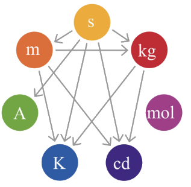
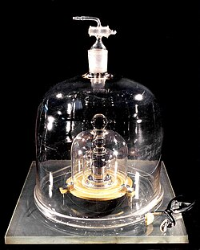
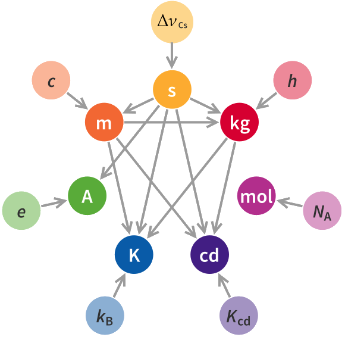

:::: {.oppgaver}

Når vi anvender matematikk for å beskrive naturen, kommer vi frem til noe vi kan kalle *fysiske størrelser*. La oss se litt på dette.

En fysisk størrelse har et tall knyttet til seg, men også en énhet. Ta forelesers vekt og høyde som eksempel. Vi kan tenke oss at foreleser veier $m=75\,\mathrm{kg}$ og har en høyde på $h=1.75\,\mathrm{m}$. Både *vekt* og *høyde* er fysiske størrelser, og vi gir gjerne disse størrelsene en variabel som navn (i dette tilfellet $m$ for masse og $h$ for høyde). Tallet i hver av disse fysiske størrelsene indikerer noe om *mengde* eller *omfang*. La oss kalle det *verdi*. Tallet sier noe om verdi. Det er ikke tilstrekkelig å spesifisere verdien. For $m=75$ sier lite. 75 *hva da*?? Vi må spesifiserer hva målestokken er. Dette kaller vi å spesifisere *målenheten*, også kalt bare *enheten* til størrelsen. Alle objekter som har samme enhet kan sammenliknes. For eksempel kan jeg si at $h=1.74\,\mathrm{m}$ er mindre enn høyden $H=1.84\,\mathrm{m}$. Men jeg kan ikke si at $h=1.74\,\mathrm{m}$ er mindre enn $m=75\,\mathrm{kg}$. Hva i huleste skulle et slikt utsagn bety? Vi ser altså at i fysikken er både verdi og enhet viktig.

::: {.callout-note title="Definisjon: Fysisk størrelse"}

En *fysisk størrelse* har både *verdi* og *enhet*: $$\begin{aligned}
    &\textrm{Fysisk størrelse} = \textrm{verdi} \cdot \textrm{enhet}.
\end{aligned}$$

:::

::: {.eksempel}
[Eksempel: Lengde]{.eks-tittel}

Et enkelt eksempel er avstanden $L$ fra Oslo til Trondheim: $$L = 500 \cdot \textrm{kilometer}$$

:::

Merk at vi multipliserer inn enheten i verdien. Dette er en viktig detalj, som vi kommer tilbake til senere: Vi kan regne på enheter, med helt vanlige algebra-regler.

::: {.callout-tip title="Til ettertanke"}

Hvor mange forskjellige enheter trenger man for å beskrive *alt* i naturen?

:::

I tabellen under ser vi noen av de mest sentrale fysiske størrelsene i mekanikken, sammen med målenheten for disse størrelsene.

| **Fysisk størrelse** | **Enhet** | **Beskrivelse**                   |
|:---------------------|:---------:|:----------------------------------|
| Tid                  |     s     | Hvor lenge noe varer              |
| Lengde               |     m     | Avstand mellom to punkter         |
| Masse                |    kg     | Hvor mye stoff det er i et objekt |
| Fart                 |    m/s    | Hvor raskt noe beveger seg        |
| Akselerasjon         |  m/s$^2$  | Hvor raskt farten endrer seg      |
| Kraft                |     N     | Vekselvirkning mellom legemer     |
| Energi               |     J     | Potensiale for vekselvirkning.    |

: Eksempler på fysiske størrelser og deres enheter.

I det følgende skal vi se på et standardisert system for enheter, og hvordan vi kan regne med enheter.

## SI-enheter



Man kunne jo tenkt at det trengs veldig mange enheter for å beskrive alt i naturen, ettersom naturen består av veldig mye forskjellig. Men det viser seg at man ikke trenger flere enn 7 forskjellige enheter. Disse 7 enhetene utgjør grunnlaget i det vi kaller for det internasjonale enhetssystemet (SI). Det finnes andre enhetssystem også, men i dette faget skal vi benytte SI-enheter, som er systemet benyttet i mange land. Figuren viser en illustrasjon av SI-enhetene, og i dette faget skal vi benytte alle, så nær som *candela*, som er måleenhet for *opplevd lysstyrke*.

:::: figure
{.kompendium-bilde .farge}

::: caption
SI-enhetene
:::
::::

Tabellen viser SI-enhetene og de naturkonstantene som bestemmer dem.

| **Måleenhet** | **Symbol** | **Fysisk størrelse** | **Bestemt av (naturkonstant)** | **Symbol** | **Verdi (eksakt)** |
|:---|:--:|:---|:---|:--:|:---|
| Sekund | s | Tid | Cesium-frekvens (hyperfin overgang) | $\Delta\nu_{Cs}$ | $9\,192\,631\,770\ \text{Hz}$ |
| Meter | m | Avstand | Lyshastigheten i vakuum | $c$ | $299\,792\,458\ \text{m/s}$ |
| Kilogram | kg | Masse | Plancks konstant | $h$ | $6.626\,070\,15\cdot10^{-34}\ \text{J\,s}$ |
| Ampere | A | Elektrisk strøm | Elementærladning | $e$ | $1.602\,176\,634\cdot10^{-19}\ \text{C}$ |
| Kelvin | K | Temperatur | Boltzmanns konstant | $k_B$ | $1.380\,649\cdot10^{-23}\ \text{J\,K}^{-1}$ |
| Mol | mol | Stoffmengde | Avogadros konstant | $N_A$ | $6.022\,140\,76\cdot 10^{23}\ \text{mol}^{-1}$ |
| Candela | cd | Lys-intensitet | Luminøs effektivitet | $K_{cd}$ | $683\ \text{lm\,W}^{-1}$ |

: SI-enhetene og de naturkonstantene som definerer dem (2018-definisjonen). Fargede navn markerer de mest sentrale på forkursnivå.

Enhetene er én sak. Men hvem bestemmer nøyaktig hvor mye 1 kilogram er? Frem til 2018 var dette bestemt av en godt bevoktet prototype; en kilogram-standard innelåst i et hvelv i Paris. Å basere seg på slike prototyper blir selvsagt både sårbart og til syvende og sist noe vilkårlig. Generalforsamlingen for mål og vekt vedtok derfor at SI-systemet ikke lenger skal definires ut ifra menneskeskapte prototyper, slik som gullstandarden for 1 kg i Paris. Fra 20.mai 2019 har enhetene i stedet vært definert ut ifra naturkonstanter, som vist i høyre del av Tabellen. En skjematisk oppsummering av sammenhengen er gitt i Figuren. Naturkonstanter er størrelser vi mener er universelle, og som vi kan anta er de samme overalt i universet. Dette gjør at SI-enhetene er universelle, og ikke avhengig av menneskeskapte prototyper. Disse naturkonstantene har nå textitdefinerte verdier! Lyshastigheten er for eksempel nå definert til å være $c = 299\,792\,458\ \text{m/s}$, og dette er en eksakt verdi. Ved å benytte denne naturkonstanten, og et standardisert eksperiment som (i prinsippet) kan gjentas av alle, overalt og til enhver tid så kan man regne seg fram til lengden på en meter. Dermed forsvinner problemet med at en meter kan være forskjellig fra sted til sted, og fra tid til tid. Alle er enige om hvordan man regner ut hvor lang en meter er.

:::: figure
{.kompendium-bilde .foto}

::: caption
Urkiloen (“Le Grand K”), den offisielle prototypen for 1 kg som frem til 2019 lå oppbevart i et hvelv utenfor Paris. \[Kilde: BIPM, Wikimedia Commons, CC BY-SA 3.0 IGO\]
:::
::::

:::: figure
{.kompendium-bilde .farge}

::: caption
Figuren viser hvilke fysiske konstanter som definerer de enkelte SI-enhetene. \[Av Emilio Pisanty – Eget verk, CC BY-SA 4.0, https://commons.wikimedia.org/w/index.php?curid=50713156\]
:::
::::

Den ytterste ringen i Figuren representerer de *naturkonstantene* som er listet i høyre del av Tabellen. De med farget navn er mest sentrale på forkursnivå.

::: {.oppgave tittel="SI-enheter"}
[SI-enheter]{.oppg-tittel}

Oppgi SI-enheten og enhetssymbolet for følgende fysiske størrelser:

a)  Masse

b)  Tid

c)  Temperatur

d)  Elektrisk strøm

e)  Lengde

::: {.losning}

Hver fysisk størrelse har én bestemt SI-enhet, se tabellen over.

a)  Masse: kilogram, symbol $\mathrm{kg}$.

b)  Tid: sekund, symbol $\mathrm{s}$.

c)  Temperatur: kelvin, symbol $\mathrm{K}$.

d)  Elektrisk strøm: ampere, symbol $\mathrm{A}$.

e)  Lengde: meter, symbol $\mathrm{m}$.

:::

:::

Dersom du har tømrer-bakgrunn er du kanskje vant med enheten *tomme* (inch). Dette er ikke en SI-enhet, men det er greit å vite at 1 tomme = 2.54 cm. Enheten *fot* (foot) er også mye brukt, og 1 fot = 12 tommer = 30.48 cm. For de med nautikk-bakgrunn så er enheten *nautisk mil* mye brukt, og 1 nautisk mil = 1852 m.

::::
