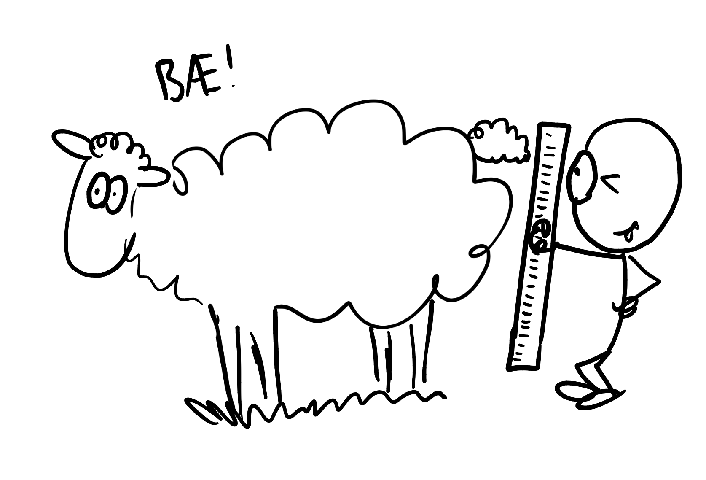

:::: {.oppgaver}



Fysikk handler altså om å anvende matematikk på naturen. Dette kan vi gjøre fordi naturen er målbar. I fysikken er vi derfor helt avhengig av å *måle*, altså å gjøre forsøk. Disse forsøkene gir aldri 100% nøyaktige svar. Derfor er det viktig å ha kontroll på usikkerhet når man gjør fysikk. La oss si du ønsker å måle lengden på en sau. Hvor nøyaktig er svaret? For å kunne svare presist på det så er det viktig å ha kontroll på feilmarginer og usikkerhet.

:::: figure
{.kompendium-bilde}

::: caption
Hvor lang er egentlig sauen?
:::
::::

På forkursnivå skal vi ikke se så mye på dette, men vi skal få med oss det mest grunnleggende, nemlig *Signifikante siffer*. Signifikante siffer handler om å bruke riktig antall siffer i en utregning. La oss starte med å se på hvordan vi skal finne antall signifikante siffer. Tallet 459 har tre signifikante siffer, ettersom det består av tre siffer. Tallet 12 001. 03700 har 10 signifikante siffer, etter som det består av 10 siffer. Men merk at tallet 0.00059400 kun har 5 signifikante siffer (nemlig 59400). Antall signifikante siffer telles nemlig fra *første siffer som er forskjellig fra null.*

::: {.callout-note title="Signifikante siffer"}

-   Antall signifikante siffer regnes fra første tall forskjellig fra null.

-   I en utregning skal svaret angis med samme nøyaktighet (antall siffer) som den *minst nøyaktige* størrelsen som inngikk i beregningen.
:::

::: {.eksempel}
[Eksempel: Signifikante siffer]{.eks-tittel}

Hvor mange signifikante siffer har tallene a) 165.00 b) 0.791400 og c) 14?

::: {.losning}
**Løsning:**

**a)** I dette tilfellet er første tall forskjellig fra null 1. Fra og med 1 er det 5 siffer. Det er derfor **fem siffers signifikans.**

**b)** Første tall forskjellig fra null er 7. Totalt er det **6 siffers signifikans.**

**c)** Her er det to siffer, så **to siffers signifikans.**
:::
:::

::: {.eksempel}
[Eksempel: Signifikante siffer i utregning]{.eks-tittel}

Eline kjører 5.00 km på 6.0 minutter. Hvor fort kjører hun i gjennomsnitt?

::: {.losning}
**Løsning:** Gjennomsnittsfart betegnes $\bar{v}$ og er rett og slett tilbakelagt strekning delt på tilbakelagt tid: $$\bar{v}=\frac{5.00\,\mathrm{km}}{6.0\,\mathrm{min}}=0.83333...\mathrm{km}\,\mathrm{min}^{-1}= \underline{\underline{0.83\,\mathrm{km}\,\mathrm{min}^{-1}}}$$ Dette kunne vi også gjort om til km$/$h ved å huske at $\mathrm{min}=h/60.$ Dersom vi setter inn dette får vi

$$\bar{v}=0.8333...\frac{\mathrm{km}}{\mathrm{h}/60}=60\cdot 0.8333...\,\mathrm{km}\,\mathrm{h}^{-1}= \underline{\underline{50\,\mathrm{km}\,\mathrm{h}^{-1}}}$$
:::
:::

::: {.callout-tip title="Avrunding"}
Vi minner om følgende regler for avrunding:

-   Tall fra 0-4 rundes ned. Tall fra og med 5 til 9 rundes opp.

-   Avrunding til riktig antall signifikante siffer må skje helt tilslutt i en beregning! Derfor brukte vi 0.8333... i stedet for 0.83 da vi gjorde om fra km/min til km/h i eksemplet over. *Bruk minst to ekstra siffer i utregningen!*
:::

::: {.oppgave tittel="Signifikante siffer"}
[Signifikante siffer]{.oppg-tittel}

a)  Oppgi antall signifikante siffer i: $0.00420$,  $3.14159$,  $1\,200$ og $165.00$.

b)  Regn ut $12.3 \cdot 4.56$ og oppgi svaret med riktig antall signifikante siffer.

c)  Regn ut $18.0 / 4.5$ og oppgi svaret med riktig antall signifikante siffer.

::: {.losning}

**a)** Antall signifikante siffer (se *Signifikante siffer*):

-   $0.00420$: de ledende nullene teller ikke, men den etterfølgende nullen gjør det $\Rightarrow$ **3 signifikante siffer**.

-   $3.14159$: alle sifre er signifikante $\Rightarrow$ **6 signifikante siffer**.

-   $1\,200$: uten desimaltegn regnes de to siste nullene som ikke-signifikante $\Rightarrow$ **2 signifikante siffer**.

-   $165.00$: desimaltegnet gjør at alle nuller teller $\Rightarrow$ **5 signifikante siffer**.

**b)** Begge faktorene har 3 signifikante siffer, så svaret skal også ha 3: $$12.3 \cdot 4.56 = 56.088 \approx \underline{\underline{56.1}}$$

**c)** $18.0$ har 3 signifikante siffer, $4.5$ har 2, så svaret skal ha 2: $$18.0 / 4.5 = \underline{\underline{4.0}}$$

:::

:::

::::
