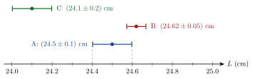

<!-- video: kommer (videoer/fysikk-forkurs/01-06-maleusikkerhet) -->
{fig-alt="Video kommer"}

<!-- tillegg: Claude -->
Legg en linjal langs en blyant og les av lengden. Er den $24.5\ \mathrm{cm}$? Eller $24.6\ \mathrm{cm}$? Enden av blyanten havner sjelden nøyaktig på en strek, og øyet ditt ser litt skrått på skalaen. Spør tre personer, og du får gjerne tre litt ulike svar. Ingen måling er helt eksakt. Det er ikke et tegn på at noen har gjort feil: Det er en del av det å måle. I fysikken oppgir vi derfor alltid **hvor sikker** en måling er.

## Måleresultat og usikkerhet

Et måleresultat skrives som en verdi pluss–minus en usikkerhet:

::: {.graa}
$$
L = (24.5 \pm 0.1)\ \mathrm{cm}
$$
:::

Dette betyr at vi er ganske sikre på at den sanne lengden ligger mellom $24.4\ \mathrm{cm}$ og $24.6\ \mathrm{cm}$. Parentesen viser at enheten gjelder både verdien og usikkerheten.

::: {.callout-note title="Definisjon: Absolutt og relativ usikkerhet"}
Skriver vi en måling som $x \pm \Delta x$, er $\Delta x$ den **absolutte usikkerheten**. Den har samme enhet som målingen.

Den **relative usikkerheten** er usikkerheten delt på verdien:
$$
\frac{\Delta x}{x}
$$
Den har ingen enhet og oppgis ofte i prosent.
:::

Den relative usikkerheten forteller hvor god målingen er. En usikkerhet på $1\ \mathrm{cm}$ er mye når du måler en blyant, men nesten ingenting når du måler lengden på en fotballbane.

::: {.eksempel}
**Eksempel: Blyant og rom.** Du måler en blyant til $(24.5 \pm 0.1)\ \mathrm{cm}$ og lengden av et rom til $(4.23 \pm 0.01)\ \mathrm{m}$. Hvilken måling er mest nøyaktig?

::: {.losning}
Vi regner ut den relative usikkerheten for begge:
$$
\frac{\Delta L_\text{blyant}}{L_\text{blyant}} = \frac{0.1\ \mathrm{cm}}{24.5\ \mathrm{cm}} = 0.004 = 0.4\ \%
\qquad
\frac{\Delta L_\text{rom}}{L_\text{rom}} = \frac{0.01\ \mathrm{m}}{4.23\ \mathrm{m}} = 0.002 = 0.2\ \%
$$
Den absolutte usikkerheten er ti ganger større for rommet ($1\ \mathrm{cm}$ mot $1\ \mathrm{mm}$), men rommet er så mye lengre at målingen likevel er relativt sett **mest nøyaktig**: $\underline{\underline{0.2\ \%}}$ mot $\underline{\underline{0.4\ \%}}$.
:::
:::

## Hvor stor er usikkerheten?

Det finnes ingen fasit for hvor stor usikkerheten er. Vi må gjøre et fornuftig anslag ut fra måten vi måler på. Tre tommelfingerregler hjelper:

::: {.kort}
- **Analog skala** (linjal, termometer med væskesøyle, målesylinder) Usikkerheten er omtrent en halv skaladel. Er det vanskelig å lese av, kan den være en hel skaladel eller mer.
- **Digitalt instrument** (vekt, multimeter, stoppeklokke på mobilen) Usikkerheten er minst én enhet i det siste sifferet instrumentet viser. Viser vekta $152.4\ \mathrm{g}$, er usikkerheten minst $0.1\ \mathrm{g}$.
- **Gjentatte målinger** Mål flere ganger og bruk gjennomsnittet som verdi. Halvparten av spredningen, $\frac{1}{2}(x_\text{maks} - x_\text{min})$, er et enkelt anslag på usikkerheten.
:::

Ofte er det ikke instrumentet som setter grensen, men måten vi bruker det på. En stoppeklokke viser hundredeler av et sekund, men reaksjonstiden din når du trykker, er omtrent en tidel. Da er usikkerheten minst $0.1\ \mathrm{s}$, uansett hvor mange siffer klokka viser.

::: {.eksempel}
**Eksempel: Tid for en pendel.** For å finne svingetiden til en pendel tar du tiden på 10 hele svingninger. Du gjør det fem ganger og får $12.4\ \mathrm{s}$, $12.7\ \mathrm{s}$, $12.5\ \mathrm{s}$, $12.3\ \mathrm{s}$ og $12.6\ \mathrm{s}$. Finn svingetiden $T$ med usikkerhet.

::: {.losning}
Gjennomsnittet av de fem målingene er
$$
\bar t = \frac{12.4 + 12.7 + 12.5 + 12.3 + 12.6}{5}\ \mathrm{s} = \frac{62.5}{5}\ \mathrm{s} = 12.5\ \mathrm{s}
$$
Spredningen går fra $12.3\ \mathrm{s}$ til $12.7\ \mathrm{s}$, så usikkerheten anslås til
$$
\Delta t = \tfrac{1}{2}(12.7 - 12.3)\ \mathrm{s} = 0.2\ \mathrm{s}
$$
Tiden for 10 svingninger er altså $(12.5 \pm 0.2)\ \mathrm{s}$. Én svingning tar en tidel av dette, og usikkerheten blir også en tidel:
$$
T = \underline{\underline{(1.25 \pm 0.02)\ \mathrm{s}}}
$$
Her ser vi hvorfor det lønner seg å ta tiden på mange svingninger: Reaksjonstiden din kommer bare med to ganger (start og stopp), uansett hvor mange svingninger du teller. Fordelt på ti svingninger blir usikkerheten per svingning liten.
:::
:::

## Tilfeldige og systematiske feil

Det er to helt ulike grunner til at en måling bommer.

::: {.kort}
- **Tilfeldige feil** gjør at målingen blir litt for stor noen ganger og litt for liten andre ganger. Eksempler: reaksjonstiden når du trykker på stoppeklokka, eller at du leser av skalaen litt ulikt hver gang. Gjentatte målinger avslører dem, og gjennomsnittet blir bedre jo flere målinger du tar.
- **Systematiske feil** drar alle målingene samme vei. Eksempler: en vekt som ikke er nullstilt og viser $3\ \mathrm{g}$ for mye hver gang, et målebånd som er slitt i enden, eller at du alltid ser skrått på skalaen fra samme side. Å gjenta målingen hjelper ikke, for du gjør samme feil hver gang.
:::

Systematiske feil er de lumskeste, fordi målingene ser fine og samstemte ut. Den beste måten å finne dem på er å måle noe kjent (for eksempel veie et lodd med kjent masse) eller å måle samme størrelse på en helt annen måte.

## Å skrive resultatet riktig

Usikkerheten er selv et anslag, så det gir ingen mening å oppgi den med mange siffer. Vi bruker disse reglene:

::: {.steg}
1. **Rund av usikkerheten** til ett gjeldende siffer. (Begynner den med 1, kan du beholde to siffer, for eksempel $\pm 0.14$.)
2. **Rund av verdien** slik at det siste sifferet står på samme plass som det siste sifferet i usikkerheten.
3. **Skriv enheten** etter en parentes rundt begge, og bruk gjerne prefiks eller standardform.
:::

En kalkulator kan gi $g = 9.8147\ \mathrm{m/s^2}$ med usikkerhet $0.0234\ \mathrm{m/s^2}$. Usikkerheten rundes til $0.02$, altså hundredeler, og da rundes verdien også til hundredeler: $\mathrm{g} = (9.81 \pm 0.02)\ \mathrm{m/s^2}$.

::: {.callout-tip title="Sammenhengen med gjeldende siffer"}
Når vi skriver et tall uten usikkerhet, viser antall gjeldende siffer hvor nøyaktig det er. Det siste sifferet er det usikre. Skriver vi $24.5\ \mathrm{cm}$, mener vi at lengden er nærmere $24.5$ enn $24.4$ og $24.6$, altså omtrent $(24.5 \pm 0.1)\ \mathrm{cm}$ eller bedre. Regnereglene for gjeldende siffer er en grov måte å holde styr på usikkerheten på uten å regne den ut.
:::

## Er to målinger enige?

To elever måler samme blyant. Er det et problem at de får ulike verdier? Ikke nødvendigvis. Det avgjørende er om **intervallene overlapper**.

{.tikz-fig style="width:620px" fig-alt="En tallinje for lengden L fra 24.0 til 25.0 cm. Tre målinger er tegnet som et punkt med en strek som viser usikkerheten: A er 24.5 pluss minus 0.1 cm, fra 24.4 til 24.6. B er 24.62 pluss minus 0.05 cm, fra 24.57 til 24.67. C er 24.1 pluss minus 0.2 cm, fra 23.9 til 24.3."}

Målingene A og B overlapper mellom $24.57\ \mathrm{cm}$ og $24.6\ \mathrm{cm}$. De er altså **enige** innenfor usikkerheten. Måling C overlapper ikke med noen av de andre. Da har sannsynligvis noen gjort en feil, eller usikkerheten i C er undervurdert. Kanskje har C lest av fra feil ende av linjalen?

På samme måte kan vi sammenligne en måling med en kjent verdi. Måler du tyngdeakselerasjonen til $(9.7 \pm 0.2)\ \mathrm{m/s^2}$, ligger $9.81\ \mathrm{m/s^2}$ innenfor intervallet, og målingen stemmer med det kjente tallet.

Hvordan usikkerheten i målingene følger med inn i et svar som er regnet ut fra dem, ser vi på under *usikkerhet i sammensatte størrelser*.

## Prøv selv

Programmet regner ut gjennomsnitt, usikkerhet (halve spredningen) og relativ usikkerhet fra en liste med målinger. Bytt ut tallene med dine egne målinger og trykk **Kjør**. Hva skjer med usikkerheten hvis én av målingene er en «bommert» som er langt unna de andre?

```{.python .kjor}
import numpy as np

maalinger = np.array([12.4, 12.7, 12.5, 12.3, 12.6])   # for eksempel tider i s

snitt = np.mean(maalinger)
usikkerhet = (np.max(maalinger) - np.min(maalinger)) / 2
relativ = usikkerhet / snitt

print(f"Antall målinger:     {len(maalinger)}")
print(f"Gjennomsnitt:        {snitt:.3f}")
print(f"Usikkerhet:          {usikkerhet:.3f}")
print(f"Relativ usikkerhet:  {100 * relativ:.1f} %")
```

:::: {.oppgaver}

::: {.oppgave tittel="Absolutt og relativ usikkerhet"}
a) En masse er målt til $(250 \pm 2)\ \mathrm{g}$. Finn den relative usikkerheten.

b) En tid er målt til $(3.2 \pm 0.1)\ \mathrm{s}$. Finn den relative usikkerheten.

c) Hvilken av de to målingene er mest nøyaktig?

::: {.losning}
a) Vi deler usikkerheten på verdien:
$$
\frac{\Delta m}{m} = \frac{2\ \mathrm{g}}{250\ \mathrm{g}} = 0.008 = \underline{\underline{0.8\ \%}}
$$

b)
$$
\frac{\Delta t}{t} = \frac{0.1\ \mathrm{s}}{3.2\ \mathrm{s}} = 0.031 = \underline{\underline{3\ \%}}
$$

c) Massemålingen har minst relativ usikkerhet og er derfor **mest nøyaktig**. Vi kan ikke sammenligne de absolutte usikkerhetene direkte, fordi de har ulike enheter.
:::
:::

::: {.oppgave tittel="Skriv resultatet riktig"}
Skriv måleresultatene med riktig avrunding:

a) $v = 13.4721\ \mathrm{m/s}$ med usikkerhet $0.38\ \mathrm{m/s}$

b) $\mathrm{g} = 9.8147\ \mathrm{m/s^2}$ med usikkerhet $0.0234\ \mathrm{m/s^2}$

c) $s = 1523.6\ \mathrm{m}$ med usikkerhet $40\ \mathrm{m}$ (bruk prefiks)

::: {.losning}
a) Usikkerheten rundes til ett gjeldende siffer: $0.38 \to 0.4$, altså tideler. Verdien rundes også til tideler:
$$
v = \underline{\underline{(13.5 \pm 0.4)\ \mathrm{m/s}}}
$$

b) Usikkerheten blir $0.02$ (hundredeler), og verdien rundes til hundredeler:
$$
\mathrm{g} = \underline{\underline{(9.81 \pm 0.02)\ \mathrm{m/s^2}}}
$$

c) Usikkerheten er $40\ \mathrm{m} = 0.04\ \mathrm{km}$, altså hundredeler av en kilometer. Verdien er $1.5236\ \mathrm{km}$, som rundes til $1.52\ \mathrm{km}$:
$$
s = \underline{\underline{(1.52 \pm 0.04)\ \mathrm{km}}}
$$
Med prefiks blir det tydelig hvor mange siffer som er sikre. Skrevet som «$1520\ \mathrm{m}$» kunne vi ikke se det.
:::
:::

::: {.oppgave tittel="Tilfeldig eller systematisk?"}
Avgjør om feilen er tilfeldig eller systematisk, og om den blir mindre av å gjenta målingen mange ganger.

a) Du tar tiden på en ball som faller, og trykker litt ulikt hver gang.

b) Kjøkkenvekta viser $5\ \mathrm{g}$ når den er tom, men du glemmer å nullstille den.

c) Termometeret henger i sola når du skal måle lufttemperaturen.

d) Det blåser litt ujevnt når du måler hvor langt en papirflyver flyr.

::: {.losning}
a) **Tilfeldig.** Noen ganger trykker du for tidlig, andre ganger for sent. Gjennomsnittet av mange målinger blir bedre.

b) **Systematisk.** Alle målingene blir $5\ \mathrm{g}$ for store. Å gjenta hjelper ikke, men feilen kan rettes ved å nullstille vekta eller trekke fra $5\ \mathrm{g}$.

c) **Systematisk.** Sola varmer termometeret, så det viser for høy temperatur hver gang. Flytt termometeret i skyggen.

d) **Tilfeldig.** Vinden hjelper noen ganger og bremser andre ganger. Mange forsøk gir et bedre gjennomsnitt.
:::
:::

::: {.oppgave tittel="Falltid" niva="Middels"}
Du slipper en ball fra samme høyde seks ganger og måler falltiden: $0.64\ \mathrm{s}$, $0.61\ \mathrm{s}$, $0.66\ \mathrm{s}$, $0.62\ \mathrm{s}$, $0.67\ \mathrm{s}$ og $0.63\ \mathrm{s}$.

a) Finn gjennomsnittet og usikkerheten, og skriv resultatet riktig.

b) Finn den relative usikkerheten.

c) Stoppeklokka viser hundredeler. Hvorfor er usikkerheten likevel større enn $0.01\ \mathrm{s}$?

::: {.losning}
a) Gjennomsnittet er
$$
\bar t = \frac{0.64 + 0.61 + 0.66 + 0.62 + 0.67 + 0.63}{6}\ \mathrm{s} = \frac{3.83}{6}\ \mathrm{s} = 0.638\ \mathrm{s}
$$
Halve spredningen er
$$
\Delta t = \tfrac{1}{2}(0.67 - 0.61)\ \mathrm{s} = 0.03\ \mathrm{s}
$$
Usikkerheten står på hundredeler, så vi runder gjennomsnittet til hundredeler:
$$
t = \underline{\underline{(0.64 \pm 0.03)\ \mathrm{s}}}
$$

b)
$$
\frac{\Delta t}{t} = \frac{0.03\ \mathrm{s}}{0.64\ \mathrm{s}} = 0.047 = \underline{\underline{5\ \%}}
$$

c) Det er ikke klokka som setter grensen, men deg. Reaksjonstiden når du starter og stopper klokka varierer med flere hundredeler fra gang til gang. Det ser vi på spredningen i målingene.
:::
:::

::: {.oppgave tittel="Stemmer målingene?" niva="Middels"}
To grupper måler tyngdeakselerasjonen. Gruppe 1 slipper en ball og tar tiden med stoppeklokke og får $(9.6 \pm 0.3)\ \mathrm{m/s^2}$. Gruppe 2 bruker en lysport og får $(9.92 \pm 0.05)\ \mathrm{m/s^2}$.

a) Er de to målingene enige med hverandre?

b) Er målingene enige med den kjente verdien $9.81\ \mathrm{m/s^2}$?

c) Gruppe 2 har mye mindre usikkerhet. Hva kan du si om målingen deres?

::: {.losning}
a) Gruppe 1 gir intervallet fra $9.3$ til $9.9\ \mathrm{m/s^2}$. Gruppe 2 gir intervallet fra $9.87$ til $9.97\ \mathrm{m/s^2}$. Intervallene overlapper mellom $9.87$ og $9.9\ \mathrm{m/s^2}$, så målingene er **enige** med hverandre, men så vidt.

b) $9.81\ \mathrm{m/s^2}$ ligger innenfor intervallet til gruppe 1, så den målingen **stemmer**. Den ligger utenfor intervallet til gruppe 2, så den målingen **stemmer ikke** med den kjente verdien.

c) Gruppe 2 har målt nøyaktig (lite spredning), men treffer ikke den kjente verdien. Det tyder på en **systematisk feil**, for eksempel at avstanden mellom lysportene er målt feil, eller at usikkerheten er undervurdert. Lav usikkerhet betyr ikke automatisk at målingen er riktig.
:::
:::

::::
