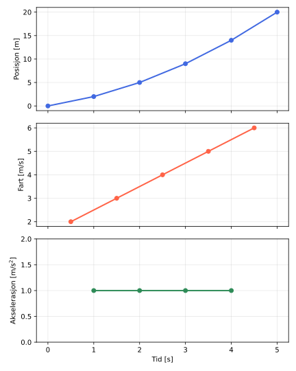

:::: {.oppgaver}

Vi har nå sett på fysiske størrelser, enheter og hvordan vi regner med tall i fysikken. La oss avslutte med en liten smakebit på hvordan disse verktøyene brukes i praksis — både når det gjelder *kinematikk* (bevegelseslære, som vi skal se mye mer av senere) og når det gjelder *Python*, som vi skal bruke som regneverktøy i faget.

Tenk deg at posisjonen til en gjenstand er målt med jevne mellomrom, for eksempel hvert sekund. Slike diskrete målepunkter er akkurat det man ofte sitter igjen med fra ekte sensorer og måleinstrumenter. Tabellen viser et eksempel på slike målinger.

|   Tid $t$ \[s\]    |  0  |  1  |  2  |  3  |  4  |  5  |
|:------------------:|:---:|:---:|:---:|:---:|:---:|:---:|
| Posisjon $s$ \[m\] |  0  |  2  |  5  |  9  | 14  | 20  |

: Målt posisjon som funksjon av tid.

Fra disse posisjonsmålingene kan vi regne ut gjennomsnittsfarten mellom hvert par av påfølgende målepunkter, ved å bruke definisjonen av gjennomsnittsfart:

::: {.graa}

$\displaystyle \bar{v} = \frac{\Delta s}{\Delta t} = \frac{s_{i+1}-s_i}{t_{i+1}-t_i}$

:::

og deretter finne gjennomsnittsakselerasjonen mellom hvert par av fartsverdier, på akkurat samme måte:

::: {.graa}

$\displaystyle \bar{a} = \frac{\Delta v}{\Delta t} = \frac{v_{i+1}-v_i}{t_{i+1}-t_i}$

:::

I Python kan vi gjøre nettopp dette svært effektivt, ved hjelp av funksjonen `np.diff()`, som regner ut differansen mellom alle par av påfølgende elementer i en liste. Koden under regner ut og plotter posisjon, fart og akselerasjon fra måledataene i tabellen.

```{.python .kjor}
import numpy as np
import matplotlib.pyplot as plt

# Malt posisjon som funksjon av tid
t = np.array([0, 1, 2, 3, 4, 5]) # tid [s]
s = np.array([0, 2, 5, 9, 14, 20]) # posisjon [m]

# Gjennomsnittsfart mellom hvert malepunkt: v = delta_s / delta_t
v = np.diff(s) / np.diff(t) # fart [m/s]
t_v = (t[:-1] + t[1:]) / 2 # tidspunkt (midtpunkt) for hver fart

# Gjennomsnittsakselerasjon mellom hvert fartspunkt: a = delta_v / delta_t
a = np.diff(v) / np.diff(t_v) # akselerasjon [m/s^2]
t_a = (t_v[:-1] + t_v[1:]) / 2 # tidspunkt (midtpunkt) for hver akselerasjon

print(f"Fart: {v} m/s")
print(f"Akselerasjon: {a} m/s^2")

fig, axs = plt.subplots(3, 1, figsize=(6, 7.5), sharex=True)

axs[0].plot(t, s, ’o-’, color=’royalblue’, linewidth=2)
axs[0].set_ylabel(’Posisjon [m]’)
axs[0].grid(True, alpha=0.3)

axs[1].plot(t_v, v, ’o-’, color=’tomato’, linewidth=2)
axs[1].set_ylabel(’Fart [m/s]’)
axs[1].grid(True, alpha=0.3)

axs[2].plot(t_a, a, ’o-’, color=’seagreen’, linewidth=2)
axs[2].set_ylabel(’Akselerasjon [m/s$^2$]’)
axs[2].set_xlabel(’Tid [s]’)
axs[2].set_ylim(0, 2)
axs[2].grid(True, alpha=0.3)

plt.tight_layout()
plt.show()
```

```{.text .utskrift}
Fart: [2. 3. 4. 5. 6.] m/s
Akselerasjon: [1. 1. 1. 1.] m/s^2
```

*Kodefil: [K1_fart_og_akselerasjon.ipynb](https://github.com/kosmoben/TRES0312/blob/main/TRES0312%20Python/Kap1_HvaErFysikk/K1_fart_og_akselerasjon.ipynb)*

:::: figure
{.kompendium-bilde}

::: caption
Posisjon, fart og akselerasjon regnet ut fra de diskrete målepunktene i Tabellen.
:::
::::

Legg merke til at akselerasjonen her er helt konstant, lik $\bar a = 1.0\,\mathrm{m}\,\mathrm{s}^{-2}$. Det er ingen tilfeldighet — måledataene i Tabellen er konstruert nettopp for å gi konstant akselerasjon. Slik bevegelse, med konstant akselerasjon, skal vi se mye mer av snart.


::::
