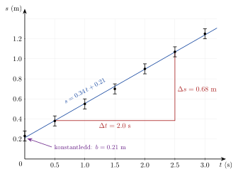

<!-- video: kommer (videoer/fysikk-forkurs/01-10-grafer-og-regresjon) -->
{fig-alt="Video kommer"}

<!-- tillegg: Claude -->
Du henger lodd på en fjær og måler hvor mye den strekkes. Seks lodd gir seks tallpar. I en tabell ser tallene bare ut som tall, men tegner du dem i en graf, ser du med en gang at punktene ligger nesten på en rett linje. Og fra den linja kan du lese av fjærstivheten, med bedre nøyaktighet enn fra noen enkeltmåling. Det er dette grafer og regresjon handler om: å la mange målinger sammen fortelle hvordan to størrelser henger sammen.

## Gode grafer

En graf av måledata er bare til hjelp hvis den er lett å lese. Disse reglene gjør grafen din god:

::: {.kort}
- **Riktig vei** Som hovedregel står størrelsen du bestemmer selv (hvilket lodd, hvilken tid) vannrett, og størrelsen du måler som svar, loddrett. Unntaket er når du velger aksene slik at stigningstallet blir nettopp den størrelsen du vil finne.
- **Navn og enhet på aksene** Skriv for eksempel «$t$ (s)» og «$s$ (m)». Uten enhet kan ingen lese av stigningstallet.
- **Fornuftig skala** Velg runde skaladeler (1, 2 eller 5 ganger en tierpotens), og la punktene fylle det meste av grafen.
- **Bare punkter** Tegn målingene som punkter, ikke koble dem med streker. Linja som beskriver sammenhengen, tegnes etterpå.
- **Feilstolper** Vis usikkerheten i hver måling som en strek gjennom punktet.
:::

En **feilstolpe** er det samme intervallet som vi brukte under [måleusikkerhet](06-maleusikkerhet.qmd): Er en posisjon målt til $(0.55 \pm 0.05)\ \mathrm{m}$, går stolpen fra $0.50\ \mathrm{m}$ til $0.60\ \mathrm{m}$. Stolpen står i retningen til den usikre størrelsen, loddrett hvis det er den loddrette størrelsen som er usikker. Feilstolpene viser hvor nøye linja må treffe: En god linje går gjennom (nesten) alle stolpene, men trenger ikke treffe selve punktene.

## Den beste rette linja

En vogn ruller med jevn fart bort fra en avstandsmåler. Hvert halve sekund leser vi av avstanden $s$:

::: {.graa}
| $t$ (s) | 0 | 0.5 | 1.0 | 1.5 | 2.0 | 2.5 | 3.0 |
|:---|---:|---:|---:|---:|---:|---:|---:|
| $s$ (m) | 0.23 | 0.38 | 0.55 | 0.70 | 0.90 | 1.07 | 1.25 |
:::

Usikkerheten i hver avstand er $0.05\ \mathrm{m}$. Grafen viser punktene med feilstolper:

{.tikz-fig style="width:620px" fig-alt="Graf av avstanden s i meter mot tiden t i sekunder for en vogn. Sju målepunkter fra t = 0 til 3.0 s, hvert med en loddrett feilstolpe på pluss minus 0.05 m. En rett linje s = 0.34 t + 0.21 går gjennom alle feilstolpene. En stigningstrekant fra t = 0.5 s til 2.5 s har Delta t = 2.0 s og Delta s = 0.68 m. En pil viser at linja skjærer s-aksen i konstantleddet b = 0.21 m."}

Punktene ligger ikke *nøyaktig* på en rett linje, fordi hver måling har en liten tilfeldig feil. Men vi ser tydelig at sammenhengen er lineær. Den rette linja som passer best med alle punktene, kalles **regresjonslinja** eller den **utjevnede linja**. Å finne den kalles **lineær regresjon**.

::: {.callout-note title="Definisjon: Lineær regresjon"}
Lineær regresjon er å finne den rette linja
$$
y = a\,x + b
$$
som passer best med målepunktene. Her er $a$ **stigningstallet** og $b$ **konstantleddet** (der linja skjærer den loddrette aksen). Datamaskinen velger linja slik at punktene til sammen ligger så nær linja som mulig (minste kvadraters metode).
:::

### Hva tallene betyr fysisk

I matematikken er $a$ og $b$ bare tall. I fysikken har de **enheter** og en **betydning**, og det er dem vi er ute etter.

::: {.kort}
- **Stigningstallet** er endringen i den loddrette størrelsen delt på endringen i den vannrette: $a = \dfrac{\Delta y}{\Delta x}$. Enheten er enheten på den loddrette aksen delt på enheten på den vannrette. For vogna blir det $\mathrm{m/s}$, altså en fart.
- **Konstantleddet** er verdien av den loddrette størrelsen når den vannrette er null. Det har samme enhet som den loddrette aksen. For vogna er det avstanden når vi startet klokka.
:::

Stigningstallet er ofte den viktigste størrelsen: Det samler informasjonen fra *alle* målingene i ett tall. Én enkeltmåling kan bomme, men tilfeldige feil i mange punkter jevner seg ut i linja.

::: {.eksempel}
**Eksempel: Farten til vogna.** Finn farten og startavstanden til vogna fra grafen.

::: {.losning}
Vi velger to punkter **på linja** (ikke målepunkter), langt fra hverandre for å få god nøyaktighet. Fra stigningstrekanten leser vi av at linja går gjennom omtrent $(0.5\ \mathrm{s},\ 0.38\ \mathrm{m})$ og $(2.5\ \mathrm{s},\ 1.07\ \mathrm{m})$. Stigningstallet er
$$
a = \frac{\Delta s}{\Delta t} = \frac{1.07\ \mathrm{m} - 0.38\ \mathrm{m}}{2.5\ \mathrm{s} - 0.5\ \mathrm{s}} = \frac{0.69\ \mathrm{m}}{2.0\ \mathrm{s}} = 0.345\ \mathrm{m/s}
$$
Regresjon med datamaskin gir $a = 0.342\ \mathrm{m/s}$ og $b = 0.2125\ \mathrm{m}$, nesten det samme. Stigningstallet er farten, og konstantleddet er avstanden ved $t = 0$:
$$
v = \underline{\underline{0.34\ \mathrm{m/s}}} \qquad s_0 = \underline{\underline{0.21\ \mathrm{m}}}
$$
Legg merke til at målingen ved $t = 0$ var $0.23\ \mathrm{m}$. Linja gir et bedre anslag ($0.21\ \mathrm{m}$), fordi den bygger på alle sju målingene.
:::
:::

### Grafisk utjevning for hånd

Uten datamaskin kan du finne linja med linjal og øyemål:

::: {.steg}
1. **Tegn punktene** med feilstolper på ruteark, med god skala.
2. **Legg linjalen** slik at linja går gjennom så mange feilstolper som mulig, med omtrent like mange punkter over og under linja. Ikke la den være låst til det første eller siste punktet.
3. **Tegn en stor stigningstrekant** med hjørner på linja, gjerne der linja krysser rutenettet, så det er lett å lese av.
4. **Regn ut stigningstallet** $\Delta y / \Delta x$ med enheter, og les av konstantleddet der linja krysser den loddrette aksen.
:::

En stor trekant gir et sikrere stigningstall enn en liten, av samme grunn som at det lønner seg å ta tiden på mange svingninger av en pendel: Avlesningsfeilen blir liten sammenlignet med det du måler.

::: {.callout-tip title="Usikkerheten i stigningstallet"}
Tegn også den **brattest mulige** og den **slakest mulige** linja som fortsatt går gjennom (nesten) alle feilstolpene. Usikkerheten i stigningstallet er omtrent halve forskjellen mellom de to stigningstallene. Det er den samme tanken som metoden med største og minste verdi under [usikkerhet i sammensatte størrelser](07-usikkerhet-i-sammensatte-storrelser.qmd).
:::

## Regresjon i Python

Med flere punkter og mer nøyaktige data er det lettere å la datamaskinen finne linja. I Python gjør funksjonen `np.polyfit(x, y, 1)` jobben: Den finner den beste linja (et polynom av grad 1) og gir tilbake stigningstallet og konstantleddet.

::: {.eksempel}
**Eksempel: Fjærstivheten.** Vi henger lodd på en fjær og måler forlengelsen $x$. Kraften fra loddet er $F = m\mathrm{g}$. Usikkerheten i forlengelsen er $0.2\ \mathrm{cm}$.

| $m$ (g) | 50 | 100 | 150 | 200 | 250 | 300 |
|:---|---:|---:|---:|---:|---:|---:|
| $F$ (N) | 0.49 | 0.98 | 1.47 | 1.96 | 2.45 | 2.94 |
| $x$ (cm) | 1.9 | 3.9 | 5.8 | 7.7 | 9.9 | 11.9 |

Etter Hookes lov er $F = kx$. Finn fjærstivheten $k$.

::: {.losning}
Hookes lov $F = kx$ har formen $y = ax + b$ med kraften $F$ på den loddrette aksen, forlengelsen $x$ på den vannrette, $a = k$ og $b = 0$. Tegner vi $F$ mot $x$, skal vi altså få en rett linje gjennom origo, og **stigningstallet er fjærstivheten**. Det er grunnen til at vi her setter den målte størrelsen $x$ vannrett. Det er forlengelsen som er usikker, så feilstolpene står vannrett.

Vi gjør om forlengelsen til meter og lar Python regne:
```python
a, b = np.polyfit(x, F, 1)   # x i m, F i N
```
som gir $a = 24.52\ \mathrm{N/m}$ og $b = 0.035\ \mathrm{N}$. Stigningstallet har enheten $\mathrm{N/m}$, som er enheten til en fjærstivhet:
$$
k = \underline{\underline{24.5\ \mathrm{N/m}}}
$$
Konstantleddet $0.035\ \mathrm{N}$ er lite. Det tilsvarer en forlengelse på $0.035 / 24.5\ \mathrm{m} = 0.14\ \mathrm{cm}$, som er mindre enn usikkerheten i $x$. Linja går altså gjennom origo innenfor måleusikkerheten, slik Hookes lov sier. Hadde konstantleddet vært stort, ville det tydet på en systematisk feil, for eksempel at vi målte forlengelsen fra feil nullpunkt.
:::
:::

Programmet under gjør hele jobben: tegner punktene med feilstolper, finner linja og skriver ut $k$. Bytt ut målingene med dine egne og trykk **Kjør**. Hva skjer med $k$ og konstantleddet om du endrer én av forlengelsene med $1\ \mathrm{cm}$?

```{.python .kjor}
import numpy as np
import matplotlib.pyplot as plt

g = 9.81                                               # m/s^2
m = np.array([50, 100, 150, 200, 250, 300]) / 1000     # masse i kg
x = np.array([1.9, 3.9, 5.8, 7.7, 9.9, 11.9]) / 100    # forlengelse i m
dx = 0.002                                             # usikkerhet i x (m)

F = m * g                                              # kraft i N
a, b = np.polyfit(x, F, 1)                             # beste rette linje
print(f"Stigningstall: k = {a:.1f} N/m")
print(f"Konstantledd:  b = {b:.3f} N")

xs = np.linspace(0, max(x) * 1.05, 100)
plt.errorbar(x * 100, F, xerr=dx * 100, fmt="o", capsize=3, label="målinger")
plt.plot(xs * 100, a * xs + b, label=f"F = {a:.1f}x + {b:.3f}")
plt.xlabel("Forlengelse x (cm)")
plt.ylabel("Kraft F (N)")
plt.grid(True)
plt.legend()
plt.show()
```

## Linearisering: å gjøre krumme sammenhenger rette

Mange sammenhenger i fysikken er ikke lineære. Svingetiden til en pendel er
$$
T = 2\pi\sqrt{\frac{L}{\mathrm{g}}}
$$
Tegner vi $T$ mot lengden $L$, får vi en krum graf. Den er vanskelig å tilpasse for hånd, og vi kan ikke bruke et stigningstall. Men kvadrerer vi begge sider, får vi
$$
T^2 = \frac{4\pi^2}{\mathrm{g}}\cdot L
$$
Dette er en rett linje gjennom origo hvis vi tegner $T^2$ mot $L$. Stigningstallet er $4\pi^2/\mathrm{g}$, og fra det kan vi finne $\mathrm{g}$.

::: {.callout-important title="Linearisering"}
Skriv om formelen slik at den får formen
$$
\underbrace{(\text{noe du kan regne ut fra målingene})}_{y} = a \cdot \underbrace{(\text{noe annet du kan regne ut})}_{x} + b
$$
Tegn $y$ mot $x$. Blir grafen en rett linje, stemmer modellen, og stigningstallet $a$ gir den størrelsen du er ute etter.
:::

::: {.graa}
| Sammenheng | Tegn | mot | Stigningstall |
|:---|:---|:---|:---|
| Pendel: $T = 2\pi\sqrt{L/\mathrm{g}}$ | $T^2$ | $L$ | $4\pi^2/\mathrm{g}$ |
| Fritt fall fra ro: $s = \tfrac{1}{2}\mathrm{g}t^2$ | $s$ | $t^2$ | $\tfrac{1}{2}\mathrm{g}$ |
| Kinetisk energi: $E_k = \tfrac{1}{2}mv^2$ | $E_k$ | $v^2$ | $\tfrac{1}{2}m$ |
:::

::: {.eksempel}
**Eksempel: Tyngdeakselerasjonen fra en pendel.** Vi måler svingetiden $T$ for fem ulike lengder $L$ av en pendel:

| $L$ (m) | 0.200 | 0.400 | 0.600 | 0.800 | 1.000 |
|:---|---:|---:|---:|---:|---:|
| $T$ (s) | 0.90 | 1.27 | 1.55 | 1.80 | 2.01 |

Finn $\mathrm{g}$ ved linearisering.

::: {.losning}
Vi regner ut $T^2$ for hver måling:

| $L$ (m) | 0.200 | 0.400 | 0.600 | 0.800 | 1.000 |
|:---|---:|---:|---:|---:|---:|
| $T^2$ ($\mathrm{s^2}$) | 0.810 | 1.613 | 2.403 | 3.240 | 4.040 |

Disse punktene ligger på en rett linje. Regresjon av $T^2$ mot $L$ gir stigningstallet $a = 4.044\ \mathrm{s^2/m}$ og konstantleddet $b = -0.005\ \mathrm{s^2}$, som er tilnærmet null, slik modellen sier. Stigningstallet er $4\pi^2/\mathrm{g}$, så
$$
\mathrm{g} = \frac{4\pi^2}{a} = \frac{4\pi^2}{4.044\ \mathrm{s^2/m}} = \underline{\underline{9.76\ \mathrm{m/s^2}}}
$$
Det er $0.5\ \%$ fra den kjente verdien $9.81\ \mathrm{m/s^2}$. Legg merke til enheten: $\mathrm{s^2/m}$ i nevneren gir $\mathrm{m/s^2}$.
:::
:::

Programmet viser begge grafene ved siden av hverandre: $T$ mot $L$ er krum, $T^2$ mot $L$ er rett. Prøv å endre én av tidene og se hvordan $\mathrm{g}$ endrer seg.

```{.python .kjor}
import numpy as np
import matplotlib.pyplot as plt

L = np.array([0.200, 0.400, 0.600, 0.800, 1.000])   # lengde i m
T = np.array([0.90, 1.27, 1.55, 1.80, 2.01])        # svingetid i s

a, b = np.polyfit(L, T**2, 1)                       # linje for T^2 mot L
g = 4 * np.pi**2 / a
print(f"Stigningstall: a = {a:.3f} s^2/m,  konstantledd: b = {b:.3f} s^2")
print(f"Tyngdeakselerasjon: g = {g:.2f} m/s^2")

fig, (v, h) = plt.subplots(1, 2, figsize=(9, 3.5))
v.plot(L, T, "o")
v.set_xlabel("L (m)"); v.set_ylabel("T (s)"); v.set_title("Krum: T mot L")
h.plot(L, T**2, "o")
h.plot(L, a * L + b)
h.set_xlabel("L (m)"); h.set_ylabel("T² (s²)"); h.set_title("Rett: T² mot L")
for ax in (v, h):
    ax.grid(True)
plt.tight_layout()
plt.show()
```

:::: {.oppgaver}

::: {.oppgave tittel="Vannkokeren"}
Du måler temperaturen i vannet i en vannkoker mens den varmer. Grafen av temperaturen $\theta$ (°C) mot tiden $t$ (s) blir en rett linje som går gjennom punktene $(0\ \mathrm{s},\ 18\ ^\circ\mathrm{C})$ og $(120\ \mathrm{s},\ 66\ ^\circ\mathrm{C})$.

a) Finn stigningstallet med enhet. Hva betyr det fysisk?

b) Hva er konstantleddet, og hva betyr det?

c) Hvilken temperatur forventer du etter $150\ \mathrm{s}$?

::: {.losning}
a) Stigningstallet er endringen i temperatur delt på endringen i tid:
$$
a = \frac{\Delta\theta}{\Delta t} = \frac{66\ ^\circ\mathrm{C} - 18\ ^\circ\mathrm{C}}{120\ \mathrm{s} - 0\ \mathrm{s}} = \frac{48\ ^\circ\mathrm{C}}{120\ \mathrm{s}} = \underline{\underline{0.40\ ^\circ\mathrm{C/s}}}
$$
Det betyr at temperaturen stiger med $0.40\ ^\circ\mathrm{C}$ hvert sekund. Det sier noe om hvor raskt vannkokeren varmer.

b) Konstantleddet er temperaturen ved $t = 0$: $b = \underline{\underline{18\ ^\circ\mathrm{C}}}$. Det er starttemperaturen til vannet.

c) Linja er $\theta = 0.40\ ^\circ\mathrm{C/s}\cdot t + 18\ ^\circ\mathrm{C}$, så
$$
\theta = 0.40\ ^\circ\mathrm{C/s}\cdot 150\ \mathrm{s} + 18\ ^\circ\mathrm{C} = 60\ ^\circ\mathrm{C} + 18\ ^\circ\mathrm{C} = \underline{\underline{78\ ^\circ\mathrm{C}}}
$$
Det forutsetter at oppvarmingen fortsetter like raskt. Nær kokepunktet stemmer ikke det lenger.
:::
:::

::: {.oppgave tittel="Hva skal på aksene?" niva="Middels"}
Hva bør du tegne mot hva for å få en rett linje, og hva blir stigningstallet?

a) Du måler tyngden $G$ av lodd med ulik masse $m$ og vil finne $\mathrm{g}$.

b) Du lar en vogn rulle fra ro ned et skråplan og måler strekningen $s$ ved ulike tider $t$. Modellen er $s = \tfrac{1}{2}at^2$, og du vil finne akselerasjonen $a$.

c) Du måler farten $v$ og den kinetiske energien $E_k$ til en ball og vil finne massen $m$.

d) Et lodd med masse $m$ svinger opp og ned i en fjær. Svingetiden er $T = 2\pi\sqrt{m/k}$. Du endrer massen og vil finne fjærstivheten $k$.

::: {.losning}
a) $G = m\mathrm{g}$ er allerede lineær. Tegn **$G$ mot $m$**. Stigningstallet er $\mathrm{g}$.

b) $s = \tfrac{1}{2}a\cdot t^2$ er lineær i $t^2$. Tegn **$s$ mot $t^2$**. Stigningstallet er $\tfrac{1}{2}a$, så $a$ = 2 · stigningstallet.

c) $E_k = \tfrac{1}{2}m\cdot v^2$. Tegn **$E_k$ mot $v^2$**. Stigningstallet er $\tfrac{1}{2}m$, så $m$ = 2 · stigningstallet.

d) Vi kvadrerer: $T^2 = \dfrac{4\pi^2}{k}\cdot m$. Tegn **$T^2$ mot $m$**. Stigningstallet er $4\pi^2/k$, så $k = 4\pi^2/\text{stigningstallet}$.

I alle tilfellene skal linja gå gjennom origo. Et konstantledd langt fra null tyder på en systematisk feil, eller på at modellen ikke stemmer.
:::
:::

::: {.oppgave tittel="Fritt fall" niva="Middels"}
En ball slippes fra ro, og en lysport måler falltiden $t$ for ulike fallhøyder $s$:

| $s$ (m) | 0.200 | 0.400 | 0.600 | 0.800 | 1.000 |
|:---|---:|---:|---:|---:|---:|
| $t$ (s) | 0.203 | 0.285 | 0.349 | 0.405 | 0.451 |

a) Forklar hvorfor $s$ mot $t^2$ skal gi en rett linje.

b) Regn ut $t^2$ for alle målingene.

c) Regresjon av $s$ mot $t^2$ gir stigningstallet $4.91\ \mathrm{m/s^2}$ og konstantleddet $-0.001\ \mathrm{m}$. Finn $\mathrm{g}$. (Sjekk gjerne regresjonen selv med `np.polyfit(t**2, s, 1)`.)

::: {.losning}
a) Ved fritt fall fra ro er $s = \tfrac{1}{2}\mathrm{g}t^2$. Det har formen $y = ax$ med $y = s$, $x = t^2$ og $a = \tfrac{1}{2}\mathrm{g}$. Grafen av $s$ mot $t^2$ er altså en rett linje gjennom origo.

b) Vi kvadrerer tidene:

| $s$ (m) | 0.200 | 0.400 | 0.600 | 0.800 | 1.000 |
|:---|---:|---:|---:|---:|---:|
| $t^2$ ($\mathrm{s^2}$) | 0.0412 | 0.0812 | 0.1218 | 0.1640 | 0.2034 |

c) Stigningstallet er $\tfrac{1}{2}\mathrm{g}$, så
$$
\mathrm{g} = 2\cdot 4.91\ \mathrm{m/s^2} = \underline{\underline{9.82\ \mathrm{m/s^2}}}
$$
Konstantleddet er tilnærmet null, slik modellen sier, og svaret ligger svært nær den kjente verdien $9.81\ \mathrm{m/s^2}$.
:::
:::

::: {.oppgave tittel="Lengden av en fjær" niva="Middels"}
Denne gangen måler du hele lengden $L$ av en fjær, ikke forlengelsen, når den trekkes med kraften $F$:

| $F$ (N) | 0 | 0.5 | 1.0 | 1.5 | 2.0 | 2.5 |
|:---|---:|---:|---:|---:|---:|---:|
| $L$ (cm) | 12.0 | 14.1 | 16.0 | 18.0 | 20.1 | 22.0 |

Regresjon av $L$ (i m) mot $F$ (i N) gir $a = 0.0400\ \mathrm{m/N}$ og $b = 0.1203\ \mathrm{m}$.

a) Hva betyr konstantleddet fysisk?

b) Vis at $L = L_0 + \dfrac{F}{k}$, der $L_0$ er lengden uten last, og bruk dette til å finne fjærstivheten $k$.

::: {.losning}
a) Konstantleddet er lengden når $F = 0$, altså **lengden av fjæra uten last**: $L_0 = \underline{\underline{12.0\ \mathrm{cm}}}$.

b) Forlengelsen er $x = L - L_0$, og Hookes lov gir $F = kx = k(L - L_0)$. Vi løser for $L$:
$$
L = L_0 + \frac{1}{k}\cdot F
$$
Dette er en rett linje med $y = L$ og $x = F$, der konstantleddet er $L_0$ og stigningstallet er $1/k$. Altså er
$$
k = \frac{1}{a} = \frac{1}{0.0400\ \mathrm{m/N}} = \underline{\underline{25.0\ \mathrm{N/m}}}
$$
Legg merke til at stigningstallet ikke alltid *er* størrelsen du vil finne. Her er det den omvendte verdien. Enheten $\mathrm{m/N}$ avslører det: En fjærstivhet har enheten $\mathrm{N/m}$.
:::
:::

::: {.oppgave tittel="Usikkerheten i farten" niva="Utfordrende"}
Se på grafen av vogna, der hver avstand har usikkerheten $0.05\ \mathrm{m}$.

a) Den bratteste linja som går gjennom alle feilstolpene, går fra $(0\ \mathrm{s},\ 0.18\ \mathrm{m})$ til $(3.0\ \mathrm{s},\ 1.30\ \mathrm{m})$. Den slakeste går fra $(0\ \mathrm{s},\ 0.27\ \mathrm{m})$ til $(3.0\ \mathrm{s},\ 1.20\ \mathrm{m})$. Finn stigningstallene til de to linjene.

b) Bruk dette til å oppgi farten til vogna med usikkerhet.

c) Hvordan kunne du fått en mindre usikkerhet i farten?

::: {.losning}
a) Den bratteste linja har stigningstallet
$$
a_\text{maks} = \frac{1.30\ \mathrm{m} - 0.18\ \mathrm{m}}{3.0\ \mathrm{s}} = \frac{1.12\ \mathrm{m}}{3.0\ \mathrm{s}} = 0.373\ \mathrm{m/s}
$$
og den slakeste
$$
a_\text{min} = \frac{1.20\ \mathrm{m} - 0.27\ \mathrm{m}}{3.0\ \mathrm{s}} = \frac{0.93\ \mathrm{m}}{3.0\ \mathrm{s}} = 0.310\ \mathrm{m/s}
$$

b) Usikkerheten er halve forskjellen:
$$
\Delta v = \tfrac{1}{2}(0.373 - 0.310)\ \mathrm{m/s} = 0.032\ \mathrm{m/s} \approx 0.03\ \mathrm{m/s}
$$
Med regresjonslinja som beste verdi ($0.342\ \mathrm{m/s}$) og usikkerheten rundet til ett siffer blir
$$
v = \underline{\underline{(0.34 \pm 0.03)\ \mathrm{m/s}}}
$$

c) Feilstolpene bestemmer hvor mye linja kan vippe. Mindre usikkerhet i hver avstandsmåling gir mindre spillerom. Å måle over lengre tid hjelper også: Jo lenger linja er, jo mindre kan den vippe når den skal treffe stolpene i begge ender. Flere målepunkter gjør det i tillegg lettere å se hvor linja skal gå.
:::
:::

::::
