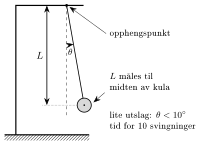

<!-- video: kommer (videoer/fysikk-forkurs/01-11-forsok-og-rapport) -->
{fig-alt="Video kommer"}

<!-- tillegg: Claude -->
Heng en nøkkel i en hyssing og la den svinge. Bytt så nøkkelen ut med et tyngre nøkkelknippe. Svinger det fortere, saktere eller like fort? Mange gjetter at det tyngste svinger fortest. Den eneste måten å finne ut av det på, er å *måle*. Det er kjernen i naturvitenskapen: Vi avgjør spørsmål med forsøk, ikke med meninger. På denne siden ser vi hvordan et godt forsøk planlegges, gjennomføres og skrives ned i en rapport, slik at andre kan forstå, kontrollere og gjenta det.

## Den naturvitenskapelige metoden

Arbeidet går i en syklus. Vi **observerer** noe vi lurer på, og foreslår en **hypotese**: en mulig forklaring som kan testes. Så gjør vi et **forsøk** og **analyserer** målingene. Resultatet **styrker eller svekker** hypotesen, og det fører ofte til nye spørsmål.

{.tikz-fig style="width:520px" fig-alt="En syklus med fem bokser forbundet med piler: Observasjon (noe vi lurer på), Hypotese (en mulig forklaring som kan testes), Forsøk (planlegge og måle), Analyse (middelverdi, usikkerhet, graf) og Konklusjon (styrker eller svekker hypotesen), og tilbake til Observasjon. I midten står: mange forsøk som stemmer gir teori og naturlov."}

En hypotese må kunne testes. «Svingetiden til en pendel avhenger ikke av massen» kan vi teste med en hyssing og noen lodd. «Pendelen svinger fordi den vil det» kan vi ikke teste, og da er det ingen hypotese i naturvitenskapelig forstand.

Når mange forsøk, gjort av mange folk på mange måter, stemmer med samme forklaring, får vi noe sterkere enn en hypotese:

::: {.kort}
- **Hypotese** En foreløpig forklaring eller påstand som skal testes. Eksempel: «Svingetiden avhenger ikke av massen.»
- **Naturlov** En sammenheng som er målt og bekreftet så mange ganger at vi stoler på den, ofte skrevet som en formel. Eksempel: Newtons andre lov, $\sum F = ma$. Den sier *hva* som skjer.
- **Teori** Et stort, sammenhengende forklaringssystem som binder mange lover og observasjoner sammen. Eksempel: Newtons mekanikk eller relativitetsteorien. Den forklarer *hvorfor*.
:::

I hverdagen betyr «det er bare en teori» at noe er usikkert. I naturvitenskapen er det motsatt: En teori er det sterkeste vi har. Likevel er ingenting bevist for alltid. Viser nye og bedre målinger at en teori ikke stemmer, må den justeres eller byttes ut.

## Å planlegge forsøket

Et forsøk undersøker hvordan én størrelse påvirker en annen. Da må vi holde orden på tre slags variabler:

::: {.callout-note title="Definisjon: Variabler i et forsøk"}
- Den **uavhengige variabelen** er den vi endrer med vilje (for eksempel massen til loddet).
- Den **avhengige variabelen** er den vi måler for å se om den endrer seg (for eksempel svingetiden).
- De **kontrollerte variablene** er alt annet som kunne påvirket resultatet, og som vi derfor holder konstant (for eksempel snorlengden og utslaget).
:::

Hvorfor er de kontrollerte variablene så viktige? Endrer vi både massen og snorlengden samtidig og ser at svingetiden endrer seg, vet vi ikke hvilken av dem som var årsaken. Et rettferdig forsøk endrer **bare én ting om gangen**.

Før du begynner, lønner det seg også å tenke gjennom hvilke måleinstrumenter du trenger, hvor stor usikkerhet du kan vente, og hvordan du kan gjøre den mindre. Ofte er det et lite triks som gjør mest: å ta tiden på ti svingninger i stedet for én, eller å slippe ballen fra større høyde.

::: {.eksempel}
**Eksempel: Avhenger svingetiden av massen?** Planlegg et forsøk som tester hypotesen «Svingetiden til en pendel avhenger ikke av massen til loddet».

::: {.losning}
**Variabler.** Den uavhengige variabelen er massen $m$ til loddet. Den avhengige variabelen er svingetiden $T$. Alt annet som kan påvirke svingetiden, må holdes konstant: snorlengden $L$ (målt fra opphengspunktet til midten av loddet), utslaget (startvinkelen) og selve snora. Lodd med ulik masse bør også ha omtrent samme form og størrelse, så luftmotstanden blir lik.

**Gjennomføring.** Vi bruker for eksempel fire lodd med massene $50\ \mathrm{g}$, $100\ \mathrm{g}$, $200\ \mathrm{g}$ og $500\ \mathrm{g}$, slik at massen varierer mye. Svingetiden er kort, så vi tar tiden på 10 svingninger og deler på 10. Hver måling gjentas fem ganger, slik at vi kan finne middelverdien og usikkerheten.

**Måleskjema.** Vi lager skjemaet før vi begynner:

| $m$ (g) | $t_1$ (s) | $t_2$ (s) | $t_3$ (s) | $t_4$ (s) | $t_5$ (s) | $\bar t$ (s) | $T$ (s) |
|:---:|:---:|:---:|:---:|:---:|:---:|:---:|:---:|
| 50 | | | | | | | |
| 100 | | | | | | | |
| 200 | | | | | | | |
| 500 | | | | | | | |

**Hva teller som svar?** Hypotesen styrkes hvis svingetidene for alle massene er like innenfor usikkerheten (intervallene overlapper). Den svekkes hvis svingetiden endrer seg tydelig og systematisk med massen.
:::
:::

## Å gjennomføre og måle

Under forsøket skriver du ned **alle** målingene i måleskjemaet med en gang, med enhet i kolonneoverskriften. Ikke rund av og ikke stryk målinger som «ser rare ut» før du har tenkt deg om. Noter også ting som skjer underveis: at pendelen begynte å svinge i en ellipse, eller at noen åpnet et vindu.

Fra gjentatte målinger finner vi en verdi og en usikkerhet:

::: {.graa}
$$
\bar x = \frac{x_1 + x_2 + \dots + x_n}{n}
\qquad\qquad
\Delta x \approx \tfrac{1}{2}\,(x_\text{maks} - x_\text{min})
$$
:::

Hvordan usikkerheten anslås og skrives, står under [måleusikkerhet](06-maleusikkerhet.qmd). Regner vi videre fra målingene, følger usikkerheten med etter reglene under [usikkerhet i sammensatte størrelser](07-usikkerhet-i-sammensatte-storrelser.qmd). Har vi målt en sammenheng for mange verdier av den uavhengige variabelen, viser vi den i en graf, se [grafer og regresjon](10-grafer-og-regresjon.qmd).

Husk også de to slagene feil. **Tilfeldige feil** (som reaksjonstiden din) gir spredning, og de blir mindre av å gjenta målingen. **Systematiske feil** (som en vekt som ikke er nullstilt) drar alle målingene samme vei og avsløres ikke av gjentakelse. Dem må du finne ved å tenke gjennom oppsettet.

## Å skrive rapporten

En rapport skal gjøre det mulig for en annen person å forstå hva du gjorde, kontrollere regningen og gjenta forsøket. Den har en fast oppbygning, og hver del svarer på ett spørsmål:

::: {.steg}
1. **Formål** Hva vil vi finne ut? Én eller to setninger, gjerne med hypotesen.
2. **Teori** Hvilke formler og sammenhenger bygger vi på? Forklar symbolene.
3. **Utstyr og metode** Hva brukte vi, og hvordan gjorde vi det? Så nøyaktig at andre kan gjenta forsøket. Gjerne en skisse av oppsettet.
4. **Resultater** Måleskjemaet, beregningene og svaret med usikkerhet og enhet. Bare tall og fakta, ingen tolkning ennå.
5. **Drøfting** Hva betyr resultatet? Stemmer det med teorien eller en kjent verdi innenfor usikkerheten? Hvilke feilkilder finnes, er de tilfeldige eller systematiske, og hvilken vei drar de svaret?
6. **Konklusjon** Et kort svar på formålet, med tall og usikkerhet.
:::

Formålet og konklusjonen skal passe sammen som spørsmål og svar. En leser som bare leser disse to delene, skal vite hva du fant ut.

::: {.callout-tip title="Feilkilder som betyr noe"}
«Menneskelige feil» og «unøyaktige målinger» er ikke feilkilder: De sier ingenting. En god feilkilde er **konkret** (hva gikk galt?), sier om den er **tilfeldig eller systematisk**, og forteller helst **hvilken vei** den påvirker svaret og **hvor mye**. Sammenlign usikkerhetene: Den største feilkilden er den det lønner seg å gjøre noe med.
:::

## En kort rapport

Her er en hel rapport fra et enkelt forsøk, der vi bruker en pendel til å måle tyngdeakselerasjonen.

{.tikz-fig style="width:420px" fig-alt="Oppsettet i pendelforsøket: Et stativ med en snor festet i et opphengspunkt. En kule henger i snora og er trukket ut en liten vinkel theta fra loddlinja. Snorlengden L er målt fra opphengspunktet til midten av kula. Merknad: lite utslag, theta under 10 grader, og tid for 10 svingninger."}

::: {.eksempel}
**Eksempel: Tyngdeakselerasjonen målt med pendel.** Rapporten under bygger på målingene i måleskjemaet.

::: {.losning}
**Formål.** Å bestemme tyngdeakselerasjonen $\mathrm{g}$ ved å måle svingetiden til en pendel, og å sammenligne med den kjente verdien $9.81\ \mathrm{m/s^2}$.

**Teori.** For en pendel med lite utslag (under omtrent $10^\circ$) er svingetiden
$$
T = 2\pi\sqrt{\frac{L}{\mathrm{g}}}
\qquad\Longrightarrow\qquad
\mathrm{g} = \frac{4\pi^2 L}{T^2}
$$
der $L$ er lengden fra opphengspunktet til midten av kula. Formelen gjelder når snora er lett og kula er liten i forhold til $L$.

**Utstyr og metode.** Stålkule i en tynn snor festet i et stativ, målebånd og stoppeklokke på mobilen. Snorlengden ble målt til midten av kula. Kula ble trukket ut omtrent $5^\circ$ og sluppet. Vi tok tiden på 10 hele svingninger og gjentok dette fem ganger.

**Resultater.** Snorlengden er $L = (0.800 \pm 0.005)\ \mathrm{m}$.

| Måling | 1 | 2 | 3 | 4 | 5 |
|:---|:---:|:---:|:---:|:---:|:---:|
| $t_{10}$ (s) | 17.9 | 18.0 | 17.8 | 18.1 | 17.9 |

Middelverdien og usikkerheten for 10 svingninger er
$$
\bar t_{10} = \frac{17.9 + 18.0 + 17.8 + 18.1 + 17.9}{5}\ \mathrm{s} = \frac{89.7}{5}\ \mathrm{s} = 17.94\ \mathrm{s}
\qquad
\Delta t_{10} = \tfrac{1}{2}(18.1 - 17.8)\ \mathrm{s} = 0.15\ \mathrm{s}
$$
Én svingning tar en tidel av dette: $T = (1.794 \pm 0.015)\ \mathrm{s}$. Da blir
$$
\mathrm{g} = \frac{4\pi^2 \cdot 0.800\ \mathrm{m}}{(1.794\ \mathrm{s})^2} = 9.813\ \mathrm{m/s^2}
$$
Relative usikkerheter legges sammen, og $T$ er kvadrert, så den teller dobbelt:
$$
\frac{\Delta \mathrm{g}}{\mathrm{g}} = \frac{\Delta L}{L} + 2\,\frac{\Delta T}{T} = \frac{0.005}{0.800} + 2\cdot\frac{0.015}{1.794} = 0.0063 + 0.0167 = 0.023
$$
$$
\Delta \mathrm{g} = 0.023 \cdot 9.813\ \mathrm{m/s^2} = 0.23\ \mathrm{m/s^2}
\qquad\Longrightarrow\qquad
\mathrm{g} = (9.8 \pm 0.2)\ \mathrm{m/s^2}
$$

**Drøfting.** Den kjente verdien $9.81\ \mathrm{m/s^2}$ ligger godt innenfor intervallet fra $9.6$ til $10.0\ \mathrm{m/s^2}$, så målingen stemmer med den. Tiden gir det største bidraget til usikkerheten ($1.7\ \%$ mot $0.6\ \%$ for lengden). Den kommer av reaksjonstiden ved start og stopp, som er en **tilfeldig** feil. Den kan gjøres mindre ved å ta tiden på flere svingninger, for eksempel 20, eller ved å bruke en lysport. Mulige **systematiske** feil er at lengden måles til feil sted på kula (gir feil $L$ i samme retning hver gang), og at utslaget blir for stort, som gjør svingetiden litt lengre og $\mathrm{g}$ litt for liten. Med utslag på $5^\circ$ er den siste effekten under $0.1\ \%$, altså mye mindre enn usikkerheten vår. Luftmotstanden på en liten stålkule er også liten.

**Konklusjon.** Vi målte tyngdeakselerasjonen til $\underline{\underline{\mathrm{g} = (9.8 \pm 0.2)\ \mathrm{m/s^2}}}$, som stemmer med den kjente verdien $9.81\ \mathrm{m/s^2}$.
:::
:::

Legg merke til at drøftingen ikke bare ramser opp feilkilder, men sammenligner dem og sier hva som kan gjøres bedre. Og konklusjonen svarer direkte på formålet.

## Prøv selv

Programmet gjør beregningene fra pendelrapporten. Bytt ut tallene med dine egne målinger og trykk **Kjør**. Hva skjer med usikkerheten i $\mathrm{g}$ hvis du tar tiden på 20 svingninger i stedet for 10 og får omtrent samme spredning i tidene?

```{.python .kjor}
import numpy as np

L, dL = 0.800, 0.005                          # snorlengde og usikkerhet i m
antall = 10                                    # svingninger per tidtaking
t = np.array([17.9, 18.0, 17.8, 18.1, 17.9])   # tid for alle svingningene i s

t_snitt = np.mean(t)
dt = (np.max(t) - np.min(t)) / 2
T, dT = t_snitt / antall, dt / antall

g = 4 * np.pi**2 * L / T**2
rel = dL / L + 2 * dT / T
dg = rel * g

print(f"Svingetid:  T = {T:.4f} ± {dT:.4f} s")
print(f"g = {g:.3f} ± {dg:.3f} m/s^2  (relativ usikkerhet {100*rel:.1f} %)")
```

:::: {.oppgaver}

::: {.oppgave tittel="Planlegg et forsøk"}
Du vil undersøke hvordan strekningen en lekebil ruller bortover gulvet, avhenger av høyden den slippes fra på en rampe.

a) Hva er den uavhengige og den avhengige variabelen?

b) Nevn minst tre kontrollerte variabler.

c) Lag et måleskjema for forsøket.

::: {.losning}
a) Den **uavhengige variabelen** er slipphøyden $h$ på rampa, fordi det er den du endrer med vilje. Den **avhengige variabelen** er strekningen $s$ bilen ruller bortover gulvet, fordi det er den du måler.

b) Ting som må holdes konstant: samme bil (samme masse og hjul), samme rampe med samme helning, samme gulv (samme underlag), og at bilen slippes uten fart, ikke dyttes. Også at bilen starter rett, så den ikke svinger.

c) For eksempel fem høyder med tre gjentakelser hver:

| $h$ (cm) | $s_1$ (m) | $s_2$ (m) | $s_3$ (m) | $\bar s$ (m) | $\Delta s$ (m) |
|:---:|:---:|:---:|:---:|:---:|:---:|
| 10 | | | | | |
| 20 | | | | | |
| 30 | | | | | |
| 40 | | | | | |
| 50 | | | | | |

Enheten står i kolonneoverskriften, så tallene i skjemaet kan skrives uten enhet.
:::
:::

::: {.oppgave tittel="Hypotese, naturlov eller teori?"}
Avgjør om hver påstand best beskrives som en hypotese, en naturlov eller en teori.

a) «Jeg tror vann koker raskere med lokk på kjelen.»

b) Energibevaring: Den totale energien i et lukket system er konstant.

c) Den generelle relativitetsteorien, som forklarer tyngdekraften som krumning av rom og tid.

d) «Jo lengre snor, desto lengre svingetid.»

::: {.losning}
a) **Hypotese.** En påstand som ennå ikke er testet, og som kan testes med et enkelt forsøk.

b) **Naturlov.** En sammenheng som er bekreftet i et enormt antall forsøk, og som sier *hva* som skjer.

c) **Teori.** Et stort forklaringssystem som binder sammen mange lover og observasjoner og forklarer *hvorfor*.

d) **Hypotese**, så lenge den ikke er testet. Den er lett å teste: Endre snorlengden, hold alt annet konstant og mål svingetiden. (Sammenhengen er velkjent og stemmer, men i et forsøk er det nettopp den du tester.)
:::
:::

::: {.oppgave tittel="Falltid fra måleskjema" niva="Middels"}
En ball slippes fra høyden $h = (1.20 \pm 0.01)\ \mathrm{m}$, og falltiden måles seks ganger med stoppeklokke:

| Måling | 1 | 2 | 3 | 4 | 5 | 6 |
|:---|:---:|:---:|:---:|:---:|:---:|:---:|
| $t$ (s) | 0.50 | 0.48 | 0.51 | 0.47 | 0.49 | 0.50 |

a) Finn middelverdien og usikkerheten i falltiden.

b) Tyngdeakselerasjonen er $\mathrm{g} = \dfrac{2h}{t^2}$. Finn $\mathrm{g}$ med usikkerhet.

c) Stemmer resultatet med $9.81\ \mathrm{m/s^2}$? Hva er den største feilkilden, og hvordan kan forsøket forbedres?

::: {.losning}
a) Middelverdien er
$$
\bar t = \frac{0.50 + 0.48 + 0.51 + 0.47 + 0.49 + 0.50}{6}\ \mathrm{s} = \frac{2.95}{6}\ \mathrm{s} = 0.492\ \mathrm{s}
$$
og usikkerheten (halve spredningen)
$$
\Delta t = \tfrac{1}{2}(0.51 - 0.47)\ \mathrm{s} = 0.02\ \mathrm{s}
$$
Falltiden er $t = \underline{\underline{(0.49 \pm 0.02)\ \mathrm{s}}}$.

b) Vi regner videre med den urundede middelverdien:
$$
\mathrm{g} = \frac{2 \cdot 1.20\ \mathrm{m}}{(0.492\ \mathrm{s})^2} = 9.93\ \mathrm{m/s^2}
$$
Relative usikkerheter legges sammen, og tiden er kvadrert:
$$
\frac{\Delta \mathrm{g}}{\mathrm{g}} = \frac{0.01}{1.20} + 2\cdot\frac{0.02}{0.492} = 0.008 + 0.081 = 0.090
\qquad
\Delta \mathrm{g} = 0.090 \cdot 9.93\ \mathrm{m/s^2} = 0.9\ \mathrm{m/s^2}
$$
$$
\mathrm{g} = \underline{\underline{(9.9 \pm 0.9)\ \mathrm{m/s^2}}}
$$

c) Intervallet går fra $9.0$ til $10.8\ \mathrm{m/s^2}$, så $9.81\ \mathrm{m/s^2}$ ligger innenfor, og resultatet **stemmer**. Men usikkerheten er stor. Nesten hele den kommer fra tiden ($8\ \%$ mot under $1\ \%$ for høyden), og den skyldes reaksjonstiden ved start og stopp, en tilfeldig feil. Forsøket blir bedre med en lysport eller en lydopptaker som måler tiden, eller med større fallhøyde, slik at reaksjonstiden blir en mindre del av den målte tiden.
:::
:::

::: {.oppgave tittel="Finn feilene i rapporten" niva="Middels"}
Her er et utdrag fra en elevrapport om et pendelforsøk. Finn minst fem ting som bør gjøres bedre.

> **Resultater.** Snora var 60 cm. Vi tok tiden på 10 svingninger og fikk 15.3 s. Da er $T = 1.53\ \mathrm{s}$ og $\mathrm{g} = 4\pi^2 \cdot 0.60 / 1.53^2 = 10.118779$.
>
> **Konklusjon.** Forsøket beviser at g er 10.118779. At svaret ikke ble 9.81, skyldes menneskelige feil.

::: {.losning}
1. **Bare én måling.** Uten gjentatte målinger kan vi ikke finne middelverdi eller usikkerhet. Tidtakingen burde vært gjentatt flere ganger.
2. **Ingen usikkerhet.** Verken snorlengden, tiden eller $\mathrm{g}$ har usikkerhet. Uten den kan vi ikke avgjøre om svaret stemmer med $9.81\ \mathrm{m/s^2}$.
3. **For mange siffer.** Dataene har to–tre gjeldende siffer, så åtte siffer i svaret later som om vi vet mye mer enn vi gjør. Utregningen gir $10.1\ \mathrm{m/s^2}$.
4. **Enhet mangler** på $\mathrm{g}$, både i resultatet og i konklusjonen.
5. **Uklart hvor snora er målt.** Det står ikke om $60\ \mathrm{cm}$ er målt til midten av loddet. Det er $L$ til midten som skal inn i formelen.
6. **«Beviser»** er feil ord. Et forsøk gir en måling med usikkerhet, ikke et bevis.
7. **«Menneskelige feil»** er ingen feilkilde. Drøftingen bør nevne konkrete feilkilder, for eksempel reaksjonstiden (tilfeldig) eller at snorlengden er målt til toppen av loddet (systematisk, gir for liten $L$), og si hvilken vei de drar svaret.
8. **Drøftingen mangler.** Konklusjonen inneholder en forklaring på avviket, som hører hjemme i drøftingen.

En bedre konklusjon kunne vært: «Vi målte $\mathrm{g} = (10.1 \pm 0.3)\ \mathrm{m/s^2}$, som stemmer med den kjente verdien innenfor usikkerheten» (med en usikkerhet som er regnet ut fra gjentatte målinger).
:::
:::

::: {.oppgave tittel="Tilfeldig eller systematisk i pendelforsøket?" niva="Middels"}
I pendelforsøket for å måle $\mathrm{g}$ kan disse tingene gå galt. Avgjør for hver om feilen er tilfeldig eller systematisk, og om den gjør $\mathrm{g}$ for stor eller for liten (eller begge deler).

a) Du starter og stopper stoppeklokka litt ulikt hver gang.

b) Snorlengden måles fra opphengspunktet til **toppen** av kula i stedet for til midten.

c) Kula trekkes ut $40^\circ$ før den slippes. Da blir svingetiden litt lengre enn formelen sier.

d) Du teller feil og tar tiden på 9 svingninger, men deler på 10.

::: {.losning}
Husk at $\mathrm{g} = \dfrac{4\pi^2 L}{T^2}$: For stor $L$ gir for stor $\mathrm{g}$, og for stor $T$ gir for liten $\mathrm{g}$.

a) **Tilfeldig.** Tiden blir noen ganger for lang og noen ganger for kort, så $\mathrm{g}$ kan bli både for stor og for liten. Middelverdien av mange målinger blir bedre.

b) **Systematisk.** Den målte $L$ blir for kort hver gang (med kulas radius), så $\mathrm{g}$ blir **for liten**. Å gjenta hjelper ikke; det må rettes ved å måle til midten av kula.

c) **Systematisk.** Svingetiden blir for lang hver gang, så $\mathrm{g}$ blir **for liten**. Rettes ved å bruke lite utslag, under omtrent $10^\circ$.

d) **Systematisk** (hvis det skjer hver gang) eller en enkeltstående bommert. Tiden for 9 svingninger er kortere enn for 10, så $T$ blir for liten og $\mathrm{g}$ blir **for stor**, omtrent $(10/9)^2 \approx 1.23$ ganger for stor. En slik bommert avsløres ofte ved at én måling skiller seg tydelig ut fra de andre.
:::
:::

::::
