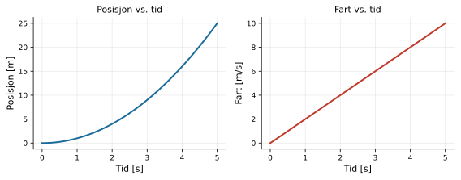

:::: {.oppgaver}

En *funksjon* er en regel som til enhver innverdi $x$ knytter én bestemt utverdi $f(x)$. I fysikk er funksjoner et sentralt verktøy — for eksempel er posisjonen $s$ til et objekt i bevegelse en funksjon av tid $t$. Da skriver vi gjerne $s(t)$ som funksjonsnavn.

## Lineær funksjon {#lineær-funksjon .unnumbered}

Den enkleste funksjonen er den lineære:

::: {.graa}

$\displaystyle f(x) = b + ax$

:::

der $a$ er *stigningstallet* (hvor bratt grafen er) og $b$ er *konstantleddet* (der grafen skjærer $y$-aksen). Et slikt eksempel er farten $v(t)$ når akselerasjonen er konstant: $$v(t) = v_0 + at.$$ Som du ser så bruker vi forskjellige variabelnavn, avhengig av hva vi prater om. Det er viktig å forstå at variabelnavnene i seg selv ikke er viktige. Vi kunne i prinsippet godt ha kalt fartsfunksjonen for $f(t)$, uten at det hadde endret noe som helst. Det er bare ikke så hensiktsmessig.

## Kvadratisk funksjon {#kvadratisk-funksjon .unnumbered}

En kvadratisk funksjon har formen

::: {.graa}

$\displaystyle f(x) = ax^2 + bx + c$

:::

Grafen er en parabel. Posisjonen til et legeme med konstant akselerasjon er for eksempel en kvadratisk funksjon av tid: $$s(t) = \frac{1}{2}at^2+ v_0 t + s_0.$$

::: mymerk*
Merk at mange bokstaver kan symbolisere veldig forskjellige ting. Bokstaven $s$ er et godt eksempel. Skriver vi $s(t)$ mener vi nok strekning som funksjon av tid $t$. Men tiden $t$ har jo enhet sekund, som også betegnes med bokstaven $s$! Et annet eksempel er bokstaven $m$, som brukes både til å symbolisere masse, men også som symbol for enheten meter. Ut ifra sammenhengen greier man som regel å forstå hva som er ment — i alle fall med litt trening.
:::

## Plotting med Python {#plotting-med-python .unnumbered}

En av de nyttigste tingene vi kan gjøre med Python, er å tegne grafer. Eksemplet under plotter posisjon og fart som funksjon av tid for et legeme med konstant akselerasjon:

```{.python .kjor}
import numpy as np
import matplotlib.pyplot as plt

# Parametre
a = 2.0 # akselerasjon [m/s^2]
v0 = 0.0 # startfart [m/s]
s0 = 0.0 # startposisjon [m]

# Tid fra 0 til 5 sekunder (200 punkter)
t = np.linspace(0, 5, 200)

# Bevegelsesligninger
s = s0 + v0*t + 0.5*a*t**2 # posisjon
v = v0 + a*t # fart

# To grafer side om side
fig, (ax1, ax2) = plt.subplots(1, 2, figsize=(10, 4))

ax1.plot(t, s, color=’royalblue’, linewidth=2)
ax1.set_xlabel(’Tid [s]’)
ax1.set_ylabel(’Posisjon [m]’)
ax1.set_title(’Posisjon vs. tid’)
ax1.grid(True, alpha=0.3)

ax2.plot(t, v, color=’tomato’, linewidth=2)
ax2.set_xlabel(’Tid [s]’)
ax2.set_ylabel(’Fart [m/s]’)
ax2.set_title(’Fart vs. tid’)
ax2.grid(True, alpha=0.3)

plt.tight_layout()
plt.show()
```

*Kodefil: [K2_funksjoner_og_plotting.ipynb](https://github.com/kosmoben/TRES0312/blob/main/TRES0312%20Python/Kap2_MatematiskeVerktoyViTrenger/K2_funksjoner_og_plotting.ipynb)*

:::: figure
{.kompendium-bilde}

::: caption
Posisjon og fart som funksjon av tid for konstant akselerasjon $a=2.0\,\mathrm{m}\,\mathrm{s}^{-2}$, $v_0 = 0$.
:::
::::

::: {.oppgave tittel="Funksjoner og plotting"}
[Funksjoner og plotting]{.oppg-tittel}

a)  Bruk Python (eller et annet verktøy du måtte foretrekke) til å plotte funksjonen $f(x) = 2x^2 - 3x + 1$ for $x \in [-2,\, 4]$.

b)  Modifiser Python-koden gitt i teksten over slik at startfarten er $v_0 = 3.0\,\mathrm{m}\,\mathrm{s}^{-1}$. Hva forandrer seg i grafene? Grafen du plotter i oppgave a) kan være til hjelp for å se svaret.

::: {.losning}

**a)** Funksjonen $f(x)=2x^2-3x+1$ plottes med koden under. Grafen er en oppovervendt parabel (siden koeffisienten foran $x^2$ er positiv), med bunnpunkt ved $x=-b/(2a)=3/4=0.75$ og nullpunkter ved $x=0.5$ og $x=1$ (løs $2x^2-3x+1=0$ med abc-formelen).

**b)** Vi endrer `v0 = 0.0` til `v0 = 3.0` i koden i teksten over. Da blir posisjonen $$s(t) = s_0 + v_0 t + \tfrac12 a t^2 = 3.0\,t + t^2$$ og farten $v(t)=v_0+at = 3.0+2.0t$. Fart-grafen er fortsatt en rett linje med samme stigningstall, men *løftet opp* slik at den starter på $3.0\,\mathrm{m}\,\mathrm{s}^{-1}$ i stedet for $0$. Posisjonsgrafen er fortsatt en oppovervendt parabel, men stigningstallet ved $t=0$ er nå $3.0$ i stedet for $0$, slik at kurven stiger brattere helt fra starten — den ser ikke lenger flat ut ved $t=0$.

Dette er akkurat den samme effekten som i oppgave a): leddet $v_0t$ i $s(t)$ spiller samme rolle som leddet $-3x$ i $f(x)=2x^2-3x+1$ — et lineært ledd flytter bunnpunktet til parabelen bort fra origo. For $f(x)$ ligger bunnpunktet ved $x=0.75$, synlig i det plottede intervallet. For $s(t)$ med $v_0=3.0$ og $a=2.0$ ligger bunnpunktet ved $t=-v_0/a=-1.5\,\mathrm{s}$, altså *utenfor* tidsintervallet $t\in[0,5]\,\mathrm{s}$ som plottes — derfor ser vi bare den stigende delen av parabelen, uten at kurven flater ut noe sted i grafen.

:::

:::


::::
