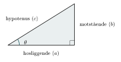
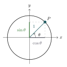

:::: {.oppgaver}

Trigonometri er veldig nyttig redskap i fysikken, ettersom vi hele veien har bruk for å dekomponere vektorer i koordinatsystem. Det er antatt at studentene kjenner dette begrepsaparatet fra før, men her følger en liten oppsummering.

**I en rettvinklet trekant** navngir vi sidene i forhold til en valgt vinkel $\theta$:

-   **Hypotenus** ($c$) — den lengste siden, alltid overfor den rette vinkelen ($90-$graders vinkelen). Denen sidekanten vil utgjøre det ene benet ivinkelen $\theta$.

-   **Hosliggende katet** (a) — sidekanten som utgjør det andre benet i $\theta$-vinkelen.

-   **Motstående katet** (b) — siden overfor $\theta$

::: center
{.tikz-fig style="width:395px"}

{.tikz-fig style="width:265px"}
:::

::: center
*Venstre: rettvinklet trekant med vinkel $\theta$. Høyre: enhetssirkelen ($r=1$), der $P=(\cos\theta,\,\sin\theta)$.*
:::

Pythagoras læresetning sier nå at $$\begin{aligned}
    a^2 + b^2 = c^2.
\end{aligned}$$ Vi kan nå definere de trigonometriske funksjonene sinus, cosinus og tangens.

::: {.callout-note title="Definisjon: Sinus, cosinus og tangens"}

For en vinkel $\theta$ i en rettvinklet trekant med hypotenus $c$ har vi nå følgende definisjoner: $$\begin{aligned}
    \cos\theta = \frac{\text{hosligg.}}{\text{hyp.}}=\frac{a}{c}, \qquad
    \sin\theta = \frac{\text{motst.}}{\text{hyp.}}=\frac{b}{c}, \qquad
    \tan\theta = \frac{\sin\theta}{\cos\theta} = \frac{\text{motst.}}{\text{hosligg.}}=\frac{b}{a}.
\end{aligned}$$

:::

Ut ifra formlene over så se vi at vi får følgende formlerfor katetene $a$ og $b$: $$\text{a} = c\cos\theta, \qquad \text{b} = c\sin\theta.$$ Dette er uttrykk som vi kommer til å benytte oss av veldig mye. Jeg anbefaler å pugge uttrykkene i den grønne boksen, og alltid utlede ting på nytt derifra når du trenger det.

**Enhetssirkelen** er et veldig nyttig verktøy når man jobber med trigonometriske funksjoner. Enhetssirklene er rett og slett en sirkel med radius 1, slik at katetene i trekanten med vinkel $\theta$ skrevet inn i enhetssirkelen, blir $\cos\theta$ og $\sin\theta$. Da ser vi også umiddelbart fra Pythagoras læesetning at $$\begin{aligned}
    \cos^2\theta + \sin^2\theta = 1.
\end{aligned}$$ Denne formelen er mye brukt, så den kan du bare lære deg med det samme. Tabellen under viser noen eksakte verdier for de trigonometriske funksjonene. De fleste vinklene har ikke eksakte uttrykk på denne formen, men disse er mye brukte vinkler, og det kan derfor være kjekt å kjenne til dem. Jeg anbefaler likevel ikke å bruke tid på å pugge de.

| $\theta$ | $\sin\theta$ | $\cos\theta$ | $\tan\theta$ |
|:--:|:--:|:--:|:--:|
| $0^\circ$ | $0$ | $1$ | $0$ |
| $30^\circ$ | $\dfrac{1}{2}$ | $\dfrac{\sqrt{3}}{2}$ | $\dfrac{1}{\sqrt{3}}$ |
| $45^\circ$ | $\dfrac{\sqrt{2}}{2}$ | $\dfrac{\sqrt{2}}{2}$ | $1$ |
| $60^\circ$ | $\dfrac{\sqrt{3}}{2}$ | $\dfrac{1}{2}$ | $\sqrt{3}$ |
| $90^\circ$ | $1$ | $0$ | — |

: Viktige trigonometriske verdier.

::: {.eksempel}
[Eksempel 2.5: Trigonometri: stige mot vegg]{.eks-tittel}

En stige av lengde $h = 5.0\,\mathrm{m}$ lener seg mot en vegg i vinkel $\theta = 37^\circ$ med gulvet. Finn den horisontale og vertikale komponenten til stigen.

::: {.losning}
**Løsning:** $$\begin{aligned}
x &= h\cos\theta = 5.0\cdot\cos 37^\circ \approx 5.0\cdot 0.799 \approx \underline{\underline{4.0\,\mathrm{m}}} \\
y &= h\sin\theta = 5.0\cdot\sin 37^\circ \approx 5.0\cdot 0.602 \approx \underline{\underline{3.0\,\mathrm{m}}}
\end{aligned}$$ Dette er nøyaktig et $(3,4,5)$-trekant skalert med $1\,\mathrm{m}$.
:::
:::

::: {.eksempel}
[Eksempel 2.6: Bruk av $\sin^2\theta + \cos^2\theta = 1$]{.eks-tittel}

En vinkel $\theta$ i første kvadrant har $\sin\theta = \dfrac{3}{5}$.

a)  Bruk sammenhengen $\sin^2\theta + \cos^2\theta = 1$ til å finne $\cos\theta$.

b)  Finn $\tan\theta$.

::: {.losning}
**Løsning:** **a)** Vi løser for $\cos\theta$: $$\cos^2\theta = 1 - \sin^2\theta = 1 - \left(\frac{3}{5}\right)^2 = 1 - \frac{9}{25} = \frac{16}{25}.$$ Siden $\theta$ er i første kvadrant er $\cos\theta$ positiv, så $$\cos\theta = \sqrt{\frac{16}{25}} = \underline{\underline{\frac{4}{5}}}.$$ **b)** $$\tan\theta = \frac{\sin\theta}{\cos\theta} = \frac{3/5}{4/5} = \underline{\underline{\frac{3}{4}}}.$$
:::
:::

::: {.eksempel}
[Eksempel 2.7: Fortegn til $\sin\theta$ og $\cos\theta$]{.eks-tittel}

Bruk enhetssirkelen til å avgjøre om $\sin\theta$ og $\cos\theta$ er positiv eller negativ for hver av vinklene:

a)  $\theta = 120^\circ$

b)  $\theta = 200^\circ$

c)  $\theta = 300^\circ$

I hvilken kvadrant er både $\sin\theta$ og $\cos\theta$ positive? I hvilken kvadrant er begge negative?

::: {.losning}
**Løsning:** På enhetssirkelen er $\cos\theta$ lik $x$-koordinaten og $\sin\theta$ lik $y$-koordinaten til punktet på sirkelen. Fortegnet avhenger derfor av hvilken kvadrant vinkelen $\theta$ befinner seg i. **a)** $\theta = 120^\circ$ ligger i andre kvadrant ($90^\circ < \theta < 180^\circ$), der $x<0$ og $y>0$: **$\sin\theta$ positiv, $\cos\theta$ negativ.** **b)** $\theta = 200^\circ$ ligger i tredje kvadrant ($180^\circ < \theta < 270^\circ$), der $x<0$ og $y<0$: **$\sin\theta$ negativ, $\cos\theta$ negativ.** **c)** $\theta = 300^\circ$ ligger i fjerde kvadrant ($270^\circ < \theta < 360^\circ$), der $x>0$ og $y<0$: **$\sin\theta$ negativ, $\cos\theta$ positiv.**

Begge er positive i **første kvadrant** ($0^\circ < \theta < 90^\circ$), og begge er negative i **tredje kvadrant** ($180^\circ < \theta < 270^\circ$).
:::
:::

::: {.oppgave tittel="Trigonometri"}
[Trigonometri]{.oppg-tittel}

a)  Les av $\sin 30^\circ$, $\cos 45^\circ$ og $\tan 60^\circ$ fra Tabell .

b)  En trekant har hypotenus $c = 10\,\mathrm{m}$ og vinkel $\theta = 53^\circ$. Finn lengden av den motstående kateten $b$ og den hosliggende kateten $a$.

c)  Vis at $\sin^2 30^\circ + \cos^2 30^\circ = 1$.

d)  Hva blir $(\sin\theta+1)(\sin\theta-1)$? Hint: Bruk en av kvadratsetningene.

:::

::::
