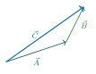
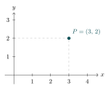
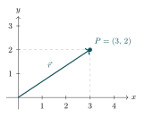
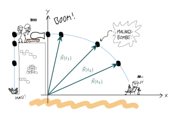
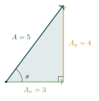

:::: {.oppgaver}



Vektorer kan sees på som utvidelse av tall til flere dimensjoner. Vi får da et objekt som med vår bruk kan representeres som en pil i et koordinatsystem. Vi kan gå så langt som å si at det er dette vektorer er for oss.

::: {.callout-note title="Definisjon: vektor"}

En vektor er et matematisk objekt med både størrelse og retning. Vi bruker en pil for å si at det er en vektor: $\vec{A}.$

:::

Det vi tidligere kalte tall, refererer vi nå gjerne til som *skalarer*, altså ikke vektorer. Skalarer har kun størrelse, og ikke retning. Det neste vi må gjøre er å definere hva vi mener med operasjoner som addisjon ($+$) og multiplikasjon ($\cdot$) for vektorer.

::: center
{.tikz-fig style="width:257px"}

{.tikz-fig style="width:208px"}
:::

::: center
*Venstre: vektorene $\vec{A}$ og $\vec{B}$. Høyre: $\vec{B}$ plassert ved spissen av $\vec{A}$ gir resultantvektoren $\vec{C} = \vec{A} + \vec{B}$ (tip-til-hale-metoden).*
:::

Multiplikasjon skal vi komme tilbake til litt senere.

::: {.oppgave tittel="Skalarer og vektorer"}
[Skalarer og vektorer]{.oppg-tittel}

Er følgende fysiske størrelser skalarer eller vektorer? Begrunn svaret.

a)  Temperatur

b)  Posisjon

c)  Fart

d)  Hastighet

e)  Akselerasjon

f)  Masse

:::

La oss nå gå over til å introdusere koordinatsystem, som er et viktig verktøy for å kunne regne med vektorer på en effektiv måte i fysikken.

## Koordinatsystem

Et koordinatsystem er et verktøy vi bruker for å beskrive posisjon. Dette er helt essensielt i fysikken, for eksempel når vi ønsker å beskrive bevegelse i planet eller rommet.

::: center
{.tikz-fig style="width:428px"}

{.tikz-fig style="width:313px"}
:::

::: center
*Venstre: tallinjen $\mathbb{R}$ med punkt $P=3$. Høyre: planet $\mathbb{R}^2$ med punkt $P=(3,\,2)$. Stiplete linjer markerer koordinatene.*
:::

::: center
{.tikz-fig style="width:428px"}

{.tikz-fig style="width:313px"}
:::

::: center
*Avstand fra origo til $P$ som vektor: $r = 3$ i $\mathbb{R}$ (venstre) og $\vec{r} = (3,\,2)$ i $\mathbb{R}^2$ (høyre).*
:::

I et todimensjonalt koordinatsystem, som $xy$-planet, beskrives en posisjon ved hjelp av et ordnet par $(x,y)$. Her angir:

-   $x$ posisjonen i horisontal retning

-   $y$ posisjonen i vertikal retning

Punktet $(0,0)$ kalles origo, og fungerer som referansepunkt for alle andre posisjoner i koordinatsystemet.

::: {.oppgave tittel="Koordinatsystem"}
[Koordinatsystem]{.oppg-tittel}

a)  Tegn punktene $A = (2,\,3)$, $B = (-1,\,4)$ og $C = (0,\,-2)$ i et koordinatsystem.

b)  Hvilket kvadrant befinner hvert punkt seg i?

c)  Finn midtpunktet $M$ mellom $A$ og $B$. *Hint:* $M = \left(\frac{x_A + x_B}{2},\, \frac{y_A + y_B}{2}\right)$.

:::

## Enhetsvektorer

For å arbeide systematisk med vektorer er det nyttig å innføre et sett med faste referansevektorer. Disse kalles *basisvektorer*. Dersom basisvektorene har lengde 1, kaller vi de *enhetsvektorer*. Alle andre vektorer kan uttrykkes som en lineær kombinasjon av basisvektorene. Vi lar gjerne enhetsvektorene peke i retningene til koordinataksene, og kaller de $\hat{\mathbf{x}}$ og $\hat{\mathbf{y}}$ i $xy$-planet. I tre dimensjoner har vi også en enhetsvektor $\hat{\mathbf{z}}$ som peker i $z$-retning.

::: {.callout-note title="Definisjon: Enhetsvektor"}

En enhetsvektor er en vektor med lengde 1 som angir en bestemt retning i rommet.

:::

I $xy$-planet finnes det to enhetsvektorer: $$\begin{aligned}
\hat{\mathbf{x}} = \frac{\vec{x}}{x}=[1,0], \qquad \hat{\mathbf{y}} = \frac{\vec{y}}{y}=[0,1].
\end{aligned}$$

Her peker $\hat{\mathbf{x}}$ i positiv $x$-retning, mens $\hat{\mathbf{y}}$ peker i positiv $y$-retning. Sammen danner disse enhetsvektorene grunnlaget for koordinatsystemet. Merk at $\hat{\mathbf{x}}$ og $\hat{\mathbf{y}}$ er ortonormale, det vil si at de står vinkelrett på hverandre, og at de begge har lengde 1.

::: {.callout-tip title="Alternativ notasjon for enhetsvektorer"}
I mange lærebøker brukes symbolene $\mathbf{i}$, $\mathbf{j}$ (og $\mathbf{k}$ i tre dimensjoner) for de samme enhetsvektorene. Her bruker vi $\hat{\mathbf{x}}$, $\hat{\mathbf{y}}$ (og $\hat{z}$ i tre dimensjoner), da denne notasjonen gjør det umiddelbart tydelig hvilken retning enhetsvektoren peker i.
:::

Enhver vektor i $xy$-planet kan skrives som en lineær-kombinasjon av enhetsvektorene. Det finnes to ekvivalente skrivemåter: $$\begin{aligned}
\vec{v} = [v_x, v_y] = v_x \hat{\mathbf{x}} + v_y \hat{\mathbf{y}}.
\end{aligned}$$

Begge disse skrivemåtene tydeliggjør hvordan vektoren er bygget opp av bidrag i hver retning. Tallene $v_x$ og $v_y$ kalles vektorens komponenter i henholdsvis $x$- og $y$-retning. Prosessen med å finne komponentene til en vektor kalles *dekomponering*, og er tema for neste avsnitt.

::: {.oppgave tittel="Vektorer som en lineærkombinasjon av enhetsvektorer"}
[Vektorer som en lineærkombinasjon av enhetsvektorer]{.oppg-tittel}

a)  Skriv vektoren $\vec{A} = [4,\,-3]$ som en lineær kombinasjon av enhetsvektorene $\hat{\mathbf{x}}$ og $\hat{\mathbf{y}}$.

b)  Regn ut summen $\vec{u} + \vec{v}$ der $\vec{u} = 3\hat{\mathbf{x}} - 2\hat{\mathbf{y}}$ og $\vec{v} = -\hat{\mathbf{x}} + 5\hat{\mathbf{y}}$. Skriv svaret på komponentform.

:::

## Dekomponering av vektorer i koordinatsystem

Dekomponering er en generell teknikk i fysikk som innebærer å dele opp en vektor i dens komponenter langs de enkelte koordinataksene[^1]. Ved å dekomponere en vektor, kan vi forstå hvordan den virker i hver retning separat, noe som gjør komplekse problemer enklere å håndtere. Dette er helt essensielt i alle deler av fysikken som omhandler vektorer. For eksempel, når vi studerer bevegelse i to dimensjoner, som for eksempel en prosjektilbevegelse, slik som vist i Figuren, så er det veldig nyttig å dekomponere bevegelsen i horisontal og vertikal retning. Da kan vi bruke de enklere bevegelsesligningene for hver retning, og deretter kombinere resultatene for å få en fullstendig beskrivelse av bevegelsen.

:::: figure
{.tikz-fig style="width:554px"}

::: caption
En malingsbombe i prosjektilbevegelse. Posisjonsvektoren $\vec{S}(t)$ peker fra origo til bomben ved de ulike tidspunktene $t_1$, $t_2$ og $t_3$, og bestemmer dermed banen.
:::
::::

Fysikkens lover formuleres ved hjelp av vektorer, og er uavhengig av valg av koordinatsystem. Likevel innfører vi koordinatsystem når vi saktisk skal regne på noe. Dette er fordi lovene lar seg dekomponere i hver enkelt retning. La oss ta fart som eksempel. Dersom akselerasjonen er konstant så er hastigheten $\vec{v}(t)$ ved tidspunkt $t$ gitt ved starthastigheten $\vec{v}_0$ og akselerasjonen $\vec{a}$ ved formelen $$\begin{aligned}
\vec{v}(t) = \vec{v}_0 + \vec{a}t.
\end{aligned}$$ Dette er en vektorlikning, og den gjelder i alle koordinatsystem. Dersom vi velger et koordinatsystem, så kan vi skrive ut komponentene i hver retning, og dermed få to separate likninger: $$\begin{aligned}
v_x(t) = v_{0x} + a_x t, \qquad
v_y(t) = v_{0y} + a_y t.
\end{aligned}$$

::: {.eksempel}
[Eksempel: Dekomponering av hastighet]{.eks-tittel}

En ball kastes med fart $v = 20\,\mathrm{m}\,\mathrm{s}^{-1}$ i en vinkel $\theta = 37°$ over horisonten ($\cos 37° \approx 0.80$, $\sin 37° \approx 0.60$).\
**a)** Finn komponentene $v_x$ og $v_y$.\
**b)** Verifiser at $|\vec{v}| = \sqrt{v_x^2 + v_y^2} = 20\,\mathrm{m}\,\mathrm{s}^{-1}$.

:::

::: {.callout-note .svar collapse="true" title="Vis løsning"}

**a)** Vi bruker de trigonometriske relasjonene $v_x = v\cos\theta$ og $v_y = v\sin\theta$: $$v_x = 20\,\mathrm{m}\,\mathrm{s}^{-1}\cdot 0.80 = \underline{\underline{16\,\mathrm{m}\,\mathrm{s}^{-1}}},
\qquad
v_y = 20\,\mathrm{m}\,\mathrm{s}^{-1}\cdot 0.60 = \underline{\underline{12\,\mathrm{m}\,\mathrm{s}^{-1}}}.$$ **b)** Pythagoras bekrefter: $$\sqrt{v_x^2 + v_y^2} = \sqrt{(16\,\mathrm{m}\,\mathrm{s}^{-1})^2 + (12\,\mathrm{m}\,\mathrm{s}^{-1})^2}
= \sqrt{256 + 144}\,\mathrm{m}\,\mathrm{s}^{-1} = \sqrt{400}\,\mathrm{m}\,\mathrm{s}^{-1} = \underline{\underline{20\,\mathrm{m}\,\mathrm{s}^{-1}}}\;\checkmark$$

:::

::: {.eksempel}
[Eksempel: Dekomponering av vektor og beregning av vinkel]{.eks-tittel}

Vi har en vektor $\vec{A} = [3,\;4]$ med komponenter $A_x = 3$ og $A_y = 4$.\
**a)** Finn størrelsen (skalarverdien) $A = |\vec{A}|$.\
**b)** Finn vinkelen $\theta$ mellom $\vec{A}$ og den horisontale aksen.

:::

::: {.callout-note .svar collapse="true" title="Vis løsning"}

1.  Størrelsen finner vi med Pythagoras: $$A = |\vec{A}| = \sqrt{A_x^2+A_y^2} = \sqrt{3^2+4^2} = \sqrt{25} = \underline{\underline{5}}$$

2.  Vinkelen kan beregnes på tre ekvivalente måter: $$\sin\theta = \frac{A_y}{A} = \frac{4}{5}
                \;\Rightarrow\;
                \theta = \arcsin\!\tfrac{4}{5} \approx \underline{\underline{53.1°}}$$ $$\cos\theta = \frac{A_x}{A} = \frac{3}{5}
                \;\Rightarrow\;
                \theta = \arccos\!\tfrac{3}{5} \approx 53.1°$$ $$\tan\theta = \frac{A_y}{A_x} = \frac{4}{3}
                \;\Rightarrow\;
                \theta = \arctan\!\tfrac{4}{3} \approx 53.1°$$ Alle tre metoder gir samme svar.

{.tikz-fig style="width:239px"}

:::

::: {.oppgave tittel="Dekomponering av vektorer"}
[Dekomponering av vektorer]{.oppg-tittel}

En ball kastes med startfart $v_0 = 20\,\mathrm{m}\,\mathrm{s}^{-1}$ i en vinkel $\theta = 30°$ over horisonten.

a)  Finn den horisontale startfarten $v_{0x}$.

b)  Finn den vertikale startfarten $v_{0y}$.

c)  Verifiser at $|\vec{v}_0| = \sqrt{v_{0x}^2 + v_{0y}^2} = 20\,\mathrm{m}\,\mathrm{s}^{-1}$.

:::

## Størrelse og retning til en vektor

Vi har sett at vi kan skrive ut vektorkomponentene i et koordinatsystem. En annen måte å angi en vektor på, er å angi dens *lengde* og *retning* i forhold til en gitt akse (dette er egentlig det samme som å angi vektoren i polarkoordinater, for den som har lært om det). Lengden til en vektor med komponenter i $xy$-planet kan finnes ved hjelp av Pytagoras’ setning.

::: {.callout-note title="Definisjon: Vektorlengde"}

Lengden til en vektor $\vec{v} = [v_x, v_y]$ er gitt ved $$\begin{aligned}
v=|\vec{v}| = \sqrt{v_x^2 + v_y^2}
\end{aligned}$$ Merk at vi som regel bare skriver $v$ for lengden, og ikke $|\vec{v}|$.

:::

Retningen til en vektor i forhold til $x$-aksen kan vi beskrive ved hjelp av tangensfunksjonen, som vi alt har sett.

::: {.callout-note title="Definisjon: Vektorvinkel"}

Vinkelen til en vektor $\vec{v} = [v_x, v_y]$ er gitt ved $$\begin{aligned}
\theta = \arctan\!\left(\frac{v_y}{v_x}\right)
\end{aligned}$$ der $\theta$ måles fra positiv $x$-retning.

:::

::: {.eksempel}
[Eksempel: Størrelse og retning]{.eks-tittel}

Finn lengde og vinkel til $\vec{v} = [3,\, 4]$.

::: {.losning}
**Løsning:** $$|\vec{v}| = \sqrt{3^2 + 4^2} = \underline{\underline{5}}, \qquad
\theta = \arctan\!\left(\tfrac{4}{3}\right) \approx \underline{\underline{53.1^\circ}}.$$ Vektoren har lengde 5 og peker ca. $53^\circ$ over den positive $x$-aksen.
:::
:::

## Python: lengde og vinkel {#python-lengde-og-vinkel .unnumbered}

```{.python .kjor}
import numpy as np

vx = 3.0 # x-komponent
vy = 4.0 # y-komponent

lengde = np.sqrt(vx**2 + vy**2)
vinkel = np.degrees(np.arctan2(vy, vx)) # arctan2 haandterer alle kvadranter

print(f"Vektor: ({vx}, {vy})")
print(f"Lengde: {lengde:.2f}")
print(f"Vinkel: {vinkel:.1f} grader")
```

```{.text .utskrift}
Vektor: (3.0, 4.0)
Lengde: 5.00
Vinkel: 53.1 grader
```

*Kodefil: [K2_vektorlengde_og_vinkel.ipynb](https://github.com/kosmoben/TRES0312/blob/main/TRES0312%20Python/Kap2_MatematiskeVerktoyViTrenger/K2_vektorlengde_og_vinkel.ipynb)*

::: {.callout-tip title="Bruk `arctan2`, ikke `arctan`"}
`np.arctan2(vy, vx)` er bedre enn `np.arctan(vy/vx)` fordi den håndterer alle fire kvadranter riktig — også når $v_x = 0$ eller $v_x < 0$.
:::

::: {.oppgave tittel="Størrelse og retning"}
[Størrelse og retning]{.oppg-tittel}

a)  Finn lengden til $\vec{v} = [5,\,12]$.

b)  Finn lengden til $\vec{u} = [-3,\,4]$.

c)  En fugl flyr $6\,\mathrm{km}$ østover og $8\,\mathrm{km}$ nordover. Hva er luftlinjeavstanden, og hvilken vinkel fra østaksen flyr den?

d)  Finn vinkelen $\vec{u} = [1,\,\sqrt{3}]$ danner med positiv $x$-akse.

e)  En kraft $\vec{F}$ har størrelse $F = 10\,\mathrm{N}$ og danner vinkel $\theta = 40°$ med horisonten. Finn de horisontale og vertikale komponentene.

:::

[^1]: Eller mer presist langs basisvektorene. Men vi velger disse identisk med koordinataksene, så i praksis blir det ikke noen forskjell. Faktisk kan man si at det å velge et sett med basisvektorer *er* å velge et koordinatsystem.


::::
