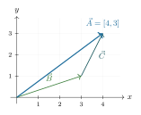
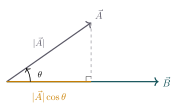
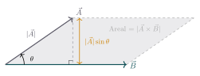

:::: {.oppgaver}

Vi har alt sett at vektorer kan adderes (plusses sammen). I tillegg kan vi multiplisere en vektor med en skalar (et tall), samt multiplisere vektorer sammen. I dette delkapitlet skal vi se på disse operasjonene og hvordan vi tolker dem.

::: {.callout-note title="Definisjon: Vektoraddisjon"}

Addisjon av vektorer gjøres grafisk ved å plassere starten til den andre vektoren i sluttpunktet til den første (hale-til-spiss-metoden). Algebraisk legges komponentene sammen retningsvis: $$\begin{aligned}
    \vec{v}+\vec{u} = [v_x + u_x, \; v_y + u_y]
\end{aligned}$$

:::

::: {.eksempel}
[Eksempel: Vektoraddisjon]{.eks-tittel}

Gitt vektorene $\vec{B} = [3,\,1]$ og $\vec{C} = [1,\,2]$. Finn resultantvektoren $\vec{A} = \vec{B} + \vec{C}$ og beregn lengden $|\vec{A}|$.

::: {.losning}
**Løsning:** Vi legger komponentene sammen retningsvis: $$\begin{aligned}
    \vec{B} &= [3,\,1] = 3\hat{\mathbf{x}} + 1\hat{\mathbf{y}}\\
    \vec{C} &= [1,\,2] = 1\hat{\mathbf{x}} + 2\hat{\mathbf{y}}\\
    \vec{A} &= \vec{B} + \vec{C}
             = (3+1)\hat{\mathbf{x}} + (1+2)\hat{\mathbf{y}}
             = \underline{\underline{[4,\,3]}}.
\end{aligned}$$ Lengden til resultantvektoren er $$|\vec{A}| = \sqrt{4^2 + 3^2} = \sqrt{16 + 9} = \sqrt{25} = \underline{\underline{5}}.$$ Figuren under viser tip-til-hale-metoden: $\vec{C}$ plasseres ved spissen av $\vec{B}$, og $\vec{A}$ er pilen fra starten av $\vec{B}$ til slutten av $\vec{C}$.

::: center
{.tikz-fig style="width:304px"}
:::
:::
:::

## Python: vektoraddisjon {#python-vektoraddisjon .unnumbered}

```{.python .kjor}
import numpy as np

# Definer vektorene som NumPy-arrays
a = np.array([3.0, -1.0])
b = np.array([-1.0, 4.0])

c = a + b # addisjon

print(f"a = {a}")
print(f"b = {b}")
print(f"a + b = {c}")
print(f"|a + b| = {np.linalg.norm(c):.2f}")
```

```{.text .utskrift}
a = [ 3. -1.]
b = [-1. 4.]
a + b = [2. 3.]
|a + b| = 3.61
```

*Kodefil: [K2_vektoraddisjon.ipynb](https://github.com/kosmoben/TRES0312/blob/main/TRES0312%20Python/Kap2_MatematiskeVerktoyViTrenger/K2_vektoraddisjon.ipynb)*

::: {.oppgave tittel="Vektoraddisjon"}
[Vektoraddisjon]{.oppg-tittel}

Gitt vektorene $\vec{a} = [3,\,-1]$ og $\vec{b} = [-1,\,4]$.

a)  Regn ut $\vec{c}=\vec{a} + \vec{b}$ og $\vec{d}=\vec{a} - \vec{b}$.

b)  Finn lengden av $\vec{d}$ og finn en enhetsvektor $\hat{d}$.

c)  Hva slags vektor blir $\vec{d}=3\vec{a}$? Tegn opp begge vektorene.

:::

## Multiplikasjon av vektorer: skalarproduktet {#multiplikasjon-av-vektorer-skalarproduktet .unnumbered}

Skalarproduktet, også kalt prikkproduktet (engelsk: *dot product*), er en operasjon mellom to vektorer som gir et tall (en skalar). Det uttrykker i hvilken grad to vektorer peker i samme retning.

::: {.callout-note title="Definisjon: Skalarprodukt"}

Skalarproduktet av to vektorer $\vec{u} = [u_x,\, u_y]$ og $\vec{v} = [v_x,\, v_y]$ er definert som $$\begin{aligned}
    \vec{u} \cdot \vec{v} = u_x\,v_x + u_y\,v_y.
\end{aligned}$$ Et ekvivalent uttrykk er $$\begin{aligned}
    \vec{u} \cdot \vec{v} = |\vec{u}|\,|\vec{v}|\,\cos\theta,
\end{aligned}$$ der $\theta$ er vinkelen mellom vektorene.

:::

**Geometrisk tolkning**

Skalarproduktet er et mål på *hvor mye to vektorer peker i samme retning.* Tenk deg at vi slår lodd fra spissen av $\vec{A}$ ned på linjen til $\vec{B}$. Loddfoten gir en *projeksjon* med lengde $|\vec{A}|\cos\theta$, og skalarproduktet er denne projeksjonen ganget med $|\vec{B}|$: $$\vec{A}\cdot\vec{B} \;=\;
\underbrace{|\vec{A}|\cos\theta}_{\text{projeksjon av }\vec{A}\text{ på }\vec{B}}
\;\cdot\; |\vec{B}|$$

::: center
{.tikz-fig style="width:349px"}
:::

Spesielle tilfeller: $\theta=0^\circ$ (samme retning) $\Rightarrow$ $\cos\theta=1$ (maksimalt positivt); $\theta=90^\circ$ (vinkelrette) $\Rightarrow$ $\cos\theta=0$; $\theta=180^\circ$ (motsatt retning) $\Rightarrow$ $\cos\theta=-1$ (maksimalt negativt).

Ettersom vinkelen mellom enhetsvektorer i et ortogonalt system er 90°, gir definisjonen over oss følgende resultat: $$\begin{aligned}
\colorbox{black!7}{$\displaystyle
\hat{\mathbf{x}} \cdot \hat{\mathbf{x}} = 1, \qquad
\hat{\mathbf{y}} \cdot \hat{\mathbf{y}} = 1, \qquad
\hat{\mathbf{x}} \cdot \hat{\mathbf{y}} = 0, \qquad
\hat{\mathbf{y}} \cdot \hat{\mathbf{x}} = 0.
$}
\end{aligned}$$ Her har vi brukt at enhetsvektorene har lengde 1, og at $\cos 90° = 0$ og $\cos 0° = 1$.

::: {.eksempel}
[Eksempel: Skalarprodukt]{.eks-tittel}

Finn skalarproduktet av $\vec{u} = 2\hat{\mathbf{x}} + 3\hat{\mathbf{y}}$ og $\vec{v} = 4\hat{\mathbf{x}} - \hat{\mathbf{y}}$.

::: {.losning}
**Løsning:** Vi bruker definisjonen av skalarproduktet, og setter inn komponentene i forhold til enhetsvektorene: $$\begin{aligned}
\vec{u} \cdot \vec{v} &= (2\hat{\mathbf{x}} + 3\hat{\mathbf{y}}) \cdot (4\hat{\mathbf{x}} - \hat{\mathbf{y}}) \\
&= 2\cdot 4 (\hat{\mathbf{x}} \cdot \hat{\mathbf{x}}) + 2\cdot(-1) (\hat{\mathbf{x}} \cdot \hat{\mathbf{y}}) + 3\cdot 4 (\hat{\mathbf{y}} \cdot \hat{\mathbf{x}}) + 3\cdot(-1) (\hat{\mathbf{y}} \cdot \hat{\mathbf{y}}) \\
&= 8\cdot 1 + (-2)\cdot 0 + 12\cdot 0 + (-3)\cdot 1 \\
&= 8 - 3 = \underline{\underline{5}}.
\end{aligned}$$
:::
:::

::: {.eksempel}
[Eksempel: Skalarprodukt og vinkel]{.eks-tittel}

Finn skalarproduktet av $\vec{u} = [3,\,4]$ og $\vec{v} = [1,\,-2]$, og bestem vinkelen mellom dem.

::: {.losning}
**Løsning:** Komponentvis: $$\vec{u}\cdot\vec{v} = 3\cdot 1 + 4\cdot(-2) = 3 - 8 = -5.$$ Størrelsen til vektorene er $|\vec{u}| = \sqrt{3^2+4^2} = 5$ og $|\vec{v}| = \sqrt{1^2+2^2} = \sqrt{5}$. Vinkelen finnes fra $$\cos\theta = \frac{\vec{u}\cdot\vec{v}}{|\vec{u}|\,|\vec{v}|} = \frac{-5}{5\sqrt{5}} = \frac{-1}{\sqrt{5}},$$ altså $\theta = \arccos\!\left(-\dfrac{1}{\sqrt{5}}\right) \approx \underline{\underline{116.6^\circ}}$.
:::
:::

Skalarproduktet gir oss også en alternativ måte å uttrykke lengden til en vektor på. Dersom vi tar skalarproduktet av en vektor $\vec{u}$ med seg selv, er vinkelen mellom vektorene $\theta = 0^\circ$, slik at $\cos\theta = 1$: $$\vec{u}\cdot\vec{u} = |\vec{u}|\,|\vec{u}|\,\cos 0^\circ = |\vec{u}|^2.$$ Dette gir oss en alternativ definisjon av vektorlengden, som vi allerede møtte i Definisjon :

::: {.callout-note title="Definisjon: Vektorlengde via skalarproduktet"}

Lengden til en vektor $\vec{u} = [u_x,\,u_y]$ kan uttrykkes ved skalarproduktet av vektoren med seg selv: $$\begin{aligned}
u = |\vec{u}| = \sqrt{\vec{u}\cdot\vec{u}} = \sqrt{u_x^2 + u_y^2}.
\end{aligned}$$

:::

Vi ser at dette stemmer overens med Definisjon : siden $\vec{u}\cdot\vec{u} = u_x^2+u_y^2$, gir de to definisjonene nøyaktig samme resultat — skalarproduktet av en vektor med seg selv er rett og slett lengden i annen.

## Python: skalarprodukt og vinkel {#python-skalarprodukt-og-vinkel .unnumbered}

```{.python .kjor}
import numpy as np

u = np.array([3.0, 4.0])
v = np.array([1.0, -2.0])

dot = np.dot(u, v)
cos_th = dot / (np.linalg.norm(u) * np.linalg.norm(v))
theta = np.degrees(np.arccos(cos_th))

print(f"u . v = {dot}")
print(f"Vinkel = {theta:.1f} grader")
```

```{.text .utskrift}
u . v = -5.0
Vinkel = 116.6 grader
```

*Kodefil: [K2_skalarprodukt.ipynb](https://github.com/kosmoben/TRES0312/blob/main/TRES0312%20Python/Kap2_MatematiskeVerktoyViTrenger/K2_skalarprodukt.ipynb)*

::: {.oppgave tittel="Skalarprodukt"}
[Skalarprodukt]{.oppg-tittel}

Gitt $\vec{u} = [4,\,3]$ og $\vec{v} = [2,\,-1]$.

a)  Beregn skalarproduktet $\vec{u} \cdot \vec{v}$.

b)  Finn vinkelen mellom $\vec{u}$ og $\vec{v}$.

:::

## Multiplikasjon av vektorer: kryssproduktet {#multiplikasjon-av-vektorer-kryssproduktet .unnumbered}

Kryssprodukt (engelsk: *cross product*) er en operasjon mellom to vektorer som gir en ny vektor vinkelrett på begge. I to dimensjoner reduseres kryssproduktet til et enkelt tall — z-komponenten — som blant annet brukes til å beregne dreiemoment og areal av parallelogrammer. Egentlig defineres kryssproduktet kun i tre dimensjoner, men vi kan bruke det i to dimensjoner ved å anta at vektorene ligger i xy-planet, og at kryssproduktet peker i z-retning.

::: {.callout-note title="Definisjon: Kryssprodukt i 2D"}

For to vektorer $\vec{u} = [u_x,\, u_y]$ og $\vec{v} = [v_x,\, v_y]$ i $xy$-planet peker kryssproduktet i $z$-retning, med størrelse $$\begin{aligned}
    |\vec{u}\times\vec{v}| = u_x\,v_y - u_y\,v_x.
\end{aligned}$$ En ekvivalent definisjon av størrelsen til kryssproduktet er $$\begin{aligned}
    |\vec{u}\times\vec{v}| = |\vec{u}|\,|\vec{v}|\,\sin\theta,
\end{aligned}$$ der $\theta$ er vinkelen mellom vektorene.

:::

Fra definisjonen over kan vi observere noen viktige egenskaper:

-   Dersom $\theta = 0^\circ$ (parallelle vektorer) er kryssproduktet **null**.

-   Dersom $\theta = 90^\circ$ (vinkelrette vektorer) er størrelsen **maksimal**: $|\vec{u}\times\vec{v}|=|\vec{u}|\,|\vec{v}|$.

-   Merk at kryssproduktet *ikke* er kommutativt: $\vec{u}\times\vec{v} = -(\vec{v}\times\vec{u})$.

**Geometrisk tolkning**

Størrelsen på kryssproduktet er lik *arealet av parallellogrammet* som dannes av de to vektorene. Høyden i parallellogrammet er projeksjonen av $\vec{A}$ vinkelrett på $\vec{B}$, gitt ved $|\vec{A}|\sin\theta$: $$|\vec{A}\times\vec{B}| = |\vec{B}| \cdot |\vec{A}|\sin\theta = \text{Areal av parallellogrammet.}$$

::: center
{.tikz-fig style="width:485px"}
:::

::: {.eksempel}
[Eksempel: Kryssprodukt]{.eks-tittel}

Finn kryssproduktet av $\vec{u} = [3,\,4]$ og $\vec{v} = [1,\,-2]$.

::: {.losning}
**Løsning:** $$(\vec{u}\times\vec{v})_z = 3\cdot(-2) - 4\cdot 1 = -6 - 4 = \underline{\underline{-10}}.$$ Negativt fortegn betyr at den resulterende vektoren peker i negativ z-retning (inn i siden av arket).
:::
:::

::: {.oppgave tittel="Kryssprodukt"}
[Kryssprodukt]{.oppg-tittel}

Gitt $\vec{u} = [2,\,1]$ og $\vec{v} = [1,\,3]$.

a)  Finn $(\vec{u} \times \vec{v})_z$.

b)  Finn $(\vec{v} \times \vec{u})_z$.

:::


::::
