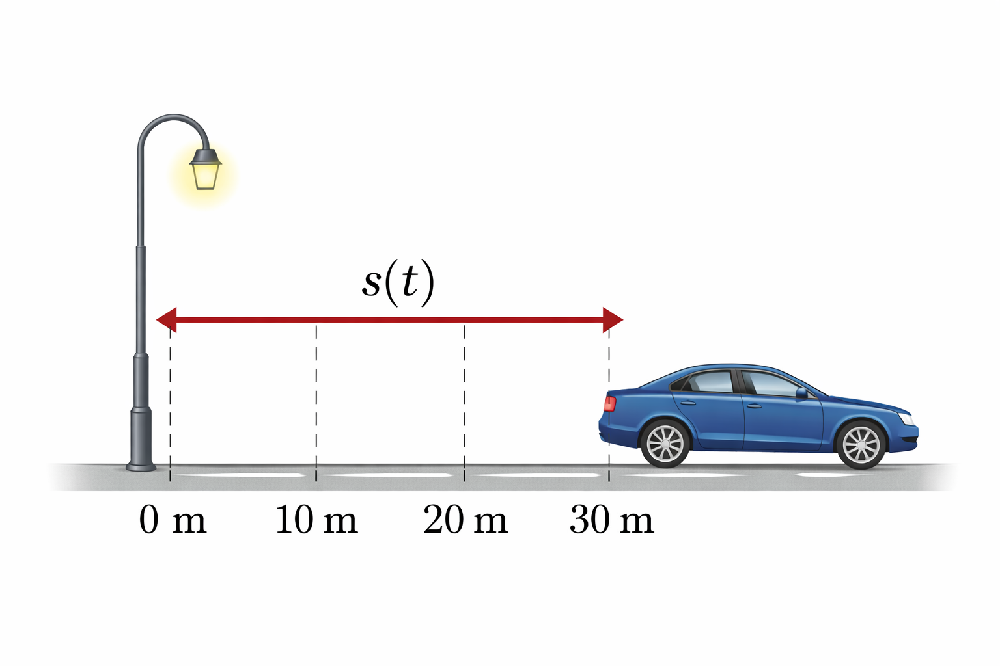
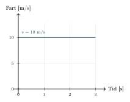
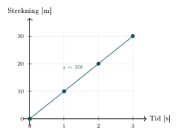
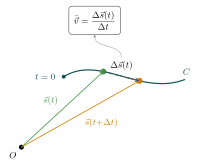
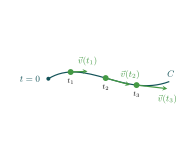
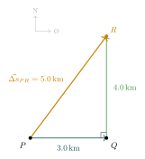
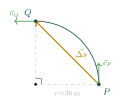
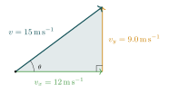
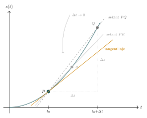

:::: {.oppgaver}



Dersom all bevegelse er langs samme, rette linje så kallder vi bevegelsen *rettlinjet*. I dette tilfellet kan vi beskrive strekning og fart som skalarer, altså uten vektornotasjon. Dersom bevegelsen er krum, må vi bruke vektorer. Dette refererer vi til som *krumlinjet* bevegelse. Vi skal se på begge deler. Merk derfor følgende notasjon:

-   $s$ er strekning, altså størrelsen på **avstandsvektoren** $\vec{s}$. Vi kommer nok til å bruke begrep som *posisjon* og *forflytning* i tillegg til strekning og avstand. Poenget er at vi må gjøre forsljell på $s$ *uten* vektortegn og *med* vektortegn.

-   $v$ kalles **fart** og er størrelsen på **hastighetsvektoren** $\vec{v}$.

-   $a$ er størrelsen på **akselerasjonsvektoren** $\vec{a}$.

En bil som kjører på en rett strekning vekk fra en lyktestolpe tilbakelegger større og større strekning (målt fra lyktestolpen). Vi sier gjerne at strekningen er en funksjon av tid, og skriver $s(t)$:

$$s(t)=\textrm{strekning som funksjon av tid}.$$

:::: figure
{.kompendium-bilde}

::: caption
Eksempel på avstand mellom en lyktestolpe og forbipasserende bil.
:::
::::

Vi kan illustrere beveglesen til bilen med grafer for fart og strekning. La oss anta at bilen holder konstant fart på $v=36\,\mathrm{km}\,\mathrm{h}^{-1}=10\,\mathrm{m}\,\mathrm{s}^{-1}$. Da vil strekningen øke med 10 meter hvert sekund, og grafen for strekning vil være en rett linje som stiger jevnt. Grafen for fart vil være en horisontal linje på 10 m/s, siden farten ikke endrer seg. Dette er illustrert i figuren.

:::: figure
:::: figure
{.tikz-fig style="width:412px"}

::: caption
Fartsgraf $v(t)$
:::
::::

:::: figure
{.tikz-fig style="width:425px"}

::: caption
Posisjonsgraf $s(t)$
:::
::::

::: caption
Fart- og posisjonsgraf for bil som passerer lyktestolpe med konstant hastighet $v = 10\,\mathrm{m/s}$.
:::
::::



Stigningstallet til strekningsgrafen kan vi regne ut momentant ved derivasjon, eller som gjennomsnittet av endring i posisjon over en periode: $$\begin{aligned}
    \textrm{v} = \frac{\Delta\textrm{s}}{\Delta\textrm{t}} = \frac{10\,\mathrm{m}}{1\,\mathrm{s}} = 10\,\mathrm{m}\,\mathrm{s}^{-1}
\end{aligned}$$ Som vi kan se ut ifra grafene, er farten det samme som stigningstallet til strekningsgrafen. Fart er altså størrelsen som beskriver endring i posisjon, og uformelt skriver vi gjerne “trekantformelen” som mange alt har sett:

$$\begin{aligned}
    v=\frac{s}{t}
\end{aligned}$$

::: {.callout-tip title="Til ettertanke"}

Hvordan måler man fart?

:::

Hvilken strekning er det snakk om i formelen over? Og hvilken tid? Når vi skal måle fart i fysikken, så er det alltid over et visst tidsrom, som vi gjerne kaller $\Delta t$. Det kan jo godt være at farten egentlig endret seg underveis i dette tidsrommet, uten at våre målinger fikk det med seg. Et eksempel kan være om du måler tiden Trine bruker på en 60-meter. La oss si at Trine bruker 12 sekunder. Da er den gjennomsnittlige farten hennes $\bar{v}=60\,\mathrm{m}/12\,\mathrm{s}=5\,\mathrm{m}\,\mathrm{s}^{-1}.$ Men det er jo ikke slik å forstå at Trine holdt samme fart hele løpet. I starten var farten gjerne 0m/s, mens den på slutten av løpet kanskje var 10 m/s. Det er derfor viktig å være klar over at når vi snakker om *målt* fart, så handler det alltid om gjennomsnittsfart over et tidsintervall $\Delta t$. Tidsintervallene vi måler på kan være veldig små (slik som i et speedometer), men det er likefullt et gjennomsnitt over dette lille tidsintervallet. For å være litt mer presis definerer vi nå det vi kaller for *gjennomsnittsfart*, som altså er lengden av *gjennomsnittshastighets*-vektoren.

::: {.callout-note title="Definisjon: Gjennomsnittsfart og gjennomsnittshastighet"}

Matematisk kan gjennomsnittshastigheten uttrykkes som: $$\begin{aligned}
        \bar{\vec{v}}= \frac{\vec{\Delta s}}{\Delta t}= \frac{\vec{s}(t+\Delta t) - \vec{s}(t)}{\Delta t}
\end{aligned}$$ hvor $\Delta \vec{s}$ er den totale forflytningen, og $\Delta t$ er den totale tiden. Lengden av denne vektoren kalles for gjennomsnittsfarten, og er gitt ved: $$\begin{aligned}
        \bar{v} = |\bar{\vec{v}}| = \frac{|\vec{\Delta s}|}{\Delta t}
\end{aligned}$$

:::

Gjennomsnitts*fart* beskriver altså størrelsen på den totale forflytningen til et objekt delt på den totale tiden som har gått. Ettersom forflytning er en vektor, så er gjennomsnitts*hastighet* en vektor. Gjennomsnittsfart er derimot en skalar, siden det er lengden av gjennomsnittshastighetsvektoren.

::: {.eksempel}
[Eksempel 3.1: Gjennomsnittsfart i rettlinjet bevegelse]{.eks-tittel}

En bil kjører $60\,\mathrm{km}$ på $1.5\,\mathrm{h}$. Finn gjennomsnittsfarten i km/t. Gjør om til m/s

:::

::: {.callout-note .svar collapse="true" title="Vis løsning"}

Vi bruker definisjonen $\bar{v} = \dfrac{\Delta s}{\Delta t}$: $$\bar{v} = \frac{60\,\mathrm{km}}{1.5\,\mathrm{h}} = \underline{\underline{40\,\mathrm{km}\,\mathrm{h}^{-1}}}$$ Vi bruker omregningsfaktoren $1\,\mathrm{km}\,\mathrm{h}^{-1} = \frac{1\,000\,\mathrm{m}}{3\,600\,\mathrm{s}}$: $$\bar{v} = 40\;\mathrm{km}\,\mathrm{h}^{-1} \cdot \frac{1\,000\,\mathrm{m}}{3\,600\,\mathrm{s}} = \frac{40\,000}{3\,600}\,\mathrm{m}\,\mathrm{s}^{-1} \approx \underline{\underline{11\,\mathrm{m}\,\mathrm{s}^{-1}}}$$

:::

::: {.oppgave tittel="Gjennomsnittsfart i rettlinjet bevegelse"}
[Gjennomsnittsfart i rettlinjet bevegelse]{.oppg-tittel}

En bil kjører $120\,\mathrm{km}$ på $1.5\,\mathrm{h}$.

a)  Finn gjennomsnittsfarten i km/t.

b)  Gjør om til m/s.

c)  En annen bil kjører samme strekning på $90\,\mathrm{min}$. Hvem kjørte raskest?

::: {.losning}

**a)** Vi bruker definisjonen av gjennomsnittsfart, $\bar v = \Delta s/\Delta t$ (se *Gjennomsnittsfart og gjennomsnittshastighet* i kompendiet): $$\bar v = \frac{120\,\mathrm{km}}{1.5\,\mathrm{h}} = \underline{\underline{80\,\mathrm{km}\,\mathrm{h}^{-1}}}$$

**b)** Vi regner om med $1\,\mathrm{km}\,\mathrm{h}^{-1} = \dfrac{1000\,\mathrm{m}}{3600\,\mathrm{s}}$: $$\bar v = 80\;\mathrm{km}\,\mathrm{h}^{-1}\cdot\frac{1000\,\mathrm{m}}{3600\,\mathrm{s}} = 22.2\,\mathrm{m}\,\mathrm{s}^{-1} \approx \underline{\underline{22\,\mathrm{m}\,\mathrm{s}^{-1}}}$$

**c)** Her må vi passe på enhetene: $90\,\mathrm{min} = 1.5\,\mathrm{h}$, altså akkurat samme tid som den første bilen brukte! Den andre bilens gjennomsnittsfart blir dermed $$\bar v_2 = \frac{120\,\mathrm{km}}{1.5\,\mathrm{h}} = 80\,\mathrm{km}\,\mathrm{h}^{-1},$$ som er **nøyaktig like fort** som den første bilen. De to bilene kjørte altså like fort – dette er en påminnelse om at man alltid bør sjekke enhetene nøye før man sammenlikner tall.

:::

:::

## Hastighet og fart i krumlinjet bevegelse {#hastighet-og-fart-i-krumlinjet-bevegelse .unnumbered}

Når et objekt beveger seg krumlinjet, så kommer blir det hele litt mer komplisert enn ved rettlinjet bevegelse. Nå må vi nemlig ta høyde for at forflytningen $\Delta \vec{s}$ endrer retning. Se for deg en kurve gjennom rommet — la oss si det er banen som Erling Braut Haaland følger i en spurt. For ethvert par med tidspunkt så kan vi tegne opp en forskjellsvektor $\Delta\vec{s}$ som viser avstanden mellom posisjonen til Haaland ved de to tidspunktene. Denne vektoren kan vi bruke til å beregne gjennomsnittshastigheten til Haaland mellom de to tidspunktene. Kanskje ser du nå også at dersom vi lar $\Delta t$ gå mot null, så vil $\Delta\vec{s}$ også gå mot null, og vi vil kunne finne den momentane hastigheten til Haaland på et gitt tidspunkt. Denne hastigheten vil for et hvert tidspunkt være tangent til kurva som Haaland løper. Det er som en buss som er ute og kjører. Bussen sin lengde peker alltid i fartsretningen, og hadde vi tegnet en linje gjennom bussen så ville den linja til enhvert tid vært tangent til bussens bane.

:::: figure
{.tikz-fig style="width:387px"}

{.tikz-fig style="width:362px"}

::: caption
Hastighetsvektorene $\vec{v}(t_1)$, $\vec{v}(t_2)$ og $\vec{v}(t_3)$ er tangenter til Haalands løpebane ved tre tidspunkter. Lengre piler indikerer at farten øker gjennom spurten.
:::
::::

I krumlinjet bevegelse er ikke gjennomsnittsfart lenger et like nyttig begrep, dersom vi forstår det som størrelsen på hastighetsvektoren mellom to punkt. Størrelsen på den totale forflytningen dividert med den totale tiden gir nemlig ikke nødvendigvis et riktig inntrykk av hvor fort et legeme faktisk har beveget seg (med mindre tidsintervallet er veldig kort). For eksempel, hvis et objekt beveger seg i en sirkel og returnerer til utgangspunktet, vil den totale forflytningsvektoren være null (prøv å tegne opp $\vec{\Delta s}$ mellom start og slutt!) — og dermed er både gjennomsnittshastigheten *og* gjennomsnittsfarten null, om vi måler over én runde. Men jeg er ganske sikker på at Karsten Warholm har løpt veldig fort rundt friidrettsbanen selv om gjennomsnittsfarten hans er null, målt over hver runde... Problemet oppstår fordi hastighet er definert ut ifra forflytningsvektoren $\vec{\Delta s}$. Dermed får også farten, som er størrelsen på hastighetsvektoren, det samme problemet. Det er derfor nyttig å innføre et begrep til, kalt *banefart*. Dette er farten som et legeme har til enhver tid langs den buen, eller banen, det beveger seg.

::: {.callout-note title="Definisjon: Banefart"}

Banefarten $v$ er strekning tilbakelagt i en bane, dividert med tiden brukt på strekningen.

:::

Her ser vi altså ikke på netto forflytning, men summativ forflytning. Merk at vi bruker samme symbol som ellers (for fart). Så får vi heller la sammenhengen gjøre det klart hvilket begrep som er hensiktsmessig å bruke. La oss ta et par eksempler som illustrerer forskjellen.

::: {.eksempel}
[Eksempel 3.2: Båt på havet]{.eks-tittel}

To båter skal seile fra punkt $P$ til punkt $R$. Båt 1 seiler i en rett linje fra $P$ til $R$ og bruker 2.0 timer på seilasen. Båt 2 seiler først 3.0 km øst til punktet $Q$ og deretter 4.0 km nord fra $Q$ til $R$. Den bruker 1.0 time på seilasen øst og 1.0 time på seilasen nord.\
**a)** Skriv ned avstandsvektorene $\vec{\Delta s}_\text{PQ}$, $\vec{\Delta s}_\text{QR}$ og $\vec{\Delta s}_\text{PR}$ som beskriver de relevante forflytningene.\
**b)** Bruk svarene fra a) til å skrive ned tilhørende hastighetsvektorer $\vec{v}_\text{PQ}$, $\vec{v}_\text{QR}$ og $\vec{v}_\text{PR}$.\
**c)** Hva er gjennomsnittsfarten til båt 1 (lengden av hastighetsvektoren)?\
**d)** Hva er gjennomsnittsfarten til båt 2 på hver av de to delstrekningene? Hva er den totale gjennomsnittsfarten til båt 2?\
**e)** Hva er gjennomsnittlig banefart til båt 2 på hele strekningen?

:::

::: {.callout-note .svar collapse="true" title="Vis løsning"}

::: center
{.tikz-fig style="width:312px"}
:::

1.  Forflytningsvektorene (se figur): $$\vec{\Delta s}_{PQ}=[3.0,\;0]\,\mathrm{km},\quad
                \vec{\Delta s}_{QR}=[0,\;4.0]\,\mathrm{km},\quad
                \vec{\Delta s}_{PR}=[3.0,\;4.0]\,\mathrm{km}$$

2.  Hastighetsvektorene finner vi ved å dele hver forflytning på tiden som ble brukt på den etappen: $$\vec{v}_{PQ}=\frac{\vec{\Delta s}_{PQ}}{1.0\,\mathrm{h}}=[3.0,\;0]\,\mathrm{km}\,\mathrm{h}^{-1},\quad
                \vec{v}_{QR}=\frac{\vec{\Delta s}_{QR}}{1.0\,\mathrm{h}}=[0,\;4.0]\,\mathrm{km}\,\mathrm{h}^{-1}$$ $$\vec{v}_{PR}=\frac{\vec{\Delta s}_{PR}}{2.0\,\mathrm{h}}=[1.5,\;2.0]\,\mathrm{km}\,\mathrm{h}^{-1}$$

3.  Båt 1 seiler direkte fra $P$ til $R$, så gjennomsnittsfarten er nettopp lengden av $\vec{v}_{PR}$ fra b): $$\bar{v}_1=|\vec{v}_{PR}|=\sqrt{1.5^2+2^2}= \underline{\underline{2.5\,\mathrm{km}\,\mathrm{h}^{-1}}}$$

4.  Gjennomsnittsfart per etappe for båt 2 er lengden av de tilhørende hastighetsvektorene fra b): $$\bar{v}_{PQ}=|\vec{v}_{PQ}|=3.0\,\mathrm{km}\,\mathrm{h}^{-1},\quad\bar{v}_{QR}=|\vec{v}_{QR}|=4.0\,\mathrm{km}\,\mathrm{h}^{-1}$$ Den *totale* gjennomsnittsfarten regnes derimot fra totalforflytningen over hele tiden — altså igjen lengden av $\vec{v}_{PR}$: $$\bar{v}_2=|\vec{v}_{PR}|= \underline{\underline{2.5\,\mathrm{km}\,\mathrm{h}^{-1}}}$$ Selv om båt 2 hadde ulik fart på de to etappene, er den totale gjennomsnittsfarten altså identisk med båt 1. Gjennomsnittsfart (forstått som lengden på hastighetsvektoren) avhenger kun av total forflytning og total tid — ikke av hvordan hastighetsvektoren kan ha endret størrelse og retning underveis. Vi ser at det er ikke denne farten vi er interessert i. Det egentlig interessante fartsbegrepet i akkurat denne sammenheng, er banefarten, som vi ser på i neste deloppgave.

5.  Den gjennomsnittlige banefarten ser i stedet på hvor langt båt 2 faktisk har seilt, uavhengig av retning: $$v_{\text{bane},2}=\frac{3.0\,\mathrm{km}+4.0\,\mathrm{km}}{2.0\,\mathrm{h}}= \underline{\underline{3.5\,\mathrm{km}\,\mathrm{h}^{-1}}},$$ altså høyere enn gjennomsnittsfarten på $2.5\,\mathrm{km}\,\mathrm{h}^{-1}$ — nettopp fordi båt 2 seilte en lengre vei enn den rette linja fra $P$ til $R$.

:::

Fra eksemplet over, med båtene, ser vi at når vi ikke lenger har en rettlinjet bevegelse, så er det nødvendig med en presisering. **Vi må skille mellom total forflytning og strekning**. Forflytning er en vektor som beskriver endring i posisjon, mens strekning er en skalar som beskriver hvor langt et objekt faktisk har beveget seg, om vi summerer forflytninger langs banen.

::: {.eksempel}
[Eksempel 3.3: Karsten Warholm]{.eks-tittel}

Se for deg at Karsten Warholm løper med konstant fart gjennom en sving. Etter 7.0 sekunder har han løpt fra inngangen av svingen (punkt $P$) til midten (punkt $Q$). Radiusen i svingen er 36 meter.\
**a)** Finn $\vec{\Delta s}$ mellom punktene $P$ og $Q$ og beregn gjennomsnittshastigheten og gjennomsnittsfarten på forflytningen $PQ$.\
**b)** Beregn banefarten til Karsten gjennom svingen, når du vet at han egentlig løper en kvart sirkelbane.

:::

::: {.callout-note .svar collapse="true" title="Vis løsning"}

::: center
{.tikz-fig style="width:236px"}
:::

1.  Vi legger origo i sentrum av svingen, med $P$ på $x$-aksen og $Q$ på $y$-aksen, slik at $P=(36,\,0)\,\mathrm{m}$ og $Q=(0,\,36)\,\mathrm{m}$. Forflytningsvektoren fra $P$ til $Q$ blir da: $$\vec{\Delta s}_{PQ}=Q-P=\underline{\underline{[-36,\;36]\,\mathrm{m}}}$$ med størrelse $$|\vec{\Delta s}_{PQ}|=\sqrt{36^2+36^2}=36\sqrt{2}\approx \underline{50.9\,\mathrm{m}}.$$ Gjennomsnittshastigheten er forflytningen delt på tiden: $$\vec{\bar{v}}=\frac{\vec{\Delta s}_{PQ}}{7.0\,\mathrm{s}}\approx [-5.14,\;5.14]\,\mathrm{m}\,\mathrm{s}^{-1} \approx \underline{\underline{[-5.1,\;5.1]\,\mathrm{m}\,\mathrm{s}^{-1}}}$$ og gjennomsnittsfarten er størrelsen på denne vektoren: $$\bar{v}=|\vec{\bar{v}}|=\frac{|\vec{\Delta s}_{PQ}|}{7.0\,\mathrm{s}}\approx \underline{\underline{7.3\,\mathrm{m}\,\mathrm{s}^{-1}}}$$ Dette virker påfallende lavt til å beskrive en toppidrettsutøver som spurter gjennom en sving — vi undersøker hvorfor i b).

2.  Farten $|\vec{v}|$ til Karsten er konstant hele veien, men siden banen er krum, er strekningen han faktisk løper lengre enn forflytningen $|\vec{\Delta s}_{PQ}|$ fra a). Buelengden langs en kvart sirkel er: $$\Delta s=\tfrac{1}{4}\cdot 2\pi r=\tfrac{\pi\cdot 36}{2}=18\pi\approx \underline{56.5\,\mathrm{m}}$$ Banefarten bruker denne strekningen — altså hvor langt Karsten faktisk har løpt — i stedet for forflytningen: $$v_{\text{bane}}=\frac{18\pi\,\mathrm{m}}{7.0\,\mathrm{s}}\approx \underline{\underline{8.1\,\mathrm{m}\,\mathrm{s}^{-1}}}$$ Banefarten på $8.1\,\mathrm{m}\,\mathrm{s}^{-1}$ er altså høyere enn gjennomsnittsfarten på $7.3\,\mathrm{m}\,\mathrm{s}^{-1}$ fra a) — nettopp fordi gjennomsnittsfarten kun ser på nettoforflytningen $PQ$, og ikke fanger opp at Karsten faktisk løper en lengre, krum bane. Gjennomsnittsfarten, forstått som lengden av hastighetsvektoren,er derfor et dårlig mål på farten hans når tidsintervallet vi tar gjennomsnittet over, blir for stort.

:::

::: {.callout-important title="Merk: Hva mener vi med “gjennomsnittsfart”?"}

Begrepet “gjennomsnittsfart” er altså et generisk, litt utydelig begrep. Ut ifra sammenhengen må vi forstå om det er snakk om størrelsen til hastighetsvektoren, eller banefarten.

:::

La oss tilslutt ta med et eksempel der vi vet retningen til en hastighetsvektor og skal finne komponentene. Denne type beregning så vi også på i forrige kapittel.

::: {.eksempel}
[Eksempel 3.4: Dekomponering av hastighet]{.eks-tittel}

En fugl flyr med fart $v = 15\,\mathrm{m}\,\mathrm{s}^{-1}$ i en retning som utgjør $\theta = 37°$ over horisontalplanet ($\cos 37° \approx 0.80$, $\sin 37° \approx 0.60$).\
**a)** Finn den horisontale komponenten $v_x$ og den vertikale komponenten $v_y$ av hastigheten.\
**b)** Verifiser at $|\vec{v}| = \sqrt{v_x^2 + v_y^2} = 15\,\mathrm{m}\,\mathrm{s}^{-1}$.

:::

::: {.callout-note .svar collapse="true" title="Vis løsning"}

1.  Vi dekomponerer langs de to aksene (se figur): $$v_x = v\cos\theta = 15\cdot 0.80 = \underline{\underline{12\,\mathrm{m}\,\mathrm{s}^{-1}}}$$ $$v_y = v\sin\theta = 15\cdot 0.60 = \underline{\underline{9.0\,\mathrm{m}\,\mathrm{s}^{-1}}}$$

2.  Pythagoras bekrefter: $$\sqrt{v_x^2+v_y^2}=\sqrt{12^2+9^2}=\sqrt{144+81}=\sqrt{225}= \underline{\underline{15\,\mathrm{m}\,\mathrm{s}^{-1}}}\;\checkmark$$

Merk at dette er det samme $9$-$12$-$15$-trekantforholdet (skalert $3$-$4$-$5$) som dukket opp i eksempel 3.2, men nå brukt til å gå fra totalfart til komponenter.

{.tikz-fig style="width:360px"}

:::

### Momentanfart

Fra eksemplet med de to båtene, samt Karsten Warholm, så ser vi at hva gjennomsnittsfarten er (forstått som lengden av hastighetsvektoren) er veldig avhengig av hvor ofte vi måler. Desto kortere tidsintervall vi måler på, desto mer interessant blir resultatet. I praksis kan vi ofte måle posisjonen til et legeme veldig ofte, og dermed kan vi finne ut hva farten er på et gitt tidspunkt. Dette kaller vi for *momentanhastighet*. Lengden av momentanhastigheten kaller vi *momentanfart*. Dette er et veldefinert og nyttig begrep.

Momentanhastighet er hastigheten til et objekt på et spesifikt tidspunkt. Det beskriver hvor raskt et objekt beveger seg i akkurat det øyeblikket, og er derfor den “øyeblikkelige” hastigheten.

Geometrisk kan vi forstå dette ved å betrakte posisjonskurven $s(t)$: gjennomsnittsfarten over intervallet $[t_0,\,t_0+\Delta t]$ er stigningstallet til *sekantlinjen* gjennom punktene $(t_0,\,s(t_0))$ og $(t_0+\Delta t,\,s(t_0+\Delta t))$. Lar vi $\Delta t \to 0$, vil sekantlinjen nærme seg *tangentlinjen* ved $t_0$ (se figuren under). Stigningstallet til tangentlinjen er nettopp den deriverte, og vi skriver: $$v(t_0)
  = \lim_{\Delta t \to 0} \frac{\Delta s}{\Delta t}
  = \frac{ds}{dt}\bigg|_{t=t_0}$$

::: center
{.tikz-fig style="width:573px"}
:::

::: {.callout-note title="Definisjon: Momentanhastighet"}

Matematisk kan momentanfart finnes ved å ta den deriverte av posisjonen med hensyn til tid: $$\begin{aligned}
        \vec{v} &= \frac{d\vec{s}}{dt}
\end{aligned}$$ Dette gir oss hastigheten nøyaktig i det øyeblikket vi er interessert i.

:::

::: {.eksempel}
[Eksempel 3.5: Speedometer]{.eks-tittel}

Tenk deg at du kjører bil og ser på speedometeret. Hastigheten som vises på speedometeret er (så godt som) momentanhastigheten din. Den kan endre seg fra ett sekund til et annet hvis du akselererer eller bremser.

:::

Den store forskjellen mellom momentanfart og gjennomsnittsfart er at momentanfart ser på hastigheten i et spesifikt øyeblikk, mens gjennomsnittsfart ser på den totale bevegelsen over tid. Momentanfarten kan variere kraftig under en bevegelse, mens gjennomsnittsfarten gir en enkel verdi som representerer hele bevegelsen.

::: {.eksempel}
[Eksempel 3.6: Momentanhastighet]{.eks-tittel}

Posisjonen til en firhjuling på et jorde er gitt ved $\vec{s}(t) = (2t^2, 3t)$ i meter og sekunder.\
**a)** Vis at uttrykket for momentanhastigheten $\vec{v}(t)$ til firhjulingen er gitt ved $\vec{v}(t) = (4t, 3)$.\
**b)** Hva er momentanhastigheten ved $t = 2\,\mathrm{s}$?\
**c)** Ved hvilken tid er momentanhastigheten $\vec{v} = (16, 12)\,\mathrm{m}\,\mathrm{s}^{-1}$?

:::

::: {.callout-note .svar collapse="true" title="Vis løsning"}

a)  Vi deriverer hver komponent for seg med potensregelen $\frac{d}{dt}(t^n) = nt^{n-1}$: $$\vec{v}(t) = \left(\frac{d}{dt}(2t^2),\ \frac{d}{dt}(3t)\right) = (4t,\ 3)
          \quad\checkmark$$

b)  Vi setter inn $t = 2\,\mathrm{s}$: $$\vec{v}(2) = (4\cdot 2,\ 3) = \underline{\underline{(8,\ 3)\,\mathrm{m}\,\mathrm{s}^{-1}}}$$

c)  $x$-komponenten gir $4t = 16$, altså $t = 4\,\mathrm{s}$. Men $y$-komponenten er alltid $3\,\mathrm{m}\,\mathrm{s}^{-1}$, og blir aldri $12\,\mathrm{m}\,\mathrm{s}^{-1}$. Firhjulingen har derfor **aldri** hastigheten $(16, 12)\,\mathrm{m}\,\mathrm{s}^{-1}$.

:::

::: {.oppgave tittel="Momentanhastighet"}
[Momentanhastighet]{.oppg-tittel}

Et legeme beveger seg etter posisjonslikningen $s(t) = 3t^2 + 2t$ (i meter og sekunder).

a)  For den som kan derivere: Vis at momentanfarten er gitt ved $v(t) = 6t + 2$.

b)  Hva er momentanhastigheten ved $t = 2\,\mathrm{s}$?

c)  Ved hvilken tid er momentanfarten $v = 20\,\mathrm{m}\,\mathrm{s}^{-1}$?

::: {.losning}

**a)** Momentanfarten er den deriverte av posisjonen med hensyn til tid (se *Momentanhastighet* i kompendiet), $v(t) = ds/dt$. Vi deriverer $s(t) = 3t^2+2t$ ledd for ledd med potensregelen $\frac{d}{dt}(t^n) = nt^{n-1}$: $$v(t) = \frac{d}{dt}\left(3t^2\right) + \frac{d}{dt}\left(2t\right) = 2\cdot 3t + 2 = \underline{\underline{6t+2}} \quad\checkmark$$

**b)** Vi setter inn $t=2\,\mathrm{s}$: $$v(2) = 6\cdot 2 + 2 = \underline{\underline{14\,\mathrm{m}\,\mathrm{s}^{-1}}}$$

**c)** Vi løser likningen $v(t) = 20$ for $t$: $$6t+2 = 20 \quad\Rightarrow\quad 6t = 18 \quad\Rightarrow\quad t = \underline{\underline{3\,\mathrm{s}}}$$

:::

:::

::: {.callout-note .svar collapse="true" title="Vis løsning"}

a)  Vi deriverer $s(t) = 3t^2 + 2t$ ledd for ledd med potensregelen $\frac{d}{dt}(t^n) = nt^{n-1}$: $$v(t) = \frac{ds}{dt} = 3 \cdot 2t^{2-1} + 2 \cdot 1 = 6t + 2\,\mathrm{m}\,\mathrm{s}^{-1}
          \quad\checkmark$$

b)  Vi setter inn $t = 2\,\mathrm{s}$: $$v(2) = 6 \cdot 2 + 2 = 12 + 2 = \underline{\underline{14\,\mathrm{m}\,\mathrm{s}^{-1}}}$$

c)  Vi løser likningen $v(t) = 20\,\mathrm{m}\,\mathrm{s}^{-1}$: $$6t + 2 = 20
          \implies 6t = 18
          \implies t = \underline{\underline{3\,\mathrm{s}}}$$

:::

### Konstant fart

Vi kan tilslutt merke oss at desom farten ikke endrer seg, men er konstant, da er *momentanfarten* til enhver tid den samme som *gjennomsnittlig banefart*.

::: {.oppgave tittel="Konstant hastighet"}
[Konstant hastighet]{.oppg-tittel}

En syklist kjører med konstant fart $v = 8.0\,\mathrm{m}\,\mathrm{s}^{-1}$ i rettlinjet bevegelse.

a)  Hvor langt har syklisten kjørt etter $t = 10\,\mathrm{s}$?

b)  Hvor langt har syklisten kjørt etter $t = 2\,\mathrm{min}$?

c)  Hvor lang tid tar det å tilbakelegge $s = 2.0\,\mathrm{km}$?

::: {.losning}

Farten er konstant, $v=8.0\,\mathrm{m}\,\mathrm{s}^{-1}$, så vi bruker den enkle sammenhengen $s = v\cdot t$ (spesialtilfellet av posisjonslikningen i avsnitten når $a=0$ og $s_0=0$).

**a)** Med $t=10\,\mathrm{s}$: $$s = 8.0\,\mathrm{m}\,\mathrm{s}^{-1}\cdot10\,\mathrm{s} = \underline{\underline{80\,\mathrm{m}}}$$

**b)** Vi regner om $t=2\,\mathrm{min} = 120\,\mathrm{s}$: $$s = 8.0\,\mathrm{m}\,\mathrm{s}^{-1}\cdot120\,\mathrm{s} = \underline{\underline{9.6\cdot 10^{2}\,\mathrm{m}}}$$

**c)** Vi løser $s=v\cdot t$ for $t$: $$t = \frac{s}{v} = \frac{2.0\,\mathrm{km}}{8.0\,\mathrm{m}\,\mathrm{s}^{-1}} = \frac{2000\,\mathrm{m}}{8.0\,\mathrm{m}\,\mathrm{s}^{-1}} = \underline{\underline{2.5\cdot 10^{2}\,\mathrm{s}}}$$

:::

:::

::: {.oppgave tittel="En oppgave til"}
[En oppgave til]{.oppg-tittel}

En båt beveger seg med fart $v=5.0$ knopp i Nord-Østlig retning. Én knop er definert som $1.852$ km/h.

a)  Finn farta i nordlig retning ($v_\text{N}$) og farta i østlig retning ($v_\text{Ø}$).

b)  Oppgi farten $v$ i km/h.

::: {.losning}

Vi regner først om farten til km/h, siden $1$ knop $=1.852\,\mathrm{km}\,\mathrm{h}^{-1}$: $$v = 5.0\cdot1.852\,\mathrm{km}\,\mathrm{h}^{-1} = 9.26\,\mathrm{km}\,\mathrm{h}^{-1}$$

**a)** Nord-øst betyr en retning nøyaktig mellom nord og øst, altså en vinkel på $45^\circ$ fra nord-aksen. Vi dekomponerer farten (se *Dekomponering av vektorer* i kompendiet) i nordlig og østlig komponent: $$v_\text{N} = v\cos(45^\circ) = 9.26\,\mathrm{km}\,\mathrm{h}^{-1}\cdot\cos(45^\circ) = 6.55\,\mathrm{km}\,\mathrm{h}^{-1} \approx \underline{\underline{6.5\,\mathrm{km}\,\mathrm{h}^{-1}}}$$ $$v_\text{Ø} = v\sin(45^\circ) = 9.26\,\mathrm{km}\,\mathrm{h}^{-1}\cdot\sin(45^\circ) = 6.55\,\mathrm{km}\,\mathrm{h}^{-1} \approx \underline{\underline{6.5\,\mathrm{km}\,\mathrm{h}^{-1}}}$$ Komponentene blir like store, siden retningen ligger nøyaktig mellom nord og øst.

**b)** Farten i km/h fant vi allerede over: $$v = 9.26\,\mathrm{km}\,\mathrm{h}^{-1} \approx \underline{\underline{9.3\,\mathrm{km}\,\mathrm{h}^{-1}}}$$

:::

:::

::::
