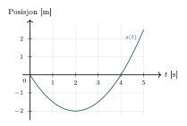
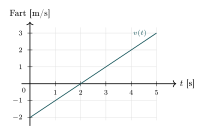
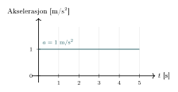
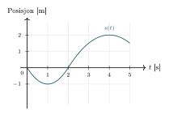
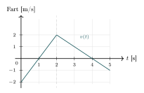
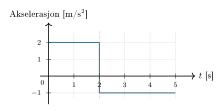

:::: {.oppgaver}



Vi har så langt sett at endringen i strekning kalles fart. Men hva kalles endring i fart? Jo, det kalles *akselerasjon*. Eller mer presist, så er akselerasjon et mål på endring i hastighet. Og hastighet har både størrelse og retning (er en vektor). Derfor handler akselerasjon om endring både av fartens størrelse og retning. Hvis akselerasjonen er positiv, øker objektets hastighet, mens en negativ akselerasjon (ofte kalt retardasjon, deselerasjon eller bare bremsing) betyr at hastigheten minker.

::: {.callout-tip title="Til ettertanke"}

Hva tenker du om størrelse og retning på akselerasjonen i følgende to tilfeller?\
(I) En racerbil kjører med konstant fart på et rett strekke.\
(II) En racerbil kjører med konstant fart gjennom en sving.

:::

:::: figure
{.tikz-fig style="width:404px"}

{.tikz-fig style="width:397px"}

{.tikz-fig style="width:433px"}

------------------------------------------------------------------------

{.tikz-fig style="width:404px"}

{.tikz-fig style="width:397px"}

{.tikz-fig style="width:433px"}

::: caption
Posisjon, fart og akselerasjon ved *varierende* akselerasjon ($s_0=0$, $v_0=-2\,\mathrm{m/s}$; $a_1=2\,\mathrm{m/s}^2$ for $t\in[0,2\,\mathrm{s}]$ og $a_2=-1\,\mathrm{m/s}^2$ for $t\in[2,5\,\mathrm{s}]$).
:::
::::

På samme vis som for fart, så definerer vi også for akselerasjon det vi kaller *gjennomsnittsakselerasjon*, som altså handler om å måle hastighetsendring over et tidsintervall.

::: {.callout-note title="Definisjon: Gjennomsnittsakselerasjon"}

Gjennomsnittsakselerasjonen over et tidsintervall $\Delta t$ er definert som endringen i hastighetsvektoren delt på tidsintervallet: $$\begin{aligned}
        \bar{\vec{a}} = \frac{\Delta \vec{v}}{\Delta t} = \frac{\vec{v}(t+\Delta t) - \vec{v}(t)}{\Delta t}
\end{aligned}$$ Størrelsen $|\bar{\vec{a}}|$ kalles gjennomsnittlig akselerasjon, og enheten er m/s$^2$.

:::

*Momentanakselerasjonen* er da grenseverdien av gjennomsnittsakselerasjonen når tidsintervallet $\Delta t$ går mot null. Dette gir oss den eksakte akselerasjonen i et spesifikt øyeblikk, og kan uttrykkes som den deriverte av hastighetsvektoren med hensyn til tid, eller den andrederiverte av posisjonsvektoren med hensyn til tid.

::: {.callout-note title="Definisjon: Momentanakselerasjon"}

Momentanakselerasjonen er grenseverdien av gjennomsnittsakselerasjonen når $\Delta t \to 0$, det vil si den deriverte av hastighetsvektoren – eller den andrederiverte av posisjonsvektoren – med hensyn til tid: $$\begin{aligned}
        \vec{a} = \lim_{\Delta t \to 0}\frac{\Delta \vec{v}}{\Delta t} = \frac{d\vec{v}}{dt} = \frac{d^2\vec{s}}{dt^2}
\end{aligned}$$ Akselerasjonen er altså en vektor: den har både størrelse og retning. I figurene og kan vi lese av akselerasjonen som stigningstallet til $v(t)$-kurven.

:::

Figurene og illustrerer sammenhengen mellom strekning, fart og akselerasjon godt.I hvert panel viser øverste graf posisjonen $s(t)$, midterste graf farten $v(t)$, og nederste graf akselerasjonen $a(t)$. Legg merke til at fartsgrafens stigningstall til enhver tid tilsvarer verdien på akselerasjonsgrafen, og at posisjonsgrafens stigningstall tilsvarer verdien på fartsgrafens graf – slik det følger av derivasjonsrelasjonen.

**Konstant akselerasjon** Når akselerasjonen er konstant, vil gjennomsnittsakselerasjon og momentanakselerasjon være identiske.

::: {.oppgave tittel="Akselerasjon"}
[Akselerasjon]{.oppg-tittel}

En bil øker farten fra $v_0 = 20\,\mathrm{m}\,\mathrm{s}^{-1}$ til $v = 30\,\mathrm{m}\,\mathrm{s}^{-1}$ på $\Delta t = 5.0\,\mathrm{s}$.

a)  Finn gjennomsnittsakselerasjonen.

b)  Er akselerasjonen positiv eller negativ? Hva betyr det?

c)  Dersom akselerasjonen er konstant, hva er farten etter ytterligere $3.0\,\mathrm{s}$?

::: {.losning}

**a)** Gjennomsnittsakselerasjonen er endring i fart delt på tidsintervallet (se *Gjennomsnittsakselerasjon* i kompendiet): $$\bar a = \frac{\Delta v}{\Delta t} = \frac{v-v_0}{\Delta t} = \frac{30\,\mathrm{m}\,\mathrm{s}^{-1}-20\,\mathrm{m}\,\mathrm{s}^{-1}}{5.0\,\mathrm{s}} = \underline{\underline{2.0\,\mathrm{m}\,\mathrm{s}^{-2}}}$$

**b)** Akselerasjonen er **positiv**. Det betyr at farten øker – bilen aksellererer (i vanlig forstand), den bremser ikke.

**c)** Dersom akselerasjonen er konstant, bruker vi hastighetslikningen (Likning 1 i avsnitten), $v = v_0+at$, med ny starttid og startfart $v_0' = 30\,\mathrm{m}\,\mathrm{s}^{-1}$ og $t=3.0\,\mathrm{s}$: $$v = 30\,\mathrm{m}\,\mathrm{s}^{-1} + 2.0\,\mathrm{m}\,\mathrm{s}^{-2}\cdot3.0\,\mathrm{s} = \underline{\underline{36\,\mathrm{m}\,\mathrm{s}^{-1}}}$$

:::

:::

::::
