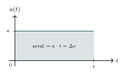
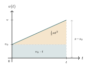
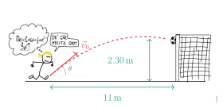
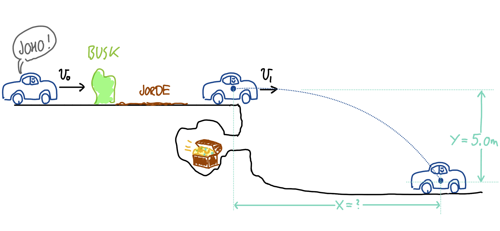

:::: {.oppgaver}



Noen ganger er akselerasjonen konstant, $a = \mathrm{konst.}$ Dette er en god antakelse i mange situasjoner, slik som fritt fall eller jevn bremsing.Bevegelseslikningene kan da utledes geometrisk ved hjelp av *arealet under grafen*: arealet under $a(t)$-grafen gir endring i fart, og arealet under $v(t)$-grafen gir forflytning.

::: center
{.tikz-fig style="width:350px"}

**(a)** $a(t)$-grafen. Arealet av rektangelet er endringen i fart: $\Delta v = v - v_0$.

{.tikz-fig style="width:353px"}

**(b)** $v(t)$-grafen. Trapesarealet (rektangel $+$ trekant) er forflytningen: $\Delta s = s - s_0$.
:::

**Likning 1 – Hastighetslikningen.** Siden $a(t) = a$ er konstant, er akselerasjonsgrafen en horisontal linje (figur (a)). Arealet av rektangelet under grafen er lik endringen i fart: $$a \cdot t \;=\; \Delta v \;=\; v - v_0.$$ Løser vi for $v$ får vi: $$\begin{aligned}
  \colorbox{black!7}{$\displaystyle v = v_0 + at$}
\end{aligned}$$

**Likning 2 – Posisjonslikningen.** Fartsgrafen $v(t) = v_0 + at$ er en stigende rett linje (figur (b)). Arealet under den – trapeset fra $0$ til $t$ – er forflytningen $\Delta s = s - s_0$. Vi deler trapeset i to deler: et rektangel med bredde $t$ og høyde $v_0$ (areal $= v_0\,t$), og en trekant med base $t$ og høyde $at$ (areal $= \tfrac{1}{2}at^2$). Totalt: $$s - s_0 \;=\; v_0\,t + \tfrac{1}{2}at^2,$$ altså: $$\begin{aligned}
  \colorbox{black!7}{$\displaystyle s = s_0 + v_0\,t + \tfrac{1}{2}at^2$}
\end{aligned}$$

**Likning 3 – Fart-strekning-likningen.** Likning 3 følger algebraisk av likning 1 og 2. Fra likning 1 er $t = (v - v_0)/a$. Setter vi dette inn i likning 2: $$\begin{aligned}
  s - s_0
  &= v_0\cdot\frac{v-v_0}{a} + \tfrac{1}{2}a\left(\frac{v-v_0}{a}\right)^2
   = \frac{v_0(v-v_0)}{a} + \frac{(v-v_0)^2}{2a}
   = \frac{(v-v_0)\bigl(2v_0 + v - v_0\bigr)}{2a}
   = \frac{v^2 - v_0^2}{2a}.
\end{aligned}$$ Multipliserer vi med $2a$: $$\begin{aligned}
  \colorbox{black!7}{$\displaystyle 2a(s-s_0) = v^2 - v_0^2$}
\end{aligned}$$

**Likning 4 – Gjennomsnittshastighetslikningen.** Et trapes med parallelle sider $v_0$ og $v$ har gjennomsnittshøyde $(v_0 + v)/2$. Arealet (forflytningen) kan derfor skrives: $$\begin{aligned}
  \colorbox{black!7}{$\displaystyle s - s_0 = \frac{v_0 + v}{2}\cdot t$}
\end{aligned}$$ Dette viser at gjennomsnittshastigheten ved konstant akselerasjon er gjennomsnittet av start- og sluttfarten: $\bar{v} = (v_0 + v)/2$.

Selv om vi nå har utledet formlene over ved hjelp av de skalare størrelsene, sp gjelder de samme relasjonene også for krumlinjet bevegelse, hvor vi altså må benytte vektorer. I oppsumeringen under har vi derfor skrevet likningene i vektorform, slik at de gjelder for alle typer bevegelse – både rettlinjet og krumlinjet.

::: {.callout-note title="Bevegelseslikningene ved konstant akselerasjon"}
**1. Hastighetslikningen** gir hastighetsvektoren som funksjon av tid: $$\begin{aligned}
        \vec{v} = \vec{v}_0 + \vec{a}\,t
\end{aligned}$$

**2. Posisjonslikningen** gir posisjonsvektoren som funksjon av tid: $$\begin{aligned}
        \vec{s} = \vec{s}_0 + \vec{v}_0\,t + \tfrac{1}{2}\vec{a}\,t^2
\end{aligned}$$

**3. Fart-strekning-likningen** kopler fart og posisjon uten tid: $$\begin{aligned}
       |\vec{v}|^2 = |\vec{v}_0|^2 + 2\,\vec{a} \cdot (\vec{s} - \vec{s}_0)
\end{aligned}$$

**4. Gjennomsnittshastighetslikningen** (gjelder kun ved konstant $\vec{a}$): $$\begin{aligned}
        \vec{s} - \vec{s}_0 = \frac{\vec{v}_0 + \vec{v}}{2}\,t, \qquad \bar{\vec{v}} = \frac{\vec{v}_0 + \vec{v}}{2}
\end{aligned}$$
:::

I spesialtilfellet med rettlinjet bevegelse (bevegelse langs én akse) trenger vi selvsagt ikke vektortegnene, siden retningen uttrykkes fullt ut ved fortegnet til de skalare størrelsene. Da er det de opprinnelige, skalare likningene — slik vi utledet dem tidligere i dette avsnittet — som gjelder.

Vi setter dessuten ofte $s_0 = 0$ i praksis, ettersom $s_0$ bare er startposisjonen — og vi kan alltid velge koordinatsystemet slik at bevegelsen starter i origo.

::: {.callout-tip title="Tips: Alternativ utledning med integrasjon"}

Likning 1 og 2 kan også utledes ved integrasjon. Siden $a$ er konstant, integrerer vi over tid: $$v(t) = \int a\,\mathrm{d}t = at + v_0,$$ der $v_0$ er integrasjonskonstanten, som vi tolker som startfarten (farten ved $t=0$). Integrerer vi én gang til: $$s(t) = \int v\,\mathrm{d}t = \int(v_0 + at)\,\mathrm{d}t = v_0\,t + \tfrac{1}{2}at^2 + s_0,$$ der $s_0$ er startposisjonen. Likning 3 og 4 følger deretter algebraisk, som vist i utledningen ovenfor.

:::

Disse fire likningene gir et komplett sett med verktøy for å analysere bevegelse under konstant akselerasjon. Det er imidlertid avgjørende å huske at de bare gjelder når akselerasjonen ikke varierer. Hvis akselerasjonen endrer seg, blir bevegelsen mer kompleks, og disse likningene vil ikke lenger være gyldige.

::: {.eksempel}
[Eksempel: Bremseavstand]{.eks-tittel}

En bil har en startfart på $30 \, \mathrm{m}\,\mathrm{s}^{-1}$ og bremser med en konstant akselerasjon på $-5.0 \, \mathrm{m}\,\mathrm{s}^{-2}$. Hvor langt beveger bilen seg før den stopper helt?

::: {.losning}
*Metode:* Bruk hastighet-posisjonslikningen $v^2 = v_0^2 + 2a(s - s_0)$. Her er $v = 0 \, \mathrm{m}\,\mathrm{s}^{-1}$, $v_0 = 30 \, \mathrm{m}\,\mathrm{s}^{-1}$, og $a = -5.0 \, \mathrm{m}\,\mathrm{s}^{-2}$: $$0 = (30 \, \mathrm{m}\,\mathrm{s}^{-1})^2 + 2 \cdot (-5.0 \, \mathrm{m}\,\mathrm{s}^{-2}) \cdot (s - s_0).$$ $$0 = 900\,\mathrm{m}^{2}\,\mathrm{s}^{-2} - 10\,\mathrm{m}\,\mathrm{s}^{-2} \cdot (s - s_0).$$ $$10\,\mathrm{m}\,\mathrm{s}^{-2} \cdot (s - s_0) = 900\,\mathrm{m}^{2}\,\mathrm{s}^{-2}$$ $$s - s_0 = \underline{\underline{90 \, \mathrm{m}}}$$ Bilen beveger seg $90\,\mathrm{m}$ før den stopper.
:::
:::

::: {.eksempel}
[Eksempel: Sykkeltur]{.eks-tittel}

Du sykler med en startfart på $5.0 \, \mathrm{m}\,\mathrm{s}^{-1}$ og akselererer til $15 \, \mathrm{m}\,\mathrm{s}^{-1}$ over en tidsperiode på $10$ sekunder. Hvor langt syklet du i denne perioden?

::: {.losning}
*Metode:* Bruk gjennomsnittshastighetslikningen $s = s_0 + \frac{v_0 + v}{2}t$. Her er $s_0 = 0 \, \mathrm{m}$, $v_0 = 5.0 \, \mathrm{m}\,\mathrm{s}^{-1}$, $v = 15 \, \mathrm{m}\,\mathrm{s}^{-1}$, og $t = 10 \, \mathrm{s}$: $$s = 0\,\mathrm{m} + \frac{5.0\,\mathrm{m}\,\mathrm{s}^{-1} + 15\,\mathrm{m}\,\mathrm{s}^{-1}}{2} \cdot 10\,\mathrm{s} = \underline{\underline{1.0\cdot 10^{2}\,\mathrm{m}}}$$ Du syklet $1.0\cdot 10^{2}\,\mathrm{m}$ i løpet av denne perioden.
:::
:::

## Fritt fall som eksempel



Her på jorden blir vi påvirket av en tyngdekraft, som gjør at alt blir dratt mot senter av jorden. Det som kanskje er litt overraskende, er at alle legemer vil ha samme akselerasjon ned mot bakken (når vi ser bort ifra luftmotstand). Denne akselerasjonen er konstant og kalles $\mathrm{g}$. Størrelsen er

::: {.graa}

$\displaystyle \text{Tyngdens akselerasjon:}\quad\mathrm{g} = 9.81\,\mathrm{m}\,\mathrm{s}^{-2}$

:::

I videoen slippes en stein fra en bro for å måle brohøyden — akkurat dette scenarioet går vi gjennom numerisk (med og uten luftmotstand) i notatboken det er lenket til under.

*Kodefil: [K3_steinkast_luftmotstand.ipynb](https://github.com/kosmoben/TRES0312/blob/main/TRES0312%20Python/Kap3_Kinematikk/K3_steinkast_luftmotstand.ipynb)*

Legemer som kun er under påvirkning av tyngdekraften, sies å være i **fritt fall**. En bergknaus som faller fra fjellet og nedover mot fjorden er for eksempel i fritt fall. Eller — ikke helt; vi må jo huske luftmotstanden, som også påvirker knausens bevegelse gjennom lufta. Noen ganger simulerer man vektløshet i fly. Dette er å simulere fritt fall. Inne i flyet så fallre jo lufta sammen med deg, og du påvirkes derfor ikke av luftmotstand heller. Dermed får man til fritt fall, som altså er det samme som vektløshet. Hadde du tatt med en baderomsvekt opp i flyet, ville du sett at vekten viste 0 kg under fritt fall! Fin (men kortvarig) jubel over vektnedgang ;)

::: {.callout-tip title="Til ettertanke"}

Dersom alle legemer faller med lik akselerasjon under fritt fall, hvorfor faller da et papirark saktere enn en stein mot bakken?

:::

::: {.eksempel}
[Eksempel: Hastighetsendring]{.eks-tittel}

Tenk deg at du kaster en ball rett opp i luften med en startfart på $10 \, \mathrm{m}\,\mathrm{s}^{-1}$. Tyngdekraften gir ballen en konstant akselerasjon på $-9.81 \, \mathrm{m}\,\mathrm{s}^{-2}$. Hvor raskt beveger ballen seg etter $2.0$ sekunder?

::: {.losning}
*Metode:* Bruk hastighetslikningen $v = v_0 + at$. Her er $v_0 = 10 \, \mathrm{m}\,\mathrm{s}^{-1}$, $a = -9.81 \, \mathrm{m}\,\mathrm{s}^{-2}$, og $t = 2.0 \, \mathrm{s}$. Sett inn verdiene: $$v = 10 \, \mathrm{m}\,\mathrm{s}^{-1} + (-9.81 \, \mathrm{m}\,\mathrm{s}^{-2}) \cdot 2.0 \, \mathrm{s} = -9.62 \, \mathrm{m}\,\mathrm{s}^{-1} \approx \underline{\underline{-9.6 \, \mathrm{m}\,\mathrm{s}^{-1}}}$$ Ballens hastighet etter $2.0$ sekunder er omtrent $-9.6\,\mathrm{m}\,\mathrm{s}^{-1}$, noe som indikerer at ballen nå beveger seg nedover.
:::
:::

::: {.eksempel}
[Eksempel: Fallende objekt]{.eks-tittel}

En stein blir sluppet fra en bro $35 \, \mathrm{m}$ over bakken. Hvor høyt over bakken er steinen etter $2.0$ sekunder? Tyngdens akselerasjon er $9.81 \, \mathrm{m}\,\mathrm{s}^{-2}$, og startfarten er $v_0 = 0$. Vi ser bort fra luftmotstand.

::: {.losning}
*Metode:* Vi velger positiv retning oppover og legger nullpunktet ved bakken. Da er $s_0 = 35 \, \mathrm{m}$, $v_0 = 0$, og akselerasjonen er $a = -9.81 \, \mathrm{m}\,\mathrm{s}^{-2}$ (den peker nedover). Vi bruker posisjonslikningen $s = s_0 + v_0t + \frac{1}{2}at^2$ med $t = 2.0 \, \mathrm{s}$: $$s = 35 \, \mathrm{m} + 0 + \frac{1}{2} \cdot (-9.81 \, \mathrm{m}\,\mathrm{s}^{-2}) \cdot (2.0 \, \mathrm{s})^2
  = 35\,\mathrm{m} - 19.6\,\mathrm{m} = 15.4\,\mathrm{m}$$ $$s \approx \underline{\underline{15 \, \mathrm{m}}}$$ Steinen har falt omtrent $20\,\mathrm{m}$, og er omtrent $15\,\mathrm{m}$ over bakken etter $2.0$ sekunder.
:::
:::

::: {.oppgave tittel="Sten i fritt fall"}
[Sten i fritt fall]{.oppg-tittel}

a)  En sten faller utfor preikestolen. Hva er akselerasjonen til steinen (se bort ifra luftmotstand)

b)  En sten kastes rett oppover, og faller rett ned igjen. Hva er akselerasjonen til steinen (i) på vei opp, (ii) på toppen og (ii) på vei ned? Tegn figur og forklar kort med ord.

::: {.losning}

**a)** Når vi ser bort fra luftmotstand, er den eneste kraften som virker på steinen tyngdekraften. Alle legemer i fritt fall har da samme akselerasjon, tyngdens akselerasjon (se *Fritt fall som eksempel*): $$a = \underline{\underline{\mathrm g = 9.81\,\mathrm{m}\,\mathrm{s}^{-2}}}\ \text{(rettet nedover)}$$

**b)** Så lenge luftmotstand ses bort fra, er steinen i fritt fall under hele kastet – både på vei opp, på toppen og på vei ned. Akselerasjonen er derfor **konstant lik $\mathrm g$, rettet nedover, i alle tre tilfeller**. Det som endrer seg er *farten*, ikke akselerasjonen:

::: center
:::

I alle tre tilfeller peker $\vec a$ nedover med samme størrelse $\mathrm g$ – selv på toppen, der farten momentant er null, er akselerasjonen fortsatt $\mathrm g$ nedover (det er jo nettopp denne akselerasjonen som gjør at steinen begynner å falle igjen).

:::

:::

::: {.oppgave tittel="Fritt fall"}
[Fritt fall]{.oppg-tittel}

En ball slippes fra ro fra en høyde $h = 45\,\mathrm{m}$ over bakken. Husk at $\mathrm{g} = 9.81\,\mathrm{m}\,\mathrm{s}^{-2}$.

a)  Finn tiden det tar før ballen treffer bakken.

b)  Finn farten rett før ballen treffer bakken.

::: {.losning}

**a)** Ballen slippes fra ro, $v_0=0$, og faller med konstant akselerasjon $\mathrm g$. Vi bruker posisjonslikningen (Likning 2 i avsnitten) med $s_0=0$ og $v_0=0$: $$h = \tfrac{1}{2}\mathrm g t^2 \quad\Rightarrow\quad t = \sqrt{\frac{2h}{\mathrm g}} = \sqrt{\frac{2\cdot45\,\mathrm{m}}{9.81\,\mathrm{m}\,\mathrm{s}^{-2}}} = 3.03\,\mathrm{s} \approx \underline{\underline{3.0\,\mathrm{s}}}$$

**b)** Vi bruker hastighetslikningen $v=v_0+\mathrm g t$ med $v_0=0$: $$v = \mathrm g\cdot t = 9.81\,\mathrm{m}\,\mathrm{s}^{-2}\cdot3.03\,\mathrm{s} = 29.7\,\mathrm{m}\,\mathrm{s}^{-1} \approx \underline{\underline{3.0\cdot 10^{1}\,\mathrm{m}\,\mathrm{s}^{-1}}}$$

:::

:::

## Dekomponering ved krumlinjet bevegelse

Vi har tidligere utledet formler for $$a=\text{konst},$$ og brukt vektorer i oppsummeringen, fordi disse formlene gjelder for krumlinjet bevegelse også. Men hvordan regner vi egentlig med konstant akselerasjon i krumlinjet bevegelse i praksis? I denne seksjonen skal vi se på nettopp det, gjennom eksempler og oppgaver.

**Dekomponering.** Se for deg en stein som kastes utfor en klippe. Steinen vil falle nedover på grunn av tyngdekraftens konstante akselerasjon på $\mathrm{g}=9.81\,\mathrm{m}\,\mathrm{s}^{-2}$. Men i horisontal retning så vil steinen bare fortsette rett fram uten å akselerere. Vi må *dekomponere* likningene og analysere hver retning for seg.

::: {.callout-note title="Dekomponering av hastighets- og posisjonslikningene"}
Krumlinjet bevegelse med konstant akselerasjon analyseres ved å dekomponere vektorlikningene i x- og y-komponenter:

**Hastighetslikningen:** $$\vec{v} = \vec{v}_0 + \vec{a}\,t
  \quad\Longrightarrow\quad
  \begin{cases}
    v_x = v_{0x} + a_x\,t \\[5pt]
    v_y = v_{0y} + a_y\,t
  \end{cases}$$

**Posisjonslikningen:** $$\vec{s} = \vec{s}_0 + \vec{v}_0\,t + \tfrac{1}{2}\vec{a}\,t^2
  \quad\Longrightarrow\quad
  \begin{cases}
    x = x_0 + v_{0x}\,t + \tfrac{1}{2}a_x\,t^2 \\[5pt]
    y = y_0 + v_{0y}\,t + \tfrac{1}{2}a_y\,t^2
  \end{cases}$$
:::

Vi kunne gjort tilsvarende dekomponeringer av de to andre likningene — og hvilke som helst andre vektorlikninger.

::: {.callout-tip title="Tips: Fortegn ved dekomponering"}

Husk at når du dekomponerer så er alle fortegn avhengig av hva du har valt som positiv retning for hver koordinat-akse. For eksempel, hvis du velger oppover som positiv y-retning, så vil tyngdekraftens akselerasjon i y-retning være negativ, altså $a_y = -\mathrm{g}$. Hvis du velger nedover som positiv y-retning, så vil tyngdekraftens akselerasjon i y-retning være positiv, altså $a_y = \mathrm{g}$. Dette er bare et valg av koordinatsystem, og har ingen innvirkning på fysikken.

:::

La oss nå se på eksempler for å lære dette med dekomponering ordentlig.

::: {.eksempel}
[Eksempel: Straffespark]{.eks-tittel}

Håland skal skyte et straffespark, og skyter ballen med en utgangsvinkel på $18^\circ$ i forhold til bakken, se figuren. Straffemerket ligger $11\,\mathrm{m}$ fra mållinjen. Et fotballmål er internasjonalt standardisert til å være $2.44\,\mathrm{m}$ høyt (avstanden fra bakken til undersiden av tverrliggeren). Ballen har imidlertid selv en viss utstrekning, så det holder at *senteret* av ballen befinner seg i høyden $2.30\,\mathrm{m}$ for at ballen så vidt skal passere under tverrliggeren. Håland ønsker å skyte ballen slik at den passerer rett under tverrliggeren, akkurat idet den når mållinjen. Vi ser bort fra luftmotstand. Hvor stor må utgangsfarten $v_0$ være?\

::: center
{.tikz-fig style="width:541px"}

[Straffespark. Ballens bane er vist med stiplet linje, med utgangsfarten $\vec{v}_0$ tegnet inn som tangent til banen ved avspark.]{.figurtekst}
:::

::: {.losning}
**Del a: Sett opp posisjonslikningene**\
*Metode:* Ballens bane er krumlinjet, så vi dekomponerer bevegelsen i en horisontal ($x$) og en vertikal ($y$) retning, og analyserer hver retning for seg. Vi lar $x$ være den horisontale avstanden fra straffemerket, og $y$ være høyden over bakken, slik at posisjonsvektoren er $\vec{s}(t) = [x(t), y(t)]$. Ballen starter i origo, altså $\vec{s}_0 = [x_0, y_0] = [0, 0]$. Utgangsfarten $v_0$ peker i vinkelen $\theta = 18^\circ$ over bakken, og dekomponeres som $$\vec{v}_0 = [v_{0x}, v_{0y}] = [v_0\cos\theta,\ v_0\sin\theta].$$ Ballen påvirkes kun av tyngdekraften (vi ser bort fra luftmotstand), så det er ingen akselerasjon i $x$-retning, mens akselerasjonen i $y$-retning er tyngdeakselerasjonen. Akselerasjonsvektoren er dermed $$\vec{a} = [a_x, a_y] = [0,\ -\mathrm{g}].$$ Den generelle (vektorielle) posisjonslikningen for konstant akselerasjon er $$\vec{s}(t) = \vec{s}_0 + \vec{v}_0\,t + \tfrac{1}{2}\vec{a}\,t^2.$$ Dette er en vektorlikning, og den gjelder derfor komponent for komponent. I $x$-retning gir den $$x(t) = x_0 + v_{0x}\,t + \tfrac{1}{2}a_x\,t^2,$$ og setter vi inn $x_0 = 0$, $v_{0x} = v_0\cos\theta$ og $a_x = 0$ fra vektorene over, får vi $$x(t) = v_0 \cos\theta \cdot t.$$ På samme måte, i $y$-retning: $$y(t) = y_0 + v_{0y}\,t + \tfrac{1}{2}a_y\,t^2,$$ og setter vi inn $y_0 = 0$, $v_{0y} = v_0\sin\theta$ og $a_y = -\mathrm{g}$, får vi $$y(t) = v_0 \sin\theta \cdot t - \frac{1}{2} \mathrm{g} t^2.$$ Posisjonslikningene blir altså: $$x(t) = v_0 \cos\theta \cdot t, \qquad y(t) = v_0 \sin\theta \cdot t - \frac{1}{2} \mathrm{g} t^2.$$

**Del b: Finn tiden $t^\ast$ ballen bruker til mållinjen**\
*Metode:* Ballen når mållinjen når $x(t^\ast) = 11\,\mathrm{m}$. Fra uttrykket for $x(t)$ i Del a løser vi for $t^\ast$: $$t^\ast = \frac{11}{v_0 \cos\theta}.$$

**Del c: Finn utgangsfarten $v_0$**\
*Metode:* Idet ballen når mållinjen skal ballens senter befinne seg i høyden $y(t^\ast) = 2.30\,\mathrm{m}$ (rett under tverrliggeren, når vi tar hensyn til ballens egen utstrekning). Vi setter $t^\ast$ fra Del b inn i uttrykket for $y(t)$: $$2.30 = v_0 \sin\theta \cdot \frac{11}{v_0 \cos\theta} - \frac{1}{2} \mathrm{g} \left( \frac{11}{v_0 \cos\theta} \right)^2 = 11 \tan\theta - \frac{121\, \mathrm{g}}{2 v_0^2 \cos^2\theta}.$$ Legg merke til at $v_0$ forsvinner fra det første leddet, siden $\sin\theta / \cos\theta = \tan\theta$. Vi løser likningen for $v_0^2$: $$v_0^2 = \frac{121\, \mathrm{g}}{2\cos^2\theta \left( 11\tan\theta - 2.30 \right)}.$$ Setter vi inn tallverdiene $\mathrm{g} = 9.81\,\mathrm{m}\,\mathrm{s}^{-2}$ og $\theta = 18^\circ$, får vi $$v_0 = 22.7\,\mathrm{m}\,\mathrm{s}^{-1} \approx \underline{\underline{23\,\mathrm{m}\,\mathrm{s}^{-1}}} \approx 82\,\mathrm{km}\,\mathrm{h}^{-1}.$$ Dette er en realistisk fart for et hardt skutt straffespark.
:::
:::

::: {.eksempel}
[Eksempel: Rallybil kjører utfor]{.eks-tittel}

En rallybil kjører utfor banen. Den starter med farten $v_0 = 80\,\mathrm{km}\,\mathrm{h}^{-1}$. Fordi den kjører over et jorde og gjennom noen busker, bremses farten, slik at den til slutt er $v_1 = 30\,\mathrm{km}\,\mathrm{h}^{-1}$. Vi antar at denne oppbremsingen skjer med konstant akselerasjon over en strekning på $50\,\mathrm{m}$. Deretter kjører bilen utfor en klippe og lander $5.0\,\mathrm{m}$ lenger nede, se figuren.

-   a\) Bestem akselerasjonen på strekningen.

-   b\) Finn ut hvor langt bort den beveger seg i horisontal retning før den treffer bakken.

-   c\) Finn fartsvektoren i det bilen treffer bakken.

::: center
{.kompendium-bilde}

[Rallybilen kjører utfor klippen]{.figurtekst}
:::

::: {.losning}
**Del a: Beregn akselerasjonen**\
*Metode:* Vi regner om fartene til SI-enheter: $$v_0 = 80\,\mathrm{km}\,\mathrm{h}^{-1} = 22.2\,\mathrm{m}\,\mathrm{s}^{-1}, \qquad v_1 = 30\,\mathrm{km}\,\mathrm{h}^{-1} = 8.33\,\mathrm{m}\,\mathrm{s}^{-1}.$$ Siden akselerasjonen er konstant, og vi kjenner start- og sluttfart samt strekningen $\Delta s = 50\,\mathrm{m}$, bruker vi likningen $v_1^2 = v_0^2 + 2a\,\Delta s$. Vi løser for $a$: $$a = \frac{v_1^2 - v_0^2}{2\,\Delta s} = \frac{(8.33)^2 - (22.2)^2}{2\cdot 50} = -4.24 \, \mathrm{m}\,\mathrm{s}^{-2} \approx \underline{\underline{-4.2 \, \mathrm{m}\,\mathrm{s}^{-2}}}.$$ Akselerasjonen er negativ, altså en oppbremsing (retardasjon), som vi forventer.

**Del b: Finn horisontal avstand $x$**\
*Metode:* Idet bilen kjører utfor klippen blir bevegelsen krumlinjet, og vi dekomponerer den igjen i en horisontal ($x$) og en vertikal ($y$) retning, med posisjonsvektor $\vec{s}(t) = [x(t), y(t)]$. I dette øyeblikket har bilen kun horisontal fart (den faller ikke ennå), så utgangsfarten dekomponeres som $$\vec{v}_0 = [v_{0x}, v_{0y}] = [v_1,\ 0] = [8.33\,\mathrm{m}\,\mathrm{s}^{-1},\ 0],$$ og akselerasjonen er igjen kun tyngdeakselerasjonen, $\vec{a} = [a_x, a_y] = [0,\ -\mathrm{g}]$. Vi lar $x_0 = 0$ ved klippekanten, og $y_0 = 5.0\,\mathrm{m}$ være klippens høyde over bakken der bilen lander ($y=0$). Fra den generelle vektorlikningen $\vec{s}(t) = \vec{s}_0 + \vec{v}_0\,t + \tfrac{1}{2}\vec{a}\,t^2$ får vi, komponent for komponent: $$x(t) = x_0 + v_{0x}\,t + \tfrac{1}{2}a_x t^2 = v_1 t,
    \qquad
    y(t) = y_0 + v_{0y}\,t + \tfrac{1}{2}a_y t^2 = y_0 - \tfrac{1}{2} \mathrm{g} t^2,$$ der vi har satt inn $x_0 = 0$, $a_x = 0$ og $v_{0y} = 0$ fra vektorene over. Bilen treffer bakken når $y(t) = 0$, som gir tiden $t$ den er i lufta: $$0 = y_0 - \frac{1}{2} \mathrm{g} t^2 \quad \Rightarrow \quad 0 = 5 - \frac{1}{2}(9.81) t^2 \quad \Rightarrow \quad t = \sqrt{\frac{2\cdot 5}{9.81}} \approx 1.01\,\mathrm{s}.$$ Horisontal avstand følger da av $x(t) = v_1 t$: $$x = 8.33 \cdot 1.01 = 8.41\,\mathrm{m} \approx \underline{\underline{8.4\,\mathrm{m}}}.$$

**Del c: Finn fartsvektoren idet bilen treffer bakken**\
*Metode:* Hastighetsvektoren følger på samme måte fra den generelle vektorlikningen $\vec{v}(t) = \vec{v}_0 + \vec{a}\,t$, som komponent for komponent gir $$v_x(t) = v_{0x} + a_x t, \qquad v_y(t) = v_{0y} + a_y t.$$ Setter vi inn $v_{0x} = 8.33\,\mathrm{m}\,\mathrm{s}^{-1}$, $a_x = 0$, $v_{0y}=0$ og $a_y=-\mathrm{g}$ fra vektorene i Del b, ser vi at den horisontale hastighetskomponenten er uendret, $v_x = v_{0x} = 8.33\,\mathrm{m}\,\mathrm{s}^{-1}$, mens den vertikale komponenten blir $$v_y = -\mathrm{g} t = -9.81 \cdot 1.01 \approx -9.90\,\mathrm{m}\,\mathrm{s}^{-1}.$$ Fartsvektoren er dermed $\vec{v} = [8.33\,\mathrm{m}\,\mathrm{s}^{-1},\, -9.90\,\mathrm{m}\,\mathrm{s}^{-1}]$, med størrelse $$v = \sqrt{v_x^2 + v_y^2} = \sqrt{8.33^2 + 9.90^2} = 12.9\,\mathrm{m}\,\mathrm{s}^{-1} \approx \underline{\underline{13\,\mathrm{m}\,\mathrm{s}^{-1}}},$$ og retning $$\theta = \arctan\left(\frac{|v_y|}{v_x}\right) = \arctan\left(\frac{9.90}{8.33}\right) \approx \underline{\underline{50^\circ}} \text{ under horisontalen}.$$
:::
:::

::: {.oppgave tittel="Ballkast"}
[Ballkast]{.oppg-tittel}

En ball kastes horisontalt fra en klippe $h = 5.0\,\mathrm{m}$ over bakken med startfart $v_0 = 10\,\mathrm{m}\,\mathrm{s}^{-1}$. Bruk $\mathrm{g} = 9.81\,\mathrm{m}\,\mathrm{s}^{-2}$.

a)  Finn tiden ballen bruker på å treffe bakken.

b)  Finn den horisontale avstanden fra klippen til der ballen lander.

c)  Finn farten (størrelsen av hastighetsvektoren) rett før ballen treffer bakken.

::: {.losning}

Ballens bane er krumlinjet, så vi dekomponerer bevegelsen i en horisontal ($x$) og vertikal ($y$) retning, slik som i eksempelet *Rallybil kjører utfor* (figuren). Vi lar $x_0=0$ ved klippekanten og $y_0=h=5.0\,\mathrm{m}$ være høyden over bakken der ballen lander ($y=0$). Ballen kastes horisontalt, så $$\vec v_0 = [v_{0x}, v_{0y}] = [10\,\mathrm{m}\,\mathrm{s}^{-1},\,0], \qquad \vec a = [a_x,a_y] = [0,\,-\mathrm g].$$ Komponentvis gir den generelle posisjonslikningen $\vec s(t) = \vec s_0+\vec v_0 t+\tfrac12\vec a t^2$: $$x(t) = v_0 t, \qquad y(t) = h - \tfrac12 \mathrm g t^2.$$

**a)** Ballen treffer bakken når $y(t)=0$: $$0 = h - \tfrac12\mathrm g t^2 \quad\Rightarrow\quad t = \sqrt{\frac{2h}{\mathrm g}} = \sqrt{\frac{2\cdot5.0\,\mathrm{m}}{9.81\,\mathrm{m}\,\mathrm{s}^{-2}}} = 1.01\,\mathrm{s} \approx \underline{\underline{1.0\,\mathrm{s}}}$$

**b)** Den horisontale avstanden er $x(t) = v_0 t$: $$x = 10\,\mathrm{m}\,\mathrm{s}^{-1}\cdot1.01\,\mathrm{s} = 10.1\,\mathrm{m} \approx \underline{\underline{10\,\mathrm{m}}}$$

**c)** Hastighetskomponentene idet ballen treffer bakken er $v_x=v_{0x}=10\,\mathrm{m}\,\mathrm{s}^{-1}$ (uendret, ingen akselerasjon i $x$-retning) og $$v_y = -\mathrm g t = -9.81\,\mathrm{m}\,\mathrm{s}^{-2}\cdot1.01\,\mathrm{s} = -9.90\,\mathrm{m}\,\mathrm{s}^{-1}.$$ Farten (størrelsen av hastighetsvektoren) blir $$v = \sqrt{v_x^2+v_y^2} = \sqrt{10^2+9.90^2} = 14.1\,\mathrm{m}\,\mathrm{s}^{-1} \approx \underline{\underline{14\,\mathrm{m}\,\mathrm{s}^{-1}}}$$

:::

:::

::: {.oppgave tittel="Prosjektilbevegelse"}
[Prosjektilbevegelse]{.oppg-tittel}

Et prosjektil skytes ut fra bakken ($y_0 = 0$) med en kjent utgangshastighet $v_0$, i en vinkel $\theta$ over horisontalen. Se bort fra luftmotstand.

a)  Sett opp uttrykk for posisjonen til prosjektilet i $x$- og $y$-retning som funksjon av tiden $t$.

b)  Finn et uttrykk for tiden $t$ prosjektilet er i lufta, uttrykt ved $v_0$, $\theta$ og $\mathrm{g}$.

    *Hint:* Bruk at prosjektilet returnerer til utgangshøyden når det lander, altså $y(t) = 0$.

c)  Bruk uttrykket for $t$ fra forrige punkt til å finne et uttrykk for hvor langt prosjektilet lander fra utgangspunktet (sluttposisjonen i $x$-retning).

d)  Skriv sluttposisjonen som en vektor $[x,\,y]$.

::: {.losning}

Dette er samme type dekomponering som i eksempelet *Straffespark* (figuren), men nå helt generelt og symbolsk.

**a)** Prosjektilet starter i origo, $\vec s_0=[x_0,y_0]=[0,0]$, med utgangsfart dekomponert som $\vec v_0=[v_0\cos\theta,\,v_0\sin\theta]$, og akselerasjon $\vec a=[0,-\mathrm g]$ (kun tyngdekraften). Fra posisjonslikningen $\vec s(t)=\vec s_0+\vec v_0 t+\tfrac12\vec a t^2$, komponentvis: $$x(t) = v_0\cos\theta\cdot t, \qquad y(t) = v_0\sin\theta\cdot t - \tfrac12\mathrm g t^2.$$

**b)** Prosjektilet lander når $y(t)=0$: $$0 = v_0\sin\theta\cdot t - \tfrac12\mathrm g t^2 = t\left(v_0\sin\theta - \tfrac12\mathrm g t\right)$$ Dette gir enten $t=0$ (utgangspunktet) eller $$\underline{\underline{t = \frac{2v_0\sin\theta}{\mathrm g}}}$$ som er tiden prosjektilet er i lufta.

**c)** Vi setter inn $t$ fra forrige punkt i uttrykket for $x(t)$: $$x(t) = v_0\cos\theta\cdot\frac{2v_0\sin\theta}{\mathrm g} = \frac{2v_0^2\sin\theta\cos\theta}{\mathrm g}$$ Ved å bruke den dobble vinkelen $\sin(2\theta)=2\sin\theta\cos\theta$ kan dette skrives kompakt som $$\underline{\underline{x = \frac{v_0^2\sin(2\theta)}{\mathrm g}}}$$

**d)** Siden prosjektilet lander tilbake på utgangshøyden, $y=0$, blir sluttposisjonen $$\underline{\underline{[x,\,y] = \left[\dfrac{v_0^2\sin(2\theta)}{\mathrm g},\ 0\right]}}$$

:::

:::

::::
