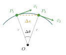
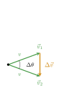

:::: {.oppgaver}

*Sirkelbevegelse* Vi Sirkelbevegelse er en form for krumlinjet bevegelse i planet som vi skal se ekstra nøye på.

::: {.callout-tip title="Til ettertanke"}

I hvilken retning peker akselerasjonen i sirkelbevegelse?

:::

Se for deg at du sitter i en bil som holder konstant høy fart gjennom en rundkjøring. Du vil oppleve at du presses ut mo høyre i bilen (gitt at bilens kjøreretning er overholder norske trafikkregler!). Men om vi zoomer ut av bilen og tar perspektivet til den forskrekkede måken som sitter på en flaggstand midt i rundkjøringen, så ser vi tydelig at det ikke er det som skjer. Det som egentlig skjer er at bilen stadig endrer kjøreretning. Dette fører til at du (som passasjer i bilen) stadig aksellereres inn mot sentrum! Denne akselerasjonen kalles *sentripetalakselerasjon*, og er altså grunnen til at det føles som om noe dytter deg ut av rundkjøringen, selv om det altså ikke er det som skjer.

**Utledning av sentripetalakselerasjon** I det følgende skal vi utlede et uttrykk for størrelsen på sentripetalakselerasjon. Se for deg et legeme (f.eks. en bil) som holder konstant fart i sirkelbevegelse. Selv om farten $v$ forblir konstant så endrer harstighetsvektoren $\vec{v}$ seg, ettersom retningen til farten endres. Ser vi på to tidspunkt hvor hastigheten endrer seg fra $\vec{v}_1$ til $\vec{v}_2$, kan vi bruke forholdet mellom de formlike trekantene for $\Delta \vec{v}$ og $\Delta \vec{s}$, som gir oss: $$\frac{\Delta v}{v} = \frac{\Delta s}{r}.$$ Der $r$ er radiusen til sirkelen, og $\Delta s$ er avstanden objektet har beveget seg langs sirkelen i løpet av et lite tidsintervall $\Delta t$.

:::: figure
{.tikz-fig style="width:257px"}

{.tikz-fig style="width:167px"}

::: caption
Utledning av sentripetalakselerasjon. **Venstre:** To nærliggende posisjoner $P_1$ og $P_2$ på sirkelbanen adskilt med vinkelen $\Delta\theta$. Hastighetsvektorene $\vec{v}_1$ og $\vec{v}_2$ er tangenter til banen. **Høyre:** Hastighetstrekanten (vektorene lagt hale mot hale). De to trekantene er formlike med samme toppvinkel $\Delta\theta$ og forholdssidene $r$ og $v$, slik at $\Delta v/v = \Delta s/r$.
:::
::::

Formlikheten mellom trekantene er altså illustrert i figuren. Ved å multiplisere med $v$ og dele på $\Delta t$ finner vi nå

$$\frac{\Delta v}{\Delta t} = \frac{\Delta r \cdot v}{\Delta t \cdot r}$$

For å finne størrelsen på momentanakselerasjonen så må vi la $\Delta t \to 0$. Vi ser da at $\Delta s$ blir mer og mer likt et lite buesegment, etterhvert som $\Delta t \to 0$. Dermed finner vi $$a_\perp = \lim_{\Delta t \to 0} \frac{\Delta v}{\Delta t} = \lim_{\Delta t \to 0} \frac{\Delta v}{\Delta t} = \frac{\Delta r \cdot v}{\Delta t \cdot r}={v}\cdot \frac{v}{r}=\frac{v^2}{r},$$ hvor vi har brukt at $v=\Delta s/\Delta t$. Dette er formelen for sentripetalakselerasjon, som alltid peker mot sentrum av sirkelen og sørger for at objektet holdes i sirkelbanen.

::: {.callout-note title="Definisjon: Sentripetalakselerasjon"}

Sentripetalakselerasjonen er akselerasjonen inn mot sentrum i ren sirkelbevegelse med konstant fart. Uttrykket for størrelsen på denne akselerasjonen kan vises å være $$\begin{aligned}
        a_\perp = \frac{v^2}{r}
\end{aligned}$$ hvor $v$ er banehastigheten til objektet og $r$ er radiusen til sirkelen.

:::



Sentripetalakselerasjonen peker alltid mot sentrum av sirkelen, selv om objektet hele tiden beveger seg langs kanten av sirkelen. Dette er en viktig idé å forstå når vi ser på bevegelse i sirkulære baner. Men... hva om bilen også øker farten sin langs sirkelbanen, og ikke bare endrer retning? I det tilfelel vil bilen både ha en akselerasjon inn mot sentrum (sentripetalakselerasjonen) og en akselerasjon i kjøreretningen (tangentialakselerasjonen). Den totale akselerasjonsvektoren kan da skrives som en sum av disse to komponentene: $$\vec{a} = \vec{a}_\perp + \vec{a}_\parallel,$$ hvor $\vec{a}_\perp$ er sentripetalakselerasjonen og $\vec{a}_\parallel$ er tangentialakselerasjonen. I dette faget skal vi ikke se på slike tilfeller, men det er greit å ha sett sammenhengen.

::: {.eksempel}
[Eksempel 3.13: Bil i rundkjøring]{.eks-tittel}

En bil kjører gjennom en rundkjøring med konstant fart $v = 36\,\mathrm{km}\,\mathrm{h}^{-1}$ og radius $r = 20\,\mathrm{m}$. Hva er sentripetalakselerasjonen til bilen?

:::

::: {.callout-note .svar collapse="true" title="Vis løsning"}

Vi starter med å gjøre om farten til $\mathrm{m}\,\mathrm{s}^{-1}$: $$v = 36\,\mathrm{km}\,\mathrm{h}^{-1} = 10\,\mathrm{m}\,\mathrm{s}^{-1}$$ Deretter bruker vi formelen for sentripetalakselerasjon: $$a_\perp = \frac{v^2}{r} = \frac{(10\,\mathrm{m}\,\mathrm{s}^{-1})^2}{20\,\mathrm{m}}
    = \frac{100\,\mathrm{m}^{2}\,\mathrm{s}^{-2}}{20\,\mathrm{m}}
    = \underline{\underline{5.0\,\mathrm{m}\,\mathrm{s}^{-2}}}$$ Akselerasjonen peker hele tiden inn mot sentrum av rundkjøringen, selv om bilen beveger seg fremover.

:::

::: {.oppgave tittel="Sykkel i sving"}
[Sykkel i sving]{.oppg-tittel}

En syklist kjører gjennom en sirkulær sving med radius $r = 12\,\mathrm{m}$ og konstant fart $v = 5.4\,\mathrm{km}\,\mathrm{h}^{-1}$.

a)  Gjør om farten til $\mathrm{m}\,\mathrm{s}^{-1}$.

b)  Finn sentripetalakselerasjonen til syklisten.

c)  Hva skjer med sentripetalakselerasjonen om syklisten dobler farten? Forklar svaret.

::: {.losning}

**a)** Vi gjør om farten til SI-enheter: $$v = 5.4\,\mathrm{km}\,\mathrm{h}^{-1} = \underline{\underline{1.5\,\mathrm{m}\,\mathrm{s}^{-1}}}$$

**b)** Vi bruker formelen for sentripetalakselerasjon (se *Sentripetalakselerasjon*, figuren, i kompendiet): $$a_\perp = \frac{v^2}{r} = \frac{(1.5\,\mathrm{m}\,\mathrm{s}^{-1})^2}{12\,\mathrm{m}} = \underline{\underline{0.19\,\mathrm{m}\,\mathrm{s}^{-2}}}$$

**c)** Siden $a_\perp \propto v^2$, vil en dobling av farten ($v\to 2v$) gi $$a_\perp' = \frac{(2v)^2}{r} = 4\cdot\frac{v^2}{r} = 4a_\perp,$$ altså **firedobles** sentripetalakselerasjonen – den øker med kvadratet av farten, ikke proporsjonalt med farten.

:::

:::

## Omløpstid

Når vi snakker om legemer som har periodisk bevegelse, slik som en satelitt rundt jorda, en planet eller en drill i en borerigg, så er det praktisk å definere begrepet *periode*, $T$, også kalt *omløpstid*. Dette er rett og slett tiden brukt på ett omløp (én runde), Det viser seg at vi nå kan skrive om uttrykket for sentripetalakselerasjonen ved hjelp av omløpstiden. Farten i konstant sirkelbevegelse må nesten kunne uttrykkes som avstanden rundt sirkelen (omkretsen) delt på tiden det tar å fullføre ett omløp, altså $T$. Vi får $$v = \frac{2\pi r}{T}.$$ Ved å sette dette uttrykket for $v$ inn i formelen for sentripetalakselerasjon, får vi $$\begin{aligned}
        \colorbox{black!7}{$\displaystyle a_\perp = \dfrac{4\pi^2 r}{T^2}$}
\end{aligned}$$

::: {.eksempel}
[Eksempel 3.14: Jorda rundt sola]{.eks-tittel}

Jorda beveger seg i en tilnærmet sirkulær bane rundt sola med gjennomsnittlig radius $r = 1.496\cdot 10^{11}\,\mathrm{m}$ og omløpstid $T = 365.25\,\mathrm{d}$. Hva er den gjennomsnittlige sentripetalakselerasjonen jorda opplever?

:::

::: {.callout-note .svar collapse="true" title="Vis løsning"}

Vi starter med å gjøre om omløpstiden til sekunder: $$T = 365.25\,\mathrm{d} \cdot \frac{24\,\mathrm{h}}{1\,\mathrm{d}} \cdot \frac{3600\,\mathrm{s}}{1\,\mathrm{h}}
    = 3.156\cdot 10^{7}\,\mathrm{s}$$ Deretter setter vi inn i formelen for sentripetalakselerasjon: $$a_\perp = \frac{4\pi^2 r}{T^2}
    = \frac{4\pi^2 \cdot 1.496\cdot 10^{11}\,\mathrm{m}}{\left(3.156\cdot 10^{7}\,\mathrm{s}\right)^2}
    = \underline{\underline{5.930\cdot 10^{-3}\,\mathrm{m}\,\mathrm{s}^{-2}}}$$ Dette er omtrent $6.1\cdot10^{-3}$ ganger tyngdeakselerasjonen $\mathrm{g}$. Selv om akselerasjonen er svært liten, er det nok til å holde jorda i bane rundt sola — fordi tyngdekraften virker over en enorm avstand.

:::

::: {.oppgave tittel="Sirkelbevegelse og omløpstid"}
[Sirkelbevegelse og omløpstid]{.oppg-tittel}

Månens gjennomsnittlige avstand fra jorda er $r = 3.84 \cdot 10^8\,\mathrm{m}$, og omløpstiden er $T = 27.3\,\textrm{dager}$.

a)  Gjør om omløpstiden til sekunder.

b)  Finn sentripetalakselerasjonen månen opplever ved hjelp av formelen $a_\perp = 4\pi^2 r / T^2$.

c)  Beregn månens banehastighet $v = 2\pi r / T$ og verifiser svaret ved å bruke $a_\perp = v^2/r$ og sammenlikne med svaret du fikk i b).

::: {.losning}

**a)** Vi gjør om omløpstiden til sekunder: $$T = 27.3\,\mathrm{d}\cdot\frac{24\,\mathrm{h}}{1\,\mathrm{d}}\cdot\frac{3600\,\mathrm{s}}{1\,\mathrm{h}} = \underline{\underline{2.359\cdot 10^{6}\,\mathrm{s}}}$$

**b)** Vi bruker formelen fra *Omløpstid* (se kompendiet): $$a_\perp = \frac{4\pi^2 r}{T^2} = \frac{4\pi^2\cdot3.84\cdot 10^{8}\,\mathrm{m}}{(2.359\cdot 10^{6}\,\mathrm{s})^2} = \underline{\underline{2.72\cdot 10^{-3}\,\mathrm{m}\,\mathrm{s}^{-2}}}$$

**c)** Banehastigheten er $$v = \frac{2\pi r}{T} = \frac{2\pi\cdot3.84\cdot 10^{8}\,\mathrm{m}}{2.359\cdot 10^{6}\,\mathrm{s}} = \underline{\underline{1.02\cdot 10^{3}\,\mathrm{m}\,\mathrm{s}^{-1}}} \approx 1.02\,\mathrm{km}\,\mathrm{s}^{-1}$$ Som en verifikasjon bruker vi $a_\perp = v^2/r$: $$a_\perp = \frac{(1.023\cdot 10^{3}\,\mathrm{m}\,\mathrm{s}^{-1})^2}{3.84\cdot 10^{8}\,\mathrm{m}} \approx 2.72\cdot 10^{-3}\,\mathrm{m}\,\mathrm{s}^{-2},$$ som stemmer godt overens med svaret i b).

:::

:::

::::
