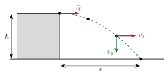
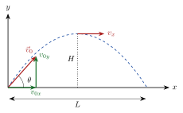

<!-- video: kommer (videoer/fysikk-forkurs/03-06-bevegelse-i-to-dimensjoner) -->
{fig-alt="Video kommer"}

<!-- tillegg: Claude -->
En fotball som sparkes, en stein som kastes ut fra en brygge, vannstrålen fra en hageslange: alle følger en krum bane. Banen ser kanskje innviklet ut, men det finnes et triks som gjør den enkel. Vi deler bevegelsen i to deler, en **vannrett** og en **loddrett**, og regner på dem hver for seg med bevegelseslikningene vi allerede kan.

## Del bevegelsen i to

Vi legger $x$-aksen vannrett og $y$-aksen loddrett oppover. Ser vi bort fra luftmotstand, er tyngdekraften den eneste kraften som virker etter at legemet har sluppet. Tyngdekraften virker rett nedover. Derfor er akselerasjonen

$$
a_x = 0, \qquad a_y = -\mathrm{g} = -9.81\ \mathrm{m/s^2}.
$$

::: {.kort}
- **Vannrett** Ingen akselerasjon, altså *konstant fart*. Legemet går like langt hvert sekund.
- **Loddrett** Konstant akselerasjon nedover, akkurat som fritt fall.
- **Uavhengige** De to delene påvirker ikke hverandre. Det eneste som binder dem sammen, er **tiden** $t$.
:::

Dette kalles **uavhengighetsprinsippet**. Legemet er i lufta like lenge i begge retninger.

::: {.graa}
| Vannrett ($x$) | Loddrett ($y$) |
|---|---|
| $a_x = 0$ | $a_y = -\mathrm{g}$ |
| $v_x = v_{0x}$ | $v_y = v_{0y} - \mathrm{g}t$ |
| $x = v_{0x}\,t$ | $y = y_0 + v_{0y}\,t - \tfrac12 \mathrm{g}t^2$ |
:::

Her har vi startet i $x_0 = 0$. Formlene i tabellen er bevegelseslikningene for konstant akselerasjon, skrevet én gang for hver retning.

::: {.callout-tip title="Et lite forsøk"}
Hold en mynt på bordkanten og en annen mynt rett ved. Slipp den ene samtidig som du knipser den andre vannrett utfor kanten. Lytt: Begge treffer gulvet samtidig. Den vannrette farten endrer ikke hvor fort mynten faller.
:::

## Vannrett kast

En ball triller utfor en bordkant med fart $v_0$. I det den slipper kanten, er farten bare vannrett, så

$$
v_{0x} = v_0, \qquad v_{0y} = 0.
$$

{.tikz-fig style="width:420px" fig-alt="Ball som triller utfor en bordkant med høyde h og lander en avstand x fra bordet. Den vannrette farten er like stor hele veien, mens den loddrette farten vokser."}

Ballen faller høyden $h$ på samme tid som om du bare hadde sluppet den. Med $y_0 = h$ og $y = 0$ ved gulvet gir den loddrette likningen

$$
0 = h - \tfrac12 \mathrm{g}t^2 \quad\Longrightarrow\quad t = \sqrt{\frac{2h}{\mathrm{g}}}.
$$

Så bruker vi tiden i den vannrette retningen: $x = v_0\,t$.

::: {.eksempel}
**Eksempel: Ballen på bordet.** En ball triller utfor en bordkant med farten $2.5\ \mathrm{m/s}$. Bordet er $0.80\ \mathrm{m}$ høyt. a) Hvor lang tid bruker ballen ned til gulvet? b) Hvor langt fra bordkanten lander den? c) Hvor stor fart har den når den treffer gulvet?

::: {.losning}
**Kjent:** $v_{0x} = 2.5\ \mathrm{m/s}$, $v_{0y} = 0$, $h = 0.80\ \mathrm{m}$, $\mathrm{g} = 9.81\ \mathrm{m/s^2}$.

a) Tiden finner vi fra den loddrette bevegelsen, der vi kjenner fallhøyden:
$$
t = \sqrt{\frac{2h}{\mathrm{g}}} = \sqrt{\frac{2\cdot 0.80\ \mathrm{m}}{9.81\ \mathrm{m/s^2}}} = 0.404\ \mathrm{s} \approx \underline{\underline{0.40\ \mathrm{s}}}
$$

b) Vannrett er farten konstant:
$$
x = v_{0x}\,t = 2.5\ \mathrm{m/s}\cdot 0.404\ \mathrm{s} = 1.01\ \mathrm{m} \approx \underline{\underline{1.0\ \mathrm{m}}}
$$

c) Den vannrette farten er fortsatt $v_x = 2.5\ \mathrm{m/s}$. Den loddrette farten har vokst til
$$
v_y = -\mathrm{g}t = -9.81\ \mathrm{m/s^2}\cdot 0.404\ \mathrm{s} = -3.96\ \mathrm{m/s}.
$$
Minustegnet betyr at den peker nedover. Farten er lengden av hastighetsvektoren, som vi finner med Pytagoras:
$$
v = \sqrt{v_x^2 + v_y^2} = \sqrt{(2.5\ \mathrm{m/s})^2 + (3.96\ \mathrm{m/s})^2} = 4.68\ \mathrm{m/s} \approx \underline{\underline{4.7\ \mathrm{m/s}}}
$$
Svarene har to gjeldende siffer, som dataene.
:::
:::

## Skrått kast

Kaster vi skrått oppover med farten $v_0$ og vinkelen $\theta$ over vannrett, må vi først dele startfarten i to komponenter, slik vi gjør med alle vektorer:

$$
v_{0x} = v_0\cos\theta, \qquad v_{0y} = v_0\sin\theta.
$$

{.tikz-fig style="width:460px" fig-alt="Skrått kast fra bakken. Startfarten v0 med vinkel theta deles i v0x og v0y. På toppen, i høyden H, er farten bare vannrett. Kastelengden er L."}

Tre spørsmål går igjen i nesten alle oppgaver om skrått kast:

::: {.kort}
- **Høyeste punkt** På toppen er $v_y = 0$. Fra $v_y = v_{0y} - \mathrm{g}t$ er tiden til toppen $t_{\text{topp}} = v_{0y}/\mathrm{g}$, og fra $0 = v_{0y}^2 - 2\mathrm{g}H$ er høyden $H = \dfrac{v_{0y}^2}{2\mathrm{g}}$.
- **Flytid** Lander ballen i samme høyde som den startet, tar turen ned like lang tid som turen opp: $T = 2\,t_{\text{topp}}$.
- **Kastelengde** Vannrett er farten konstant hele tiden, så $L = v_{0x}\,T$.
:::

Merk at farten på toppen *ikke* er null. Den er $v_x = v_{0x}$, rett vannrett.

### Fire steg som alltid virker

::: {.steg}
1. **Del opp** startfarten i $v_{0x}$ og $v_{0y}$, og skriv opp $a_x = 0$ og $a_y = -\mathrm{g}$.
2. **Finn tiden** fra den retningen der du vet nok, som oftest den loddrette.
3. **Bruk tiden** i den andre retningen.
4. **Sett sammen** svaret, for eksempel farten med Pytagoras.
:::

::: {.eksempel}
**Eksempel: Fotballsparket.** En fotball sparkes fra bakken med farten $15.0\ \mathrm{m/s}$ i vinkelen $35.0^\circ$ over vannrett. Se bort fra luftmotstand. Finn a) hvor høyt ballen kommer, b) hvor lenge den er i lufta og c) hvor langt unna den lander.

::: {.losning}
**1. Del opp startfarten:**
$$
v_{0x} = 15.0\ \mathrm{m/s}\cdot\cos 35.0^\circ = 12.29\ \mathrm{m/s}, \qquad
v_{0y} = 15.0\ \mathrm{m/s}\cdot\sin 35.0^\circ = 8.604\ \mathrm{m/s}.
$$

a) På toppen er $v_y = 0$:
$$
H = \frac{v_{0y}^2}{2\mathrm{g}} = \frac{(8.604\ \mathrm{m/s})^2}{2\cdot 9.81\ \mathrm{m/s^2}} = \underline{\underline{3.77\ \mathrm{m}}}
$$

b) Tiden til toppen er
$$
t_{\text{topp}} = \frac{v_{0y}}{\mathrm{g}} = \frac{8.604\ \mathrm{m/s}}{9.81\ \mathrm{m/s^2}} = 0.8770\ \mathrm{s},
$$
og siden ballen lander i samme høyde som den startet, er flytiden
$$
T = 2\,t_{\text{topp}} = 1.754\ \mathrm{s} \approx \underline{\underline{1.75\ \mathrm{s}}}
$$

c) Vannrett går ballen med konstant fart hele flytiden:
$$
L = v_{0x}\,T = 12.29\ \mathrm{m/s}\cdot 1.754\ \mathrm{s} = \underline{\underline{21.6\ \mathrm{m}}}
$$
I virkeligheten bremser luftmotstanden ballen, så den lander noe kortere.
:::
:::

::: {.callout-tip title="Hvilken vinkel gir lengst kast?"}
Setter vi sammen formlene over, får vi kastelengden for et kast som lander i samme høyde som det startet:
$$
L = \frac{v_0^2 \sin 2\theta}{\mathrm{g}}.
$$
$\sin 2\theta$ er størst, lik 1, når $2\theta = 90^\circ$, altså $\theta = 45^\circ$. Uten luftmotstand gir $45^\circ$ det lengste kastet. To vinkler som til sammen blir $90^\circ$, for eksempel $30^\circ$ og $60^\circ$, gir like lange kast. Formelen gjelder **bare** når start og landing er i samme høyde.
:::

## Prøv selv

Programmet regner ut toppunkt, flytid og kastelengde og tegner banen. Endre startfarten og vinkelen og trykk **Kjør**. Prøv for eksempel $30^\circ$, $45^\circ$ og $60^\circ$ med samme fart.

```{.python .kjor}
import numpy as np
import matplotlib.pyplot as plt

g = 9.81          # m/s^2
v0 = 15.0         # startfart i m/s
vinkel = 35.0     # grader over vannrett

theta = np.radians(vinkel)
v0x = v0 * np.cos(theta)
v0y = v0 * np.sin(theta)

H = v0y**2 / (2 * g)      # høyeste punkt
T = 2 * v0y / g           # flytid (landing i samme høyde)
L = v0x * T               # kastelengde
print(f"Høyeste punkt: {H:.2f} m")
print(f"Flytid:        {T:.2f} s")
print(f"Kastelengde:   {L:.1f} m")

t = np.linspace(0, T, 200)
x = v0x * t
y = v0y * t - 0.5 * g * t**2
plt.plot(x, y)
plt.xlabel("x (m)")
plt.ylabel("y (m)")
plt.axis("equal")
plt.grid(True)
plt.show()
```

:::: {.oppgaver}

::: {.oppgave tittel="Stein fra brua"}
Du kaster en stein vannrett ut fra en bru med farten $8.00\ \mathrm{m/s}$. Steinen slipper hånden $20.0\ \mathrm{m}$ over vannet. Se bort fra luftmotstand. a) Hvor lang tid tar det før steinen treffer vannet? b) Hvor langt fra brua treffer den?

::: {.losning}
Kastet er vannrett, så $v_{0x} = 8.00\ \mathrm{m/s}$ og $v_{0y} = 0$.

a) Den loddrette bevegelsen er et fritt fall på $h = 20.0\ \mathrm{m}$:
$$
h = \tfrac12 \mathrm{g}t^2 \quad\Longrightarrow\quad
t = \sqrt{\frac{2h}{\mathrm{g}}} = \sqrt{\frac{2\cdot 20.0\ \mathrm{m}}{9.81\ \mathrm{m/s^2}}} = \underline{\underline{2.02\ \mathrm{s}}}
$$

b) Vannrett er farten konstant:
$$
x = v_{0x}\,t = 8.00\ \mathrm{m/s}\cdot 2.019\ \mathrm{s} = \underline{\underline{16.2\ \mathrm{m}}}
$$
Legg merke til at vi brukte den uavrundede tiden $2.019\ \mathrm{s}$ i mellomregningen.
:::
:::

::: {.oppgave tittel="Del opp startfarten"}
En ball kastes med farten $20.0\ \mathrm{m/s}$ i vinkelen $30.0^\circ$ over vannrett. a) Finn den vannrette og den loddrette komponenten av startfarten. b) Hvor stor fart har ballen i det høyeste punktet av banen? Se bort fra luftmotstand.

::: {.losning}
a) Vi deler opp vektoren med cosinus og sinus:
$$
v_{0x} = v_0\cos\theta = 20.0\ \mathrm{m/s}\cdot\cos 30.0^\circ = \underline{\underline{17.3\ \mathrm{m/s}}}
$$
$$
v_{0y} = v_0\sin\theta = 20.0\ \mathrm{m/s}\cdot\sin 30.0^\circ = \underline{\underline{10.0\ \mathrm{m/s}}}
$$

b) I det høyeste punktet er den loddrette farten null, $v_y = 0$. Den vannrette farten er den samme som ved start, fordi det ikke er noen akselerasjon vannrett. Farten på toppen er derfor
$$
v = v_x = \underline{\underline{17.3\ \mathrm{m/s}}},
$$
rettet vannrett. En vanlig feil er å tro at farten er null på toppen. Det er bare den *loddrette* delen som er null.
:::
:::

::: {.oppgave tittel="Ballkast på plenen" niva="Middels"}
En ball kastes fra bakken med farten $12.0\ \mathrm{m/s}$ i vinkelen $60.0^\circ$ over vannrett og lander på bakken igjen. Se bort fra luftmotstand. Finn a) den største høyden, b) flytiden og c) kastelengden.

::: {.losning}
**Del opp startfarten:**
$$
v_{0x} = 12.0\ \mathrm{m/s}\cdot\cos 60.0^\circ = 6.00\ \mathrm{m/s}, \qquad
v_{0y} = 12.0\ \mathrm{m/s}\cdot\sin 60.0^\circ = 10.39\ \mathrm{m/s}.
$$

a) På toppen er $v_y = 0$:
$$
H = \frac{v_{0y}^2}{2\mathrm{g}} = \frac{(10.39\ \mathrm{m/s})^2}{2\cdot 9.81\ \mathrm{m/s^2}} = \underline{\underline{5.50\ \mathrm{m}}}
$$

b) Tiden til toppen er $t_{\text{topp}} = v_{0y}/\mathrm{g} = 10.39/9.81\ \mathrm{s} = 1.059\ \mathrm{s}$. Start og landing er i samme høyde, så
$$
T = 2\,t_{\text{topp}} = 2.119\ \mathrm{s} \approx \underline{\underline{2.12\ \mathrm{s}}}
$$

c) Vannrett er farten konstant:
$$
L = v_{0x}\,T = 6.00\ \mathrm{m/s}\cdot 2.119\ \mathrm{s} = \underline{\underline{12.7\ \mathrm{m}}}
$$
:::
:::

::: {.oppgave tittel="Samme fart, ny vinkel" niva="Middels"}
Ballen fra oppgaven over kastes nå med samme fart, $12.0\ \mathrm{m/s}$, men i vinkelen $30.0^\circ$. a) Finn kastelengden og den største høyden. b) Sammenlign med kastet i $60.0^\circ$. Hva er likt, og hva er forskjellig?

::: {.losning}
**Del opp startfarten:**
$$
v_{0x} = 12.0\ \mathrm{m/s}\cdot\cos 30.0^\circ = 10.39\ \mathrm{m/s}, \qquad
v_{0y} = 12.0\ \mathrm{m/s}\cdot\sin 30.0^\circ = 6.00\ \mathrm{m/s}.
$$

a) Største høyde:
$$
H = \frac{v_{0y}^2}{2\mathrm{g}} = \frac{(6.00\ \mathrm{m/s})^2}{2\cdot 9.81\ \mathrm{m/s^2}} = \underline{\underline{1.83\ \mathrm{m}}}
$$
Flytid: $T = 2v_{0y}/\mathrm{g} = 2\cdot 6.00/9.81\ \mathrm{s} = 1.223\ \mathrm{s}$. Kastelengde:
$$
L = v_{0x}\,T = 10.39\ \mathrm{m/s}\cdot 1.223\ \mathrm{s} = \underline{\underline{12.7\ \mathrm{m}}}
$$

b) Kastelengden er den samme som med $60.0^\circ$. Komponentene har byttet plass: Ved $30^\circ$ er den vannrette farten stor og den loddrette liten, og ved $60^\circ$ er det omvendt. Kastet i $30^\circ$ blir lavere (1.83 m mot 5.50 m) og kortere i tid (1.22 s mot 2.12 s), men går fortere vannrett, så lengden blir lik. Det stemmer med formelen $L = v_0^2\sin 2\theta/\mathrm{g}$, siden $\sin 60^\circ = \sin 120^\circ$.
:::
:::

::: {.oppgave tittel="Kast fra skulderhøyde" niva="Utfordrende"}
En elev kaster en ball fra $1.80\ \mathrm{m}$ over bakken med farten $10.0\ \mathrm{m/s}$ i vinkelen $40.0^\circ$ over vannrett. Se bort fra luftmotstand. a) Hvor lenge er ballen i lufta? b) Hvor langt unna lander den? c) Hvorfor kan du ikke bruke formelen $L = v_0^2\sin 2\theta/\mathrm{g}$ her?

::: {.losning}
**Del opp startfarten:**
$$
v_{0x} = 10.0\ \mathrm{m/s}\cdot\cos 40.0^\circ = 7.660\ \mathrm{m/s}, \qquad
v_{0y} = 10.0\ \mathrm{m/s}\cdot\sin 40.0^\circ = 6.428\ \mathrm{m/s}.
$$

a) Vi setter origo på bakken rett under hånden, så $y_0 = 1.80\ \mathrm{m}$. Ballen lander når $y = 0$:
$$
0 = 1.80 + 6.428\,t - 4.905\,t^2 \qquad (\text{med } t \text{ i s og } y \text{ i m}).
$$
Dette er en andregradslikning $at^2 + bt + c = 0$ med $a = -4.905$, $b = 6.428$ og $c = 1.80$. Abc-formelen gir
$$
t = \frac{-b \pm \sqrt{b^2 - 4ac}}{2a} = \frac{-6.428 \pm \sqrt{41.32 + 35.32}}{-9.81} = \frac{-6.428 \pm 8.754}{-9.81}.
$$
Den ene løsningen er negativ ($t = -0.237\ \mathrm{s}$) og gir ikke mening, fordi ballen ikke fantes i lufta før kastet. Den andre er
$$
t = \frac{-6.428 - 8.754}{-9.81} = \underline{\underline{1.55\ \mathrm{s}}}
$$

b) Vannrett:
$$
x = v_{0x}\,t = 7.660\ \mathrm{m/s}\cdot 1.548\ \mathrm{s} = \underline{\underline{11.9\ \mathrm{m}}}
$$

c) Formelen bygger på at ballen lander i samme høyde som den ble kastet fra, slik at turen ned tar like lang tid som turen opp. Her lander ballen 1.80 m lavere, så den er lenger i lufta og går lenger. Formelen ville gitt $10.0\ \mathrm{m}$, som er for kort.
:::
:::

::::
