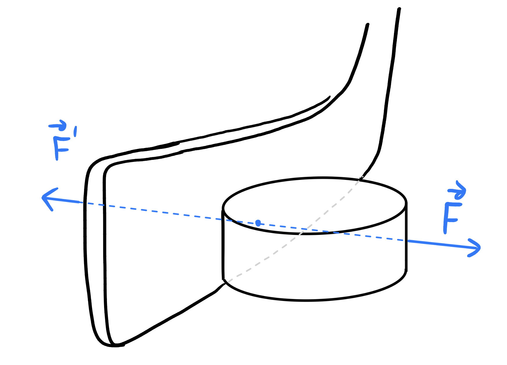

:::: {.oppgaver}



Se for deg en ishockey-puck ute på isen. Hva skal til for å endre bevegelsen til pucken? Jo, da må pucken interagere med et annet legeme. Så langt har vi brukt begrep som *legeme* og *objekt* om hverandre. La oss være litt mer presise:

::: {.callout-note title="Definisjon: Legeme"}

Et legeme er et objekt med masse og posisjon. Massen $m$ måles i kg (kilogram), og posisjonen $\vec{r}$ måles i meter (m). Realistiske legemer har dessuten romlig utstrekning.

:::

Dette kan være alt fra en liten partikkel til en stor planet. Alle legemer kan derfor erverve bevegelsesmengde, så lenge de kan interagere med andre legemer. Legemer er brikkene i spillet vi kaller *dynamikk*. Dette spillet har videre noen regler for hvordan brikkene, altså legemene, kan interagere. Interaksjon mellom legemer kalles i fysikken for . Vi sier at *krefter* er *vekselvirkning mellom legemer*. Og som i all interaksjon så er den ikke ensidig. Dersom legeme A virker på legeme B, så virker legeme B på legeme A. Det som kanskje ikke er like opplagt, er at legemene virker like mye på hverandre. Det vil si at kraften som legeme A utøver på legeme B, er like stor som kraften som legeme B utøver på legeme A, bare i motsatt retning. Dette kalles Newtons tredje lov, og vi skal tenke på den som en av tre krav som totalt sett gjør *kraft*-begrepet veldefinert si fysikken.

::: {.callout-note title="Definisjon: Kraft som vekselvirkning"}

En kraft er en vekselvirkning mellom legemer. Krefter opptrer derfor alltid i par, slik at dersom legeme $A$ virker på legeme $B$ med en kraft $\vec{F}$, så virker legeme $B$ på legeme $A$ med en kraft $\vec{F}^\prime$. Videre er disse to kreftene like store, men motsatt rettet; $$\vec{F}=-\vec{F}^\prime\qquad \textbf{(Newtons 3. lov)}.$$ Enheten for kraft er Newton (N), til ære for Isaac Newton, som var den første til å formulere en systematisk teori for krefter og bevegelse.

:::

:::: figure
{.kompendium-bilde}

::: caption
Kraft er vekselvirkning mellom to legemer, og krefter opptrer derfor alltid i par: kraft og motkraft, som virker på hvert sitt legeme. Disse kreftene er alltid like store og motsatt rettet.
:::
::::



Videre kan vi spørre hva som skjer når legemer vekselvirker, altså når det virker krefter mellom legemene. Pucken i interaksjon med hockeykøllen er et eksempel, og her ser vi tydelig hva som kan skje: pucken på isen får sin bevegelse endret; altså endret bevegelsesmengde. La oss bruke begrepet bevegelsesmengde for å beskrive denne endringen. La oss si at pucken først hadde en bevegelsesmengde $\vec{p}_1=m\vec{v}_1$. Så dytter du den med hockey-køllen en tid $\Delta t$, slik at pucken endrer retning og fart. Da virker det krefter mellom hockeykøllen og pucken i dette tidsrommet. Etter interaksjonen har pucken bevegelsesmengde $\vec{p}_2=m\vec{v}_2$. Det er ikke sikkert du dytter like hardt på pucken hele tiden gjennom interaksjonen, og det begrepet som viser seg å ha størst nytte er derfor endringen av bevegelsesmengde *per tid*. Først finner vi at $\Delta \vec{p}$: $$\Delta \vec{p} = \vec{p}_2 - \vec{p}_1=m(\vec{v}_2 - \vec{v}_1)=m\Delta\vec{v}.$$ Gjennomsnittsendrignen *per tid* må derfor være $$\frac{\Delta \vec{p}}{\Delta t} = m\frac{\Delta\vec{v}}{\Delta t}=m\vec{a}.$$ Denne endringen skyldes vekselvirkning mellom legemene (kølla dytter pucken, og pucken dytter tilbake mot kølla), altså *krefter*. Summen av krefter som har virket på pucken i løpet av tidsrommet $\Delta t$ må nå være gitt ved $$\sum\vec{F}=\frac{\Delta \vec{p}}{\Delta t}= m\vec{a}.$$ Kraft som årsak til hastighetsendring er oppsumert i det som er kjent som Newtons 2. lov.

::: {.callout-note title="Definisjon: Kraft som endring av bevegelse"}

Dersom et legeme blir påvirket av én eller flere krefter vil legemet akselerere i retning av resultant-kraften $\sum\vec{F};$ $$\begin{aligned}
\Sigma\vec{F} = m \cdot\vec{a}\qquad \textbf{(Newtons 2. lov)}.
\end{aligned}$$ Fra denne sammenhengen ser vi at enheten for kraft, Newton (N) kan uttrykkes som $$\textrm{N}=\textrm{kg}\cdot\frac{\textrm{m}}{\textrm{s}^2}$$

:::

Matematisk sett så beskrives altså krefter som vektorer. Derfor bruker vi pil over symbolet for kraft; $\vec{F},$ mens sylbolet *uten* vektortegn, altså i dette tilfellet $F$, betegner størrelsen på kraften.

Tilslutt er det verdt å skrive ned en lovmessighet som gjelder et legeme hvor summen av krefter som virker på legemet er null. Et eksempel kan være en stige mot en vegg, eller en person som sitter og ser ut vinduet på et tog som suser avsted med konstant fart. Summen av påvirkning på stigen er slik at stigen står i ro. Personen i toget påvirkes også av krefter, men på en slik måte at det ikke er noen hastigehtsendring. Men går det an å ha akselerasjon dersom $\sum\vec{F}=0$? Vel, fra Newtons 2. lov ser vi at dersom $\sum\vec{F}=0$ så må vi enten ha $m\to 0$ eller $\vec{a}\to 0$. Så dersom vi krever $\vec{a}\neq 0$ så står vi igjen med $m\to 0$. Kan det hende at massen forsvinner når kreftene forsvinner?



Hvordan sammenhengen mellom bevegelse og vekselvirkning egentlig er, tok det lang tid å foredle. Aristoteles trodde for eksempel at et legeme hadde en slags indre drivkraft. En stein som kastes og forlater hånden ville derfor fortsette i en rett linje oppover, før den plutselig falt mot bakken. Legemer hadde altså en iboende slags kraft. Det var midt imot slikt gammelt tankegods at Newton formulerte sine lover. Nei, sa Newton, bevegelse er ikke forårsaket av en iboende kraft i materien. Snarere er det slik at alle legemer vil beholde den bevegelsen de har såfremt det virker ytre krefter som forstyrrer bevegelsen. Legemers evne til å beholde bevegelsen sin, kaller vi *treghet*. Og dette er det vi i dagligtale kaller *masse*. I motsetning til kraft, så er tregheten (altså massen) en iboende egenskap ved materie. Newton sier altså at $m\to0$ ikke er en gyldig løsning. Legemer beholder sin treghet, eller masse. La oss formulere dette som en egen lov. Dersom summen av krefter er null, må det derfor være slik at også akselerasjonen blir null, slik det beskrives i Newtons 1. lov:

::: {.callout-note title="Definisjon: Krefter og treghet"}

Alle legemer har en iboende treghet, kalt **masse**, som gjør at bevegelsen beholdes så lenge det ikke virker krefter på legemet: $$\begin{aligned}
\Sigma\vec{F} = 0\Leftrightarrow v=\text{konst.}\qquad \textbf{(Newtons 1. lov)}.
\end{aligned}$$

:::

Konstant bevegelse krever derfor ingen mekanisk årsak (krefter).Endring i bevegelse må derimot forklares. Forklaringen er alltid at det har virket krefter. Mekanikk handler derfor i stor grad om å finne ut hvilke krefter som virker på et system, for deretter å analysere hva slags bevegelse disse kreftene eventuelt vil forårsake.

::::
