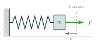
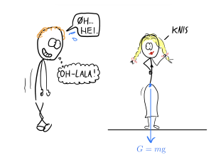
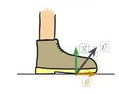
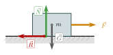

:::: {.oppgaver}



I dette avsnittet viser vi noen eksempler på krefter som du møter i hverdagen.

::: {.callout-tip title="Til ettertanke"}

Hvordan måler vi krefter?

:::

For å måle og sammenlikne krefter med hverandre bruker vi noe som kalles et *Newtonmeter*. Det er rett og slett en fjær som presses sammen i et rør. Jo mer den presses sammen, jo større er krafta som trykker på fjæra. Så... la oss starte med å studere nettopp kraften fra en spiralfjær.

## Kraft fra spiralfjær

Tenk på en spiralfjær. Når den er uspennt, hviler den i sin naturlige lengde — vi kaller dette *likevektsposisjonen*. Presser du fjæra sammen (eller drar den ut), vil den forsøke å sprette tilbake. Jo mer du presser, jo sterkere er kraften som prøver å rette den ut igjen.

La $\vec{x}$ betegne forflytningen til den ene enden av fjæra fra likevektsposisjonen. Da er fjærkraften gitt ved Hookes lov:

::: {.callout-note title="Definisjon: Hookes lov"}

Kraften fra en fjær på det den er festet til er proporsjonal med avviket $\vec{x}$ fra likevektsposisjonen: $$\vec{F} = -k\vec{x}$$ Her er $k > 0$ *fjærkonstanten* (enhet: $\mathrm{N}\,\mathrm{m}^{-1}$), og $\vec{x}$ er forflytningen fra likevekt. Minustegnet viser at kraften alltid peker *mot* likevekt — uansett om fjæra er presset sammen eller strukket ut.

:::

Figuren viser en fjær som er presset sammen. Vi definerer positiv $x$-retning mot høyre. Fjæra presses slik at avviket fra likevekt er $\vec{x}$ (peker mot venstre, altså $x < 0$). Da er fjærkraften $$\vec{F} = -k\vec{x},$$ som peker mot høyre — tilbake mot likevekt. Stivheten til fjæra bestemmes av fjærkonstanten $k$: en stiv fjær (stor $k$) gir stor kraft selv ved lite avvik, mens en myk fjær (liten $k$) gir liten kraft.

{.tikz-fig style="width:326px"}

[Fjær trykket sammen. Avviket $\vec{x}$ peker mot venstre (fra likevekt til klossen), og fjærkraften $\vec{F}=-k\vec{x}$ peker mot høyre — tilbake mot likevekt.]{.figurtekst}

::: {.eksempel}
[Eksempel: Komprimert fjær]{.eks-tittel}

En spiralfjær har fjærkonstant $k = 250\,\mathrm{N}\,\mathrm{m}^{-1}$. Den trykkes $6.0\,\mathrm{cm}$ sammen fra likevektsposisjonen. Hva er størrelsen på fjærkraften?

:::

::: {.callout-note .svar collapse="true" title="Vis løsning"}

Avviket fra likevekt er $x = 6.0\,\mathrm{cm} = 0.060\,\mathrm{m}$. Hookes lov gir størrelsen på kraften: $$F = k \cdot |x| = 250\,\mathrm{N}\,\mathrm{m}^{-1} \cdot 0.060\,\mathrm{m}
    = \underline{\underline{15\,\mathrm{N}}}$$ Kraften peker vekk fra veggen — tilbake mot likevektsposisjonen.

:::

::: {.oppgave tittel="Finn fjærkonstanten"}
[Finn fjærkonstanten]{.oppg-tittel}

Du fester et lodd til en vertikal fjær og måler at fjæra strekkes $12\,\mathrm{cm}$ når loddet har masse $m = 250\,\mathrm{g}$.

a)  Hva er fjærkonstanten $k$? (Hint: når fjæra er i ro, er fjærkraften lik tyngdekraften på loddet.)

b)  Hvor mye strekkes fjæra om du bytter til et lodd med masse $m = 400\,\mathrm{g}$?

::: {.losning}

**a)** Loddet henger i ro, så fjærkraften er like stor som tyngdekraften på loddet (se *Hookes lov*): $F=kx=m\mathrm{g}$. Vi løser for $k$: $$k = \frac{m\mathrm{g}}{x} = \frac{0.250\,\mathrm{kg}\cdot9.81\,\mathrm{m}\,\mathrm{s}^{-2}}{0.12\,\mathrm{m}} = 20.4\,\mathrm{N}\,\mathrm{m}^{-1} \approx \underline{\underline{20\,\mathrm{N}\,\mathrm{m}^{-1}}}$$

**b)** Med det nye loddet, $m=0.400\,\mathrm{kg}$, løser vi $kx=m\mathrm{g}$ for $x$: $$x = \frac{m\mathrm{g}}{k} = \frac{0.400\,\mathrm{kg}\cdot9.81\,\mathrm{m}\,\mathrm{s}^{-2}}{20.4\,\mathrm{N}\,\mathrm{m}^{-1}} = 0.192\,\mathrm{m} \approx \underline{\underline{0.19\,\mathrm{m}}} = 19.2\,\mathrm{cm} \approx \underline{\underline{19\,\mathrm{cm}}}$$

:::

:::

## Tyngdekraft

Tyngdekraften $\vec{G}$ er kraften jorda trekker et legeme mot sitt sentrum med. Størrelsen avhenger av legemets masse $m$ og hvor langt unna jordas sentrum vi er. Men på jordoverflaten viser det seg at tyngdekraften er $$\vec{G} = m\vec{\mathrm{g}},$$ hvor $\mathrm{g}\approx 9.81\,\mathrm{m}\,\mathrm{s}^{-2}$. Vi ser altså at tyngdekraften er proporsjonal med massen $m$. Dette er spesielt. For se nå for deg et legeme som faller mot jorda, kun under påvirkning av tyngdekraften. Da gir Newtons andre lov at $$\begin{aligned}
\sum F=ma\quad\rightarrow m\mathrm{g}=ma\\
a=\mathrm{g}=9.81\,\mathrm{m}\,\mathrm{s}^{-2}.
\end{aligned}$$ Tyngdekraften trekker altså alle legemer mot bakken med samme akselerasjon. Dette kalles **fritt fall.**

:::: figure
{.tikz-fig style="width:587px"}

::: caption
Dash-Line påvirkes av en kraft med størrelse $G=m\mathrm{g}$ fra jorda. Dashman ser ut til å være påvirket av helt andre former for tiltrekningskrefter... ;)
:::
::::

På overflaten av månen ville tyngdens akselerasjon vært en annen. Der har vi nemlig $\mathrm{g}_\text{måne} \approx 1.62\,\mathrm{m}\,\mathrm{s}^{-2}$ — omtrent $\frac{1}{6}$ av jordas. Merk at *massen* $m$ er den samme uansett hvor du befinner deg, mens *tyngdekraften* $G$ varierer med stedet.

::: {.eksempel}
[Eksempel: Tyngdekraft på jordoverflaten]{.eks-tittel}

Sofie har masse $m = 60\,\mathrm{kg}$. Hva er tyngdekraften som virker på henne på jordoverflaten?

:::

::: {.callout-note .svar collapse="true" title="Vis løsning"}

Vi bruker definisjonen av tyngdekraft med $\mathrm{g} = 9.81\,\mathrm{m}\,\mathrm{s}^{-2}$: $$G = m \cdot \mathrm{g} = 60\,\mathrm{kg} \cdot 9.81\,\mathrm{m}\,\mathrm{s}^{-2}
    = 588.6\,\mathrm{N} \approx \underline{\underline{5.9\cdot 10^{2}\,\mathrm{N}}}$$

:::

::: {.oppgave tittel="Tyngdekraft på jord og måne"}
[Tyngdekraft på jord og måne]{.oppg-tittel}

Ola har masse $m = 75\,\mathrm{kg}$.

a)  Finn tyngdekraften på Ola på jordoverflaten ($\mathrm{g} = 9.81\,\mathrm{m}\,\mathrm{s}^{-2}$).

b)  Finn tyngdekraften på Ola på månens overflate ($\mathrm{g}_\text{måne} = 1.62\,\mathrm{m}\,\mathrm{s}^{-2}$).

c)  Hva er Olas masse på månen? Forklar svaret.

::: {.losning}

Vi bruker $G=m\mathrm{g}$ (se *Tyngdekraft*).

**a)** På jorda: $$G = m\mathrm{g} = 75\,\mathrm{kg}\cdot9.81\,\mathrm{m}\,\mathrm{s}^{-2} = 736\,\mathrm{N} \approx \underline{\underline{7.4\cdot 10^{2}\,\mathrm{N}}}$$

**b)** På månen: $$G_\text{måne} = m\,\mathrm{g}_\text{måne} = 75\,\mathrm{kg}\cdot1.62\,\mathrm{m}\,\mathrm{s}^{-2} = 122\,\mathrm{N} \approx \underline{\underline{1.2\cdot 10^{2}\,\mathrm{N}}}$$

**c)** Olas masse er fortsatt $\underline{\underline{m=75\,\mathrm{kg}}}$ – helt uendret. Massen er et mål på hvor mye *treghet* (stoffmengde) Ola har, og det avhenger ikke av hvor han befinner seg. Det er *tyngdekraften* $G$ som endrer seg mellom jorda og månen (fordi $\mathrm{g}$ er forskjellig), ikke massen $m$.

:::

:::

::: {.oppgave tittel="Fritt fall"}
[Fritt fall]{.oppg-tittel}

En hammer og en fjær slippes samtidig fra samme høyde.

a)  Hva tror du skjer — hvilket objekt når bakken først?

b)  Hva skjer om vi pumper vekk all lufta i rommet? Bruk det du har lært om tyngdekraft til å forklare svaret.

::: {.losning}

**a)** De fleste vil tro at hammeren treffer bakken først. Dette stemmer faktisk i virkeligheten (med luft til stede): fjæra har stort overflateareal i forhold til massen sin, så luftmotstanden bremser fjæra mye mer enn den bremser hammeren. Hammeren faller dermed tilnærmet i fritt fall, mens fjæra daler sakte ned.

**b)** Dersom vi pumper vekk all lufta (fullstendig vakuum), er luftmotstanden borte, og begge objektene er i *fritt fall* – de påvirkes kun av tyngdekraften. Fra Newtons 2. lov (se *Tyngdekraft*): $$\sum F = ma \quad\Rightarrow\quad m\mathrm{g} = ma \quad\Rightarrow\quad a = \mathrm{g},$$ og massen $m$ forsvinner fullstendig fra likningen. Akselerasjonen er dermed $\mathrm{g}$ for *alle* legemer, uavhengig av masse og form. I vakuum vil derfor hammeren og fjæra **treffe bakken samtidig** – noe som faktisk ble demonstrert på Månen av astronaut David Scott under Apollo 15-ferden, nettopp fordi Månen ikke har noen atmosfære.

:::

:::

## Underlagskrefter

Når et objekt står på et underlag så virker det krefter fra underlaget, som sørger for at objektet ikke faller gjennom. Vi dekomponerer gjerne slike *underlagskrefter* $\vec{U}$ i to deler: normalkraft ($\vec{N}$) og friksjonskraft ($\vec{R}$), slik at $$\vec{U}=\vec{N}+\vec{R}.$$ Normalkraften $\vec{N}$ virker *vinkelrett* på underlaget, mens friksjonskraften $\vec{R}$ virker *parallelt* med underlaget. Figuren viser en fot som står på bakken — underlagskraften $\vec{U}$ kan da dekomponeres i begge disse retningene.

{.tikz-fig style="width:329px"}

[En fot som står på bakken. Underlagskraften $\vec{U}$ dekomponeres i normalkraften $\vec{N}$ (vinkelrett) og friksjonskraften $\vec{R}$ (parallelt med underlaget).]{.figurtekst}

La oss se nærmere på hver av disse.

### Normalkraft

Normalkraften $\vec{N}$ er den delen av underlagskraften som virker *vinkelrett* på underlaget (/normalt på underlaget, derav navnet). Som vi skal se i de følgende eksemplene så kan vi i mange tilfeller bruke Newtons 1. eller 2. lov til å finne størrelsen på normalkraften.

::: {.eksempel}
[Eksempel: Person i ro på flatt underlag]{.eks-tittel}

Ola har masse $m = 80\,\mathrm{kg}$ og står i ro på et flatt gulv. Hva er normalkraften som gulvet utøver på Ola?

:::

::: {.callout-note .svar collapse="true" title="Vis løsning"}

Siden Ola er i ro, er summen av krefter i vertikal retning null (Newtons 2. lov med $a = 0$): $$\sum F_y = N - G = 0 \implies N = G = m \cdot \mathrm{g}$$ $$N = 80\,\mathrm{kg} \cdot 9.81\,\mathrm{m}\,\mathrm{s}^{-2}
    = 784.8\,\mathrm{N} \approx \underline{\underline{7.8\cdot 10^{2}\,\mathrm{N}}}$$ Gulvet skyver Ola opp med nøyaktig like stor kraft som tyngdekraften trekker Ola ned — dette er et eksempel på Newtons 3. lov i praksis.

:::

Som vi så i eksemplet over så er Normalkraften like stor og motsatt rettet i forhold til tyngdekraften når et legeme står i ro på et gulv. Slik må det nesten være, ettersom det da kun er $G$ og $N$ som virker. Likevel er ikke $N$ motkraften til $G$.

::: {.callout-tip title="Til ettertanke"}

Hvorfor er ikke $\vec{N}$ og $\vec{G}$ et kraft-motkraft par slik som det er definert i Newtons 3. lov?

:::

Grunnen er enkel: Både $\vec{N}$ og $\vec{G}$ virker på samme legeme. Newtons 3. lov handler om *vekselvirkning* mellom legemer, og kraft-motkraftpar virker derfor alltid på to forskjellige legemer. Det er liksom hele poenget. Derfor må vi stille oss et viktig spørsmål til.

::: {.callout-tip title="Til ettertanke"}

Hva er motkreftene til $\vec{N}$ og $\vec{G}$ i eksemplet over? På hvilke legemer virker de?

:::

::: {.eksempel}
[Eksempel: Normalkraft i akselererende heis]{.eks-tittel}

Kari har masse $m = 70\,\mathrm{kg}$ og står i en heis. Heisen akselererer oppover med $a = 2.0\,\mathrm{m}\,\mathrm{s}^{-2}$. Hva er normalkraften $\vec{N}$ som gulvet utøver på Kari?

:::

::: {.callout-note .svar collapse="true" title="Vis løsning"}

Vi tegner inn kreftene på Kari: tyngdekraften $\vec{G}$ peker ned og normalkraften $\vec{N}$ peker opp. Kari akselererer oppover, så vi velger oppover som positiv retning. Newtons 2. lov gir $$\sum F_y = N - G = ma$$ $$N = G + ma = m(\mathrm{g} + a)
    = 70\,\mathrm{kg} \cdot (9.81\,\mathrm{m}\,\mathrm{s}^{-2} + 2.0\,\mathrm{m}\,\mathrm{s}^{-2})
    = 827\,\mathrm{N} \approx \underline{\underline{8.3\cdot 10^{2}\,\mathrm{N}}}$$ Til sammenligning er tyngdekraften på Kari $G = 70\,\mathrm{kg} \cdot 9.81\,\mathrm{m}\,\mathrm{s}^{-2} \approx 687\,\mathrm{N}$. Normalkraften er altså større enn tyngdekraften når heisen akselererer oppover — Kari føler seg tyngre enn til vanlig.

:::

::: {.oppgave tittel="Normalkraft i heis — ulike situasjoner"}
[Normalkraft i heis — ulike situasjoner]{.oppg-tittel}

Ola har masse $m = 80\,\mathrm{kg}$ og er i en heis. Finn normalkraften $N$ i følgende tilfeller:

a)  Heisen bremser ned mens den beveger seg oppover, slik at $a = -3.0\,\mathrm{m}\,\mathrm{s}^{-2}$.

b)  Heisen er i fritt fall (tau røk!). Hva er $N$ da, og hva ville Ola oppleve?

::: {.losning}

Vi velger oppover som positiv retning og bruker Newtons 2. lov i vertikal retning, akkurat som i eksempelet *Normalkraft i akselererende heis*: $\sum F_y = N - G = ma \implies N = m(\mathrm{g}+a)$.

**a)** Her er $a=-3.0\,\mathrm{m}\,\mathrm{s}^{-2}$ (akselerasjonen peker nedover, siden heisen bremser mens den beveger seg oppover): $$N = m(\mathrm{g}+a) = 80\,\mathrm{kg}\cdot(9.81\,\mathrm{m}\,\mathrm{s}^{-2}-3.0\,\mathrm{m}\,\mathrm{s}^{-2}) = 545\,\mathrm{N} \approx \underline{\underline{5.4\cdot 10^{2}\,\mathrm{N}}}$$ Dette er mindre enn tyngdekraften ($G=785\,\mathrm{N}$) – Ola føler seg lettere enn vanlig.

**b)** I fritt fall er $a=-\mathrm{g}$: $$N = m(\mathrm{g}-\mathrm{g}) = \underline{\underline{0\,\mathrm{N}}}$$ Normalkraften er null – Ola ville oppleve **vektløshet**. Dette er nøyaktig samme situasjon som å simulere vektløshet i fly ved fritt fall (se *Fritt fall som eksempel*).

:::

:::

### Friksjonskraft

Friksjonskraft $\vec{R}$ er den delen av underlagskraften som virker *parallelt* med kontaktflaten. Den motstår alltid relativ bevegelse mellom to overflater — eller tendensen til slik bevegelse. Figuren viser et objekt som skyves horisontalt: normalkraften $\vec{N}$ peker opp, tyngdekraften $\vec{G}$ peker ned, den påførte kraften $\vec{F}$ peker til høyre, og friksjonskraften $\vec{R}$ peker til venstre — motsatt av bevegelsesretningen.

Størrelsen på friksjonskraften avhenger av to ting: normalkraften $N$ og et tall som beskriver hvor «glatt» eller «ru» kontakten mellom overflatene er. Dette tallet kalles *friksjonskoeffisienten*, og det finnes én for hvert av de to tilfellene vi nå skal studere.

{.tikz-fig style="width:319px"}

[Krefter på et objekt som skyves horisontalt. Friksjonskraften $\vec{R}$ virker alltid motsatt av bevegelsesretningen.]{.figurtekst}

::: {.callout-note title="Definisjon: Friksjonskrefter"}

Den **statiske friksjonskoeffisienten** $\mu_s$ bestemmer maksimal hvilefriksjon. Når et objekt er *i ro*, tilpasser friksjonskraften seg automatisk og kan ta alle verdier opp til $$R_s \leq \mu_s N.$$ Den **kinetiske friksjonskoeffisienten** $\mu_k$ bestemmer glidefriksjonen. Når et objekt *glir* langs underlaget, er friksjonskraften tilnærmet konstant: $$R = \mu_k N.$$ Begge koeffisientene er dimensjonsløse tall ($\mu > 0$) som avhenger av materialene i kontakt. Som regel er $\mu_k < \mu_s$.

:::

Verdiene til $\mu_s$ og $\mu_k$ avhenger sterkt av overflatene. Is mot stål gir lave verdier ($\mu_k \approx 0.03$), gummi mot asfalt gir høye ($\mu_s \approx 0.8$). Legg merke til at $\mu_k < \mu_s$: det kreves alltid mer kraft for å *sette* noe i bevegelse enn for å *holde* det i bevegelse — noe alle som noen gang har prøvd å flytte et tungt møbel, kjenner godt til.

|                    |     |      |      |      |     |       |     |
|:-------------------|:---:|:----:|:----:|:----:|:---:|:-----:|:---:|
|                    |     |      |      |      |     |       |     |
| tørr asfalt        |     |      |      |      |     |       |     |
| våt asfalt         |     |      |      |      |     |       |     |
| mot is             |     |      |      |      |     |       |     |
| mot is             |     |      |      |      |     |       |     |
| jern               |     |      |      |      |     |       |     |
| kroppen            |     |      |      |      |     |       |     |
| metall             |     |      |      |      |     |       |     |
| $\mu_s$ (statisk)  | 1.0 | 0.3  | 0.15 | 0.03 | 0.7 | 0.01  | 0.5 |
| $\mu_k$ (kinetisk) | 0.8 | 0.25 | 0.1  | 0.01 | 0.6 | 0.003 | 0.4 |

: Typiske verdier for statisk ($\mu_s$) og kinetisk ($\mu_k$) friksjonskoeffisient for noen kjente kontaktflater. Verdiene er tilnærmede og varierer med overflatetilstand, temperatur og fuktighet.

**\*** Hvilefriksjon

::: {.eksempel}
[Eksempel: Kasse på gulv]{.eks-tittel}

En kasse med masse $m = 15\,\mathrm{kg}$ står på et gulv med statisk friksjonskoeffisient $\mu_s = 0.40$. Du skyver horisontalt med kraft $F = 40\,\mathrm{N}$. Begynner kassen å bevege seg?

:::

::: {.callout-note .svar collapse="true" title="Vis løsning"}

Normalkraften er $N = m\mathrm{g} = 15\,\mathrm{kg}\cdot9.81\,\mathrm{m}\,\mathrm{s}^{-2} = 147.2\,\mathrm{N}$. Maksimal hvilefriksjon er $$R_{s,\text{maks}} = \mu_s \cdot N = 0.40 \cdot 147.2\,\mathrm{N}
    = 58.9\,\mathrm{N} \approx \underline{\underline{59\,\mathrm{N}}}$$ Siden $F = 40\,\mathrm{N} < R_{s,\text{maks}} = 59\,\mathrm{N}$, holder hvilefriksjonen kassen i ro. Den beveger seg ikke.

:::

::: {.oppgave tittel="Flytte et skap"}
[Flytte et skap]{.oppg-tittel}

Et skap har masse $m = 80\,\mathrm{kg}$ og står på et tregulv med $\mu_s = 0.35$.

a)  Hva er den minste horisontale kraften som trengs for å sette skapet i bevegelse?

b)  To personer skyver med en samlet kraft på $F = 260\,\mathrm{N}$. Begynner skapet å bevege seg? Forklar.

::: {.losning}

Normalkraften er $N=m\mathrm{g}=80\,\mathrm{kg}\cdot9.81\,\mathrm{m}\,\mathrm{s}^{-2}=784.8\,\mathrm{N}$.

**a)** Den minste kraften som trengs for å sette skapet i bevegelse må akkurat overvinne maksimal hvilefriksjon (se *Friksjonskrefter*), $R_{s,\text{maks}}=\mu_s N$: $$F_\text{min} = \mu_s N = 0.35\cdot784.8\,\mathrm{N} = 275\,\mathrm{N} \approx \underline{\underline{2.7\cdot 10^{2}\,\mathrm{N}}}$$

**b)** De to personene skyver med $F=260\,\mathrm{N}$, som er *mindre* enn $R_{s,\text{maks}}=275\,\mathrm{N}$. Hvilefriksjonen tilpasser seg og motvirker hele den påførte kraften ($R_s=F=260\,\mathrm{N} < R_{s,\text{maks}}$), så skapet **begynner ikke å bevege seg**.

:::

:::

**\*** Glidefriksjon

Et nyttig resultat: hva er akselerasjonen til et objekt som glir langs et flatt underlag uten noen annen horisontal kraft enn friksjon? Newtons 2. lov i vertikal retning gir $N = m\mathrm{g}$ (ingen vertikal akselerasjon). I horisontal retning er eneste kraft friksjonskraften: $$\sum F_x = -R = ma
    \quad\Rightarrow\quad
    -\mu_k N = ma
    \quad\Rightarrow\quad
    -\mu_k m\mathrm{g} = ma$$

::: {.graa}

$\displaystyle a = -\mu_k \mathrm{g}$

:::

Akselerasjonen (retardasjonen) avhenger altså *ikke* av massen — kun av friksjonskoeffisienten og tyngdeakselerasjonen. En tung og en lett gjenstand med samme $\mu_k$ bremser like raskt.

::: {.eksempel}
[Eksempel: Boks som sklir]{.eks-tittel}

En boks med masse $m = 10\,\mathrm{kg}$ glir langs et gulv med kinetisk friksjonskoeffisient $\mu_k = 0.30$. Ingen andre horisontale krefter virker.

a)  Hva er friksjonskraften på boksen?

b)  Hva er boksens akselerasjon?

:::

::: {.callout-note .svar collapse="true" title="Vis løsning"}

**a)** Normalkraften er $N = m\mathrm{g} = 10\,\mathrm{kg}\cdot9.81\,\mathrm{m}\,\mathrm{s}^{-2} = 98.1\,\mathrm{N}$. $$R = \mu_k \cdot N = 0.30 \cdot 98.1\,\mathrm{N} = 29.4\,\mathrm{N} \approx \underline{\underline{29\,\mathrm{N}}}$$

**b)** Friksjonskraften er eneste horisontale kraft, og den peker motsatt av bevegelsesretningen. Newtons 2. lov gir $$\sum F = -R = ma \implies a = -\frac{R}{m}
    = -\frac{29.4\,\mathrm{N}}{10\,\mathrm{kg}}
    = -2.94\,\mathrm{m}\,\mathrm{s}^{-2} \approx \underline{\underline{-2.9\,\mathrm{m}\,\mathrm{s}^{-2}}}$$ Minustegnet betyr at boksen bremser ned.

:::

::: {.oppgave tittel="Hockeypuck på is"}
[Hockeypuck på is]{.oppg-tittel}

En hockeypuck har masse $m = 170\,\mathrm{g}$ og glir på is med $\mu_k = 0.030$.

a)  Hva er friksjonskraften på pucken?

b)  Hva er puckens akselerasjon?

c)  Pucken skyves avgårde med startfart $v_0 = 15\,\mathrm{m}\,\mathrm{s}^{-1}$. Bruk kinematikk til å beregne hvor lang strekning den glir før den stopper.

::: {.losning}

**a)** Normalkraften er $N=m\mathrm{g}$, med $m=170\,\mathrm{g}=0.170\,\mathrm{kg}$. Friksjonskraften er (se *Glidefriksjon*): $$R = \mu_k N = \mu_k m\mathrm{g} = 0.030\cdot0.170\,\mathrm{kg}\cdot9.81\,\mathrm{m}\,\mathrm{s}^{-2} = 0.0500\,\mathrm{N} \approx \underline{\underline{0.050\,\mathrm{N}}}$$

**b)** Friksjonen er eneste horisontale kraft, så akselerasjonen er (uavhengig av massen): $$a = -\mu_k \mathrm{g} = -0.030\cdot9.81\,\mathrm{m}\,\mathrm{s}^{-2} = -0.294\,\mathrm{m}\,\mathrm{s}^{-2} \approx \underline{\underline{-0.29\,\mathrm{m}\,\mathrm{s}^{-2}}}$$

**c)** Vi bruker fart-strekning-likningen (Likning 3 i avsnitten), $v^2=v_0^2+2a\,\Delta s$, med $v=0$ (pucken stopper): $$0 = v_0^2 + 2a\,s \quad\Rightarrow\quad s = \frac{-v_0^2}{2a} = \frac{v_0^2}{2\mu_k \mathrm{g}} = \frac{(15\,\mathrm{m}\,\mathrm{s}^{-1})^2}{2\cdot 0.030\cdot9.81\,\mathrm{m}\,\mathrm{s}^{-2}} = 382\,\mathrm{m} \approx \underline{\underline{3.8\cdot 10^{2}\,\mathrm{m}}}$$ Pucken glir svært langt, nettopp fordi friksjonskoeffisienten mellom puck og is er så liten.

:::

:::

::: {.oppgave tittel="Bremselengde for bildekk"}
[Bremselengde for bildekk]{.oppg-tittel}

Et kjøretøy bremser hardt på flatt underlag slik at hjulene låser seg og bildekket sklir. Startfarten er $v_0 = 80\,\mathrm{km}\,\mathrm{h}^{-1}$.

a)  Vis ved hjelp av Newtons 2. lov og kinematikk at bremselengden er gitt ved $$s = \frac{v_0^2}{2\,\mu_k\,\mathrm{g}}.$$

b)  Beregn bremselengden for tørr asfalt ($\mu_k = 0.70$), våt vei ($\mu_k = 0.40$) og is ($\mu_k = 0.10$).

c)  Hva skjer med bremselengden om farten dobles? Forklar med formelen.

::: {.losning}

**a)** Når hjulene låser seg, glir dekket mot veien, og glidefriksjonen er eneste horisontale kraft. Newtons 2. lov i horisontal retning gir ($x$ i bevegelsesretningen, $N=m\mathrm{g}$ fra vertikal likevekt): $$\sum F_x = -R = ma \quad\Rightarrow\quad -\mu_k m\mathrm{g} = ma \quad\Rightarrow\quad a = -\mu_k\mathrm{g}$$ (dette er samme resultat som i *Glidefriksjon*, kompendiet). Deretter bruker vi fart-strekning-likningen (Likning 3 i avsnitten), $v^2=v_0^2+2a\,s$, med $v=0$ når bilen har stoppet: $$0 = v_0^2 - 2\mu_k\mathrm{g}\,s \quad\Longrightarrow\quad \underline{\underline{s = \frac{v_0^2}{2\,\mu_k\,\mathrm{g}}}} \qquad\checkmark$$

**b)** Vi regner om $v_0=80\,\mathrm{km}\,\mathrm{h}^{-1}=22.2\,\mathrm{m}\,\mathrm{s}^{-1}$, og setter inn for hver verdi av $\mu_k$: $$\mu_k=0.70:\quad s = \frac{22.2^2}{2\cdot0.70\cdot9.81} = 36.0\,\mathrm{m} \approx \underline{\underline{36\,\mathrm{m}}} \quad\text{(tørr asfalt)}$$ $$\mu_k=0.40:\quad s = \frac{22.2^2}{2\cdot0.40\cdot9.81} = 62.9\,\mathrm{m} \approx \underline{\underline{63\,\mathrm{m}}} \quad\text{(våt vei)}$$ $$\mu_k=0.10:\quad s = \frac{22.2^2}{2\cdot0.10\cdot9.81} = 252\,\mathrm{m} \approx \underline{\underline{2.5\cdot 10^{2}\,\mathrm{m}}} \quad\text{(is)}$$

**c)** Siden $s \propto v_0^2$, vil en dobling av farten ($v_0 \to 2v_0$) gi $$s' = \frac{(2v_0)^2}{2\mu_k\mathrm{g}} = 4\cdot\frac{v_0^2}{2\mu_k\mathrm{g}} = 4s,$$ altså **firedobles** bremselengden. Dette er grunnen til at det er så mye farligere å kjøre fort – bremselengden øker med *kvadratet* av farten.

:::

:::

::::
