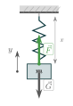
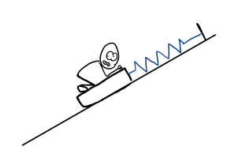
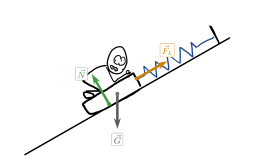
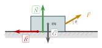
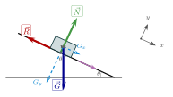
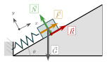
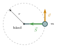
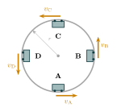
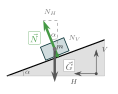

:::: {.oppgaver}

I dette avsnittet skal vi studere anvendelser av det vi har lært så langt. Vi skal se på noen eksempler som demonstrerer hvordan vi bør tenke og jobbe når mange krefter opptrer samtidig, og når vi må dekomponere i forhold til et koordinatsystem. La oss derfor starte med å repetere viktigheten av koordinatsystem.

::: myoppsum*
Dekomponering av Newtons lover Når du skal løse oppgaver med krefter i planet, er det viktig å innføre et koordinatsystem, og deretter dekomponere Newtons lover. La oss velge koordinater $x$ og $y$ i planet. Da har vi

**Newtons 2. lov:** $$\sum\vec{F} = m\vec{a}\quad\Longrightarrow\quad
  \begin{cases}
    \sum F_x = m a_x\\[5pt]
    \sum F_y = m a_y\\[5pt]
  \end{cases}$$ Og selvsagt helt tilsvarende for Newtons første lov, eller andre lover skrevet på vektorform.
:::

Med dette i bakhodet kan vi skrive ned algoritmen som vi skal lære å følge når vi løser sammensatte oppgaver med krefter.

::: myoppsum*
Algoritme for løsing av sammensatte kraftoppgaver

1.  Tegn figur av problemet, med relevante krefter.

2.  Skriv ned de relevante lovene.

3.  Gjør et hensiktsmessig valg av koordinatsystem.

4.  Dekomponer vektorlovene i koordinatsystemet.

5.  Løs settet med skalare likninger for de ukjente.
:::

Følgende eksempel viser algoritmen i bruk for et enkelt likevektsproblem i én dimensjon.

{.tikz-fig style="width:158px"}

[Kloss i ro i en vertikal fjær. $x$ er fjærforlenging fra likevekt, $y$ peker oppover.]{.figurtekst}

::: {.eksempel}
[Eksempel: Kloss hengende i fjær]{.eks-tittel}

En kloss med masse $m = 500\,\mathrm{g}$ festes til en vertikal spiralfjær som er festet i taket. I ro strekkes fjæra $x = 4.0\,\mathrm{cm}$ ut fra likevektsposisjonen. Bestem fjærkonstanten $k$.

:::

::: {.callout-note .svar collapse="true" title="Vis løsning"}

**1. Figur:** Se figur over — kreftene er $\vec{F}$ (fjærkraft, opp) og $\vec{G}$ (tyngdekraft, ned).

**2. Lov:** Klossen er i ro, så Newtons 1. lov gir $\sum\vec{F}=0$.

**3. Koordinatsystem:** $y$-akse peker oppover (se figur).

**4. Dekomponér i $y$-retning:** $$\sum F_y = F - G = 0 \implies kx = m\mathrm{g}$$

**5. Løs for $k$:** $$k = \frac{m\mathrm{g}}{x}
    = \frac{0.500\,\mathrm{kg} \cdot 9.81\,\mathrm{m}\,\mathrm{s}^{-2}}{0.040\,\mathrm{m}}
    = 123\,\mathrm{N}\,\mathrm{m}^{-1} \approx \underline{\underline{1.2\cdot 10^{2}\,\mathrm{N}\,\mathrm{m}^{-1}}}$$

:::

Det neste eksemplet viser algoritmen i bruk når et legeme er i ro på et *friksjonsfritt* skråplan, og holdes tilbake av en fjær i stedet for å skli nedover.

:::: figure
{.tikz-fig style="width:594px"}

::: caption
En slede (med Dashman) holdes i ro på et friksjonsfritt skråplan ($\theta=30°$) av en fjær festet til en stolpe på toppen av planet.
:::
::::

::: {.eksempel}
[Eksempel: Slede i skråplan holdt av fjær]{.eks-tittel}

En slede med Dashman, med samlet masse $m$, ligger i ro på et friksjonsfritt skråplan med helningsvinkel $\theta = 30°$ (se figuren). Sleden er festet til en fjær med fjærkonstant $k = 180\,\mathrm{N}\,\mathrm{m}^{-1}$, som er strukket en lengde $x = 12\,\mathrm{cm}$ fra likevekt.

a)  Tegn inn kreftene som virker på sleden.

b)  Regn ut fjærkrafta $F_k$.

c)  Finn massen $m$ til sleden (med Dashman).

:::

::: {.callout-note .svar collapse="true" title="Vis løsning"}

**a) Figur og krefter:** Tre krefter virker på sleden: normalkraften $\vec{N}$ (vinkelrett på skråplanet), tyngdekraften $\vec{G}=m\vec{\mathrm{g}}$ (rett ned) og fjærkrafta $\vec{F}_k$ (langs skråplanet, oppover). Se figuren.

::: center
{.tikz-fig style="width:501px"}
:::

[Krefter på sleden: normalkraft $\vec{N}$, tyngdekraft $\vec{G}$ og fjærkraft $\vec{F}_k$.]{.figurtekst}

**Lov og koordinatsystem:** Sleden er i ro, så Newtons 1. lov gir $\sum\vec{F}=0$. Vi velger $x$-akse langs skråplanet (positiv oppover) og $y$-akse vinkelrett på skråplanet.

**Dekomponér langs skråplanet ($x$-retning):** $$\sum F_x = F_k - m\mathrm{g}\sin\theta = 0$$

**b) Fjærkrafta:** $$F_k = kx = 180\,\mathrm{N}\,\mathrm{m}^{-1}\cdot0.12\,\mathrm{m} = 21.6\,\mathrm{N} \approx \underline{\underline{22\,\mathrm{N}}}$$

**c) Massen:** Fra dekomponeringen over har vi $F_k = m\mathrm{g}\sin\theta$, slik at $$m = \frac{F_k}{\mathrm{g}\sin\theta}
    = \frac{21.6\,\mathrm{N}}{9.81\,\mathrm{m}\,\mathrm{s}^{-2}\cdot\sin 30°}
    = \underline{\underline{4.4\,\mathrm{kg}}}$$

:::

::: {.oppgave tittel="Kjelke med skrå trekkraft"}
[Kjelke med skrå trekkraft]{.oppg-tittel}

En kjelke med masse $m = 15\,\mathrm{kg}$ dras langs et flatt, snødekket underlag. Trekkraften $\vec{F} = 50\,\mathrm{N}$ er rettet i vinkel $\theta = 30°$ over horisontal (se figur). Den kinetiske friksjonskoeffisienten er $\mu_k = 0.20$.

a)  Finn normalkraften $N$. (Husk at $\vec{F}$ har en vertikal komponent som påvirker $N$.)

b)  Finn friksjonskraften $R$.

c)  Finn kjelkens akselerasjon.

::: {.losning}

**1. Figur:** Kjelken påvirkes av fire krefter: tyngdekraften $\vec G$ (ned), normalkraften $\vec N$ (opp), trekkraften $\vec F$ (i vinkel $\theta=30^\circ$ over horisontalen) og friksjonskraften $\vec R$ (mot bevegelsesretningen), akkurat som i figuren.

**2. Lov:** Newtons 2. lov, $\sum\vec F = m\vec a$. Friksjonen er glidefriksjon: $R=\mu_k N$.

**3. Koordinatsystem:** $x$ horisontalt (i bevegelsesretningen), $y$ vertikalt oppover. Kjelken beveger seg bare langs bakken, så $a_y=0$.

**4. Dekomponér:** Trekkraften har komponenter $F_x=F\cos\theta$ og $F_y=F\sin\theta$. I $y$-retning: $$\sum F_y = N + F\sin\theta - m\mathrm{g} = 0 \quad\Rightarrow\quad N = m\mathrm{g} - F\sin\theta$$ I $x$-retning: $$\sum F_x = F\cos\theta - R = ma$$

**5. Løs:**

**a)** Normalkraften: $$N = m\mathrm{g} - F\sin\theta = 15\,\mathrm{kg}\cdot9.81\,\mathrm{m}\,\mathrm{s}^{-2} - 50\,\mathrm{N}\cdot\sin(30^\circ) = 122\,\mathrm{N} \approx \underline{\underline{1.2\cdot 10^{2}\,\mathrm{N}}}$$ Legg merke til at $N$ er *mindre* enn tyngdekraften, siden trekkraftens vertikale komponent bidrar til å løfte kjelken litt.

**b)** Friksjonskraften: $$R = \mu_k N = 0.20\cdot122\,\mathrm{N} = 24.4\,\mathrm{N} \approx \underline{\underline{24\,\mathrm{N}}}$$

**c)** Akselerasjonen, fra $x$-likningen: $$a = \frac{F\cos\theta - R}{m} = \frac{50\,\mathrm{N}\cdot\cos(30^\circ) - 24.4\,\mathrm{N}}{15\,\mathrm{kg}} = 1.26\,\mathrm{m}\,\mathrm{s}^{-2} \approx \underline{\underline{1.3\,\mathrm{m}\,\mathrm{s}^{-2}}}$$

:::

:::

{.tikz-fig style="width:324px"}

[Kjelke dradd med kraft $\vec{F}$ i vinkel $\theta=30°$ over horisontal. Friksjonskraften $\vec{R}$ og normalkraften $\vec{N}$ angriper ved kontaktflaten.]{.figurtekst}

## Skråplan



Et legeme på skråplan er et mye brukt eksempel som gir oss anledning til å øve på å anvende tre av kreftene vi har pratet om så langt ($\vec{G}, \vec{N}$ og $\vec{R}$) samtidig. I tillegg gir det god øvelse i dekomponering, som vi skal se. La oss se for oss en bil i en isete bakke. Vi ønsker å kunne besvare spørsmål som

-   Ved hvilken vinkel begynner bilen å skli?

-   Hvor fort akselererer den nedover bakken når den først sklir?

La oss nå besvare disse to spørsmålene systematisk ved å bruke Newtons 2. lov. Figuren viser kreftene som virker på en kloss som sklir nedover et skråplan med helningsvinkel $\theta$.

:::: figure
{.tikz-fig style="width:373px"}

::: caption
Krefter på en kloss som sklir nedover et skråplan. Normalkraften $\vec{N}$ peker normalt ut fra planet, tyngdekraften $\vec{G}$ peker rett ned (med komponenter $G_x$, $G_y$ langs og normalt på planet), og friksjonskraften $\vec{R}$ peker opp langs planet siden klossen beveger seg ned. Koordinatsystem: $x$ nedover langs planet, $y$ normalt ut.
:::
::::

**\*** Utledning av akselerasjon ned et skråplan med friksjon.

**1. Figur:** Se figuren.

**2. Lov:** Klossen akselererer nedover langs planet med $\vec{a}$ ned bakken. Friksjonskraften er glidefriksjon og peker *opp* langs planet (den motvirker bevegelsen): $R = \mu_k N$.

**3. Koordinatsystem:** Vi velger $x$ nedover langs planet (positiv retning ned bakken) og $y$ normalt ut fra overflaten. Klossen beveger seg bare langs $x$, så $a_y = 0$.

**4. Dekomponér:** $$\begin{aligned}
    \sum F_y = 0 &:\quad N - m\mathrm{g}\cos\theta = 0 \implies N = m\mathrm{g}\cos\theta\\
    \sum F_x = ma &:\quad m\mathrm{g}\sin\theta - R = ma
\end{aligned}$$

**5. Løs:** Setter inn $R = \mu_k N = \mu_k m\mathrm{g}\cos\theta$: $$\begin{aligned}
    m\mathrm{g}\sin\theta - \mu_k m\mathrm{g}\cos\theta &= ma\\
    \mathrm{g}(\sin\theta - \mu_k\cos\theta) &= a
\end{aligned}$$

::: tcolorbox
$$a = \mathrm{g}(\sin\theta - \mu_k\cos\theta)$$
:::

Legg merke til at massen $m$ falt ut av ligningen. Akselerasjonen ned et skråplan er uavhengig av massen — en tung buss og en lett sykkel akselererer like fort nedover den samme bakken.

**\*** Kritisk vinkel — ved hvilken helning begynner klossen å skli?

Klossen er nettopp på grensen til å begynne å skli når tyngdekraftens komponent langs planet er lik den maksimale hvilefriksjonen. I dette grensetilfelle er $\sum F_x = 0$ med $R_s = \mu_s N$ (maksimal hvilefriksjon): $$m\mathrm{g}\sin\theta_c - \mu_s m\mathrm{g}\cos\theta_c = 0
\quad\implies\quad
\tan\theta_c = \mu_s$$

::: tcolorbox
$$\theta_c = \arctan(\mu_s)$$
:::

Er $\theta < \theta_c$ holder friksjonskraften klossen i ro. Er $\theta > \theta_c$ begynner klossen å skli.

::: {.oppgave tittel="Buss på glatt vei"}
[Buss på glatt vei]{.oppg-tittel}

En buss parkerer på en bakke. Friksjonskoeffisientene mellom dekk og vei er $\mu_s = 0.70$ (statisk) og $\mu_k = 0.50$ (kinetisk).

a)  Ved hvilken helningsvinkel $\theta_c$ begynner bussen å skli nedover?

b)  Hva blir akselerasjonen til bussen idet den begynner å skli?

::: {.losning}

**a)** Bussen begynner å skli idet tyngdekraftens komponent langs bakken akkurat overgår maksimal hvilefriksjon – dette er den kritiske vinkelen utledet i *Kritisk vinkel* (avsnittet *Skråplan*): $$\theta_c = \arctan(\mu_s) = \arctan(0.70) = 35.0^\circ \approx \underline{\underline{35^\circ}}$$

**b)** Idet bussen begynner å skli, glir den, så vi bruker *kinetisk* friksjon $\mu_k$ i formelen for akselerasjon ned et skråplan (utledet i samme avsnitt): $$a = \mathrm{g}(\sin\theta_c - \mu_k\cos\theta_c) = 9.81\,\mathrm{m}\,\mathrm{s}^{-2}\cdot\left(\sin(35.0^\circ) - 0.50\cdot\cos(35.0^\circ)\right) = 1.61\,\mathrm{m}\,\mathrm{s}^{-2} \approx \underline{\underline{1.6\,\mathrm{m}\,\mathrm{s}^{-2}}}$$ Akselerasjonen er rettet nedover bakken.

:::

:::

I neste eksempel kombinerer vi fjærkraft og friksjon på et skråplan. Koordinatsystemet velges med $x$-aksen langs planet (positiv retning opp bakken) og $y$-aksen normalt ut fra overflaten. Figuren viser en kloss som er på grensen til å gli nedover, slik at $R = \mu_s N$ (maks hvilefriksjon).

{.tikz-fig style="width:295px"}

[Kloss på skråplan ($\theta=30°$) holdt av fjær $\vec{F}$ og friksjon $\vec{R}$. Koordinatsystem: $x$ opp langs planet, $y$ normalt ut.]{.figurtekst}

::: {.eksempel}
[Eksempel: Kloss på skråplan — fjær og friksjon]{.eks-tittel}

En kloss med masse $m = 2.0\,\mathrm{kg}$ ligger på et skråplan med helningsvinkel $\theta = 30°$. En fjær langs planet er festet mellom klossen og en vegg i bunnen av bakken, og er komprimert $x = 3.0\,\mathrm{cm}$. Klossen er akkurat på grensen til å gli nedover, og den statiske friksjonskoeffisienten er $\mu_s = 0.20$. Finn fjærkonstanten $k$.

:::

::: {.callout-note .svar collapse="true" title="Vis løsning"}

**1. Figur:** Se figur over.

**2. Lov:** Klossen er (nesten) i ro: $\sum\vec{F}=0$. Maks hvilefriksjon gjelder: $R = \mu_s N$.

**3. Koordinatsystem:** $x$ opp langs planet, $y$ normalt ut fra planet.

**4. Dekomponér:** $$\begin{aligned}
    \sum F_y = 0&:\quad N - G\cos\theta = 0 \implies N = m\mathrm{g}\cos\theta\\
    \sum F_x = 0&:\quad kx + R - G\sin\theta = 0
\end{aligned}$$

**5. Løs:** Sett inn $R = \mu_s N = \mu_s m\mathrm{g}\cos\theta$: $$kx = m\mathrm{g}\sin\theta - \mu_s m\mathrm{g}\cos\theta = m\mathrm{g}(\sin\theta - \mu_s\cos\theta)$$ $$k = \frac{m\mathrm{g}(\sin\theta - \mu_s\cos\theta)}{x}
    = \frac{2.0\,\mathrm{kg}\cdot9.81\,\mathrm{m}\,\mathrm{s}^{-2}(\sin 30° - 0.20\cdot\cos 30°)}{0.030\,\mathrm{m}}
    = 214\,\mathrm{N}\,\mathrm{m}^{-1} \approx \underline{\underline{2.1\cdot 10^{2}\,\mathrm{N}\,\mathrm{m}^{-1}}}$$

:::

::: {.eksempel}
[Eksempel: Kloss på skråplan]{.eks-tittel}

En kloss med masse $m = 3.0\,\mathrm{kg}$ beveger seg nedover et skråplan med helningsvinkel $\theta = 25°$, med akselerasjon $a = 3.0\,\mathrm{m}\,\mathrm{s}^{-2}$ (se figuren).

a)  Finn friksjonskrafta $R$ som virker på klossen.

b)  Finn normalkraften $N$.

:::

::: {.callout-note .svar collapse="true" title="Vis løsning"}

**1. Figur:** Se figuren. Kreftene som virker på klossen er tyngdekraften $\vec{G}$, normalkraften $\vec{N}$ og friksjonskraften $\vec{R}$.

**2. Lov:** Klossen akselererer langs planet, så Newtons 2. lov gir $\sum\vec{F}=m\vec{a}$.

**3. Koordinatsystem:** $x$-akse langs skråplanet (positiv nedover, i bevegelsesretningen), $y$-akse normalt på skråplanet.

**4. Dekomponér:** $$\begin{aligned}
    \sum F_x = ma&:\quad G\sin\theta - R = ma\\
    \sum F_y = 0&:\quad N - G\cos\theta = 0
\end{aligned}$$

**5. Løs:**

**a)** Fra $x$-likningen: $$R = G\sin\theta - ma = m(\mathrm{g}\sin\theta - a)
    = 3.0\,\mathrm{kg}\left(9.81\,\mathrm{m}\,\mathrm{s}^{-2}\cdot\sin 25° - 3.0\,\mathrm{m}\,\mathrm{s}^{-2}\right)
    = \underline{\underline{3.4\,\mathrm{N}}}$$ Positivt fortegn betyr at friksjonen peker oppover langs planet (motsatt av bevegelsesretningen), som forventet.

**b)** Fra $y$-likningen: $$N = G\cos\theta = m\mathrm{g}\cos\theta
    = 3.0\,\mathrm{kg}\cdot9.81\,\mathrm{m}\,\mathrm{s}^{-2}\cdot\cos 25°
    = 26.7\,\mathrm{N} \approx \underline{\underline{27\,\mathrm{N}}}$$

:::

:::: figure
{.tikz-fig style="width:373px"}

::: caption
Krefter på en kloss på et skråplan. Tyngdekraften $\vec{G}$ dekomponeres i $G_x$ (langs planet) og $G_y$ (normalt på planet). Koordinatsystem: $x$ nedover langs planet, $y$ normalt ut.
:::
::::

## Krefter i sirkelbevegelse

For sirkelbevegelse med konstant fart har vi sett at akselerasjonens størrelse er gitt ved $$a=\frac{v^2}{r},$$ hvor $r$ er sirkelens radius. Om vi nå samstiller dette med Newtons 2. lov, $\sum\vec{F}=m\vec{a}$ så finner vi et uttrykk for kraftsummen inn mot sentrum.

::: {.callout-note title="Definisjon: Sentripetalkraft"}

Kraftsummen for sirkelbevegelse med radius $r$ og konstant banefart $v$ er gitt ved $$\sum F=m\cdot \frac{v^2}{r},$$ og rettet inn mot sentrum av sirkelbevegelsen.

:::

Som et første eksempel ser vi på en sleggekaster som svinger slegga rundt seg. Slegga er en metallkule festet til en wire, og sleggekasteren holder i håndtaket i den andre enden. Sett ovenfra går kula i en sirkelbane rundt sleggekasterens hånd. Snorkraften $\vec{S}$ fra wiren peker hele tiden inn mot sentrum — det er denne kraften som gir kula sentripetalakselerasjonen. (Vi forenkler ved å se bort fra tyngdekraften, og ser bare på kreftene i sirkelens plan.)

{.tikz-fig style="width:230px"}

[Sett ovenfra: slegge i en sleggekasters hånd. Snorkraften $\vec{S}$ fra wiren er alltid rettet inn mot sentrum.]{.figurtekst}

::: {.eksempel}
[Eksempel: Slegge]{.eks-tittel}

En sleggekaster svinger en slegge med masse $m = 4.0\,\mathrm{kg}$ rundt seg. Avstanden fra hånda til kula er $r = 1.2\,\mathrm{m}$, og kula holder konstant fart $v = 15\,\mathrm{m}\,\mathrm{s}^{-1}$. Vi ser bort fra tyngdekraften.

Finn kraften i wiren.

:::

::: {.callout-note .svar collapse="true" title="Vis løsning"}

Snorkraften $S$ fra wiren er den eneste kraften vi tar med, og den peker alltid inn mot sentrum (hånda). Den sørger for sentripetalakselerasjonen: $$\sum F = \frac{mv^2}{r}
    \quad\implies\quad
    S = \frac{mv^2}{r}
    = \frac{4.0\,\mathrm{kg} \cdot (15\,\mathrm{m}\,\mathrm{s}^{-1})^2}{1.2\,\mathrm{m}}
    = \frac{900\,\mathrm{N}\,\mathrm{m}}{1.2\,\mathrm{m}}
    = \underline{\underline{7.5\cdot 10^{2}\,\mathrm{N}}}$$ Det tilsvarer omtrent tyngden av en person på $75\,\mathrm{kg}$, så sleggekasteren må holde godt fast!

:::

::: {.oppgave tittel="Karusell"}
[Karusell]{.oppg-tittel}

Et barn med masse $m = 25\,\mathrm{kg}$ sitter $r = 3.0\,\mathrm{m}$ fra sentrum av en karusell som snurrer horisontalt. Karusellen snurrer med konstant fart $v = 4.0\,\mathrm{m}\,\mathrm{s}^{-1}$.

Hva er den resulterende sentripetalkraften på barnet?

::: {.losning}

Den resulterende kraftsummen på barnet må peke inn mot sentrum og ha størrelse $\sum F = mv^2/r$ (se *Sentripetalkraft*): $$\sum F = \frac{mv^2}{r} = \frac{25\,\mathrm{kg}\cdot(4.0\,\mathrm{m}\,\mathrm{s}^{-1})^2}{3.0\,\mathrm{m}} = 133\,\mathrm{N} \approx \underline{\underline{1.3\cdot 10^{2}\,\mathrm{N}}}$$ Denne kraften må komme fra noe som faktisk trekker eller skyver barnet inn mot sentrum – for eksempel et sikkerhetsbelte eller friksjon mot setet.

:::

:::

I en loop på tivoli beveger vogna seg i en *vertikal* sirkel. Da virker tyngdekraften delvis langs bevegelsesretningen, slik at farten endrer seg underveis: vogna går fortere i bunnen enn på toppen. Likevel gjelder sammenhengen for sentripetalkraft i hvert eneste punkt: kraftsummen inn mot sentrum må være $mv^2/r$, der $v$ er farten akkurat der vogna er.

{.tikz-fig style="width:280px"}

[Vogn i en vertikal loop på tivoli, sett fra siden. Farten $v$ er tangentiell til sirkelen i alle fire posisjonene.]{.figurtekst}

::: {.eksempel}
[Eksempel: Vogn i loop på tivoli]{.eks-tittel}

På tivoli går en vogn i en vertikal, helt sirkulær loop. Figuren viser fart i bunnen av loopen (A), halvveis opp loopen (B), på toppen av loopen (C) og halvveis ned igjen (D).

a)  Finn uttrykk for normalkraften i alle tilfeller.

b)  Hvor stor må $v_\text{C}$ være for at vogna ikke skal falle av på toppen?

:::

::: {.callout-note .svar collapse="true" title="Vis løsning"}

**a)** To krefter virker på vogna: tyngdekraften $G = m\mathrm{g}$ (alltid rett ned) og normalkraften $\vec{N}$ fra skinnene. Vogna kjører på innsiden av loopen, så $\vec{N}$ peker alltid inn mot sentrum. Vi velger positiv retning *inn mot sentrum* og bruker at $\sum F = mv^2/r$ i hver posisjon.

**A (bunnen):** $\vec{N}$ peker opp (inn mot sentrum), $\vec{G}$ peker ned (ut fra sentrum): $$N_\text{A} - m\mathrm{g} = m\frac{v_\text{A}^2}{r}
    \quad\implies\quad
    N_\text{A} = m\frac{v_\text{A}^2}{r} + m\mathrm{g}$$

**B og D (halvveis opp og halvveis ned):** $\vec{N}$ er vannrett og peker inn mot sentrum. $\vec{G}$ står vinkelrett på denne retningen og bidrar ikke til kraftsummen inn mot sentrum (den endrer bare hvor fort vogna går): $$N_\text{B} = m\frac{v_\text{B}^2}{r},
    \qquad
    N_\text{D} = m\frac{v_\text{D}^2}{r}$$

**C (toppen):** Både $\vec{N}$ og $\vec{G}$ peker ned, altså inn mot sentrum: $$N_\text{C} + m\mathrm{g} = m\frac{v_\text{C}^2}{r}
    \quad\implies\quad
    N_\text{C} = m\frac{v_\text{C}^2}{r} - m\mathrm{g}$$

**b)** Skinnene kan bare *skyve* på vogna, ikke trekke i den. Normalkraften kan derfor ikke bli negativ. Hvis vi får $N_\text{C} < 0$ i uttrykket over, betyr det at vogna ikke klarer å holde kontakten med skinnene — den faller av. Kravet er altså $$N_\text{C} \geq 0
    \quad\implies\quad
    m\frac{v_\text{C}^2}{r} - m\mathrm{g} \geq 0
    \quad\implies\quad
    \underline{\underline{v_\text{C} \geq \sqrt{\mathrm{g}\,r}}}$$ Massen faller ut: minstefarten på toppen er den samme for en tom og en full vogn.

:::

Kan en bil kjøre gjennom en sirkelformet sving uten friksjon mellom dekk og vei? Ja — hvis veibanen er dosert (hellet innover) med riktig vinkel $\alpha$. Da gir normalkraftens horisontale komponent sentripetalakselerasjonen. Koordinatsystemet velges med $V$-akse (vertikalt opp) og $H$-akse (horisontalt inn mot sentrum), se figur.

{.tikz-fig style="width:229px"}

[Dosert veibane i tverrsnitt. $\vec{N}$ dekomponeres i $N_V$ (opp) og $N_H$ (inn mot sentrum). $H$-aksen peker inn mot svingsentrummet.]{.figurtekst}

::: {.eksempel}
[Eksempel: Dosering av veibane]{.eks-tittel}

Er det mulig for en bil med konstant fart $v$ å kjøre gjennom en sirkelformet sving med radius $r$ uten friksjon mellom dekk og vei? Bestem nødvendig dosering (helningsvinkel) $\alpha$. Bruk $v = 90\,\mathrm{km}\,\mathrm{h}^{-1}$ og $r = 200\,\mathrm{m}$.

:::

::: {.callout-note .svar collapse="true" title="Vis løsning"}

**1. Figur:** Se figur over. To krefter virker på bilen: $\vec{N}$ (normalt på veidekket) og $\vec{G}$ (rett ned). Ingen friksjon.

**2. Lov:** Newtons 2. lov. Sentripetalakselerasjon $a = v^2/r$ i $H$-retningen; null akselerasjon i $V$-retningen.

**3. Koordinatsystem:** $V$-akse vertikalt opp, $H$-akse horisontalt inn mot sentrum.

**4. Dekomponér:** $$\begin{aligned}
    \sum F_V = 0 &:\quad N_V - G = 0 \implies N_V = m\mathrm{g} \\
    \sum F_H = m\frac{v^2}{r} &:\quad N_H = m\frac{v^2}{r} 
\end{aligned}$$

**5. Løs:** Fra geometrien (se figur) er $\tan\alpha = N_H/N_V$. Del $(\star\star)$ på $(\star)$: $$\tan\alpha = \frac{N_H}{N_V} = \frac{m\,v^2/r}{m\,\mathrm{g}} = \frac{v^2}{r\,\mathrm{g}}$$ Massen faller ut — doseringa er uavhengig av kjøretøyets masse. Med tall ($v = 25\,\mathrm{m}\,\mathrm{s}^{-1}$, $r = 200\,\mathrm{m}$): $$\tan\alpha = \frac{(25\,\mathrm{m}\,\mathrm{s}^{-1})^2}{200\,\mathrm{m}\cdot9.81\,\mathrm{m}\,\mathrm{s}^{-2}} = 0.318
    \implies
    \alpha = \arctan(0.318) = 17.7° \approx \underline{\underline{18°}}$$

:::

::::
