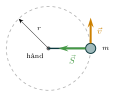
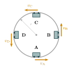
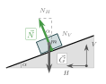

<!-- flyttet fra «Krefter i planet» (uendret tekst) -->
:::: {.oppgaver}

For sirkelbevegelse med konstant fart har vi sett at akselerasjonens størrelse er gitt ved $$a=\frac{v^2}{r},$$ hvor $r$ er sirkelens radius. Om vi nå samstiller dette med Newtons 2. lov, $\sum\vec{F}=m\vec{a}$ så finner vi et uttrykk for kraftsummen inn mot sentrum.

::: {.callout-note title="Definisjon: Sentripetalkraft"}

Kraftsummen for sirkelbevegelse med radius $r$ og konstant banefart $v$ er gitt ved $$\sum F=m\cdot \frac{v^2}{r},$$ og rettet inn mot sentrum av sirkelbevegelsen.

:::

Som et første eksempel ser vi på en sleggekaster som svinger slegga rundt seg. Slegga er en metallkule festet til en wire, og sleggekasteren holder i håndtaket i den andre enden. Sett ovenfra går kula i en sirkelbane rundt sleggekasterens hånd. Snorkraften $\vec{S}$ fra wiren peker hele tiden inn mot sentrum — det er denne kraften som gir kula sentripetalakselerasjonen. (Vi forenkler ved å se bort fra tyngdekraften, og ser bare på kreftene i sirkelens plan.)

{.tikz-fig style="width:230px"}

[Sett ovenfra: slegge i en sleggekasters hånd. Snorkraften $\vec{S}$ fra wiren er alltid rettet inn mot sentrum.]{.figurtekst}

::: {.eksempel}
[Eksempel: Slegge]{.eks-tittel}

En sleggekaster svinger en slegge med masse $m = 4.0\,\mathrm{kg}$ rundt seg. Avstanden fra hånda til kula er $r = 1.2\,\mathrm{m}$, og kula holder konstant fart $v = 15\,\mathrm{m}\,\mathrm{s}^{-1}$. Vi ser bort fra tyngdekraften.

Finn kraften i wiren.

:::

::: {.callout-note .svar collapse="true" title="Vis løsning"}

Snorkraften $S$ fra wiren er den eneste kraften vi tar med, og den peker alltid inn mot sentrum (hånda). Den sørger for sentripetalakselerasjonen: $$\sum F = \frac{mv^2}{r}
    \quad\implies\quad
    S = \frac{mv^2}{r}
    = \frac{4.0\,\mathrm{kg} \cdot (15\,\mathrm{m}\,\mathrm{s}^{-1})^2}{1.2\,\mathrm{m}}
    = \frac{900\,\mathrm{N}\,\mathrm{m}}{1.2\,\mathrm{m}}
    = \underline{\underline{7.5\cdot 10^{2}\,\mathrm{N}}}$$ Det tilsvarer omtrent tyngden av en person på $75\,\mathrm{kg}$, så sleggekasteren må holde godt fast!

:::

::: {.oppgave tittel="Karusell"}
[Karusell]{.oppg-tittel}

Et barn med masse $m = 25\,\mathrm{kg}$ sitter $r = 3.0\,\mathrm{m}$ fra sentrum av en karusell som snurrer horisontalt. Karusellen snurrer med konstant fart $v = 4.0\,\mathrm{m}\,\mathrm{s}^{-1}$.

Hva er den resulterende sentripetalkraften på barnet?

::: {.losning}

Den resulterende kraftsummen på barnet må peke inn mot sentrum og ha størrelse $\sum F = mv^2/r$ (se *Sentripetalkraft*): $$\sum F = \frac{mv^2}{r} = \frac{25\,\mathrm{kg}\cdot(4.0\,\mathrm{m}\,\mathrm{s}^{-1})^2}{3.0\,\mathrm{m}} = 133\,\mathrm{N} \approx \underline{\underline{1.3\cdot 10^{2}\,\mathrm{N}}}$$ Denne kraften må komme fra noe som faktisk trekker eller skyver barnet inn mot sentrum – for eksempel et sikkerhetsbelte eller friksjon mot setet.

:::

:::

I en loop på tivoli beveger vogna seg i en *vertikal* sirkel. Da virker tyngdekraften delvis langs bevegelsesretningen, slik at farten endrer seg underveis: vogna går fortere i bunnen enn på toppen. Likevel gjelder sammenhengen for sentripetalkraft i hvert eneste punkt: kraftsummen inn mot sentrum må være $mv^2/r$, der $v$ er farten akkurat der vogna er.

{.tikz-fig style="width:280px"}

[Vogn i en vertikal loop på tivoli, sett fra siden. Farten $v$ er tangentiell til sirkelen i alle fire posisjonene.]{.figurtekst}

::: {.eksempel}
[Eksempel: Vogn i loop på tivoli]{.eks-tittel}

På tivoli går en vogn i en vertikal, helt sirkulær loop. Figuren viser fart i bunnen av loopen (A), halvveis opp loopen (B), på toppen av loopen (C) og halvveis ned igjen (D).

a)  Finn uttrykk for normalkraften i alle tilfeller.

b)  Hvor stor må $v_\text{C}$ være for at vogna ikke skal falle av på toppen?

:::

::: {.callout-note .svar collapse="true" title="Vis løsning"}

**a)** To krefter virker på vogna: tyngdekraften $G = m\mathrm{g}$ (alltid rett ned) og normalkraften $\vec{N}$ fra skinnene. Vogna kjører på innsiden av loopen, så $\vec{N}$ peker alltid inn mot sentrum. Vi velger positiv retning *inn mot sentrum* og bruker at $\sum F = mv^2/r$ i hver posisjon.

**A (bunnen):** $\vec{N}$ peker opp (inn mot sentrum), $\vec{G}$ peker ned (ut fra sentrum): $$N_\text{A} - m\mathrm{g} = m\frac{v_\text{A}^2}{r}
    \quad\implies\quad
    N_\text{A} = m\frac{v_\text{A}^2}{r} + m\mathrm{g}$$

**B og D (halvveis opp og halvveis ned):** $\vec{N}$ er vannrett og peker inn mot sentrum. $\vec{G}$ står vinkelrett på denne retningen og bidrar ikke til kraftsummen inn mot sentrum (den endrer bare hvor fort vogna går): $$N_\text{B} = m\frac{v_\text{B}^2}{r},
    \qquad
    N_\text{D} = m\frac{v_\text{D}^2}{r}$$

**C (toppen):** Både $\vec{N}$ og $\vec{G}$ peker ned, altså inn mot sentrum: $$N_\text{C} + m\mathrm{g} = m\frac{v_\text{C}^2}{r}
    \quad\implies\quad
    N_\text{C} = m\frac{v_\text{C}^2}{r} - m\mathrm{g}$$

**b)** Skinnene kan bare *skyve* på vogna, ikke trekke i den. Normalkraften kan derfor ikke bli negativ. Hvis vi får $N_\text{C} < 0$ i uttrykket over, betyr det at vogna ikke klarer å holde kontakten med skinnene — den faller av. Kravet er altså $$N_\text{C} \geq 0
    \quad\implies\quad
    m\frac{v_\text{C}^2}{r} - m\mathrm{g} \geq 0
    \quad\implies\quad
    \underline{\underline{v_\text{C} \geq \sqrt{\mathrm{g}\,r}}}$$ Massen faller ut: minstefarten på toppen er den samme for en tom og en full vogn.

:::

Kan en bil kjøre gjennom en sirkelformet sving uten friksjon mellom dekk og vei? Ja — hvis veibanen er dosert (hellet innover) med riktig vinkel $\alpha$. Da gir normalkraftens horisontale komponent sentripetalakselerasjonen. Koordinatsystemet velges med $V$-akse (vertikalt opp) og $H$-akse (horisontalt inn mot sentrum), se figur.

{.tikz-fig style="width:229px"}

[Dosert veibane i tverrsnitt. $\vec{N}$ dekomponeres i $N_V$ (opp) og $N_H$ (inn mot sentrum). $H$-aksen peker inn mot svingsentrummet.]{.figurtekst}

::: {.eksempel}
[Eksempel: Dosering av veibane]{.eks-tittel}

Er det mulig for en bil med konstant fart $v$ å kjøre gjennom en sirkelformet sving med radius $r$ uten friksjon mellom dekk og vei? Bestem nødvendig dosering (helningsvinkel) $\alpha$. Bruk $v = 90\,\mathrm{km}\,\mathrm{h}^{-1}$ og $r = 200\,\mathrm{m}$.

:::

::: {.callout-note .svar collapse="true" title="Vis løsning"}

**1. Figur:** Se figur over. To krefter virker på bilen: $\vec{N}$ (normalt på veidekket) og $\vec{G}$ (rett ned). Ingen friksjon.

**2. Lov:** Newtons 2. lov. Sentripetalakselerasjon $a = v^2/r$ i $H$-retningen; null akselerasjon i $V$-retningen.

**3. Koordinatsystem:** $V$-akse vertikalt opp, $H$-akse horisontalt inn mot sentrum.

**4. Dekomponér:** $$\begin{aligned}
    \sum F_V = 0 &:\quad N_V - G = 0 \implies N_V = m\mathrm{g} \\
    \sum F_H = m\frac{v^2}{r} &:\quad N_H = m\frac{v^2}{r} 
\end{aligned}$$

**5. Løs:** Fra geometrien (se figur) er $\tan\alpha = N_H/N_V$. Del $(\star\star)$ på $(\star)$: $$\tan\alpha = \frac{N_H}{N_V} = \frac{m\,v^2/r}{m\,\mathrm{g}} = \frac{v^2}{r\,\mathrm{g}}$$ Massen faller ut — doseringa er uavhengig av kjøretøyets masse. Med tall ($v = 25\,\mathrm{m}\,\mathrm{s}^{-1}$, $r = 200\,\mathrm{m}$): $$\tan\alpha = \frac{(25\,\mathrm{m}\,\mathrm{s}^{-1})^2}{200\,\mathrm{m}\cdot9.81\,\mathrm{m}\,\mathrm{s}^{-2}} = 0.318
    \implies
    \alpha = \arctan(0.318) = 17.7° \approx \underline{\underline{18°}}$$

:::

::::
