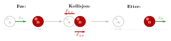
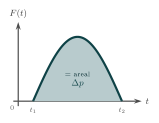
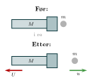
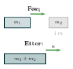

:::: {.oppgaver}

Vi har definert bevegelsesmengde som $\vec{p} = m\vec{v}$, og vi nevnte at bevegelsesmengde er bevart i isolerte systemer. Nå skal vi se nøye på hva dette betyr, og vise hvorfor det er sant.

**\*** Interne og ytre krefter. Tenk deg to biljardkuler som kolliderer (figuren). De utøver krefter på *hverandre* i kollisjonsøyeblikket — dette er *interne* krefter i systemet av to kuler. Dersom vi ser bort fra friksjon mot bordet og luftmotstand, er summen av *ytre* krefter på systemet lik 0. Et slikt system kaller vi *isolert*.

::: center
{.tikz-fig style="width:664px"}

[Biljardkollisjon. Kreftene $\vec{F}_{BA}$ og $\vec{F}_{AB}$ er interne og like store (Newtons 3. lov). Ved elastisk støt mellom like kuler stopper A og B overtar hele farten.]{.figurtekst}
:::

**\*** Utledning fra Newtons lover. Vi ser på to legemer A og B som vekselvirker. Newtons 3. lov sier at kreftene de utøver på hverandre er like store og motsatt rettet: $$\vec{F}_{AB} = -\vec{F}_{BA},$$ der $\vec{F}_{BA}$ er kraften B utøver på A og $\vec{F}_{AB}$ er kraften A utøver på B.

Fra Newtons 2. lov er kraft lik endring i bevegelsesmengde per tidsenhet: $$\vec{F}_{BA} = \frac{\Delta\vec{p}_A}{\Delta t}, \qquad \vec{F}_{AB} = \frac{\Delta\vec{p}_B}{\Delta t}.$$ Legger vi disse to uttrykkene sammen og bruker Newtons 3. lov: $$\frac{\Delta\vec{p}_A}{\Delta t} + \frac{\Delta\vec{p}_B}{\Delta t}
= \vec{F}_{BA} + \vec{F}_{AB} = \vec{0}.$$ Det betyr at: $$\frac{\Delta\!\left(\vec{p}_A + \vec{p}_B\right)}{\Delta t} = \vec{0}
\quad\Longrightarrow\quad
\vec{p}_{tot} = \vec{p}_A + \vec{p}_B = \text{konstant}.$$ Den totale bevegelsesmengden endrer seg ikke. Dette følger direkte av Newtons 2. og 3. lov — ingen ny antagelse er nødvendig.

::: {.callout-note title="Definisjon: Bevaring av bevegelsesmengde"}

Dersom summen av ytre krefter på et system er null, $$\sum \vec{F}_{ytre} = \vec{0},$$ er den totale bevegelsesmengden til systemet bevart: $$\vec{p}_{tot} = \text{konstant}.$$ For to legemer med masser $m_1$ og $m_2$ skrives dette som: $$m_1\vec{v}_1 + m_2\vec{v}_2 = m_1\vec{u}_1 + m_2\vec{u}_2$$ der bokstaven $v$ betegner hastighetene *før* kollisjonen eller hendelsen, og bokstaven $u$ betegner hastighetene *etter*.

:::

::: {.callout-tip title="Tips: For deg som kjenner derivasjon"}

Newtons 2. lov kan skrives i sin mest generelle form ved hjelp av derivasjon: $$\sum\vec{F} = \frac{d\vec{p}}{dt}$$ Her er $\frac{d\vec{p}}{dt}$ den deriverte av bevegelsesmengden med hensyn på tid — altså hvor raskt $\vec{p}$ endrer seg.

Dersom summen av ytre krefter er null, $\sum\vec{F}_{ytre} = \vec{0}$, gir dette direkte: $$\frac{d\vec{p}_{tot}}{dt} = \vec{0}$$ En funksjon med derivert lik null er konstant. Dermed følger bevaringsloven umiddelbart: $\vec{p}_{tot} = \text{konstant}$. Ingen nye antagelser trengs — loven er en direkte konsekvens av Newtons 2. lov.

:::

**Impuls:** Vi har altså sett at $$\frac{\Delta\vec{p}}{\Delta t}=\vec{F}\quad\text{som medfører}\quad \Delta\vec{p}=\vec{F}\,\Delta t.$$

Dette viser at kraft virket over tid gir endring i bevegelsesmengde. I virkeligheten varierer kraften under et kraftstøt — tenk på hockeykøllens slag mot pucken: kraften stiger raskt og faller igjen. For dem som kjenner integraler: $\Delta\vec{p} = \int_{t_1}^{t_2}\vec{F}\,dt$, altså *arealet under $F(t)$-kurven* (figuren). I det enklere tilfellet med konstant kraft er dette arealet nøyaktig rektangelet $F\cdot\Delta t$.

Endringen i bevegelsesmengde forårsaket av et slikt kraftstøt kalles *impuls*. På forkursnivå bruker vi ikke dette begrepet noe videre.

{.tikz-fig style="width:308px"}

[Arealet under $F(t)$-kurven er lik endringen i bevegelsesmengde $\Delta p$. Kraften varierer typisk under et støt.]{.figurtekst}

::: {.callout-note title="Algoritme for løsning"}
Fremgangsmåten i slike oppgaver er alltid den samme:

1.  Identifiser systemet og sjekk at ytre krefter er null (eller neglisjerbare).

2.  Velg en positiv retning.

3.  Skriv opp bevaringsligningen: $\vec{p}_{tot,\,\text{før}} = \vec{p}_{tot,\,\text{etter}}$.

4.  Løs for den ukjente.
:::

**\*** Rekyl. Et klassisk eksempel er rekyl fra et gevær. Før avfyringen er kula og geværet i ro — den totale bevegelsesmengden er null. Etter avfyringen beveger kula seg raskt fremover og geværet sakte bakover, men de to bidragene kansellerer nøyaktig, slik at totalen fortsatt er null.

::: {.eksempel}
[Eksempel: Rekyl fra gevær]{.eks-tittel}

Et gevær med masse $M = 3.0\,\mathrm{kg}$ avfyres horisontalt. En kule med masse $m = 10\,\mathrm{g} = 0.010\,\mathrm{kg}$ forlater løpet med fart $u = 800\,\mathrm{m}\,\mathrm{s}^{-1}$ fremover. Både geværet og kula er i ro før avfyringen.

Finn rekylhastigheten $U$ til geværet.

:::

::: {.callout-note .svar collapse="true" title="Vis løsning"}

Vi velger fremover som positiv retning ($+x$). Siden alt er i ro før avfyringen: $$p_{tot,\,\text{før}} = 0$$ Det virker ingen ytre horisontale krefter i avfyringsøyeblikket, så bevegelsesmengden er bevart: $$\begin{aligned}
p_{tot,\,\text{etter}} &= p_{tot,\,\text{før}} = 0\\[4pt]
mu + MU &= 0\\[4pt]
U &= -\frac{mu}{M}
\end{aligned}$$ Setter inn tallene: $$U = -\frac{0.010\,\mathrm{kg}\cdot800\,\mathrm{m}\,\mathrm{s}^{-1}}{3.0\,\mathrm{kg}}
  = \underline{\underline{-2.7\,\mathrm{m}\,\mathrm{s}^{-1}}}$$ Minustegnet viser at geværet beveger seg *bakover* — det er det vi kjenner som rekyl.

{.tikz-fig style="width:252px"}

:::

**\*** Støt mellom legemer. Det vanligste bruksområdet for bevaring av bevegelsesmengde er kollisjoner. Vi skiller mellom to typer: ved et *fullstendig uelastisk støt* henger legemene fast i hverandre etter kollisjonen og beveger seg som ett objekt, mens de ved et *elastisk støt* spretter fra hverandre og bevarer i tillegg den kinetiske energien. I begge tilfeller er bevegelsesmengden bevart, men ved uelastisk støt omdannes en del av den kinetiske energien til andre energiformer, som varme, lyd eller deformasjon. Vi skal komme tilbake til dette i neste kapittel.

::: {.eksempel}
[Eksempel: Uelastisk støt: vogner som kolliderer og henger fast]{.eks-tittel}

En vogn med masse $m_1 = 2.0\,\mathrm{kg}$ ruller med fart $v_1 = 3.0\,\mathrm{m}\,\mathrm{s}^{-1}$ og støter inn i en vogn med masse $m_2 = 1.0\,\mathrm{kg}$ som er i ro. Vognene henger seg fast i hverandre etter støtet.

Finn den felles farten $u$ til de sammenkoblede vognene.

:::

::: {.callout-note .svar collapse="true" title="Vis løsning"}

Vi velger $+x$ langs bevegelsesretningen til vogn 1.

Bevaringsligningen: $$\begin{aligned}
m_1 v_1 + m_2 \cdot 0 &= (m_1 + m_2)\,u\\[4pt]
u &= \frac{m_1 v_1}{m_1 + m_2}
\end{aligned}$$ Setter inn tallene: $$u = \frac{2.0\,\mathrm{kg}\cdot3.0\,\mathrm{m}\,\mathrm{s}^{-1}}{3.0\,\mathrm{kg}}
    = \underline{\underline{2.0\,\mathrm{m}\,\mathrm{s}^{-1}}}$$ De sammenkoblede vognene beveger seg med $2.0\,\mathrm{m}\,\mathrm{s}^{-1}$ i samme retning som vogn 1.

{.tikz-fig style="width:203px"}

:::

::: {.oppgave tittel="To skøyteløpere"}
[To skøyteløpere]{.oppg-tittel}

Oda ($m_O = 55\,\mathrm{kg}$) og Per ($m_P = 80\,\mathrm{kg}$) står i ro på isen og skyver fra hverandre. Etter skyvingen beveger Oda seg med fart $4.0\,\mathrm{m}\,\mathrm{s}^{-1}$ i én retning.

a)  Hva er Pers hastighet etter skyvingen?

b)  Hva er bevegelsesmengden til hvert av dem etter skyvingen? Kommenter svaret.

::: {.losning}

Oda og Per utgjør et isolert system (vi ser bort fra friksjon mot isen), så bevegelsesmengden er bevart (se avsnitten), akkurat som i eksempelet *Rekyl fra gevær*. Før skyvingen er alt i ro, $p_{tot,\,\text{før}}=0$. Vi velger Odas bevegelsesretning som positiv.

**a)** Bevaringslikningen gir $$0 = m_O u_O + m_P u_P \quad\Rightarrow\quad u_P = -\frac{m_O u_O}{m_P} = -\frac{55\,\mathrm{kg}\cdot4.0\,\mathrm{m}\,\mathrm{s}^{-1}}{80\,\mathrm{kg}} = -2.75\,\mathrm{m}\,\mathrm{s}^{-1} \approx \underline{\underline{-2.8\,\mathrm{m}\,\mathrm{s}^{-1}}}$$ Per beveger seg altså med $2.75\,\mathrm{m}\,\mathrm{s}^{-1}$ i *motsatt* retning av Oda.

**b)** Bevegelsesmengden til hver av dem: $$p_O = m_O u_O = 55\,\mathrm{kg}\cdot4.0\,\mathrm{m}\,\mathrm{s}^{-1} = 220\,\mathrm{kg}\,\mathrm{m}\,\mathrm{s}^{-1} \approx \underline{\underline{2.2\cdot 10^{2}\,\mathrm{kg}\,\mathrm{m}\,\mathrm{s}^{-1}}}$$ $$p_P = m_P u_P = 80\,\mathrm{kg}\cdot(-2.75\,\mathrm{m}\,\mathrm{s}^{-1}) = -220\,\mathrm{kg}\,\mathrm{m}\,\mathrm{s}^{-1} \approx \underline{\underline{-2.2\cdot 10^{2}\,\mathrm{kg}\,\mathrm{m}\,\mathrm{s}^{-1}}}$$ Bevegelsesmengdene er like store og motsatt rettet, slik at summen fortsatt er null – akkurat som før skyvingen. Dette er nøyaktig det bevaringsloven sier skal skje.

:::

:::

::: {.oppgave tittel="Bilkollisjon"}
[Bilkollisjon]{.oppg-tittel}

En bil med masse $m_1 = 1200\,\mathrm{kg}$ kjører med fart $20\,\mathrm{m}\,\mathrm{s}^{-1}$ mot en bil med masse $m_2 = 1000\,\mathrm{kg}$ som kjører i *motsatt* retning med fart $15\,\mathrm{m}\,\mathrm{s}^{-1}$. Bilene henger fast etter kollisjonen.

a)  Hva er den totale bevegelsesmengden til systemet *før* kollisjonen?

b)  Finn farten og retningen til bilene etter kollisjonen.

::: {.losning}

Vi velger bil 1 sin bevegelsesretning som positiv, slik at $v_1=20\,\mathrm{m}\,\mathrm{s}^{-1}$ og $v_2=-15\,\mathrm{m}\,\mathrm{s}^{-1}$ (motsatt retning). Dette er et fullstendig uelastisk støt (bilene henger fast), analogt med eksempelet *Uelastisk støt: vogner som kolliderer* i avsnitten.

**a)** Total bevegelsesmengde før kollisjonen: $$p_{tot,\,\text{før}} = m_1 v_1 + m_2 v_2 = 1200\,\mathrm{kg}\cdot20\,\mathrm{m}\,\mathrm{s}^{-1} + 1000\,\mathrm{kg}\cdot(-15\,\mathrm{m}\,\mathrm{s}^{-1}) = \underline{\underline{9.0\cdot 10^{3}\,\mathrm{kg}\,\mathrm{m}\,\mathrm{s}^{-1}}}$$

**b)** Siden bevegelsesmengden er bevart, og bilene beveger seg som én masse $m_1+m_2$ etter kollisjonen: $$p_{tot,\,\text{før}} = (m_1+m_2)\,u \quad\Rightarrow\quad u = \frac{p_{tot,\,\text{før}}}{m_1+m_2} = \frac{9000\,\mathrm{kg}\,\mathrm{m}\,\mathrm{s}^{-1}}{2200\,\mathrm{kg}} = 4.09\,\mathrm{m}\,\mathrm{s}^{-1} \approx \underline{\underline{4.1\,\mathrm{m}\,\mathrm{s}^{-1}}}$$ Farten er positiv, så bilvraket beveger seg videre i **samme retning som bil 1** (den tyngste og raskeste av de to) etter sammenstøtet.

:::

:::

::::
