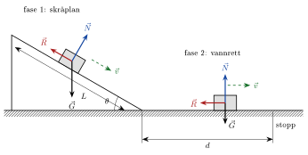
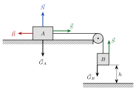

<!-- video: kommer (videoer/fysikk-forkurs/04-07-sammensatte-mekanikkoppgaver) -->
{fig-alt="Video kommer"}

<!-- tillegg: Claude -->
En pakke sklir ned en rampe og videre bortover gulvet. En bil kjører inn i en annen, og de to sklir sammen til de stopper. I virkeligheten skjer sjelden bare én ting om gangen. Mange oppgaver i mekanikk består derfor av flere deler som henger sammen: først én bevegelse, så en annen.

Det fine er at du allerede kan alle delene. Det nye er å se *hvor* oppgaven skal deles, og å velge riktig verktøy for hver del.

## En strategi som virker

::: {.steg}
1. **Skisse og kraftdiagram.** Tegn situasjonen, skriv på alle kjente størrelser, og tegn kreftene på hvert legeme. Velg positiv retning.
2. **Del opp i faser.** En ny fase begynner når kreftene endrer seg: underlaget skifter, en snor blir slakk, noe slippes, eller to legemer støter sammen.
3. **Velg verktøy.** Bestem for hver fase om du skal bruke Newtons 2. lov, bevegelseslikningene, energi eller bevegelsesmengde.
4. **Sett opp.** Skriv likningene med bokstaver først. Ofte forsvinner en størrelse, for eksempel massen.
5. **Regn.** Sett inn tall til slutt, og ta sluttfarten fra én fase med som startfart i neste.
6. **Sjekk.** Stemmer enheten? Er svaret rimelig? Gir en annen metode samme svar?
:::

Punkt 2 er nøkkelen. Innenfor én fase er kreftene som regel konstante, og da er akselerasjonen også konstant. Det er nettopp der verktøyene våre virker best.

::: {.callout-important title="Bindeleddet mellom fasene"}
Farten et legeme har i slutten av én fase, er farten det har i starten av neste. Det er denne farten som binder delene sammen. Finn den først, og regn videre med den uavrundede verdien.
:::

## Hvilket verktøy passer?

::: {.kort}
- **Newtons 2. lov** Bruk $\sum F = ma$ når du trenger akselerasjonen eller en kraft, for eksempel normalkraft, friksjon eller snorkraft. Akselerasjonen går så videre inn i bevegelseslikningene.
- **Bevegelseslikningene** Bruk dem når akselerasjonen er konstant. De er det eneste verktøyet som gir deg **tiden**, og de trengs for kast, der vannrett og loddrett bevegelse regnes hver for seg.
- **Energi** Spør oppgaven etter fart, høyde eller strekning, men ikke tid, er energi ofte raskest. Friksjon gir et energitap $R\cdot s$. Energi virker også når banen er krum.
- **Bevegelsesmengde** Ved støt og kollisjoner er kreftene store, ukjente og kortvarige. Da er bevegelsesmengden bevart, men den kinetiske energien er det som regel ikke.
:::

Du finner verktøyene forklart under [bevegelseslikningene](../03-kinematikk/04-bevegelseslikningene-for-konstant-akselerasjon.qmd), [krefter i planet](04-krefter-i-planet-dekomponering.qmd), [bevaring av mekanisk energi](../05-energi/04-bevaring-av-mekanisk-energi.qmd), [energitap](../05-energi/03-energitap.qmd) og [bevaring av bevegelsesmengde](06-bevaring-av-bevegelsesmengde.qmd).

## Gjennomregnede eksempler

Eksemplene blir gradvis vanskeligere. Prøv gjerne selv før du åpner løsningen.

{.tikz-fig style="width:560px" fig-alt="En kloss sklir ned et skråplan med vinkel theta og lengde L, og videre bortover et vannrett underlag til den stopper etter strekningen d. På skråplanet virker tyngden G rett ned, normalkraften N vinkelrett på planet og friksjonen R oppover langs planet. På det vannrette virker G ned, N opp og R mot bevegelsen."}

::: {.eksempel}
**Eksempel: Kloss ned skråplan og bortover gulvet.** En kloss med masse $2.00\ \mathrm{kg}$ slippes fra ro på toppen av et skråplan med vinkel $\theta = 30.0^\circ$ og lengde $L = 3.00\ \mathrm{m}$. Nederst går planet over i et vannrett gulv. Friksjonstallet er $\mu_k = 0.200$ både på skråplanet og på gulvet. a) Finn akselerasjonen ned skråplanet. b) Hvor stor fart har klossen nederst? c) Hvor langt glir den bortover gulvet før den stopper?

::: {.losning}
**Faser:** Fase 1 er skråplanet, fase 2 er gulvet. Kreftene er konstante i hver fase, men forskjellige fra fase til fase. Vi bruker Newtons 2. lov og bevegelseslikningene i hver fase.

**Fase 1, skråplanet.** Vi legger $x$-aksen langs planet, positiv nedover, og $y$-aksen vinkelrett på planet (se figuren). Klossen beveger seg ikke vinkelrett på planet, så
$$
N = m\mathrm{g}\cos\theta = 2.00\ \mathrm{kg}\cdot 9.81\ \mathrm{m/s^2}\cdot\cos 30.0^\circ = 16.99\ \mathrm{N}.
$$
Friksjonen er $R = \mu_k N = 0.200\cdot 16.99\ \mathrm{N} = 3.398\ \mathrm{N}$, og den peker opp langs planet. Langs planet gir Newtons 2. lov
$$
m\mathrm{g}\sin\theta - \mu_k m\mathrm{g}\cos\theta = ma_1
\quad\Longrightarrow\quad
a_1 = \mathrm{g}(\sin\theta - \mu_k\cos\theta).
$$
Massen forsvant. Med tall:

a)
$$
a_1 = 9.81\ \mathrm{m/s^2}\cdot(\sin 30.0^\circ - 0.200\cdot\cos 30.0^\circ) = 3.206\ \mathrm{m/s^2} \approx \underline{\underline{3.21\ \mathrm{m/s^2}}}
$$

b) Klossen starter i ro, så $v_0 = 0$, og $v^2 = v_0^2 + 2as$ gir
$$
v_1 = \sqrt{2a_1L} = \sqrt{2\cdot 3.206\ \mathrm{m/s^2}\cdot 3.00\ \mathrm{m}} = 4.386\ \mathrm{m/s} \approx \underline{\underline{4.39\ \mathrm{m/s}}}
$$

**Fase 2, gulvet.** Nå er $N = m\mathrm{g}$, og friksjonen $R = \mu_k m\mathrm{g}$ er den eneste kraften langs bevegelsen. Akselerasjonen er
$$
a_2 = -\frac{\mu_k m\mathrm{g}}{m} = -\mu_k\mathrm{g} = -0.200\cdot 9.81\ \mathrm{m/s^2} = -1.962\ \mathrm{m/s^2}.
$$
Startfarten i fase 2 er sluttfarten fra fase 1, $v_1 = 4.386\ \mathrm{m/s}$. Klossen stopper når $v = 0$:

c)
$$
0 = v_1^2 + 2a_2 d \quad\Longrightarrow\quad
d = \frac{v_1^2}{2\mu_k\mathrm{g}} = \frac{(4.386\ \mathrm{m/s})^2}{2\cdot 1.962\ \mathrm{m/s^2}} = 4.902\ \mathrm{m} \approx \underline{\underline{4.90\ \mathrm{m}}}
$$

**Sjekk med energi.** Klossen starter og slutter i ro, så all potensiell energi $m\mathrm{g}h$ har gått til friksjonsarbeid. Høyden er $h = L\sin\theta = 1.500\ \mathrm{m}$:
$$
m\mathrm{g}h = \mu_k m\mathrm{g}\cos\theta\cdot L + \mu_k m\mathrm{g}\cdot d
\quad\Longrightarrow\quad
d = \frac{h - \mu_k L\cos\theta}{\mu_k} = \frac{1.500\ \mathrm{m} - 0.200\cdot 3.00\ \mathrm{m}\cdot\cos 30.0^\circ}{0.200} = 4.90\ \mathrm{m}.
$$
Samme svar. At massen ikke betyr noe, er også rimelig: en tung og en lett kloss av samme materiale sklir like langt.
:::
:::

Endre vinkelen, lengden eller friksjonstallet i programmet og trykk **Kjør**. Hva skjer når friksjonstallet blir større enn $\tan\theta$?

```{.python .kjor}
import numpy as np

g = 9.81          # m/s^2
vinkel = 30.0     # skråplanets vinkel i grader
L = 3.00          # lengden ned skråplanet i m
mu = 0.200        # friksjonstall (samme på begge underlag)

theta = np.radians(vinkel)
if np.tan(theta) <= mu:
    print("Friksjonen er for stor: klossen sklir ikke ned av seg selv.")
else:
    a1 = g * (np.sin(theta) - mu * np.cos(theta))   # fase 1: skråplanet
    v1 = np.sqrt(2 * a1 * L)                         # fart nederst
    a2 = mu * g                                      # fase 2: bremsing
    d = v1**2 / (2 * a2)                             # bremselengde
    print(f"Akselerasjon ned planet: {a1:.2f} m/s^2")
    print(f"Fart nederst:            {v1:.2f} m/s")
    print(f"Glir på det vannrette:   {d:.2f} m")
```

::: {.eksempel}
**Eksempel: Dytt og utfor bordkanten.** En kloss med masse $0.500\ \mathrm{kg}$ ligger i ro på et bord. Du dytter den med en vannrett kraft på $3.00\ \mathrm{N}$ over en strekning på $0.400\ \mathrm{m}$ og slipper. Klossen glir så $0.300\ \mathrm{m}$ til før den glir utfor bordkanten. Bordet er $0.900\ \mathrm{m}$ høyt, og friksjonstallet mellom kloss og bord er $\mu_k = 0.300$. Hvor langt fra bordkanten treffer klossen gulvet? Se bort fra luftmotstand.

::: {.losning}
**Faser:** Det er tre faser: 1) dyttet, 2) glidingen uten dytt og 3) fallet. Fase 1 og 2 løser vi med Newtons 2. lov og bevegelseslikningene. Fase 3 er et vannrett kast.

**Friksjonen** er den samme i fase 1 og 2, fordi normalkraften er $N = m\mathrm{g}$ i begge:
$$
R = \mu_k m\mathrm{g} = 0.300\cdot 0.500\ \mathrm{kg}\cdot 9.81\ \mathrm{m/s^2} = 1.4715\ \mathrm{N}.
$$

**Fase 1, dyttet.** Summen av kreftene langs bordet er $F - R$:
$$
a_1 = \frac{F - R}{m} = \frac{3.00\ \mathrm{N} - 1.4715\ \mathrm{N}}{0.500\ \mathrm{kg}} = 3.057\ \mathrm{m/s^2},
$$
$$
v_1 = \sqrt{2a_1 s_1} = \sqrt{2\cdot 3.057\ \mathrm{m/s^2}\cdot 0.400\ \mathrm{m}} = 1.564\ \mathrm{m/s}.
$$

**Fase 2, glidingen.** Nå virker bare friksjonen langs bordet, så $a_2 = -\mu_k\mathrm{g} = -2.943\ \mathrm{m/s^2}$. Med $v_1$ som startfart:
$$
v_2 = \sqrt{v_1^2 + 2a_2 s_2} = \sqrt{(1.564\ \mathrm{m/s})^2 - 2\cdot 2.943\ \mathrm{m/s^2}\cdot 0.300\ \mathrm{m}} = 0.8245\ \mathrm{m/s}.
$$
Uttrykket under rottegnet er positivt, så klossen når faktisk kanten.

**Fase 3, fallet.** Klossen forlater bordet med vannrett fart $v_2$. Falltiden finner vi fra den loddrette bevegelsen:
$$
t = \sqrt{\frac{2h}{\mathrm{g}}} = \sqrt{\frac{2\cdot 0.900\ \mathrm{m}}{9.81\ \mathrm{m/s^2}}} = 0.4284\ \mathrm{s},
$$
og vannrett går klossen
$$
x = v_2 t = 0.8245\ \mathrm{m/s}\cdot 0.4284\ \mathrm{s} = 0.3532\ \mathrm{m} \approx \underline{\underline{0.353\ \mathrm{m}}}
$$

**Rimelig?** En kloss som så vidt glir utfor et bord, lander litt utenfor bordkanten, ikke flere meter unna. Det stemmer.
:::
:::

Det neste eksemplet har to legemer som henger sammen med en snor. Da tegner vi et kraftdiagram for hvert legeme. Snorkraften $S$ er like stor i begge ender når snora og trinsa er lette og trinsa går uten friksjon.

{.tikz-fig style="width:400px" fig-alt="Kloss A ligger på et bord og er festet med en snor over en trinse i bordkanten til kloss B, som henger i høyden h over gulvet. På A virker normalkraften N opp, tyngden G_A ned, snorkraften S mot trinsa og friksjonen R motsatt. På B virker snorkraften S opp og tyngden G_B ned."}

::: {.eksempel}
**Eksempel: To klosser over en trinse.** Kloss $A$ med masse $3.00\ \mathrm{kg}$ ligger på et vannrett bord, og friksjonstallet mot bordet er $\mu_k = 0.150$. En snor går fra $A$ over en lett trinse i bordkanten til kloss $B$ med masse $1.50\ \mathrm{kg}$, som henger $h = 0.800\ \mathrm{m}$ over gulvet. Klossene slippes fra ro. a) Finn akselerasjonen og snorkraften. b) Hvor stor fart har klossene når $B$ treffer gulvet? c) Hvor langt glir $A$ til sammen? Bordet er langt nok til at $A$ ikke når trinsa.

::: {.losning}
**Faser:** Fase 1 varer til $B$ treffer gulvet. Da blir snora slakk, og i fase 2 bremses $A$ av friksjonen alene.

**Fase 1.** Klossene beveger seg like fort, så de har samme akselerasjon $a$. Vi velger positiv retning slik at $A$ går mot trinsa og $B$ nedover. Newtons 2. lov for hver kloss:
$$
A:\quad S - \mu_k m_A\mathrm{g} = m_A a, \qquad\qquad B:\quad m_B\mathrm{g} - S = m_B a.
$$
Legger vi likningene sammen, forsvinner $S$:
$$
m_B\mathrm{g} - \mu_k m_A\mathrm{g} = (m_A + m_B)a
\quad\Longrightarrow\quad
a = \frac{m_B - \mu_k m_A}{m_A + m_B}\,\mathrm{g}.
$$

a)
$$
a = \frac{1.50\ \mathrm{kg} - 0.150\cdot 3.00\ \mathrm{kg}}{4.50\ \mathrm{kg}}\cdot 9.81\ \mathrm{m/s^2} = 2.289\ \mathrm{m/s^2} \approx \underline{\underline{2.29\ \mathrm{m/s^2}}}
$$
Snorkraften finner vi fra likningen for $B$:
$$
S = m_B(\mathrm{g} - a) = 1.50\ \mathrm{kg}\cdot(9.81 - 2.289)\ \mathrm{m/s^2} = 11.28\ \mathrm{N} \approx \underline{\underline{11.3\ \mathrm{N}}}
$$
Snorkraften er mindre enn tyngden til $B$ ($14.7\ \mathrm{N}$). Det må den være, ellers ville ikke $B$ akselerert nedover.

b) Begge klossene har gått $h = 0.800\ \mathrm{m}$ fra ro:
$$
v = \sqrt{2ah} = \sqrt{2\cdot 2.289\ \mathrm{m/s^2}\cdot 0.800\ \mathrm{m}} = 1.914\ \mathrm{m/s} \approx \underline{\underline{1.91\ \mathrm{m/s}}}
$$

**Fase 2.** Snora er slakk, så bare friksjonen virker langs bordet på $A$: $a_2 = -\mu_k\mathrm{g} = -1.4715\ \mathrm{m/s^2}$. Startfarten er $v = 1.914\ \mathrm{m/s}$:
$$
d_2 = \frac{v^2}{2\mu_k\mathrm{g}} = \frac{(1.914\ \mathrm{m/s})^2}{2\cdot 1.4715\ \mathrm{m/s^2}} = 1.244\ \mathrm{m}.
$$

c) Til sammen glir $A$
$$
s = h + d_2 = 0.800\ \mathrm{m} + 1.244\ \mathrm{m} = 2.044\ \mathrm{m} \approx \underline{\underline{2.04\ \mathrm{m}}}
$$

**Sjekk med energi i fase 1:** Tapet i potensiell energi for $B$ minus friksjonsarbeidet på $A$ skal bli kinetisk energi for begge:
$$
m_B\mathrm{g}h - \mu_k m_A\mathrm{g}h = 11.772\ \mathrm{J} - 3.532\ \mathrm{J} = 8.240\ \mathrm{J},
\qquad
\tfrac12(m_A + m_B)v^2 = \tfrac12\cdot 4.50\ \mathrm{kg}\cdot(1.914\ \mathrm{m/s})^2 = 8.240\ \mathrm{J}.
$$
Det stemmer.
:::
:::

Det siste eksemplet går baklengs: vi kjenner slutten og skal finne starten. Fasene er de samme, vi bare regner dem i omvendt rekkefølge.

::: {.eksempel}
**Eksempel: Kollisjon og bremsespor.** En bil med masse $1200\ \mathrm{kg}$ kjører inn i bakenden på en bil med masse $900\ \mathrm{kg}$ som står stille med bremsene på. Bilene henger sammen etter kollisjonen og sklir $6.5\ \mathrm{m}$ før de stopper. Friksjonstallet mellom dekk og vei er $\mu_k = 0.70$, og vi antar at alle hjulene sklir. a) Hvor stor fart hadde bilene rett etter kollisjonen? b) Hvor fort kjørte den første bilen? c) Hvor mye kinetisk energi gikk tapt i selve kollisjonen?

::: {.losning}
**Faser:** Fase 1 er kollisjonen, som tar svært kort tid. Fase 2 er sklien. Vi kjenner slutten av fase 2 og regner derfor fase 2 først.

**Fase 2, sklien.** Bilene sklir som ett legeme med masse $M = 2100\ \mathrm{kg}$. Friksjonen $\mu_k M\mathrm{g}$ gir akselerasjonen $-\mu_k\mathrm{g}$, og sluttfarten er null:

a)
$$
0 = u^2 - 2\mu_k\mathrm{g}s
\quad\Longrightarrow\quad
u = \sqrt{2\mu_k\mathrm{g}s} = \sqrt{2\cdot 0.70\cdot 9.81\ \mathrm{m/s^2}\cdot 6.5\ \mathrm{m}} = 9.448\ \mathrm{m/s} \approx \underline{\underline{9.4\ \mathrm{m/s}}}
$$

**Fase 1, kollisjonen.** Under kollisjonen er kreftene mellom bilene mye større enn friksjonen fra veien, og støtet varer svært kort. Derfor er bevegelsesmengden bevart. Den andre bilen står i ro før støtet:
$$
m_1 v_1 + 0 = (m_1 + m_2)\,u
\quad\Longrightarrow\quad
v_1 = \frac{m_1 + m_2}{m_1}\,u.
$$

b)
$$
v_1 = \frac{2100\ \mathrm{kg}}{1200\ \mathrm{kg}}\cdot 9.448\ \mathrm{m/s} = 16.53\ \mathrm{m/s} \approx \underline{\underline{17\ \mathrm{m/s}}}
$$
Det er omtrent $60\ \mathrm{km/h}$.

c) Kinetisk energi før og etter støtet:
$$
E_\text{K,før} = \tfrac12\cdot 1200\ \mathrm{kg}\cdot(16.53\ \mathrm{m/s})^2 = 164.0\ \mathrm{kJ},
\qquad
E_\text{K,etter} = \tfrac12\cdot 2100\ \mathrm{kg}\cdot(9.448\ \mathrm{m/s})^2 = 93.7\ \mathrm{kJ}.
$$
$$
\Delta E = 164.0\ \mathrm{kJ} - 93.7\ \mathrm{kJ} = 70.3\ \mathrm{kJ} \approx \underline{\underline{70\ \mathrm{kJ}}}
$$
Denne energien gikk til å bulke blikk, varme og lyd. Derfor kan vi **ikke** bruke energibevaring gjennom selve kollisjonen. Hadde vi gjort det, ville vi fått $\tfrac12 m_1 v_1^2 = \tfrac12(m_1 + m_2)u^2$, som gir $v_1 = 12.5\ \mathrm{m/s}$, altså bare $45\ \mathrm{km/h}$. Det er for lite.
:::
:::

::: {.callout-tip title="Til ettertanke"}
I eksemplet med kollisjonen brukte vi bevegelsesmengde i én fase og friksjon i den neste. Hvorfor kan vi se bort fra friksjonen fra veien *under* selve kollisjonen, men ikke etterpå?
:::

:::: {.oppgaver}

::: {.oppgave tittel="Skiløperen"}
En skiløper starter i ro på toppen av en bakke og kjører ned en loddrett høyde på $12.0\ \mathrm{m}$. Se bort fra friksjon og luftmotstand i bakken. Nederst går bakken over i en flate med friksjonstall $\mu_k = 0.080$. a) Hvor stor fart har skiløperen nederst i bakken? b) Hvor langt glir hun på flata før hun stopper?

::: {.losning}
**Faser:** Fase 1 er bakken (ingen friksjon), fase 2 er flata (friksjon). Bakken kan være krum, og vi kjenner ikke vinkelen, så i fase 1 bruker vi energi.

a) All potensiell energi blir kinetisk energi:
$$
m\mathrm{g}h = \tfrac12 mv^2
\quad\Longrightarrow\quad
v = \sqrt{2\mathrm{g}h} = \sqrt{2\cdot 9.81\ \mathrm{m/s^2}\cdot 12.0\ \mathrm{m}} = 15.34\ \mathrm{m/s} \approx \underline{\underline{15.3\ \mathrm{m/s}}}
$$

b) På flata er $N = m\mathrm{g}$, og friksjonen $\mu_k m\mathrm{g}$ gir akselerasjonen $a = -\mu_k\mathrm{g}$. Med startfarten fra a) og sluttfart null:
$$
d = \frac{v^2}{2\mu_k\mathrm{g}} = \frac{2\mathrm{g}h}{2\mu_k\mathrm{g}} = \frac{h}{\mu_k} = \frac{12.0\ \mathrm{m}}{0.080} = 150\ \mathrm{m} \approx \underline{\underline{1.5\cdot10^2\ \mathrm{m}}}
$$
Friksjonstallet har to gjeldende siffer, så svaret får også to. Legg merke til det enkle resultatet $d = h/\mu_k$: verken massen eller $\mathrm{g}$ betyr noe.
:::
:::

::: {.oppgave tittel="To klosser som henger over en trinse"}
To klosser med masse $2.50\ \mathrm{kg}$ og $1.50\ \mathrm{kg}$ henger i hver sin ende av en snor som går over en lett trinse uten friksjon. Klossene slippes fra ro. a) Finn akselerasjonen. b) Finn snorkraften. c) Hvor stor fart har klossene når de har flyttet seg $0.500\ \mathrm{m}$? Løs c) både med bevegelseslikningene og med energi.

::: {.losning}
Kall den tunge klossen 1 ($m_1 = 2.50\ \mathrm{kg}$) og den lette 2 ($m_2 = 1.50\ \mathrm{kg}$). Kloss 1 går ned og kloss 2 opp med like stor akselerasjon $a$. Snorkraften $S$ virker oppover på begge.

a) Newtons 2. lov, med positiv retning i bevegelsesretningen for hver kloss:
$$
1:\quad m_1\mathrm{g} - S = m_1 a, \qquad\qquad 2:\quad S - m_2\mathrm{g} = m_2 a.
$$
Vi legger sammen likningene, så $S$ forsvinner:
$$
a = \frac{m_1 - m_2}{m_1 + m_2}\,\mathrm{g} = \frac{1.00\ \mathrm{kg}}{4.00\ \mathrm{kg}}\cdot 9.81\ \mathrm{m/s^2} = 2.4525\ \mathrm{m/s^2} \approx \underline{\underline{2.45\ \mathrm{m/s^2}}}
$$

b) Fra likningen for kloss 2:
$$
S = m_2(\mathrm{g} + a) = 1.50\ \mathrm{kg}\cdot(9.81 + 2.4525)\ \mathrm{m/s^2} = 18.39\ \mathrm{N} \approx \underline{\underline{18.4\ \mathrm{N}}}
$$
Kontroll med kloss 1: $S = m_1(\mathrm{g} - a) = 2.50\ \mathrm{kg}\cdot 7.358\ \mathrm{m/s^2} = 18.4\ \mathrm{N}$. Snorkraften ligger mellom de to tyngdene ($14.7\ \mathrm{N}$ og $24.5\ \mathrm{N}$), som den må.

c) **Med bevegelseslikningene:**
$$
v = \sqrt{2as} = \sqrt{2\cdot 2.4525\ \mathrm{m/s^2}\cdot 0.500\ \mathrm{m}} = 1.566\ \mathrm{m/s} \approx \underline{\underline{1.57\ \mathrm{m/s}}}
$$
**Med energi:** Kloss 1 synker $0.500\ \mathrm{m}$, og kloss 2 stiger like mye. Endringen i potensiell energi blir kinetisk energi for begge:
$$
(m_1 - m_2)\mathrm{g}s = \tfrac12(m_1 + m_2)v^2
\quad\Longrightarrow\quad
v = \sqrt{\frac{2(m_1 - m_2)\mathrm{g}s}{m_1 + m_2}} = \sqrt{\frac{2\cdot 1.00\ \mathrm{kg}\cdot 9.81\ \mathrm{m/s^2}\cdot 0.500\ \mathrm{m}}{4.00\ \mathrm{kg}}} = 1.57\ \mathrm{m/s}.
$$
Begge metodene gir samme svar.
:::
:::

::: {.oppgave tittel="Opp skråplanet og ned igjen" niva="Middels"}
En kloss skytes opp et skråplan med vinkel $25.0^\circ$ med startfarten $4.00\ \mathrm{m/s}$. Friksjonstallene er $\mu_k = 0.300$ og $\mu_s = 0.400$. a) Finn akselerasjonen mens klossen går oppover. b) Hvor langt opp langs planet kommer den? c) Blir klossen liggende på toppen, eller glir den ned igjen? d) Hvis den glir ned: Hvor stor fart har den når den er tilbake der den startet?

::: {.losning}
**Faser:** Fase 1 er turen opp, fase 2 er turen ned. Friksjonen peker alltid mot bevegelsen, så den skifter retning mellom fasene. Derfor er akselerasjonen forskjellig. Normalkraften er $N = m\mathrm{g}\cos\theta$ i begge faser.

a) På vei opp peker både tyngdens komponent langs planet og friksjonen nedover langs planet. Med positiv retning nedover langs planet:
$$
a_1 = \mathrm{g}(\sin\theta + \mu_k\cos\theta) = 9.81\ \mathrm{m/s^2}\cdot(\sin 25.0^\circ + 0.300\cdot\cos 25.0^\circ) = 6.813\ \mathrm{m/s^2}.
$$
Klossen bremses altså med $\underline{\underline{6.81\ \mathrm{m/s^2}}}$, rettet ned langs planet.

b) Klossen stopper når farten er null:
$$
s = \frac{v_0^2}{2a_1} = \frac{(4.00\ \mathrm{m/s})^2}{2\cdot 6.813\ \mathrm{m/s^2}} = 1.174\ \mathrm{m} \approx \underline{\underline{1.17\ \mathrm{m}}}
$$

c) I ro trenger klossen en hvilefriksjon på $m\mathrm{g}\sin\theta$ for å bli liggende. Den største hvilefriksjonen er $\mu_s m\mathrm{g}\cos\theta$. Klossen blir liggende bare hvis
$$
m\mathrm{g}\sin\theta \le \mu_s m\mathrm{g}\cos\theta \quad\Longleftrightarrow\quad \tan\theta \le \mu_s.
$$
Her er $\tan 25.0^\circ = 0.466 > 0.400$. Hvilefriksjonen er ikke stor nok, så klossen **glir ned igjen**.

d) På vei ned peker friksjonen oppover langs planet:
$$
a_2 = \mathrm{g}(\sin\theta - \mu_k\cos\theta) = 9.81\ \mathrm{m/s^2}\cdot(\sin 25.0^\circ - 0.300\cdot\cos 25.0^\circ) = 1.479\ \mathrm{m/s^2}.
$$
Klossen starter fra ro på toppen og glir $s = 1.174\ \mathrm{m}$:
$$
v = \sqrt{2a_2 s} = \sqrt{2\cdot 1.479\ \mathrm{m/s^2}\cdot 1.174\ \mathrm{m}} = 1.863\ \mathrm{m/s} \approx \underline{\underline{1.86\ \mathrm{m/s}}}
$$
Farten er mye mindre enn startfarten, fordi friksjonen har tatt energi både på vei opp og ned.
:::
:::

::: {.oppgave tittel="Kula i klossen" niva="Middels"}
En kule med masse $10.0\ \mathrm{g}$ skytes vannrett med farten $400\ \mathrm{m/s}$ inn i en trekloss med masse $2.00\ \mathrm{kg}$ som ligger i ro på et bord. Kula blir sittende fast. Friksjonstallet mellom kloss og bord er $\mu_k = 0.350$. a) Hvor stor fart har klossen rett etter at kula har truffet? b) Hvor langt glir klossen? c) Hvor stor del av kulas kinetiske energi ble igjen som kinetisk energi rett etter støtet?

::: {.losning}
**Faser:** Fase 1 er støtet (bevegelsesmengde), fase 2 er glidingen (friksjon).

a) Bevegelsesmengden er bevart i støtet. Klossen er i ro før støtet:
$$
m v + 0 = (m + M)u
\quad\Longrightarrow\quad
u = \frac{m v}{m + M} = \frac{0.0100\ \mathrm{kg}\cdot 400\ \mathrm{m/s}}{2.010\ \mathrm{kg}} = 1.990\ \mathrm{m/s} \approx \underline{\underline{1.99\ \mathrm{m/s}}}
$$

b) Etter støtet bremser friksjonen klossen med kula, med akselerasjonen $-\mu_k\mathrm{g}$:
$$
d = \frac{u^2}{2\mu_k\mathrm{g}} = \frac{(1.990\ \mathrm{m/s})^2}{2\cdot 0.350\cdot 9.81\ \mathrm{m/s^2}} = 0.5767\ \mathrm{m} \approx \underline{\underline{0.577\ \mathrm{m}}}
$$

c) Kinetisk energi før og etter støtet:
$$
E_\text{K,før} = \tfrac12\cdot 0.0100\ \mathrm{kg}\cdot(400\ \mathrm{m/s})^2 = 800\ \mathrm{J},
\qquad
E_\text{K,etter} = \tfrac12\cdot 2.010\ \mathrm{kg}\cdot(1.990\ \mathrm{m/s})^2 = 3.98\ \mathrm{J}.
$$
$$
\frac{E_\text{K,etter}}{E_\text{K,før}} = \frac{3.98\ \mathrm{J}}{800\ \mathrm{J}} = 0.00498 = \underline{\underline{0.498\ \%}}
$$
Over $99\ \%$ av energien gikk til å varme opp og knuse tre. Derfor måtte vi bruke bevegelsesmengde, ikke energi, i støtet.
:::
:::

::: {.oppgave tittel="Fjær, bakke og bordkant" niva="Middels"}
En liten kloss med masse $50.0\ \mathrm{g}$ ligger inntil en fjær med fjærkonstant $k = 250\ \mathrm{N/m}$ som er presset sammen $8.00\ \mathrm{cm}$. Fjæra slippes og skyter klossen bortover et glatt bord. Klossen glir opp en glatt bakke til en vannrett hylle som ligger $0.300\ \mathrm{m}$ høyere enn bordet. Hylla ender i en kant, og klossen glir utfor. Gulvet nedenfor kanten ligger i samme høyde som bordet. Se bort fra all friksjon og luftmotstand. a) Hvor stor fart har klossen når den forlater fjæra? b) Hvor stor fart har den oppe på hylla? c) Hvor langt fra kanten lander den?

::: {.losning}
**Faser:** Fase 1 er fjæra, fase 2 er bakken opp (begge med energi, siden vi ikke kjenner formen på bakken), fase 3 er et vannrett kast fra kanten.

a) Den elastiske energien i fjæra blir kinetisk energi:
$$
\tfrac12 kx^2 = \tfrac12 mv_1^2
\quad\Longrightarrow\quad
v_1 = x\sqrt{\frac{k}{m}} = 0.0800\ \mathrm{m}\cdot\sqrt{\frac{250\ \mathrm{N/m}}{0.0500\ \mathrm{kg}}} = 5.657\ \mathrm{m/s} \approx \underline{\underline{5.66\ \mathrm{m/s}}}
$$

b) Opp bakken går noe kinetisk energi over til potensiell energi:
$$
\tfrac12 mv_1^2 = \tfrac12 mv_2^2 + m\mathrm{g}h
\quad\Longrightarrow\quad
v_2 = \sqrt{v_1^2 - 2\mathrm{g}h} = \sqrt{(5.657\ \mathrm{m/s})^2 - 2\cdot 9.81\ \mathrm{m/s^2}\cdot 0.300\ \mathrm{m}} = 5.110\ \mathrm{m/s} \approx \underline{\underline{5.11\ \mathrm{m/s}}}
$$

c) Klossen forlater kanten med vannrett fart $v_2$ og faller $0.300\ \mathrm{m}$:
$$
t = \sqrt{\frac{2h}{\mathrm{g}}} = \sqrt{\frac{2\cdot 0.300\ \mathrm{m}}{9.81\ \mathrm{m/s^2}}} = 0.2473\ \mathrm{s},
\qquad
x = v_2 t = 5.110\ \mathrm{m/s}\cdot 0.2473\ \mathrm{s} = 1.264\ \mathrm{m} \approx \underline{\underline{1.26\ \mathrm{m}}}
$$
**Enhetssjekk i a):** $\sqrt{(\mathrm{N/m})/\mathrm{kg}} = \sqrt{(\mathrm{kg\,m/s^2})/(\mathrm{m\,kg})} = 1/\mathrm{s}$, og ganget med meter blir det $\mathrm{m/s}$, som det skal.
:::
:::

::: {.oppgave tittel="Skli, støt og bremsing" niva="Utfordrende"}
Kloss $A$ med masse $0.800\ \mathrm{kg}$ slippes fra ro og glir ned en glatt rampe med høyde $0.450\ \mathrm{m}$. Nederst på det vannrette gulvet ligger kloss $B$ med masse $1.20\ \mathrm{kg}$ i ro. $A$ treffer $B$, og klossene henger sammen etterpå. Gulvet er glatt fram til $B$, men fra der $B$ ligger er friksjonstallet $\mu_k = 0.250$. a) Hvor stor fart har $A$ rett før støtet? b) Hvor stor fart har klossene rett etter støtet? c) Hvor langt glir klossene sammen? d) Hvor stor del av energien til $A$ gikk tapt i støtet? Vis at svaret kan skrives som $m_B/(m_A + m_B)$.

::: {.losning}
**Faser:** Fase 1 er rampen (energi), fase 2 er støtet (bevegelsesmengde), fase 3 er bremsingen (friksjon).

a) Uten friksjon blir all potensiell energi kinetisk:
$$
v_A = \sqrt{2\mathrm{g}h} = \sqrt{2\cdot 9.81\ \mathrm{m/s^2}\cdot 0.450\ \mathrm{m}} = 2.971\ \mathrm{m/s} \approx \underline{\underline{2.97\ \mathrm{m/s}}}
$$

b) Bevegelsesmengden er bevart i støtet:
$$
m_A v_A = (m_A + m_B)u
\quad\Longrightarrow\quad
u = \frac{0.800\ \mathrm{kg}}{2.00\ \mathrm{kg}}\cdot 2.971\ \mathrm{m/s} = 1.189\ \mathrm{m/s} \approx \underline{\underline{1.19\ \mathrm{m/s}}}
$$

c) Klossene bremses med $\mu_k\mathrm{g}$:
$$
d = \frac{u^2}{2\mu_k\mathrm{g}} = \frac{(1.189\ \mathrm{m/s})^2}{2\cdot 0.250\cdot 9.81\ \mathrm{m/s^2}} = 0.2880\ \mathrm{m} \approx \underline{\underline{0.288\ \mathrm{m}}}
$$

d) Energien til $A$ rett før støtet er $m_A\mathrm{g}h = 0.800\ \mathrm{kg}\cdot 9.81\ \mathrm{m/s^2}\cdot 0.450\ \mathrm{m} = 3.532\ \mathrm{J}$. Rett etter støtet er den kinetiske energien
$$
\tfrac12(m_A + m_B)u^2 = \tfrac12\cdot 2.00\ \mathrm{kg}\cdot(1.189\ \mathrm{m/s})^2 = 1.413\ \mathrm{J}.
$$
Tapet er $3.532\ \mathrm{J} - 1.413\ \mathrm{J} = 2.119\ \mathrm{J}$, som er
$$
\frac{2.119\ \mathrm{J}}{3.532\ \mathrm{J}} = 0.600 = \underline{\underline{60.0\ \%}}
$$
**Generelt:** Med $u = \dfrac{m_A v_A}{m_A + m_B}$ er
$$
\frac{E_\text{K,etter}}{E_\text{K,før}} = \frac{\tfrac12(m_A + m_B)u^2}{\tfrac12 m_A v_A^2} = \frac{(m_A + m_B)\,m_A^2 v_A^2}{(m_A + m_B)^2\,m_A v_A^2} = \frac{m_A}{m_A + m_B},
$$
så den delen som går tapt, er
$$
1 - \frac{m_A}{m_A + m_B} = \frac{m_B}{m_A + m_B} = \frac{1.20\ \mathrm{kg}}{2.00\ \mathrm{kg}} = 0.600.
$$
Jo tyngre klossen som står i ro, desto mer energi går tapt når de henger sammen.
:::
:::

::::
