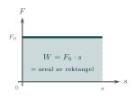
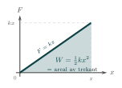

:::: {.oppgaver}



Vi har sett at kraft anvendt over tid forårsaket en endring i bevegelsesmengde: $$\Delta\vec{p}=\vec{F}\Delta t.$$ Arealet under en $F(t)$-graf tilsvarer altså (endring i) bevegelsesmengde. Men... da er det saktens fristende å prøve noe annet også: Hva blir arealet under en $F(s)$-graf? $$??=\vec{F}\cdot \Delta\vec{s}.$$ La oss si at Eva er på Hyrox-trening og dytter en kasse bortover et humpete gulv, slik at kraften hun virker på kassen med varierer med posisjonen; $F(s)$. Hvordan skal vi da tolke arealet under $F(s)$-grafen? Jo, dette arealet er et mål på det vi i fysikken kaller *arbeid*;

I hverdagslivet bruker vi ordet *arbeid* om noe vi gjør over tid. Men i fysikk tilsvarer det impuls, eller endring i bevegelsesmengde. Begrepet arbeid er i fysikken reservert for kraft anvendt over strekning.

::: {.callout-note title="Definisjon: Arbeid"}

Arbeidet $W$ som utføres av en kraft $\vec{F}$ over en forflytning $\vec{s}$ er gitt ved prikkproduktet: $$\begin{aligned}
        W = \vec{F} \cdot \vec{s} = F \cdot s \cdot \cos\theta
\end{aligned}$$ Her er $\theta$ vinkelen mellom kraftretningen og forflytningsretningen. Arbeid er en skalar og måles i joule $(\mathrm{J})$, der $1\,\mathrm{J} = 1\,\mathrm{N}\,\mathrm{m}$. For dere som kan integrere: Merk at definisjonen egentlig er $W = \int \vec{F} \cdot d\vec{s}$, som for konstant kraft gir formelen over.

:::

Legg merke til at vi tar skalarproduktet mellom kraft og forflytning. Det sikrer at kun den delen av $F$ som peker i samme retning som $s$ blir med i definisjonen av arbeid. Det er altså ikke nok at kraften er til stede – den må faktisk bidra til bevegelsen. En person som holder en tung sekk stille over hodet, utfører for eksempel *ikke* noe arbeid, slik det er definert i fysikken, selv om muskler spennes og fyren blir sliten. Dette ser vi av vinkelen $\cos\theta$ som kommer inn i definisjonen via skalarproduktet. Når $\theta = 0^\circ$ virker kraften i samme retning som bevegelsen, og arbeidet er maksimalt. Når $\theta = 90^\circ$ virker kraften vinkelrett på bevegelsen, og $W = 0$. Virker kraften *mot* bevegelsen (som friksjon), er $\theta = 180^\circ$ og arbeidet negativt.

::: {.eksempel}
[Eksempel: Dytte en boks]{.eks-tittel}
En boks dyttes langs et gulv med en kraft $F = 10\,\mathrm{N}$ over en avstand $s = 5.0\,\mathrm{m}$. Kraften virker i samme retning som bevegelsen ($\theta = 0^\circ$):

::: center
{.kompendium-bilde}

[En mann dytter en eske med konstant kraft $F$ i bevegelsesretningen, en avstand $s$. Arbeidet er $W = F \cdot s$.]{.figurtekst}
:::

::: {.losning}
$$W = F \cdot s \cdot \cos(0^\circ) = 10\,\mathrm{N} \cdot 5.0\,\mathrm{m} \cdot 1 = \underline{\underline{50\,\mathrm{J}}}$$
:::
:::

::: {.eksempel}
[Eksempel: Slede på Hyrox-trening]{.eks-tittel}

I en Hyrox-treningstime dyttes en slede $s = 10\,\mathrm{m}$ horisontalt med en kraft $F = 2.0\,\mathrm{kN}$. Sleden har konstant fart.

a)  Beregn arbeidet kraften $\vec{F}$ utfører.

b)  Beregn arbeidet som normalkraften $\vec{N}$, tyngdekraften $\vec{G}$ og friksjonskraften $\vec{R}$ utfører.

:::

::: {.callout-note .svar collapse="true" title="Vis løsning"}

**a)** Kraften $\vec{F}$ virker i samme retning som bevegelsen, så $\theta = 0^\circ$ og $\cos\theta = 1$: $$W_F = F\cdot s\cdot\cos 0^\circ = 2.0\cdot 10^{3}\,\mathrm{N}\cdot10\,\mathrm{m}\cdot 1 = \underline{\underline{20\,\mathrm{kJ}}}$$

**b)** Normalkraften $\vec{N}$ peker rett opp og tyngdekraften $\vec{G}$ rett ned. Begge står vinkelrett på bevegelsen, så $\theta = 90^\circ$ og $\cos\theta = 0$: $$\underline{\underline{W_N = 0}} \qquad \text{og} \qquad \underline{\underline{W_G = 0}}$$ For å finne friksjonskraften bruker vi at farten er konstant. Da er akselerasjonen null, og Newtons 1. lov gir at kraftsummen langs bevegelsen er null. Friksjonskraften er derfor like stor som skyvekraften, $R = F = 2.0\,\mathrm{kN}$, men peker motsatt vei av bevegelsen ($\theta = 180^\circ$, $\cos\theta = -1$): $$W_R = R\cdot s\cdot\cos 180^\circ = 2.0\cdot 10^{3}\,\mathrm{N}\cdot10\,\mathrm{m}\cdot(-1) = \underline{\underline{-20\,\mathrm{kJ}}}$$ Legg merke til at det totale arbeidet på sleden blir null: $W_F + W_N + W_G + W_R = 0$. Det henger sammen med at farten til sleden ikke endrer seg — mer om dette i seksjonen om arbeid-energi-setningen.

:::

I eksemplet over var kraften konstant. Men hva om kraften varierer underveis? Et typisk eksempel er en fjær: ifølge Hookes lov øker motstanden jo mer fjæren presses sammen. Kraften som trengs er proporsjonal med forskyvningen $x$ fra likevektsposisjonen, $$F = k \cdot x,$$ der $k$ er fjærkonstanten (enhet $\mathrm{N}\,\mathrm{m}^{-1}$). Siden kraften ikke er konstant, kan arbeidet ikke beregnes direkte som $F \cdot s$. Geometrisk er arbeidet arealet under $F(x)$-grafen, og resultatet blir $$W = \frac{1}{2} k x^2.$$ Den energien som lagres i fjæren kalles elastisk potensiell energi – mer om dette i seksjonen.

Figurene nedenfor illustrerer de to tilfellene grafisk: i begge tilfeller er arbeidet lik arealet under kraftkurven.

{.tikz-fig style="width:293px"}

[Konstant kraft $F_0$: arbeidet $W = F_0\cdot s$ er arealet av rektangelet under kurven.]{.figurtekst}

{.tikz-fig style="width:295px"}

[Lineært voksende fjærkraft $F = kx$: arbeidet $W = \tfrac{1}{2}kx^2$ er arealet av trekanten under kurven.]{.figurtekst}

::: {.oppgave tittel="Arbeid med konstant kraft"}
[Arbeid med konstant kraft]{.oppg-tittel}

Eva drar en kasse $s = 12\,\mathrm{m}$ bortover et flatt gulv. Hun drar i et tau med kraften $F = 150\,\mathrm{N}$, og tauet danner vinkelen $\theta = 25^\circ$ med gulvet. Friksjonskraften på kassen er $R = 110\,\mathrm{N}$.

a)  Hvor stort arbeid gjør Eva på kassen?

b)  Hvor stort arbeid gjør friksjonskraften? Forklar hvorfor svaret blir negativt.

c)  Hvor stort arbeid gjør tyngdekraften og normalkraften på kassen? Forklar svaret.

::: {.losning}

Vi bruker definisjonen av arbeid, $W = F\cdot s\cdot\cos\theta$, der $\theta$ er vinkelen mellom kraften og forflytningen (se *Arbeid*).

**a)** Tauet danner vinkelen $\theta = 25^\circ$ med bevegelsesretningen: $$W_F = F\cdot s\cdot\cos 25^\circ = 150\,\mathrm{N}\cdot12\,\mathrm{m}\cdot 0.906 = 1.63\,\mathrm{kJ} \approx \underline{\underline{1.6\,\mathrm{kJ}}}$$

**b)** Friksjonskraften peker motsatt vei av bevegelsen, så $\theta = 180^\circ$ og $\cos\theta = -1$: $$W_R = R\cdot s\cdot\cos 180^\circ = 110\,\mathrm{N}\cdot12\,\mathrm{m}\cdot(-1) = -1.32\,\mathrm{kJ} \approx \underline{\underline{-1.3\,\mathrm{kJ}}}$$ Arbeidet er negativt fordi friksjonen virker *mot* bevegelsen. Friksjonen tar energi ut av bevegelsen og gjør den om til varme.

**c)** Tyngdekraften peker rett ned og normalkraften rett opp. Begge står vinkelrett på forflytningen ($\theta = 90^\circ$, $\cos 90^\circ = 0$), så $$\underline{\underline{W_G = 0}} \qquad\text{og}\qquad \underline{\underline{W_N = 0}}$$ Kassen flytter seg verken opp eller ned, så disse kreftene bidrar ikke til bevegelsen.

:::

:::

::: {.oppgave tittel="Arbeid på en fjær"}
[Arbeid på en fjær]{.oppg-tittel}

En fjær har fjærkonstant $k = 400\,\mathrm{N}\,\mathrm{m}^{-1}$.

a)  Hvor stort arbeid må du gjøre for å presse fjæra sammen $x = 5.0\,\mathrm{cm}$?

b)  Hvor stort arbeid må du gjøre for å presse den sammen $x = 10\,\mathrm{cm}$?

c)  Kompresjonen ble doblet, men arbeidet ble ikke doblet. Forklar hvorfor, gjerne ved hjelp av arealet under $F(x)$-grafen.

::: {.losning}

Arbeidet for å presse sammen en fjær er arealet under $F(x)$-grafen, $W = \tfrac{1}{2}kx^2$.

**a)** Med $x = 0.050\,\mathrm{m}$: $$W = \frac{1}{2}\cdot400\,\mathrm{N}\,\mathrm{m}^{-1}\cdot(0.050\,\mathrm{m})^2 = \underline{\underline{0.50\,\mathrm{J}}}$$

**b)** Med $x = 0.10\,\mathrm{m}$: $$W = \frac{1}{2}\cdot400\,\mathrm{N}\,\mathrm{m}^{-1}\cdot(0.10\,\mathrm{m})^2 = \underline{\underline{2.0\,\mathrm{J}}}$$

**c)** Arbeidet ble fire ganger så stort. Arbeidet avhenger av $x^2$: dobles $x$, blir $x^2$ fire ganger så stort. Grafisk er arbeidet arealet av en trekant under $F(x) = kx$. Når $x$ dobles, blir både grunnlinjen og høyden i trekanten dobbelt så store, og da blir arealet fire ganger så stort.

:::

:::


## Prøv selv i Python

Koden under regner ut arbeidet en snorkraft gjør på en kjelke. Endre vinkelen eller kraften og trykk **Kjør**. Hva skjer når vinkelen nærmer seg 90°?

```{.python .kjor}
import numpy as np

F = 50        # snorkraft i newton
s = 20        # strekning i meter
theta = 30    # vinkel i grader

W = F * s * np.cos(np.radians(theta))
print(f"Arbeid: W = {W:.0f} J")
```

Her ser du arbeid som areal under grafen når kraften varierer langs strekningen. Prøv å bytte ut kraftfunksjonen:

```{.python .kjor}
import numpy as np
import matplotlib.pyplot as plt

s = np.linspace(0, 3000, 600)            # strekning i meter
F = 400 + 60 * np.sin(s / 250)           # kraften varierer litt underveis (N)

W = np.trapezoid(F, s)                   # arbeid = areal under grafen
print(f"Arbeid: W = {W/1e6:.2f} MJ")

plt.figure(figsize=(7, 3.2))
plt.plot(s, F, color="#3b9a2a", lw=2)
plt.fill_between(s, F, alpha=0.3, color="#6ef04a")
plt.xlabel("s (m)"); plt.ylabel("F (N)")
plt.title("W = arealet under kraft–strekning-grafen")
plt.ylim(0, 520)
plt.tight_layout()
plt.show()
```


::::
