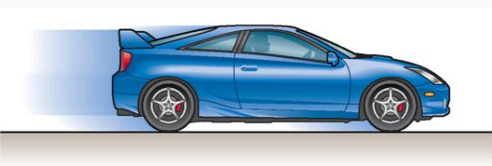
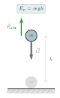
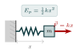

:::: {.oppgaver}

I fysikk beskriver energi et legemes evne til å påvirke omgivelsene, enten ved å utføre arbeid eller overføre varme. Når en kraft virker på et objekt og forårsaker en forflytning, blir energi overført til objektet gjennom arbeidet som utføres. Derfor kan arbeid sees som en måte å overføre energi på mellom objekter eller systemer.

I mekanikken opererer vi med det vi kaller mekanisk energi, som vi igjen deler inn i to typer: kinetisk energi (bevegelsesenergi) og potensiell energi (stillingsenergi). Besittelse av mekanisk energi gir et objekt evne til å påvirke sine omgivelser, som vi skal se. I likhet med *arbeid* så måles også energi i joule (J), som er standardenheten for energi i fysikk.

::: {.callout-note title="Definisjon: Mekanisk energi"}

Et legemes mekaniske energi er et mål på dets evne til å påvirke omgivelsene. Vi deler den mekaniske energien $E$ i to typer: $$E = E_\text{K} + E_p,$$ hvor $E_\text{K}$ er kinetisk energi og $E_p$ er potensiell energi.

:::

En av de viktigste lovene i hele fysikken handler om hva som skjer med energi over tid:

::: {.callout-note title="Definisjon: Energibevaringsloven"}

Energi kan verken oppstå eller forsvinne. Den kan bare omformes fra én energiform til en annen, eller overføres mellom legemer. I et isolert system er den totale energien derfor konstant.

:::

Energibevaringsloven gjelder *all* energi, ikke bare mekanisk energi. Når vi senere sier at energi «går tapt», for eksempel på grunn av friksjon, er den ikke borte. Den har bare blitt omformet til en form vi ikke kan bruke, som varme. Under *termofysikk* ser vi at *termodynamikkens 1. lov* er energibevaringsloven skrevet for systemer som utveksler varme og arbeid med omgivelsene.

## Kinetisk energi



Tenk deg at en bil kjører nedover en vei. Bilen har kinetisk energi på grunn av sin bevegelse. Kinetisk energi er den energien et objekt har fordi det er i bevegelse. Jo raskere objektet beveger seg, desto mer kinetisk energi har det. For en bil vil både massen $m$ og farten $v$ påvirke hvor mye kinetisk energi den har.

::: {.callout-note title="Definisjon: Kinetisk Energi"}

Matematisk kan den kinetiske energien $E_\text{K}$ uttrykkes som: $$\begin{aligned}
        E_\text{K} = \frac{1}{2} m v^2
\end{aligned}$$ hvor $m$ er massen til objektet og $v$ er farten.

:::

::: {.callout-tip title="Til ettertanke"}

Hva er forskjellen på $\vec{p}=m\vec{v}$ og $E_\text{K}=\frac{1}{2}mv^2$?

:::

Kinetisk energi er en viktig form for energi, som spiller en sentral rolle i mange fysiske prosesser som kollisjoner, bevegelse og energioverføringer. Når bilen bremser ned og stopper, reduseres dens kinetiske energi til null fordi farten $v$ også blir null.

:::: figure
{.kompendium-bilde .foto}

::: caption
Kinetisk energi i kjørende bil
:::
::::

### Arbeid-energi-setningen

Vi skal nå utlede en sammenheng mellom arbeid og kinetisk energi. Vi har

$$W = \vec{F}\cdot \Delta\vec{s} = \frac{\Delta\vec{p}}{\Delta t}\cdot\Delta\vec{s}$$ Vi bytter om på $\Delta t$ og skriver om: $$W = \Delta\vec{p} \cdot \frac{\Delta\vec{s}}{\Delta t}$$ Størrelsen $\frac{\Delta s}{\Delta t}$ er gjennomsnittsfarten $\bar{v}$ i tidsintervallet. Vi antar her at kraften — og dermed akselerasjonen — er konstant. Da gjelder at gjennomsnittsfarten er midtpunktet mellom start- og sluttfart: $$\bar{v} = \frac{v_0 + v}{2} \qquad \text{(kun for konstant akselerasjon)}$$ Videre er $\Delta p = m(v - v_0)$. Setter vi dette inn: $$W = m(v - v_0)\cdot\frac{v_0 + v}{2} = \frac{m}{2}(v - v_0)(v + v_0)$$ Vi bruker algebraidentiteten $(a - b)(a + b) = a^2 - b^2$: $$W = \frac{m}{2}(v^2 - v_0^2) = \frac{1}{2}mv^2 - \frac{1}{2}mv_0^2$$ Størrelsen $\frac{1}{2}mv^2$ er det vi kaller *kinetisk energi* — energien legemet har på grunn av bevegelsen. Arbeidet er altså lik *endringen* i kinetisk energi!

::: {.callout-note title="Definisjon: Arbeid-energi-setningen"}

Arbeidet som summen av ytre krefter gjør på et legeme er lik endringen i legemets kinetiske energi: $$W_{\text{total}} = \Delta E_\text{K}$$ Arbeid er derfor overføring av energi i bevegelsesretningen.

:::

::: {.callout-tip title="Tips: For dem som kan integrere"}

For varierende kraft — der akselerasjonen ikke er konstant — trenger man integrasjon. Da er arbeidet $W = \int F\,ds$. Ved å skrive $F = m\frac{dv}{dt}$ og bruke kjerneregelen ($\frac{dv}{dt}\,ds = \frac{ds}{dt}\,dv = v\,dv$) får man $$W = \int_{v_0}^{v} mv\,dv = \frac{1}{2}mv^2 - \frac{1}{2}mv_0^2.$$ Resultatet er det samme. Arbeid-energi-setningen $W = \Delta E_\text{K}$ er derfor *generell* — den gjelder uansett om kraften varierer eller ikke. Det er bare utledningen her over som forutsetter konstant kraft.

:::

::: {.callout-tip title="Til ettertanke"}

Merk at på samme måte som at $\Delta \vec{p}=\vec{F}\Delta t$ så er altså $\Delta E_\text{K}=\vec{F}\Delta \vec{s}$.

:::

At $\Delta \vec{p}=\vec{F}\Delta t$ mens $\Delta E_\text{K}=\vec{F}\Delta \vec{s}$ synliggjør forskjellen på bevegelsesmengde og kinetisk energi: bevegelsesmengde er en vektor, kinetisk energi er en skalar. Bevegelsesmengden handler om kraft over tid, mens kinetisk energi handler om kraft over strekning. Og begge disse størrelsene inngår i egne bevaringslover. Derfor trenger vi begge to.

::: {.eksempel}
[Eksempel: Horisontal bevegelse med friksjon]{.eks-tittel}

En kloss med masse $0.80 \, \text{kg}$ har en startfart på $2.0 \, \text{m/s}$ og blir flyttet med en horisontal kraft på $8.0 \, \text{N}$. Friksjonskraften som virker mot bevegelsen er $5.6 \, \text{N}$, og etter å ha blitt flyttet $2.0 \, \text{m}$ får klossen en fart på $4.0 \, \text{m/s}$.

::: {.losning}
**Del 1: Endringen i kinetisk energi**\
*Metode:* Kinetisk energi $E_\text{K}$ beregnes med formelen $E_\text{K} = \frac{1}{2} m v^2$. Endringen i kinetisk energi $\Delta E_\text{K}$ er forskjellen mellom slutt- og startenergien: $$E_\text{K}^{\text{start}} = \frac{1}{2} \cdot 0.80 \, \text{kg} \cdot (2.0 \, \text{m/s})^2 = \frac{1}{2} \cdot 0.8 \cdot 4 = 1.6 \, \text{J}$$ $$E_\text{K}^{\text{slutt}} = \frac{1}{2} \cdot 0.80 \, \text{kg} \cdot (4.0 \, \text{m/s})^2 = \frac{1}{2} \cdot 0.8 \cdot 16 = 6.4 \, \text{J}$$ Endringen i kinetisk energi er: $$\Delta E_\text{K} = E_\text{K}^{\text{slutt}} - E_\text{K}^{\text{start}} = 6.4 \, \text{J} - 1.6 \, \text{J} = \underline{\underline{4.8 \, \text{J}}}$$

**Del 2: Arbeid utført på klossen**\
*Metode:* Arbeid $W$ er definert som kraft ganger forflytning, men i dette tilfellet må vi ta hensyn til både den horisontale kraften og friksjonskraften som virker mot bevegelsen. Det totale arbeidet $W$ kan beregnes som summen av arbeidet utført av begge kreftene: $$W_{\text{totalt}} = W_{\text{kraft}} + W_{\text{friksjon}} = F \cdot s - F_{\text{friksjon}} \cdot s$$ Her er kraften $F = 8.0 \, \text{N}$, friksjonskraften $F_{\text{friksjon}} = 5.6 \, \text{N}$, og forflytningen $d = 2.0 \, \text{m}$: $$W_{\text{totalt}} = 8.0 \, \text{N} \cdot 2.0 \, \text{m} - 5.6 \, \text{N} \cdot 2.0 \, \text{m} = 16.0 \, \text{J} - 11.2 \, \text{J} = \underline{\underline{4.8 \, \text{J}}}$$
:::
:::

::: {.oppgave tittel="Kinetisk energi"}
[Kinetisk energi]{.oppg-tittel}

a)  En bil med masse $m = 1200\,\mathrm{kg}$ kjører i $50\,\mathrm{km}\,\mathrm{h}^{-1}$. Finn den kinetiske energien til bilen.

b)  Finn den kinetiske energien når bilen kjører i $100\,\mathrm{km}\,\mathrm{h}^{-1}$. Hvor mange ganger større er den? Forklar ved hjelp av formelen for $E_\text{K}$.

c)  En sprinter med masse $70\,\mathrm{kg}$ løper med fart $10\,\mathrm{m}\,\mathrm{s}^{-1}$, og en geværkule med masse $10\,\mathrm{g}$ har fart $900\,\mathrm{m}\,\mathrm{s}^{-1}$. Hvem har mest kinetisk energi?

::: {.losning}

Vi bruker $E_\text{K} = \tfrac{1}{2}mv^2$, og gjør om farten til $\mathrm{m}\,\mathrm{s}^{-1}$ ved å dele på 3.6.

**a)** $v = 50\,\mathrm{km}\,\mathrm{h}^{-1} = 13.9\,\mathrm{m}\,\mathrm{s}^{-1}$: $$E_\text{K} = \frac{1}{2}\cdot1200\,\mathrm{kg}\cdot(13.9\,\mathrm{m}\,\mathrm{s}^{-1})^2 = 116\,\mathrm{kJ} \approx \underline{\underline{1.2\cdot 10^{2}\,\mathrm{kJ}}}$$

**b)** $v = 100\,\mathrm{km}\,\mathrm{h}^{-1} = 27.8\,\mathrm{m}\,\mathrm{s}^{-1}$: $$E_\text{K} = \frac{1}{2}\cdot1200\,\mathrm{kg}\cdot(27.8\,\mathrm{m}\,\mathrm{s}^{-1})^2 = \underline{\underline{463\,\mathrm{kJ}}}$$ Det er **fire ganger** så mye. Siden $E_\text{K}$ er proporsjonal med $v^2$, gir dobbel fart $2^2 = 4$ ganger så mye kinetisk energi. Det er derfor en kollisjon i $100\,\mathrm{km}\,\mathrm{h}^{-1}$ er så mye farligere enn i $50\,\mathrm{km}\,\mathrm{h}^{-1}$.

**c)** $$E_\text{K,sprinter} = \frac{1}{2}\cdot70\,\mathrm{kg}\cdot(10\,\mathrm{m}\,\mathrm{s}^{-1})^2 = 3.5\,\mathrm{kJ}$$ $$E_\text{K,kule} = \frac{1}{2}\cdot0.010\,\mathrm{kg}\cdot(900\,\mathrm{m}\,\mathrm{s}^{-1})^2 = 4.05\,\mathrm{kJ}$$ **Geværkula** har litt mer kinetisk energi enn sprinteren, selv om massen er 7000 ganger mindre. Den store farten veier opp for den lille massen.

:::

:::

::: {.oppgave tittel="Kasse som sklir til ro"}
[Kasse som sklir til ro]{.oppg-tittel}

En kasse med masse $m = 20\,\mathrm{kg}$ sklir bortover et gulv med startfart $v_0 = 3.0\,\mathrm{m}\,\mathrm{s}^{-1}$. Den eneste kraften som bremser kassen, er friksjonskraften $R = 40\,\mathrm{N}$.

a)  Hvor stor er endringen i kinetisk energi fra kassen begynner å skli til den står stille?

b)  Bruk arbeid-energi-setningen til å finne hvor langt kassen sklir før den stopper.

c)  Hvor langt ville kassen skli dersom startfarten var dobbelt så stor?

::: {.losning}

**a)** Kassen stopper, så den kinetiske energien går fra $\tfrac{1}{2}mv_0^2$ til null: $$\Delta E_\text{K} = 0 - \frac{1}{2}\cdot20\,\mathrm{kg}\cdot(3.0\,\mathrm{m}\,\mathrm{s}^{-1})^2 = \underline{\underline{-90\,\mathrm{J}}}$$

**b)** Det eneste arbeidet på kassen gjøres av friksjonen, $W = -R\cdot s$ (tyngdekraften og normalkraften står vinkelrett på bevegelsen). Arbeid-energi-setningen, $W_\text{total} = \Delta E_\text{K}$, gir $$-R\cdot s = \Delta E_\text{K}
    \quad\implies\quad
    s = \frac{-\Delta E_\text{K}}{R} = \frac{90\,\mathrm{J}}{40\,\mathrm{N}} = 2.25\,\mathrm{m} \approx \underline{\underline{2.3\,\mathrm{m}}}$$

**c)** Med dobbel startfart blir den kinetiske energien fire ganger så stor ($360\,\mathrm{J}$). Friksjonskraften er den samme, så strekningen blir også fire ganger så lang: $$s = \frac{360\,\mathrm{J}}{40\,\mathrm{N}} = \underline{\underline{9.0\,\mathrm{m}}}$$

:::

:::

## Potensiell energi



Tenk deg at du løfter en stein opp på en hylle. Du bruker energi — du gjør et arbeid mot tyngdekraften. Men energien er ikke borte. Den er lagret i steinen som *potensiell energi*: slipp steinen, og den faller ned og oppnår kinetisk energi igjen!

Det samme skjer med en fjær: du komprimerer den mot fjærkraften og bruker energi. Slipp den, og energien frigjøres og skyver gjenstanden avgårde.

Dette er kjernen i begrepet potensiell energi — *arbeid lagret mot en kraft, klar til å omdannes til bevegelsesenergi*. Felles for tyngdekraft og fjærkraft er at de er *konservative*: arbeidet du gjør mot dem er ikke tapt som varme, men bevart i systemet. Friksjon er derimot ikke-konservativ — det arbeidet forsvinner som varme og kan ikke hentes tilbake.

**Gravitasjonspotensiell energi.**

For å løfte en masse $m$ en høyde $h$ i tyngdefeltet uten akselerasjon, må løftekraften nøyaktig oppheve tyngdekraften: $F_\text{løft} = m\mathrm{g}$. Arbeidet denne kraften gjør er da: $$W_\text{løft} = F_\text{løft} \cdot h = m\mathrm{g}h$$ Siden tyngdekraften er konservativ, er dette arbeidet ikke tapt — det er lagret som gravitasjonspotensiell energi $E_p$. Slippes massen, gjør tyngdekraften nøyaktig det samme arbeidet tilbake på massen, og all potensiell energi omdannes til kinetisk energi.

{.tikz-fig style="width:168px"}

[Masse $m$ løftes mot tyngdekraften til høyde $h$. Arbeidet $W=m\mathrm{g}h$ lagres som potensiell energi.]{.figurtekst}

::: {.callout-note title="Definisjon: Gravitasjonspotensiell energi"}

Gravitasjonspotensiell energi for en masse $m$ i høyde $h$ over et valgt nullnivå er: $$E_p = m\mathrm{g}h$$ $\mathrm{g} = 9.81\,\mathrm{m}\,\mathrm{s}^{-2}$ er tyngdeakselerasjonen, og $h$ måles fra et fritt valgt nullnivå.

:::

**Elastisk potensiell energi.**

For å komprimere (eller strekke) en fjær en avstand $x$ fra likevekt, må man arbeide mot fjærkraften $F = kx$. Arbeidet kan beregnes som arealet under $F(x)$-kurven. Siden kraften øker lineært med avstanden fra likevekt, er arbeidet arealet under en trekant med høyde $kx$ og bredde $x$(se figuren). Altså er arbeidets størrelse $$W = \frac{1}{2}kx^2$$ Fjærkraften er konservativ, så dette arbeidet lagres som elastisk potensiell energi. Slippes fjæren, omdannes all lagret energi til kinetisk energi.

{.tikz-fig style="width:197px"}

[Komprimert fjær med kompresjon $x$. Fjærkraften $F=kx$ skyver klossen vekk. Arbeidet $W=\frac{1}{2}kx^2$ er lagret som elastisk potensiell energi.]{.figurtekst}

::: {.callout-note title="Definisjon: Elastisk potensiell energi"}

Den elastiske potensielle energien lagret i en fjær med fjærkonstant $k$ og kompresjon eller forlengelse $x$ er: $$E_p = \frac{1}{2}kx^2$$ **Merk!** Null-nivå for potensiell energi kan velges fritt. Ofte er det praktisk å velge nullnivået der fjæren er i likevekt (ikke komprimert eller strukket).

:::

::: {.oppgave tittel="Potensiell energi og nullnivå"}
[Potensiell energi og nullnivå]{.oppg-tittel}

En bok med masse $m = 1.2\,\mathrm{kg}$ ligger på en hylle $1.8\,\mathrm{m}$ over gulvet. Rett under hylla står et bord som er $0.75\,\mathrm{m}$ høyt.

a)  Finn den potensielle energien til boka når vi velger gulvet som nullnivå.

b)  Finn den potensielle energien til boka når vi velger bordplata som nullnivå.

c)  Svarene i a) og b) er forskjellige. Er det et problem? Forklar hva det er som faktisk betyr noe når vi regner med potensiell energi.

::: {.losning}

Vi bruker $E_p = m\mathrm{g}h$, der $h$ er høyden over nullnivået.

**a)** Med gulvet som nullnivå er $h = 1.8\,\mathrm{m}$: $$E_p = 1.2\,\mathrm{kg}\cdot9.81\,\mathrm{m}\,\mathrm{s}^{-2}\cdot1.8\,\mathrm{m} = 21.2\,\mathrm{J} \approx \underline{\underline{21\,\mathrm{J}}}$$

**b)** Med bordplata som nullnivå er $h = 1.8\,\mathrm{m} - 0.75\,\mathrm{m} = 1.05\,\mathrm{m}$: $$E_p = 1.2\,\mathrm{kg}\cdot9.81\,\mathrm{m}\,\mathrm{s}^{-2}\cdot1.05\,\mathrm{m} = 12.4\,\mathrm{J} \approx \underline{\underline{12\,\mathrm{J}}}$$

**c)** Det er ikke noe problem. Nullnivået velger vi selv, så verdien av $E_p$ alene har ingen fysisk betydning. Det som betyr noe, er *endringen* i potensiell energi når boka flytter seg. Faller boka for eksempel ned på bordet, er endringen $m\mathrm{g}\cdot1.05\,\mathrm{m} = 12.4\,\mathrm{J}$ uansett hvilket nullnivå vi har valgt.

:::

:::

::: {.oppgave tittel="Energi i en fjær"}
[Energi i en fjær]{.oppg-tittel}

En fjær med fjærkonstant $k = 250\,\mathrm{N}\,\mathrm{m}^{-1}$ strekkes $x = 20\,\mathrm{cm}$ fra likevektsstillingen.

a)  Hvor mye elastisk potensiell energi er lagret i fjæra?

b)  Hvor mye må fjæra strekkes for å lagre $20\,\mathrm{J}$?

::: {.losning}

**a)** Elastisk potensiell energi er $E_p = \tfrac{1}{2}kx^2$: $$E_p = \frac{1}{2}\cdot250\,\mathrm{N}\,\mathrm{m}^{-1}\cdot(0.20\,\mathrm{m})^2 = \underline{\underline{5.0\,\mathrm{J}}}$$

**b)** Vi løser $E_p = \tfrac{1}{2}kx^2$ for $x$: $$x = \sqrt{\frac{2E_p}{k}} = \sqrt{\frac{2\cdot20\,\mathrm{J}}{250\,\mathrm{N}\,\mathrm{m}^{-1}}} = \underline{\underline{0.40\,\mathrm{m}}}$$ Fire ganger så mye energi krever bare dobbelt så stor strekning, fordi $E_p$ er proporsjonal med $x^2$.

:::

:::

::::
