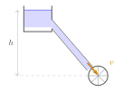

:::: {.oppgaver}

Selv om energi ikke kan oppstå eller forsvinne, kan den omformes fra en form til en annen.

Energitap skjer når energi omdannes fra en nyttig form, som kinetisk eller potensiell energi, til former som varme eller lyd. Dette skjer ofte på grunn av friksjon eller motstand i systemet. For eksempel vil et objekt som beveger seg langs en overflate oppleve friksjon, som omdanner noe av den kinetiske energien til varme.

Selv om den totale energien i systemet bevares, reduserer energitap den mengden energi som kan brukes til arbeid. Energitap er derfor en viktig faktor i mange praktiske situasjoner, som ingeniørarbeid og fysikkproblemer.

::: {.callout-note title="Definisjon: Energitap"}

Energitap i et system er energi som har forlatt systemet eller endret kvalitet til en tilstand som ikke er nyttig for oss.

:::

::: {.eksempel}
[Eksempel: Energiforskjell og energitap i et fall]{.eks-tittel}

En ball med masse $0.50 \, \text{kg}$ slippes fra en høyde på $10 \, \text{m}$. Rett før ballen treffer bakken, har den en hastighet på $12 \, \text{m/s}$. Vi antar at noe energi har gått tapt på grunn av luftmotstand. Beregn energitapet ved å sammenligne den potensielle energien på toppen med den kinetiske energien rett før bakken.

::: {.losning}
**Del 1: Potensiell energi på toppen**\
Den potensielle energien ballen har på toppen, før den slippes, kan beregnes med formelen: $$E_p = m\mathrm{g}h$$ hvor $m = 0.50 \, \text{kg}$, $\mathrm{g} = 9.81 \, \text{m/s}^2$, og $h = 10 \, \text{m}$: $$E_p = 0.50 \, \text{kg} \cdot 9.81 \, \text{m/s}^2 \cdot 10 \, \text{m} = 49.05 \, \text{J}$$ Dette er den totale potensielle energien som ballen har før fallet.

**Del 2: Kinetisk energi rett før bakken**\
Når ballen nærmer seg bakken med en hastighet på $12 \, \text{m/s}$, kan vi beregne dens kinetiske energi: $$E_\text{K} = \frac{1}{2} m v^2$$ hvor $m = 0.50 \, \text{kg}$ og $v = 12 \, \text{m/s}$: $$E_\text{K} = \frac{1}{2} \cdot 0.50 \, \text{kg} \cdot (12 \, \text{m/s})^2 = 36 \, \text{J}$$ Dette er den kinetiske energien ballen har rett før den treffer bakken.

**Del 3: Energitap på grunn av luftmotstand**\
Forskjellen mellom den potensielle energien på toppen og den kinetiske energien rett før bakken gir oss energitapet som følge av luftmotstand: $$\Delta E = E_p - E_\text{K} = 49.05 \, \text{J} - 36 \, \text{J} = 13.05 \, \text{J} \approx \underline{\underline{13 \, \text{J}}}$$ Dette betyr at omtrent $13 \, \text{J}$ av energien har blitt tapt på grunn av luftmotstanden i løpet av fallet.
:::
:::

I et vannkraftverk renner vann fra et magasin, gjennom et rør og ned til et skovlhjul. Uten tap ville all potensiell energi blitt omdannet til kinetisk energi, og vannet ville truffet skovlhjulet med farten $v = \sqrt{2\mathrm{g}h}$, der $h$ er høydeforskjellen. I virkeligheten går noe energi tapt på grunn av friksjon mellom vannet og rørveggen, så farten blir mindre. Det er vanlig å oppgi tapet som en *tapshøyde*: den høyden som tilsvarer tapet av kinetisk energi.

{.tikz-fig style="width:263px"}

[Vann renner fra et magasin gjennom et rør og ned til et skovlhjul. Høydeforskjellen fra vannflaten til skovlhjulet er $h$.]{.figurtekst}

::: {.eksempel}
[Eksempel: Tapshøyde i et rør]{.eks-tittel}

Vann renner fra et magasin, gjennom et rør og ned til et skovlhjul som ligger $h = 20\,\mathrm{m}$ under vannflaten i magasinet. Uten tap skulle vannet hatt farten $v_0 = \sqrt{2\mathrm{g}h}$ når det treffer skovlhjulet, men på grunn av tap i røret har det bare farten $v = 18.0\,\mathrm{m}\,\mathrm{s}^{-1}$.

a)  Hvor stor fart $v_0$ ville vannet hatt uten tap?

b)  Hvor stor høyde tilsvarer tapet av kinetisk energi i vannet? Denne høyden kaller vi *tapshøyden* $h_\text{tap}$.

:::

::: {.callout-note .svar collapse="true" title="Vis løsning"}

**a)** Uten tap er mekanisk energi bevart. Vi ser på en vannmengde med masse $m$ som starter i ro ved vannflaten. All potensiell energi blir omdannet til kinetisk energi: $$m\mathrm{g}h = \frac{1}{2}mv_0^2
    \quad\implies\quad
    v_0 = \sqrt{2\mathrm{g}h} = \sqrt{2\cdot9.81\,\mathrm{m}\,\mathrm{s}^{-2}\cdot20\,\mathrm{m}} = 19.8\,\mathrm{m}\,\mathrm{s}^{-1} \approx \underline{\underline{20\,\mathrm{m}\,\mathrm{s}^{-1}}}$$

**b)** Tapet av kinetisk energi er forskjellen mellom den kinetiske energien vannet skulle hatt, og den det faktisk har: $$\Delta E_\text{K} = \frac{1}{2}mv_0^2 - \frac{1}{2}mv^2$$ Tapshøyden er den høyden som svarer til denne energien, altså $m\mathrm{g}h_\text{tap} = \Delta E_\text{K}$. Siden $\frac{1}{2}mv_0^2 = m\mathrm{g}h$, får vi $$m\mathrm{g}h_\text{tap} = m\mathrm{g}h - \frac{1}{2}mv^2
    \quad\implies\quad
    h_\text{tap} = h - \frac{v^2}{2\mathrm{g}}$$ Massen faller ut, så vi trenger ikke vite hvor mye vann det er. Med tall: $$h_\text{tap} = 20\,\mathrm{m} - \frac{(18.0\,\mathrm{m}\,\mathrm{s}^{-1})^2}{2\cdot9.81\,\mathrm{m}\,\mathrm{s}^{-2}}
    = 20\,\mathrm{m} - 16.5\,\mathrm{m}
    = \underline{\underline{3.5\,\mathrm{m}}}$$ Tapet i røret tilsvarer altså at vannet hadde falt $3.5\,\mathrm{m}$ kortere enn det faktisk gjorde.

:::

::: {.oppgave tittel="Syklist ned en bakke"}
[Syklist ned en bakke]{.oppg-tittel}

En syklist og sykkelen har til sammen masse $m = 90\,\mathrm{kg}$. Syklisten starter i ro på toppen av en bakke og triller ned uten å tråkke. Høydeforskjellen er $h = 25\,\mathrm{m}$, og farten nederst i bakken er $v = 15\,\mathrm{m}\,\mathrm{s}^{-1}$.

a)  Finn den potensielle energien på toppen, med bunnen av bakken som nullnivå.

b)  Finn den kinetiske energien nederst i bakken.

c)  Hvor mye mekanisk energi har gått tapt? Hvor har denne energien blitt av?

d)  Hvor mange prosent av den opprinnelige energien gikk tapt?

::: {.losning}

**a)** $$E_p = m\mathrm{g}h = 90\,\mathrm{kg}\cdot9.81\,\mathrm{m}\,\mathrm{s}^{-2}\cdot25\,\mathrm{m} = 22.1\,\mathrm{kJ} \approx \underline{\underline{22\,\mathrm{kJ}}}$$

**b)** $$E_\text{K} = \frac{1}{2}mv^2 = \frac{1}{2}\cdot90\,\mathrm{kg}\cdot(15\,\mathrm{m}\,\mathrm{s}^{-1})^2 = 10.1\,\mathrm{kJ} \approx \underline{\underline{10\,\mathrm{kJ}}}$$

**c)** På toppen er all mekanisk energi potensiell, og i bunnen er all mekanisk energi kinetisk. Tapet er differansen: $$\Delta E = 22.1\,\mathrm{kJ} - 10.1\,\mathrm{kJ} = 12.0\,\mathrm{kJ} \approx \underline{\underline{12\,\mathrm{kJ}}}$$ Energien er ikke borte. Den har gått til å varme opp lufta og dekkene, på grunn av luftmotstand og rullemotstand.

**d)** $$\frac{12.0\,\mathrm{kJ}}{22.1\,\mathrm{kJ}} = 0.54 = \underline{\underline{54\,\%}}$$

:::

:::

::: {.oppgave tittel="Friksjon gir varme"}
[Friksjon gir varme]{.oppg-tittel}

En kloss med masse $m = 2.0\,\mathrm{kg}$ glir $s = 3.0\,\mathrm{m}$ bortover et horisontalt bord. Den kinetiske friksjonskoeffisienten er $\mu_k = 0.25$.

a)  Finn friksjonskraften på klossen.

b)  Hvor mye mekanisk energi blir omdannet til varme på denne strekningen?

c)  Klossen hadde farten $v_0 = 4.0\,\mathrm{m}\,\mathrm{s}^{-1}$ i starten. Hvilken fart har den etter $3.0\,\mathrm{m}$?

::: {.losning}

**a)** Bordet er horisontalt, så $N = m\mathrm{g}$, og friksjonskraften blir $$R = \mu_k N = 0.25\cdot2.0\,\mathrm{kg}\cdot9.81\,\mathrm{m}\,\mathrm{s}^{-2} = \underline{\underline{4.9\,\mathrm{N}}}$$

**b)** Energien som blir omdannet til varme, er like stor som arbeidet friksjonen gjør mot bevegelsen: $$Q = R\cdot s = 4.9\,\mathrm{N}\cdot3.0\,\mathrm{m} = 14.7\,\mathrm{J} \approx \underline{\underline{15\,\mathrm{J}}}$$

**c)** Klossen starter med $$E_{\text{K},0} = \frac{1}{2}\cdot2.0\,\mathrm{kg}\cdot(4.0\,\mathrm{m}\,\mathrm{s}^{-1})^2 = 16.0\,\mathrm{J}$$ Etter $3.0\,\mathrm{m}$ er $14.7\,\mathrm{J}$ blitt til varme, så $E_\text{K} = 16.0\,\mathrm{J} - 14.7\,\mathrm{J} = 1.3\,\mathrm{J}$. Farten er da $$v = \sqrt{\frac{2E_\text{K}}{m}} = \sqrt{\frac{2\cdot1.3\,\mathrm{J}}{2.0\,\mathrm{kg}}} = \underline{\underline{1.1\,\mathrm{m}\,\mathrm{s}^{-1}}}$$

:::

:::

::::
