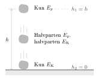
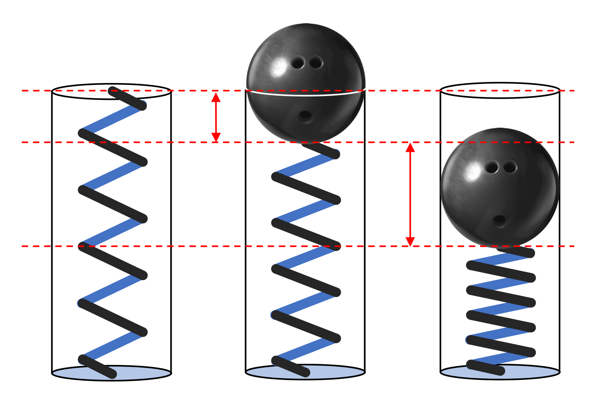
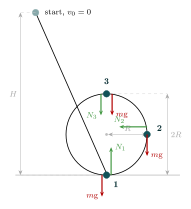
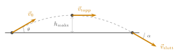

:::: {.oppgaver}

I et isolert system der det ikke er noe energitap til friksjon eller andre motstandskrefter, er den mekaniske energien bevart. Det vil si: Alt arbeidet som går med til å lagre energi potensielt, kan igjen utløses som kinetisk energi. Matematisk kan bevaring av mekanisk energi uttrykkes som: $$E = E_\text{K} + E_\text{P} = \text{konstant}$$ Dette betyr at i et system der mekanisk energi er bevart, vil all potensiell energi som et objekt mister omformes til kinetisk energi, og omvendt. For eksempel, når en ball faller fra en høyde, vil dens potensielle energi omformes til kinetisk energi når den nærmer seg bakken. I fravær av luftmotstand vil den totale energien forbli den samme gjennom hele bevegelsen.

Når det oppstår friksjon eller andre energitap, vil den mekaniske energien ikke være bevart, fordi noe av energien omformes til andre former, slik som varme.

::: {.callout-note title="Definisjon: Bevaring av mekanisk energi"}

Når et legme beveger seg under påvirkning av kun tyngdekraft og/ eller fjærkraft, er energien bevart og kan skrives slik: $$\begin{aligned}
        E_{\text{før}} = E_{\text{etter}}
\end{aligned}$$ hvor den totale mekaniske energien $E$ er summen av gravitasjonspotensiell energi, kinetisk energi og elastisk potensiell energi. Dette kan skrives som: $$\begin{aligned}
        E = m\mathrm{g}h + \frac{1}{2} m v^2 + \frac{1}{2} k x^2
\end{aligned}$$ Her er $m$ massen til objektet, $\mathrm{g}$ tyngdeakselerasjonen, $h$ høyden over et nullnivå, $v$ hastigheten, $k$ fjærkonstanten, og $x$ forlengelsen eller kompresjonen av en fjær.

:::

::: {.eksempel}
[Eksempel: Fallende stein]{.eks-tittel}

En person holder en stein på en høyde $1.60 \, \text{m}$ over bakken og slipper den. Vi skal regne ut steinens hastighet rett før den treffer bakken. Vi antar at luftmotstanden er neglisjerbar.

::: center
{.tikz-fig style="width:315px"}

[En stein slippes fra høyden $h$. Underveis omdannes potensiell energi til kinetisk energi. Halvveis ned er halvparten omdannet, og rett før bakken er all energien kinetisk.]{.figurtekst}
:::

::: {.losning}
*Metode:*\
Når steinen slippes, har den ingen startfart, så det er ingen kinetisk energi i systemet ved start. Den har kun potensiell energi på grunn av høyden over bakken. Vi setter nullpunktet for høyden til bakkenivå, slik at høyden $h = 0$ rett før steinen treffer bakken. På dette tidspunktet er den potensielle energien null, og all energien er omformet til kinetisk energi.

Vi bruker bevaring av mekanisk energi, som sier at total energien før og etter fallet er den samme: $$E_{\text{før}} = E_{\text{etter}}$$ I starten har steinen potensiell energi, men ingen kinetisk energi. Den totale energien i starten kan skrives som: $$m\mathrm{g}h_1 + \frac{1}{2} m v_1^2 = m\mathrm{g}h_2 + \frac{1}{2} m v_2^2$$ Siden steinen slippes uten startfart, er hastigheten ved starten $v_1 = 0$, og dermed er det ingen kinetisk energi i starten: $$m\mathrm{g}h_1 + \frac{1}{2} m \cdot 0^2 = m\mathrm{g}h_2 + \frac{1}{2} m v_2^2$$ Rett før steinen treffer bakken, er høyden $h_2 = 0$, og dermed er det ingen potensiell energi på dette tidspunktet: $$m\mathrm{g}h_1 + 0 = 0 + \frac{1}{2} m v_2^2$$ Vi kan nå stryke massen $m$ fra begge sider av likningen: $$\mathrm{g}h_1 = \frac{1}{2} v_2^2$$ Løs for hastigheten $v_2$: $$v_2 = \sqrt{2\mathrm{g}h_1}$$ Ved å sette inn verdiene $\mathrm{g} = 9.8 \, \text{m/s}^2$ og $h_1 = 1.60 \, \text{m}$, får vi: $$v_2 = \sqrt{2 \cdot 9.8 \, \text{m/s}^2 \cdot 1.60 \, \text{m}} = \sqrt{31.36} \approx \underline{\underline{5.6 \, \text{m/s}}}$$ Steinen har en hastighet på $5.6 \, \text{m/s}$ rett før den treffer bakken.
:::
:::

::: {.eksempel}
[Eksempel: Fjærkanon i tyngdefeltet - Finn fjærkonstanten $k$]{.eks-tittel}

En fjærkanon skyter en kanonkule med masse $0.20 \, \text{kg}$ rett opp i luften etter at fjæren har blitt komprimert med $x = 0.15 \, \text{m}$. Kanonkulen når en maksimal høyde på $h = 5.0 \, \text{m}$ før den faller tilbake ned igjen. Anta at all fjærens elastiske potensielle energi omformes til kanonkulas potensielle energi på toppen. Vi skal finne fjærkonstanten $k$ for fjæren.

::: center
{.kompendium-bilde}

[Fjærkanon i tyngdefelt]{.figurtekst}
:::

::: {.losning}
*Metode:*\
Vi bruker bevaring av mekanisk energi, som sier at all elastisk potensiell energi i fjæren omformes til gravitasjonspotensiell energi på toppen. Elastisk potensiell energi for fjæren er gitt ved: $$E_{\text{fjær}} = \frac{1}{2} k x^2$$ Den potensielle energien kanonkulen har på toppen er: $$E_p = m\mathrm{g}h$$ Siden $E_{\text{fjær}} = E_p$, kan vi sette opp likningen: $$\frac{1}{2} k x^2 = m\mathrm{g}h$$ Vi løser for fjærkonstanten $k$: $$k = \frac{2m\mathrm{g}h}{x^2}$$ Nå setter vi inn verdiene $m = 0.20 \, \text{kg}$, $\mathrm{g} = 9.8 \, \text{m/s}^2$, $h = 5.0 \, \text{m}$, og $x = 0.15 \, \text{m}$: $$k = \frac{2 \cdot 0.20 \, \text{kg} \cdot 9.8 \, \text{m/s}^2 \cdot 5.0 \, \text{m}}{(0.15 \, \text{m})^2} = \frac{19.6 \, \text{N/m} \cdot \text{m}}{0.0225 \, \text{m}^2} = 871.1 \, \text{N/m} \approx \underline{\underline{8.7\cdot 10^2 \, \text{N/m}}}$$ Fjærkonstanten $k$ er dermed omtrent $8.7\cdot 10^2 \, \text{N/m}$.
:::
:::

::: {.eksempel}
[Eksempel: Kollisjon mellom legeme og fjær]{.eks-tittel}

Et legeme med masse $100 \, \text{g}$ glir fra ro nedover en friksjonsfri bane og kolliderer med en elastisk fjær med fjærkonstanten $k = 300 \, \text{N/m}$. Startpunktet for legemet er $60 \, \text{cm}$ over den horisontale delen av banen. Vi skal først finne farten til legemet idet det treffer fjæren, og deretter finne hvor langt fjæren blir maksimalt presset inn under kollisjonen.

::: center
{.kompendium-bilde}

[Kollisjon mellom legeme og fjær]{.figurtekst}
:::

::: {.losning}
**Del a: Bestem farten til legemet idet det kolliderer med fjæren**\
*Metode:*\
Vi bruker bevaring av mekanisk energi. I startposisjonen har legemet kun potensiell energi, og i det øyeblikket det treffer fjæren er all denne potensielle energien omformet til kinetisk energi (friksjon neglisjeres): $$E_p = E_\text{K}$$ Ved bevaring av energi får vi: $$m\mathrm{g}h = \frac{1}{2} m v^2$$ Vi stryker massen $m$ fra begge sider av likningen: $$gh = \frac{1}{2} v^2$$ Løser for hastigheten $v$: $$v = \sqrt{2\mathrm{g}h}$$ Setter inn verdiene $\mathrm{g} = 9.8 \, \text{m/s}^2$ og $h = 0.60 \, \text{m}$: $$v = \sqrt{2 \cdot 9.8 \, \text{m/s}^2 \cdot 0.60 \, \text{m}} = \sqrt{11.76} = 3.43 \, \text{m/s} \approx \underline{\underline{3.4 \, \text{m/s}}}$$ Legemet har en hastighet på omtrent $3.4 \, \text{m/s}$ idet det treffer fjæren.

**Del b: Hvor langt blir fjæren maksimalt presset inn?**\
*Metode:*\
Nå overføres all den kinetiske energien fra legemet til fjæren, som blir maksimalt komprimert. Energien som lagres i den komprimerte fjæren er gitt ved elastisk potensiell energi: $$E_{\text{fjær}} = \frac{1}{2} k x^2$$ Siden all den kinetiske energien omformes til elastisk potensiell energi ved maksimal kompresjon, setter vi $E_\text{K} = E_{\text{fjær}}$: $$\frac{1}{2} m v^2 = \frac{1}{2} k x^2$$ Vi kan stryke $\frac{1}{2}$ fra begge sider: $$m v^2 = k x^2$$ Løs for $x$, som er maksimal kompresjon av fjæren: $$x = \sqrt{\frac{m v^2}{k}}$$ Sett inn verdiene $m = 0.10 \, \text{kg}$, $v = 3.43 \, \text{m/s}$, og $k = 300 \, \text{N/m}$: $$x = \sqrt{\frac{0.10 \, \text{kg} \cdot (3.43 \, \text{m/s})^2}{300 \, \text{N/m}}} = \sqrt{\frac{1.176}{300}} = \sqrt{0.00392} \approx \underline{\underline{0.063 \, \text{m}}}$$ Fjæren blir maksimalt komprimert med $6.3 \, \text{cm}$ under kollisjonen.
:::
:::

::: {.eksempel}
[Eksempel: Loop-the-loop]{.eks-tittel}
En ball med masse $m = 1.0\,\mathrm{kg}$ slippes fra ro fra en høyde $H = 10.0\,\mathrm{m}$ over bunnen av en friksjonsfri sirkularloop med radius $R = 2.0\,\mathrm{m}$. Beregn normalkraften på ballen i de tre markerte posisjonene: **1** bunn av loopen ($h = 0$), **2** halvveis opp på siden ($h = R$), og **3** toppen av loopen ($h = 2R$).

::: center
{.tikz-fig style="width:370px"}
:::

::: {.losning}
**Hastighet i hver posisjon**

Energibevaring fra start ($v_0 = 0$, høyde $H$) til høyde $h$: $$m\mathrm{g}H = \tfrac{1}{2}mv^2 + m\mathrm{g}h \implies v^2 = 2\mathrm{g}(H - h)$$

**Normalkraft via Newtons 2. lov**

I sirkulær bevegelse er nettokraften *mot sentrum* lik sentripetalkraften: $$\sum F_{\text{sentripetal}} = \frac{mv^2}{R}$$

*Posisjon 1 — bunn* ($h = 0$, sentrum peker opp). $N_1$ peker opp, $m\mathrm{g}$ peker ned: $$N_1 - m\mathrm{g} = \frac{mv_1^2}{R}, \qquad v_1^2 = 2\mathrm{g}H$$ $$N_1 = m\mathrm{g}\!\left(1 + \frac{2H}{R}\right)
      = 1.0\,\mathrm{kg}\cdot9.81\,\mathrm{m}\,\mathrm{s}^{-2}
        \!\left(1 + \frac{2\cdot10.0\,\mathrm{m}}{2.0\,\mathrm{m}}\right)
      = 108\,\mathrm{N} \approx \underline{\underline{1.1\cdot 10^{2}\,\mathrm{N}}}$$

*Posisjon 2 — siden* ($h = R$, sentrum peker horisontalt). $N_2$ peker horisontalt mot sentrum; $m\mathrm{g}$ er loddrett og bidrar *ikke* til sentripetalkraften: $$N_2 = \frac{mv_2^2}{R}, \qquad v_2^2 = 2\mathrm{g}(H - R)$$ $$N_2 = \frac{2m\mathrm{g}(H - R)}{R}
      = \frac{2\cdot1.0\,\mathrm{kg}\cdot9.81\,\mathrm{m}\,\mathrm{s}^{-2}
              \cdot8.0\,\mathrm{m}}{2.0\,\mathrm{m}}
      = 78.5\,\mathrm{N} \approx \underline{\underline{79\,\mathrm{N}}}$$

*Posisjon 3 — toppen* ($h = 2R$, sentrum peker ned). Både $N_3$ og $m\mathrm{g}$ peker nedover (mot sentrum): $$N_3 + m\mathrm{g} = \frac{mv_3^2}{R}, \qquad v_3^2 = 2\mathrm{g}(H - 2R)$$ $$N_3 = m\mathrm{g}\!\left(\frac{2(H - 2R)}{R} - 1\right)
      = 1.0\,\mathrm{kg}\cdot9.81\,\mathrm{m}\,\mathrm{s}^{-2}
        \!\left(\frac{2\cdot6.0\,\mathrm{m}}{2.0\,\mathrm{m}} - 1\right)
      = 49.1\,\mathrm{N} \approx \underline{\underline{49\,\mathrm{N}}}$$

::: tcolorbox
Normalkraften er størst i bunnen og minst på toppen. For at ballen skal holde kontakt med skinna på toppen, må $N_3 \geq 0$: $$\frac{2(H-2R)}{R} \geq 1 \implies H \geq \frac{5R}{2}$$ Med $R = 2.0\,\mathrm{m}$ er minste tillatte starthøyde $H_{\min} = 5.0\,\mathrm{m}$.
:::
:::
:::

::: {.eksempel}
[Eksempel: Skrått kast]{.eks-tittel}

En kanonkule skytes ut med fart $v_0 = 20\,\mathrm{m}\,\mathrm{s}^{-1}$ i en vinkel $\theta = 30^\circ$ over horisontalen. Se bort fra luftmotstand.

a)  Hva er kulas maksimale høyde over utskytingspunktet? Hva er farten til kula i det høyeste punktet, og i hvilken retning peker farten?

b)  Hva er farten til kula når den treffer underlaget igjen (i samme høyde som den ble skutt ut fra)? Hva er vinkelen mellom fartsretningen og underlaget?

::: center
{.tikz-fig style="width:507px"}

[Skrått kast uten luftmotstand. I toppunktet peker farten horisontalt.]{.figurtekst}
:::

:::

::: {.callout-note .svar collapse="true" title="Vis løsning"}

Vi bruker bevaring av mekanisk energi, med utskytingspunktet som nullnivå for potensiell energi. I tillegg trenger vi én opplysning fra kapittel : Uten luftmotstand virker det ingen krefter horisontalt, så den horisontale komponenten av farten er konstant gjennom hele kastet: $$v_x = v_0\cos\theta = 20\,\mathrm{m}\,\mathrm{s}^{-1}\cdot\cos 30^\circ = 17.3\,\mathrm{m}\,\mathrm{s}^{-1}$$

**a)** I det høyeste punktet går kula verken opp eller ned, så den vertikale komponenten av farten er null. Farten er da bare den horisontale komponenten: $$v_\text{topp} = v_x = 17.3\,\mathrm{m}\,\mathrm{s}^{-1} \approx \underline{\underline{17\,\mathrm{m}\,\mathrm{s}^{-1}}}, \qquad \text{\textbf{rettet horisontalt}}$$ Den maksimale høyden finner vi med energibevaring mellom utskytingspunktet og toppunktet: $$\frac{1}{2}mv_0^2 = \frac{1}{2}mv_\text{topp}^2 + m\mathrm{g}h_\text{maks}
    \quad\implies\quad
    h_\text{maks} = \frac{v_0^2 - v_\text{topp}^2}{2\mathrm{g}}$$ $$h_\text{maks} = \frac{(20\,\mathrm{m}\,\mathrm{s}^{-1})^2 - (17.3\,\mathrm{m}\,\mathrm{s}^{-1})^2}{2\cdot9.81\,\mathrm{m}\,\mathrm{s}^{-2}}
    = \underline{\underline{5.1\,\mathrm{m}}}$$ Legg merke til at kula ikke kommer like høyt som om den ble skutt rett opp. Bare en del av den kinetiske energien blir omdannet til potensiell energi, fordi kula fortsatt beveger seg horisontalt i toppunktet.

**b)** Når kula er tilbake i samme høyde, er den potensielle energien den samme som ved start. Da må også den kinetiske energien være den samme: $$\frac{1}{2}mv_0^2 = \frac{1}{2}mv_\text{slutt}^2
    \quad\implies\quad
    v_\text{slutt} = v_0 = \underline{\underline{20\,\mathrm{m}\,\mathrm{s}^{-1}}}$$ At farten er uendret er altså et direkte resultat av bevaring av energi. Vinkelen $\alpha$ med underlaget finner vi fordi den horisontale komponenten fortsatt er $v_x$: $$\cos\alpha = \frac{v_x}{v_\text{slutt}} = \frac{v_0\cos\theta}{v_0} = \cos\theta
    \quad\implies\quad
    \alpha = \underline{\underline{30^\circ}}$$ Kula treffer altså underlaget med samme fart og samme vinkel som den ble skutt ut med, men nå peker farten skrått *nedover*.

:::

::: {.oppgave tittel="Stein kastet rett opp"}
[Stein kastet rett opp]{.oppg-tittel}

En stein kastes rett opp med startfart $v_0 = 12\,\mathrm{m}\,\mathrm{s}^{-1}$. Vi ser bort fra luftmotstand.

a)  Bruk bevaring av mekanisk energi til å finne hvor høyt over utkastpunktet steinen kommer.

b)  Hvor stor fart har steinen når den er $5.0\,\mathrm{m}$ over utkastpunktet?

c)  Du fikk ikke oppgitt massen til steinen. Forklar hvorfor du ikke trengte den.

::: {.losning}

Vi velger utkastpunktet som nullnivå. Uten luftmotstand er mekanisk energi bevart.

**a)** På toppen står steinen stille, så all kinetisk energi er blitt potensiell energi: $$\frac{1}{2}mv_0^2 = m\mathrm{g}h
    \quad\implies\quad
    h = \frac{v_0^2}{2\mathrm{g}} = \frac{(12\,\mathrm{m}\,\mathrm{s}^{-1})^2}{2\cdot9.81\,\mathrm{m}\,\mathrm{s}^{-2}} = \underline{\underline{7.3\,\mathrm{m}}}$$

**b)** $$\frac{1}{2}mv_0^2 = \frac{1}{2}mv^2 + m\mathrm{g}h
    \quad\implies\quad
    v = \sqrt{v_0^2 - 2\mathrm{g}h}$$ $$v = \sqrt{(12\,\mathrm{m}\,\mathrm{s}^{-1})^2 - 2\cdot9.81\,\mathrm{m}\,\mathrm{s}^{-2}\cdot5.0\,\mathrm{m}} = \underline{\underline{6.8\,\mathrm{m}\,\mathrm{s}^{-1}}}$$

**c)** Massen $m$ står i alle leddene i energilikningen, så vi kan dele den bort. Svaret blir det samme uansett hvor tung steinen er (så lenge vi ser bort fra luftmotstand).

:::

:::

::: {.oppgave tittel="Huske"}
[Huske]{.oppg-tittel}

Et barn sitter i en huske. Husken trekkes bakover og slippes fra ro når setet er $h = 1.2\,\mathrm{m}$ over det laveste punktet. Vi ser bort fra luftmotstand og friksjon.

a)  Hvor stor fart har barnet i det laveste punktet?

b)  Hvor høyt over det laveste punktet er barnet når farten er $3.0\,\mathrm{m}\,\mathrm{s}^{-1}$?

c)  Snora i husken drar hele tiden i barnet, men gjør ikke noe arbeid. Hvorfor ikke? (Hint: hvilken vinkel er det mellom snorkraften og bevegelsesretningen?)

::: {.losning}

Vi velger det laveste punktet som nullnivå.

**a)** All potensiell energi blir til kinetisk energi i det laveste punktet: $$m\mathrm{g}h = \frac{1}{2}mv^2
    \quad\implies\quad
    v = \sqrt{2\mathrm{g}h} = \sqrt{2\cdot9.81\,\mathrm{m}\,\mathrm{s}^{-2}\cdot1.2\,\mathrm{m}} = \underline{\underline{4.9\,\mathrm{m}\,\mathrm{s}^{-1}}}$$

**b)** Energibevaring mellom startpunktet og punktet der farten er $v = 3.0\,\mathrm{m}\,\mathrm{s}^{-1}$: $$m\mathrm{g}h_0 = \frac{1}{2}mv^2 + m\mathrm{g}h
    \quad\implies\quad
    h = h_0 - \frac{v^2}{2\mathrm{g}} = 1.2\,\mathrm{m} - \frac{(3.0\,\mathrm{m}\,\mathrm{s}^{-1})^2}{2\cdot9.81\,\mathrm{m}\,\mathrm{s}^{-2}} = \underline{\underline{0.74\,\mathrm{m}}}$$

**c)** Barnet beveger seg langs en sirkelbue, så bevegelsesretningen er hele tiden langs sirkelen. Snora drar inn mot opphengspunktet, altså vinkelrett på bevegelsen. Da er $\cos 90^\circ = 0$, og snorkraften gjør ikke noe arbeid. Derfor kan vi bruke bevaring av mekanisk energi selv om snora drar i barnet.

:::

:::

::::
