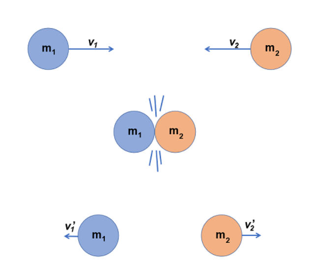
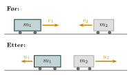

:::: {.oppgaver}

I lukkede systemer, der ingen ytre krefter virker, er bevegelsesmengden bevart. Dette prinsippet, kalt bevaringsloven, er grunnen til at en rakett kan bevege seg i rommet. Når raketten skyver gassen ut bakover, får gassen en bevegelsesmengde i én retning, og raketten får en like stor, men motsatt bevegelsesmengde, som fører til at raketten beveger seg fremover.

::: {.callout-note title="Definisjon: Bevaring av bevegelsesmengde"}

I et lukket system, der ingen ytre krefter virker, er den totale bevegelsesmengden bevart. Dette kan uttrykkes som: $$\begin{aligned}
        \vec{p}_{\text{før}} = \vec{p}_{\text{etter}}
\end{aligned}$$ hvor $\vec{p}_{\text{før}}$ er den totale bevegelsesmengden til systemet før en hendelse, og $\vec{p}_{\text{etter}}$ er den totale bevegelsesmengden etter hendelsen.

:::

## Elastisk støt

Et elastisk støt er en kollisjon der både den totale bevegelsesmengden og den totale kinetiske energien er bevart. I slike kollisjoner “sprettes” objektene fra hverandre uten å miste energi til deformasjon eller varme, noe som betyr at den kinetiske energien er den samme før og etter kollisjonen.

I et elastisk støt mellom to objekter, gjelder både bevaring av bevegelsesmengde og bevaring av kinetisk energi:

::: {.callout-note title="Definisjon: Bevaring av bevegelsesmengde"}

I et elastisk støt er bevegelsesmengden bevart: $$\begin{aligned}
        m_1 v_1 + m_2 v_2 = m_1 u_1 + m_2 u_2
\end{aligned}$$ hvor $m_1$ og $m_2$ er massene til de to objektene, og $v_1$ og $v_2$ er hastighetene til objektene *før* kollisjonen, mens $u_1$ og $u_2$ er hastighetene *etter* kollisjonen.

:::

::: {.callout-note title="Definisjon: Bevaring av kinetisk Energi"}

I et elastisk støt er også den kinetiske energien bevart: $$\begin{aligned}
        \frac{1}{2} m_1 v_1^2 + \frac{1}{2} m_2 v_2^2 = \frac{1}{2} m_1 u_1^2 + \frac{1}{2} m_2 u_2^2
\end{aligned}$$ Dette betyr at den totale kinetiske energien før kollisjonen er lik den totale kinetiske energien etter kollisjonen.

:::

Et klassisk eksempel på elastisk støt er to biljardkuler som kolliderer. Når de treffer hverandre, blir ingen energi tapt til varme eller deformasjon, så de spretter fra hverandre, og den totale bevegelsesmengden og kinetiske energien forblir den samme.

:::: figure
{.kompendium-bilde}

::: caption
Elastisk støt
:::
::::

Et annet eksempel på bevaring av bevegelsesmengde og kinetisk energi finner vi i et eksperiment kjent som Newtons pendel. Dette består av flere kuler som henger på snorer og er i kontakt med hverandre. Når du løfter én av kulene fra den ene enden og slipper den, vil den kollidere med kulen ved siden av, som overfører bevegelsesmengden gjennom alle kulene.

På grunn av bevaringen av bevegelsesmengde og kinetisk energi, vil den siste kulen i den andre enden “skytes“ opp med omtrent samme hastighet som den første kulen ble sluppet. Resten av kulene forblir i ro etter kollisjonen.

Dette skjer fordi i et elastisk støt mellom objektene, bevares både den totale bevegelsesmengden og den totale kinetiske energien i systemet. I Newtons pendel ser vi disse prinsippene tydelig. Kalles farten til den første kula rett før støtet $v$, og farten til den siste kula rett etter støtet $u$, har vi: $$m v = m u$$ $$\frac{1}{2} m v^2 = \frac{1}{2} m u^2$$ Dette viser at kulene overfører bevegelsesmengde og energi fra den ene enden av pendelen til den andre uten at energi går tapt i prosessen.\
I Newtons pendel skjer det elastiske kollisjoner mellom kulene. I en elastisk kollisjon bevares både bevegelsesmengden og den kinetiske energien, slik at ingen energi går tapt til varme eller deformasjon. Når én kule slippes, overføres bevegelsesmengden og energien gjennom de midterste kulene til den siste kulen i rekken, som "spretter" opp med samme hastighet som den første.

:::: figure
{.kompendium-bilde .foto}

::: caption
Newtons pendel
:::
::::

::: {.eksempel}
[Eksempel: Elastisk kollisjon mellom to like vogner]{.eks-tittel}

En vogn med masse $m = 2.0 \, \text{kg}$ og fart $v_1 = 3.0 \, \text{m/s}$ krasjer inn i en annen vogn med samme masse $m = 2.0 \, \text{kg}$ som står stille ($v_2 = 0$) på et friksjonsfritt underlag. Det er ingen ytre krefter som virker på systemet (vogn 1 + vogn 2), og det utføres ikke arbeid på systemet under kollisjonen. Vi skal finne hastighetene $u_1$ og $u_2$ til de to vognene etter kollisjonen.

::: {.losning}
*Løsning:*\
Siden det er en elastisk kollisjon, er både bevegelsesmengden og den kinetiske energien bevart.

**Bevaring av bevegelsesmengde:**\
Før kollisjonen har bare vogn 1 bevegelsesmengde, siden vogn 2 står stille: $$p_{\text{før}} = m v_1$$ Etter kollisjonen fordeler bevegelsesmengden seg mellom vogn 1 (med hastighet $u_1$) og vogn 2 (med hastighet $u_2$): $$p_{\text{etter}} = m u_1 + m u_2$$ Siden bevegelsesmengden er bevart, har vi: $$m v_1 = m u_1 + m u_2$$ Vi kan forkorte $m$ fra begge sider:

::: {.graa}

$\displaystyle v_1 = u_1 + u_2$

:::

**Bevaring av kinetisk energi:**\
I en elastisk kollisjon bevares også den kinetiske energien. Kinetisk energi før kollisjonen er bare fra vogn 1: $$E_{\text{før}} = \frac{1}{2} m v_1^2$$ Etter kollisjonen er den kinetiske energien fordelt mellom begge vognene: $$E_{\text{etter}} = \frac{1}{2} m u_1^2 + \frac{1}{2} m u_2^2$$ Siden kinetisk energi er bevart, har vi: $$\frac{1}{2} m v_1^2 = \frac{1}{2} m u_1^2 + \frac{1}{2} m u_2^2$$ Igjen kan vi forkorte $\frac{1}{2} m$ fra begge sider: $$v_1^2 = u_1^2 + u_2^2$$

**Løsning for hastighetene $u_1$ og $u_2$:**\
Vi har nå to ligninger: 1. $v_1 = u_1 + u_2$ 2. $v_1^2 = u_1^2 + u_2^2$

Ved å substituere $u_2 = v_1 - u_1$ fra den første ligningen inn i den andre ligningen, får vi: $$v_1^2 = u_1^2 + (v_1 - u_1)^2$$ Utvid $(v_1 - u_1)^2$: $$v_1^2 = u_1^2 + v_1^2 - 2 v_1 u_1 + u_1^2$$ Forenkle ved å samle ledd: $$v_1^2 = 2u_1^2 - 2v_1 u_1 + v_1^2$$ Trekk $v_1^2$ fra begge sider: $$0 = 2u_1^2 - 2v_1 u_1$$ Del begge sider på 2: $$0 = u_1(u_1 - v_1)$$ Dette gir to mulige løsninger: enten $u_1 = 0$ eller $u_1 = v_1$. Løsningen $u_1 = v_1$ gir $u_2 = 0$: da har vogn 1 samme fart som før og vogn 2 står fortsatt stille, som om vognene aldri traff hverandre. Det kan ikke skje når vogn 1 kjører inn i vogn 2. Den fysiske løsningen er derfor $u_1 = 0$. Dermed har vi: $$\underline{\underline{u_1 = 0}} \quad \text{og} \quad \underline{\underline{u_2 = v_1 = 3.0 \, \text{m/s}}}$$

Etter kollisjonen står vogn 1 stille ($u_1 = 0$), og vogn 2 beveger seg med en fart på $u_2 = 3.0 \, \text{m/s}$.
:::
:::

::: {.eksempel}
[Eksempel: Elastisk kollisjon mellom vogner med ulik masse]{.eks-tittel}

To vogner ruller mot hverandre på et friksjonsfritt underlag. Vogn 1 har masse $m_1 = 2.0\,\mathrm{kg}$ og fart $3.0\,\mathrm{m}\,\mathrm{s}^{-1}$ mot høyre. Vogn 2 har masse $m_2 = 1.0\,\mathrm{kg}$ og fart $2.0\,\mathrm{m}\,\mathrm{s}^{-1}$ mot venstre. Kollisjonen er elastisk.

a)  Utled generelle formler for hastighetene $u_1$ og $u_2$ etter kollisjonen, uttrykt ved massene og hastighetene $v_1$ og $v_2$ før kollisjonen.

b)  Finn hastighetene til vognene etter kollisjonen.

::: center
{.tikz-fig style="width:369px"}

[To vogner med ulik masse kolliderer elastisk. Positiv retning er mot høyre.]{.figurtekst}
:::

:::

::: {.callout-note .svar collapse="true" title="Vis løsning"}

**a)** Vi velger positiv retning mot høyre. Da er $v_1 > 0$ og $v_2 < 0$ i dette eksempelet, men utledningen under gjelder for alle fortegn.

*Bevegelsesmengde.* Vi samler vogn 1 på venstre side og vogn 2 på høyre side: $$m_1v_1 + m_2v_2 = m_1u_1 + m_2u_2
    \quad\implies\quad
    m_1(v_1 - u_1) = m_2(u_2 - v_2)$$

*Kinetisk energi.* Vi ganger med 2, samler på samme måte og bruker $a^2 - b^2 = (a-b)(a+b)$: $$m_1v_1^2 + m_2v_2^2 = m_1u_1^2 + m_2u_2^2
    \quad\implies\quad
    m_1(v_1 - u_1)(v_1 + u_1) = m_2(u_2 - v_2)(u_2 + v_2)$$

*Del (2) på (1).* Faktorene $m_1(v_1-u_1)$ og $m_2(u_2-v_2)$ er like store og forkortes bort. Det kan vi gjøre fordi $u_1 \neq v_1$ når vognene faktisk kolliderer. Vi står igjen med en enkel lineær likning: $$v_1 + u_1 = u_2 + v_2
    \quad\implies\quad
    u_2 = v_1 - v_2 + u_1$$

*Sett (3) inn i (1)* og løs for $u_1$: $$m_1v_1 - m_1u_1 = m_2(v_1 - v_2 + u_1) - m_2v_2
    \quad\implies\quad
    (m_1 + m_2)\,u_1 = (m_1 - m_2)\,v_1 + 2m_2v_2$$ Til slutt finner vi $u_2$ fra (3). Resultatet er de generelle formlene for elastisk støt i én dimensjon:

::: {.graa}

$\displaystyle u_1 = \frac{(m_1 - m_2)\,v_1 + 2m_2v_2}{m_1 + m_2}, \qquad u_2 = \frac{(m_2 - m_1)\,v_2 + 2m_1v_1}{m_1 + m_2}$

:::

Som en sjekk kan vi sette inn $m_1 = m_2$ og $v_2 = 0$. Da får vi $u_1 = 0$ og $u_2 = v_1$, akkurat som i forrige eksempel med like vogner.

**b)** Vi setter inn $m_1 = 2.0\,\mathrm{kg}$, $m_2 = 1.0\,\mathrm{kg}$, $v_1 = 3.0\,\mathrm{m}\,\mathrm{s}^{-1}$ og $v_2 = -2.0\,\mathrm{m}\,\mathrm{s}^{-1}$: $$u_1 = \frac{(2.0\,\mathrm{kg} - 1.0\,\mathrm{kg})\cdot3.0\,\mathrm{m}\,\mathrm{s}^{-1} + 2\cdot1.0\,\mathrm{kg}\cdot(-2.0\,\mathrm{m}\,\mathrm{s}^{-1})}{3.0\,\mathrm{kg}}
    = \underline{\underline{-0.33\,\mathrm{m}\,\mathrm{s}^{-1}}}$$ $$u_2 = \frac{(1.0\,\mathrm{kg} - 2.0\,\mathrm{kg})\cdot(-2.0\,\mathrm{m}\,\mathrm{s}^{-1}) + 2\cdot2.0\,\mathrm{kg}\cdot3.0\,\mathrm{m}\,\mathrm{s}^{-1}}{3.0\,\mathrm{kg}}
    = \underline{\underline{4.7\,\mathrm{m}\,\mathrm{s}^{-1}}}$$ Vogn 1 snur og ruller sakte mot venstre, mens vogn 2 spretter tilbake mot høyre med stor fart. Vi kan sjekke at bevegelsesmengden er bevart: før er den $2.0\,\mathrm{kg}\cdot3.0\,\mathrm{m}\,\mathrm{s}^{-1} + 1.0\,\mathrm{kg}\cdot(-2.0\,\mathrm{m}\,\mathrm{s}^{-1}) = 4.0\,\mathrm{kg}\,\mathrm{m}\,\mathrm{s}^{-1}$, og etter er den $2.0\,\mathrm{kg}\cdot(-0.33\,\mathrm{m}\,\mathrm{s}^{-1}) + 1.0\,\mathrm{kg}\cdot4.7\,\mathrm{m}\,\mathrm{s}^{-1} \approx 4.0\,\mathrm{kg}\,\mathrm{m}\,\mathrm{s}^{-1}$.

:::

::: {.oppgave tittel="Sjekk av elastisk støt"}
[Sjekk av elastisk støt]{.oppg-tittel}

Vogn 1 med masse $m_1 = 1.0\,\mathrm{kg}$ ruller med fart $4.0\,\mathrm{m}\,\mathrm{s}^{-1}$ mot vogn 2 med masse $m_2 = 3.0\,\mathrm{kg}$, som står i ro. Etter støtet ruller vogn 1 *tilbake* med fart $2.0\,\mathrm{m}\,\mathrm{s}^{-1}$, mens vogn 2 ruller fremover med fart $2.0\,\mathrm{m}\,\mathrm{s}^{-1}$.

a)  Vis at bevegelsesmengden er bevart. (Husk at hastigheten er negativ når vogna ruller tilbake.)

b)  Vis at den kinetiske energien også er bevart. Hva slags støt er dette?

::: {.losning}

Vi velger positiv retning i fartsretningen til vogn 1 før støtet. Da er $v_1 = 4.0\,\mathrm{m}\,\mathrm{s}^{-1}$, $v_2 = 0$, $u_1 = -2.0\,\mathrm{m}\,\mathrm{s}^{-1}$ og $u_2 = 2.0\,\mathrm{m}\,\mathrm{s}^{-1}$.

**a)** Bevegelsesmengde før og etter: $$\begin{aligned}
    p_\text{før} &= m_1v_1 + m_2v_2 = 1.0\,\mathrm{kg}\cdot4.0\,\mathrm{m}\,\mathrm{s}^{-1} + 0 = 4.0\,\mathrm{kg}\,\mathrm{m}\,\mathrm{s}^{-1}\\
    p_\text{etter} &= m_1u_1 + m_2u_2 = 1.0\,\mathrm{kg}\cdot(-2.0\,\mathrm{m}\,\mathrm{s}^{-1}) + 3.0\,\mathrm{kg}\cdot2.0\,\mathrm{m}\,\mathrm{s}^{-1} = 4.0\,\mathrm{kg}\,\mathrm{m}\,\mathrm{s}^{-1}
\end{aligned}$$ **$p_\text{før} = p_\text{etter}$**, så bevegelsesmengden er bevart.

**b)** Kinetisk energi før og etter: $$\begin{aligned}
    E_\text{K,før} &= \frac{1}{2}\cdot1.0\,\mathrm{kg}\cdot(4.0\,\mathrm{m}\,\mathrm{s}^{-1})^2 = 8.0\,\mathrm{J}\\
    E_\text{K,etter} &= \frac{1}{2}\cdot1.0\,\mathrm{kg}\cdot(2.0\,\mathrm{m}\,\mathrm{s}^{-1})^2 + \frac{1}{2}\cdot3.0\,\mathrm{kg}\cdot(2.0\,\mathrm{m}\,\mathrm{s}^{-1})^2 = 2.0\,\mathrm{J} + 6.0\,\mathrm{J} = 8.0\,\mathrm{J}
\end{aligned}$$ Både bevegelsesmengde og kinetisk energi er bevart, så støtet er **elastisk**.

:::

:::

## Uelastisk Støt

Uelastisk støt ble behandlet i seksjonen, der vi så at bevegelsesmengden er bevart også når to legemer henger fast i hverandre etter en kollisjon — i motsetning til ved elastisk støt (ovenfor) er da ikke den kinetiske energien bevart.

::: {.oppgave tittel="Energitap i et uelastisk støt"}
[Energitap i et uelastisk støt]{.oppg-tittel}

En vogn med masse $2.0\,\mathrm{kg}$ ruller med fart $3.0\,\mathrm{m}\,\mathrm{s}^{-1}$ og kolliderer med en vogn med masse $1.0\,\mathrm{kg}$ som står i ro. Vognene henger fast i hverandre etter støtet.

a)  Finn den felles farten til vognene etter støtet.

b)  Finn den totale kinetiske energien før og etter støtet.

c)  Hvor mye kinetisk energi gikk tapt, og hva ble den omdannet til?

::: {.losning}

**a)** Vognene henger sammen etter støtet og får samme fart $u$. Bevaring av bevegelsesmengde: $$m_1v_1 = (m_1 + m_2)\,u
    \quad\implies\quad
    u = \frac{2.0\,\mathrm{kg}\cdot3.0\,\mathrm{m}\,\mathrm{s}^{-1}}{3.0\,\mathrm{kg}} = \underline{\underline{2.0\,\mathrm{m}\,\mathrm{s}^{-1}}}$$

**b)** $$\begin{aligned}
    E_\text{K,før} &= \frac{1}{2}\cdot2.0\,\mathrm{kg}\cdot(3.0\,\mathrm{m}\,\mathrm{s}^{-1})^2 = \underline{\underline{9.0\,\mathrm{J}}}\\
    E_\text{K,etter} &= \frac{1}{2}\cdot3.0\,\mathrm{kg}\cdot(2.0\,\mathrm{m}\,\mathrm{s}^{-1})^2 = \underline{\underline{6.0\,\mathrm{J}}}
\end{aligned}$$

**c)** $9.0\,\mathrm{J} - 6.0\,\mathrm{J} = \underline{\underline{3.0\,\mathrm{J}}}$ kinetisk energi gikk tapt. Den er omdannet til varme, lyd og deformasjon av koblingen mellom vognene. Bevegelsesmengden er bevart, men den kinetiske energien er det ikke. Det er typisk for et uelastisk støt.

:::

:::

::::
