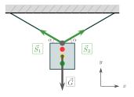
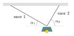
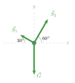
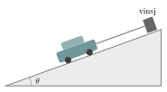
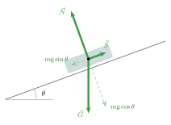

:::: {.oppgaver}

Se for deg at du skal bygge et hus. Da vil du nok gjerne at det skal bli stående i ro. Da må summen av ytre påvirkning på huset være null. Vi sier at et legeme er i *translasjonslikevekt* når den samlede kraften som virker på det er null. Fra Newtons 2. lov, $\sum\vec{F} = m\vec{a}$, ser vi at $\sum\vec{F}=\vec{0}$ nettopp betyr $\vec{a}=\vec{0}$: legemet er enten i ro eller beveger seg med konstant hastighet.

::: {.callout-note title="Definisjon: Translasjonslikevekt"}

Et legeme er i translasjonslikevekt når: $$\sum \vec{F} = \vec{0}$$ I to dimensjoner betyr dette to separate ligninger: $$\sum F_x = 0 \qquad \text{og} \qquad \sum F_y = 0$$

:::

Når vi skal løse oppgaver som handler om likevekt, blir framgangsmåten den samme som vi brukte i kapittelet om krefter:

1.  Tegn et fritt-legeme-diagram med alle krefter.

2.  Velg et koordinatsystem og dekomponér kreftene langs aksene.

3.  Sett $\sum F_x = 0$ og $\sum F_y = 0$ og løs for de ukjente.

La oss ta et eksempel for å illustrere framgangsmåten.

::: {.eksempel}
[Eksempel 6.1: Trafikklys]{.eks-tittel}

Et trafikklys med masse $m = 50\,\mathrm{kg}$ henger i to like lange snorer som danner vinkel $\alpha = 30°$ med horisontalplanet (se figuren under). Finn snorkraften $S$ i hver snor.

::: center
{.tikz-fig style="width:331px"}

[Trafikklys i ro. Snorkreftene $\vec{S}_1$ og $\vec{S}_2$ danner vinkel $\alpha$ med horisontalen.]{.figurtekst}
:::

:::

::: {.callout-note .svar collapse="true" title="Vis løsning"}

**1. Figur:** Se figuren i eksempelet.

**2. Lov:** Systemet er i ro: $\sum\vec{F}=0$. Symmetri gir $S_1 = S_2 = S$.

**3. Koordinatsystem:** $x$ horisontal, $y$ vertikal oppover.

**4. Dekomponér:** $$\begin{aligned}
    \sum F_x = 0&:\quad -S\cos\alpha + S\cos\alpha = 0 \quad \checkmark \quad \text{(automatisk oppfylt)}\\
    \sum F_y = 0&:\quad S\sin\alpha + S\sin\alpha - G = 0 \implies 2S\sin\alpha = m\mathrm{g}
\end{aligned}$$

**5. Løs for $S$:** $$S = \frac{m\mathrm{g}}{2\sin\alpha}
    = \frac{50\,\mathrm{kg}\cdot9.81\,\mathrm{m}\,\mathrm{s}^{-2}}{2\cdot\sin 30°}
    = 490.5\,\mathrm{N}
    \approx \underline{\underline{4.9\cdot 10^{2}\,\mathrm{N}}}$$ Merk at $\sin 30° = \tfrac{1}{2}$, så snorkraften er nøyaktig lik tyngdekraften. En lavere vinkel $\alpha$ ville krevd *større* snorkraft — derav det kjente rådet om ikke å henge noe i nær-horisontale snorer.

:::

::: {.eksempel}
[Eksempel 6.2: Lampe i to ulike snorer]{.eks-tittel}

En lampe med masse $m = 6.0\,\mathrm{kg}$ henger i ro i to snorer festet i taket. Snor 1 danner vinkelen $\alpha_1 = 30^\circ$ med horisontalen, og snor 2 danner vinkelen $\alpha_2 = 60^\circ$ med horisontalen (se figuren).

a)  Tegn kreftene som virker på lampa.

b)  Sett opp likevektsbetingelsene $\sum F_x = 0$ og $\sum F_y = 0$.

c)  Finn snorkreftene $S_1$ og $S_2$.

::: center
{.tikz-fig style="width:299px"}

[En lampe henger i to snorer med ulike vinkler.]{.figurtekst}
:::

:::

::: {.callout-note .svar collapse="true" title="Vis løsning"}

**a)** Tre krefter virker på lampa: tyngdekraften $\vec{G}$ rett ned, og snorkreftene $\vec{S}_1$ og $\vec{S}_2$, som peker langs hver sin snor. Vi velger $x$-aksen horisontalt mot høyre og $y$-aksen vertikalt oppover.

::: center
{.tikz-fig style="width:245px"}

[Kreftene som virker på lampa.]{.figurtekst}
:::

**b)** Vi dekomponerer snorkreftene. $\vec{S}_1$ peker oppover mot venstre, så $x$-komponenten er negativ. $\vec{S}_2$ peker oppover mot høyre: $$\begin{aligned}
    \sum F_x = 0&:\quad -S_1\cos 30^\circ + S_2\cos 60^\circ = 0\\
    \sum F_y = 0&:\quad S_1\sin 30^\circ + S_2\sin 60^\circ - m\mathrm{g} = 0
\end{aligned}$$ Lampa henger ikke symmetrisk, så vi kan ikke anta at $S_1 = S_2$. Vi har to ukjente og to likninger.

**c)** Fra $x$-likningen får vi $S_2$ uttrykt ved $S_1$: $$S_2 = S_1\,\frac{\cos 30^\circ}{\cos 60^\circ} = S_1\cdot\frac{0.866}{0.500} = 1.732\,S_1$$ Dette setter vi inn i $y$-likningen: $$S_1\cdot 0.500 + 1.732\,S_1\cdot 0.866 = m\mathrm{g}
    \quad\Longrightarrow\quad
    2.00\,S_1 = 6.0\,\mathrm{kg}\cdot9.81\,\mathrm{m}\,\mathrm{s}^{-2} = 58.86\,\mathrm{N}$$ $$S_1 = \frac{58.86\,\mathrm{N}}{2.00} = 29.43\,\mathrm{N} \approx \underline{\underline{29\,\mathrm{N}}}$$ $$S_2 = 1.732\cdot29.43\,\mathrm{N} = 50.97\,\mathrm{N} \approx \underline{\underline{51\,\mathrm{N}}}$$ Den bratteste snora (snor 2) bærer mest av lampas tyngde.

:::

::: {.eksempel}
[Eksempel 6.3: Bil trukket opp en bakke]{.eks-tittel}

En vinsj trekker en bil med masse $m = 1200\,\mathrm{kg}$ opp en bakke med *konstant fart*. Bakken har helningsvinkel $\theta = 20^\circ$, og wiren fra vinsjen er parallell med bakken. Vi ser bort fra friksjon og luftmotstand.

a)  Tegn kreftene som virker på bilen.

b)  Finn normalkraften $N$ fra bakken på bilen.

c)  Finn kraften $S$ i wiren.

::: center
{.tikz-fig style="width:359px"}

[En vinsj trekker en bil opp en bakke med konstant fart.]{.figurtekst}
:::

:::

::: {.callout-note .svar collapse="true" title="Vis løsning"}

**a)** Tre krefter virker på bilen: tyngdekraften $\vec{G}$ rett ned, normalkraften $\vec{N}$ vinkelrett ut fra bakken, og wirekraften $\vec{S}$ langs bakken, oppover. Bilen har konstant fart, så akselerasjonen er null, og etter Newtons 2. lov er $\sum\vec{F} = \vec{0}$. Bilen er altså i translasjonslikevekt selv om den beveger seg.

Når bakken er skrå, lønner det seg å legge $x$-aksen *langs* bakken og $y$-aksen vinkelrett på bakken. Da peker både $\vec{N}$ og $\vec{S}$ langs hver sin akse, og bare $\vec{G}$ må dekomponeres: $$G_x = -m\mathrm{g}\sin\theta \qquad\text{og}\qquad G_y = -m\mathrm{g}\cos\theta$$

::: center
{.tikz-fig style="width:410px"}

[Kreftene som virker på bilen. Tyngdekraften er dekomponert langs og vinkelrett på bakken (stiplet).]{.figurtekst}
:::

**b)** Vinkelrett på bakken ($y$-retning): $$\sum F_y = 0:\quad N - m\mathrm{g}\cos\theta = 0$$ $$N = m\mathrm{g}\cos\theta = 1200\,\mathrm{kg}\cdot9.81\,\mathrm{m}\,\mathrm{s}^{-2}\cdot\cos 20^\circ = 11062\,\mathrm{N} \approx \underline{\underline{1.1\cdot 10^{4}\,\mathrm{N}}}$$ Normalkraften er altså *mindre* enn tyngdekraften $m\mathrm{g} = 11772\,\mathrm{N}$, fordi bare komponenten $m\mathrm{g}\cos\theta$ presser bilen mot bakken.

**c)** Langs bakken ($x$-retning): $$\sum F_x = 0:\quad S - m\mathrm{g}\sin\theta = 0$$ $$S = m\mathrm{g}\sin\theta = 1200\,\mathrm{kg}\cdot9.81\,\mathrm{m}\,\mathrm{s}^{-2}\cdot\sin 20^\circ = 4026\,\mathrm{N} \approx \underline{\underline{4.0\cdot 10^{3}\,\mathrm{N}}}$$ Wiren trenger altså bare å dra med omtrent en tredjedel av bilens tyngde. Svaret blir det samme om bilen står i ro, holdt fast av wiren, siden $\sum\vec{F} = \vec{0}$ i begge tilfeller.

:::

::: {.oppgave tittel="Lampe i to snorer"}
[Lampe i to snorer]{.oppg-tittel}

En lampe med masse $m = 4.0\,\mathrm{kg}$ henger i ro i to snorer. Snor 1 går horisontalt inn til en vegg. Snor 2 går skrått opp til taket og danner vinkelen $\alpha = 40^\circ$ med horisontalen.

a)  Tegn kreftene som virker på lampa.

b)  Finn snorkraften $S_2$ i den skrå snora. (Hint: se på kreftene i $y$-retning.)

c)  Finn snorkraften $S_1$ i den horisontale snora.

::: {.losning}

**a)** Tre krefter virker på lampa: tyngdekraften $\vec{G}$ rett ned, snorkraften $\vec{S}_1$ horisontalt inn mot veggen, og snorkraften $\vec{S}_2$ skrått oppover langs snor 2, i vinkelen $\alpha$ med horisontalen. Vi velger $x$-aksen horisontalt bort fra veggen og $y$-aksen vertikalt oppover.

**b)** Lampa er i ro, så $\sum F_y = 0$. Bare $S_2$ har en komponent i $y$-retning: $$S_2\sin\alpha - m\mathrm{g} = 0
    \quad\implies\quad
    S_2 = \frac{m\mathrm{g}}{\sin\alpha} = \frac{4.0\,\mathrm{kg}\cdot9.81\,\mathrm{m}\,\mathrm{s}^{-2}}{\sin 40^\circ} = \underline{\underline{61\,\mathrm{N}}}$$

**c)** $\sum F_x = 0$ gir at den horisontale komponenten av $S_2$ må oppveie $S_1$: $$S_1 = S_2\cos\alpha = 61.0\,\mathrm{N}\cdot\cos 40^\circ = \underline{\underline{47\,\mathrm{N}}}$$

:::

:::

::::
