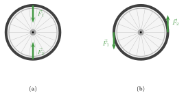
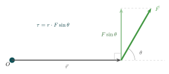
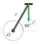
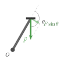

:::: {.oppgaver}

::: {.callout-tip title="Til ettertanke"}

Sikrer $\sum \vec{F}=0$ at et legemes bestanddeler ikke akselererer?

:::

Se for deg et sykkelhjul på et sykkelversted som roterer fritt om akselen sin, litt hevet over bakken. Du tar en hånd på hver side av hjulet og spinner det opp, ved å anvende like stor kraft på hver side av hjulet (figur b). Da må summen av kreftene på hjulet være 0, men likevel begynner sykkelhjulets bestanddeler å akselere rundt navet (sentrum)! Det holder altså ikke å kreve at summen av krefter er null. For å hindre at et legeme begynner å rotere, må vi også ta hensyn til hvordan kreftene står i forhold til hverandre. Se for deg at du hadde anvendt kreftene på toppen og bunnen av sykkelhjulet i stedet (figur a). Da ville det jo blitt stående i ro, uten å rotere. At det begynner å rotere har altså noe med kreftenes plassering i forhold til hverandre å gjøre. Så langt har vi i grunnen stilltiende antatt at legemer er punktformige; altså at de ikke har noen utstrekning. Men dette er en dårlig modell på virkeligheten. Egentlig har legemer utstrekning, og da vil kreftenes angrepspunkt ha betydning for hvorvidt legemet vil begynne å rotere rundt sitt eget massesenter (massesenter ser vi nærmere på under temaet *massesenter*).

::: center
{.tikz-fig style="width:525px"}

[Et sykkelhjul som kan rotere fritt om akselen, påvirket av to like store og motsatt rettede krefter, $\vec{F}_1$ og $\vec{F}_2$. (a) Kreftene virker på toppen og bunnen av hjulet og peker rett mot hverandre: hjulet blir stående i ro. (b) De samme kreftene virker i stedet på venstre og høyre side av hjulet: hjulet begynner å rotere, selv om $\sum\vec{F}=0$ også her.]{.figurtekst}
:::

For å beskrive kreftenes angrepspunkt i forhold til hverandre så bruker vi begrepet kraftmomentet. Det som bestemmer rotasjonseffekten av en kraft, kalles *kraftmoment* (også kalt dreiemoment eller torque).

::: {.callout-note title="Definisjon: Kraftmoment"}

Kraftmomentet $\tau$ (tau) om et punkt $O$ er definert som kryssprodukt mellom armvektoren $\vec{r}$ (fra $O$ til kraftens angrepspunkt) og kraftvektoren $\vec{F}$: $$\vec{\tau} = \vec{r} \times \vec{F}$$ Størrelsen er: $$\tau = r \cdot F\sin\theta$$ der $r$ er avstanden fra $O$ til kraftens angrepspunkt, og $\theta$ er vinkelen mellom $\vec{r}$ og $\vec{F}$. Her er $F\sin\theta$ den delen av kraften som står *vinkelrett* på $\vec{r}$. Det er bare denne delen som kan sette legemet i rotasjon om $O$. Den delen av kraften som peker langs $\vec{r}$, drar eller skyver bare rett mot eller bort fra $O$, og bidrar ikke til rotasjon.

Enheten for kraftmoment er $\mathrm{N}\,\mathrm{m}$ ($\mathrm{N}\,\mathrm{m}$).

:::

::: {.callout-important title="Merk: Kraftmoment virker *om et punkt*"}

Et kraftmoment er alltid regnet *om et bestemt punkt* $O$. Den samme kraften gir ulike kraftmoment om ulike punkter, fordi armvektoren $\vec{r}$ endrer seg når vi bytter punkt. Når du løser oppgaver, må du derfor alltid først velge hvilket punkt du regner kraftmomentene om, og skrive det ned. Alle kraftmomentene i samme likning må regnes om det samme punktet.

:::

Kraftmomentet er positivt når rotasjonen er mot klokken (positiv dreieretning), og negativt når det er med klokken.

::: center
{.tikz-fig style="width:541px"}
:::

::: {.eksempel}
[Eksempel: Bolt og skiftenøkkel]{.eks-tittel}

En skiftenøkkel med armlengde $\ell = 25\,\mathrm{cm}$ brukes til å stramme en bolt. En kraft $F = 80\,\mathrm{N}$ påføres vinkelrett på nøkkelskaftet. Beregn kraftmomentet om boltens sentrum.

:::

::: {.callout-note .svar collapse="true" title="Vis løsning"}

Siden kraften er vinkelrett på armen, er $\theta = 90^\circ$ og $\sin 90^\circ = 1$. Hele kraften står altså vinkelrett på armen, og $F\sin\theta = F$: $$\tau = \ell \cdot F\sin 90^\circ = \ell\cdot F = 0.25\,\mathrm{m} \cdot 80\,\mathrm{N}
       = \underline{\underline{20\,\mathrm{N}\,\mathrm{m}}}$$

:::

::: {.eksempel}
[Eksempel: Tråkke på en sykkelpedal]{.eks-tittel}

Pedalarmen på en sykkel har lengde $r = 0.17\,\mathrm{m}$, målt fra akselen til pedalen. Syklisten trår rett ned på pedalen med en kraft $F = 300\,\mathrm{N}$. Finn kraftmomentet om akselen når

a)  pedalarmen er horisontal,

b)  pedalarmen danner vinkelen $60^\circ$ med horisontalen (se figuren),

c)  pedalarmen peker rett ned.

::: center
{.tikz-fig style="width:163px"}

[Syklisten trår rett ned på pedalen. Her danner pedalarmen vinkelen $60^\circ$ med horisontalen.]{.figurtekst}
:::

:::

::: {.callout-note .svar collapse="true" title="Vis løsning"}

Vi bruker $\tau = r\cdot F\sin\theta$, der $\theta$ er vinkelen mellom $\vec{r}$ og $\vec{F}$, og $F\sin\theta$ er den delen av kraften som står vinkelrett på pedalarmen.

**a)** Pedalarmen er horisontal og kraften peker rett ned, så $\theta = 90^\circ$ og $\sin 90^\circ = 1$. Hele kraften står vinkelrett på armen: $$\tau = r\cdot F\sin 90^\circ = 0.17\,\mathrm{m}\cdot300\,\mathrm{N}\cdot 1 = \underline{\underline{51\,\mathrm{N}\,\mathrm{m}}}$$

**b)** Pedalarmen peker $60^\circ$ over horisontalen, og kraften peker rett ned. Vinkelen mellom $\vec{r}$ og $\vec{F}$ blir da $\theta = 60^\circ + 90^\circ = 150^\circ$ (se figuren under). Den delen av kraften som står vinkelrett på armen er $$F\sin 150^\circ = 300\,\mathrm{N}\cdot 0.50 = 150\,\mathrm{N},$$ og kraftmomentet blir $$\tau = r\cdot F\sin 150^\circ = 0.17\,\mathrm{m}\cdot150\,\mathrm{N} = 25.5\,\mathrm{N}\,\mathrm{m} \approx \underline{\underline{26\,\mathrm{N}\,\mathrm{m}}}$$

::: center
{.tikz-fig style="width:214px"}

[Bare komponenten $F\sin\theta$, som står vinkelrett på pedalarmen, gir kraftmoment.]{.figurtekst}
:::

**c)** Når pedalarmen peker rett ned, peker $\vec{r}$ og $\vec{F}$ i samme retning, så $\theta = 0^\circ$ og $\sin 0^\circ = 0$: $$\tau = r\cdot F\sin 0^\circ = \underline{\underline{0}}$$ Ingen del av kraften står vinkelrett på armen. Uansett hvor hardt syklisten trår, gir det ikke noe kraftmoment. Dette kalles *dødpunktet*, og det er grunnen til at det er lite effektivt å trå når pedalen er helt nede.

:::

::: {.oppgave tittel="Dørhengsler"}
[Dørhengsler]{.oppg-tittel}

En dør er $90\,\mathrm{cm}$ bred. Du trykker vinkelrett på døren med en kraft på $15\,\mathrm{N}$.

a)  Hva er kraftmomentet om hengslene når du trykker på kanten av døren (dvs. $90\,\mathrm{cm}$ fra hengslene)?

b)  Hva er kraftmomentet dersom du i stedet trykker på midten av døren ($45\,\mathrm{cm}$ fra hengslene)?

c)  Hva skjer med kraften som trengs for å oppnå det samme momentet dersom armen halveres?

::: {.losning}

Kraften står vinkelrett på døra, så momentarmen er avstanden fra hengslene, og $\tau = d\cdot F$ (se *Kraftmoment*).

**a)** $$\tau = 0.90\,\mathrm{m}\cdot15\,\mathrm{N} = 13.5\,\mathrm{N}\,\mathrm{m} \approx \underline{\underline{14\,\mathrm{N}\,\mathrm{m}}}$$

**b)** $$\tau = 0.45\,\mathrm{m}\cdot15\,\mathrm{N} = 6.75\,\mathrm{N}\,\mathrm{m} \approx \underline{\underline{6.8\,\mathrm{N}\,\mathrm{m}}}$$

**c)** Siden $\tau = d\cdot F$, må $F$ **dobles** når $d$ halveres for at momentet skal bli det samme. Det er derfor det er tungt å åpne en dør ved å dytte nær hengslene.

:::

:::

::::
