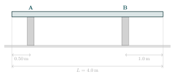
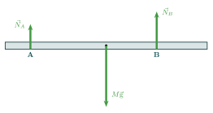
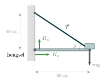
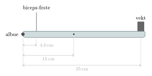
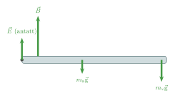

:::: {.oppgaver}

For at et legeme skal stå stille så holder det ikke å krevet at summen av kreffter som virker på det er null. Vi må *også* kreve at netto moment er null.

::: {.callout-note title="Definisjon: Fullstendig statisk likevekt"}

Et legeme er i fullstendig statisk likevekt når: $$\sum \vec{F} = \vec{0} \qquad \text{og} \qquad \sum \tau = 0$$ Momentligningen $\sum\tau = 0$ må gjelde om *ethvert* valgt dreiepunkt. *Tips: velg dreiepunkt der flest ukjente krefter angriper — da faller de ut av ligningen.*

:::

::: {.callout-tip title="Til ettertanke"}

Er fullstendig statisk likevekt nok til å sikre at et legeme står i ro uten å rotere?

:::

::: {.eksempel}
[Eksempel: Ensartet bjelke på to søyler]{.eks-tittel}

En ensartet bjelke med masse $M = 20\,\mathrm{kg}$ og lengde $L = 4.0\,\mathrm{m}$ hviler på to søyler, A og B. Søyle A står $0.50\,\mathrm{m}$ fra venstre ende, og søyle B står $1.0\,\mathrm{m}$ fra høyre ende.

a)  Tegn bjelken med kreftene som virker *på bjelken*.

b)  Beregn normalkreftene $N_A$ og $N_B$ fra søylene på bjelken.

c)  Hvilke krefter virker *på søylene* fra bjelken?

::: center
{.tikz-fig style="width:554px"}

[En ensartet bjelke som hviler på to søyler, A og B.]{.figurtekst}
:::

:::

::: {.callout-note .svar collapse="true" title="Vis løsning"}

**a)** Tre krefter virker på bjelken: tyngdekraften $M\mathrm{g}$, som angriper i massesenteret midt på bjelken, og normalkreftene $N_A$ og $N_B$ fra søylene, som virker oppover der bjelken hviler på søylene.

::: center
{.tikz-fig style="width:506px"}

[Kreftene som virker på bjelken.]{.figurtekst}
:::

**b)** Massesenteret er midt på bjelken, $L/2 = 2.0\,\mathrm{m}$ fra venstre ende. Vi velger søyle A som dreiepunkt, slik at $N_A$ faller ut av momentligningen. Avstandene fra A er:

-   til massesenteret: $d_{M\mathrm{g}} = 2.0\,\mathrm{m} - 0.50\,\mathrm{m} = 1.5\,\mathrm{m}$

-   til søyle B: $d_B = (4.0\,\mathrm{m} - 1.0\,\mathrm{m}) - 0.50\,\mathrm{m} = 2.5\,\mathrm{m}$

**Momentligning om A** ($\sum\tau_A = 0$, positivt mot klokken): $$N_B \cdot d_B - M\mathrm{g} \cdot d_{M\mathrm{g}} = 0
  \implies N_B = \frac{M\mathrm{g}\cdot d_{M\mathrm{g}}}{d_B}
  = \frac{196.2\,\mathrm{N}\cdot1.5\,\mathrm{m}}{2.5\,\mathrm{m}}
  = 117.7\,\mathrm{N} \approx \underline{\underline{1.2\cdot 10^{2}\,\mathrm{N}}}$$ der $M\mathrm{g} = 20\,\mathrm{kg}\cdot9.81\,\mathrm{m}\,\mathrm{s}^{-2} = 196.2\,\mathrm{N}$.

**Kraftligning** ($\sum F_y = 0$): $$N_A + N_B = M\mathrm{g}
  \implies N_A = M\mathrm{g} - N_B = 196.2\,\mathrm{N} - 117.7\,\mathrm{N} = 78.5\,\mathrm{N} \approx \underline{\underline{78\,\mathrm{N}}}$$

**c)** Etter Newtons 3. lov virker bjelken tilbake på hver søyle med en motkraft som er like stor som, men motsatt rettet av, normalkraften fra søylen på bjelken. Motkreftene $\vec{N}_A^\prime$ og $\vec{N}_B^\prime$ peker derfor *nedover*, og virker på søylene: $$\vec{N}_A^\prime = -\vec{N}_A, \qquad \vec{N}_B^\prime = -\vec{N}_B$$ Størrelsene er $$N_A^\prime = N_A \approx \underline{\underline{78\,\mathrm{N}\text{, rettet nedover}}}
  \qquad\text{og}\qquad
  N_B^\prime = N_B \approx \underline{\underline{1.2\cdot 10^{2}\,\mathrm{N}\text{, rettet nedover}}}$$ Søyle B, som står nærmest massesenteret, bærer altså mest av bjelkens tyngde.

::: center
{.tikz-fig style="width:554px"}

[Kreftene fra bjelken på søylene. De er motkreftene til $\vec{N}_A$ og $\vec{N}_B$ i figuren.]{.figurtekst}
:::

:::

::: {.eksempel}
[Eksempel: Vegghengt hylle med stag]{.eks-tittel}

En $60\,\mathrm{cm}$ lang, masselos hylle er festet til veggen i venstre ende (hengsel) og holdt oppe av et diagonalt stag festet til veggen $40\,\mathrm{cm}$ over hyllen, i en horisontal avstand $60\,\mathrm{cm}$ fra veggen. En gjenstand med masse $m = 3.0\,\mathrm{kg}$ er plassert på enden av hyllen. Finn stagkraften $T$ og kraften $\vec{H}$ fra hengselet på hylla.

::: center
{.tikz-fig style="width:342px"}
:::

:::

::: {.callout-note .svar collapse="true" title="Vis løsning"}

Stagfestet er i $(L,\,0)=(0.60\,\text{m},\,0)$ og stagtoppen er i $(0,\,h)=(0,\,0.40\,\text{m})$. Stagvinkelen med horisontal: $\beta = \arctan\!\bigl(\tfrac{0.40}{0.60}\bigr) \approx 33.7°$.

**Momentligning om hengselet** ($\sum\tau = 0$, positiv mot klokken):

Tyngdekraften $m\mathrm{g}$ lager et negativt (medurs) moment, den vertikale komponenten av stagkraften $T_y = T\sin\beta$ lager et positivt moment: $$T\sin\beta\cdot L - m\mathrm{g}\cdot L = 0
  \implies T = \frac{m\mathrm{g}}{\sin\beta}
  = \frac{3.0\,\mathrm{kg}\cdot9.81\,\mathrm{m}\,\mathrm{s}^{-2}}{\sin 33.7°}
  = 53.0\,\mathrm{N} \approx \underline{\underline{53\,\mathrm{N}}}$$

**Kraftligninger:** $$\begin{aligned}
  \sum F_x = 0&:\quad H_x - T\cos\beta = 0 \implies H_x = T\cos\beta = 53.0\cdot\cos 33.7° \approx \underline{\underline{44\,\mathrm{N}}}\\
  \sum F_y = 0&:\quad H_y + T\sin\beta - m\mathrm{g} = 0 \implies H_y = m\mathrm{g} - T\sin\beta = \underline{\underline{0\,\mathrm{N}}}
\end{aligned}$$ (Som forventet: momentligningen om hengselet sa nettopp at $T\sin\beta = m\mathrm{g}$, så $H_y = 0$.) Siden $H_x$ er positiv, peker den *bort fra* veggen, slik figuren viser: Stagkraften drar hylla inn mot veggen, og veggen skyver tilbake.

:::

::: {.eksempel}
[Eksempel: Underarm som holder en vekt]{.eks-tittel}

Du holder en vekt med masse $m_\text{v} = 5.0\,\mathrm{kg}$ i hånda, med underarmen horisontal og i ro. Underarmen kan rotere om albuen. Bicepsmuskelen er festet til underarmen $4.0\,\mathrm{cm}$ fra albuen og drar rett opp. Underarmen har masse $m_\text{a} = 1.5\,\mathrm{kg}$ med massesenteret $15\,\mathrm{cm}$ fra albuen, og vekta er $35\,\mathrm{cm}$ fra albuen.

a)  Tegn kreftene som virker på underarmen.

b)  Finn kraften $B$ fra bicepsmuskelen på underarmen.

c)  Finn kraften $\vec{E}$ fra overarmen på underarmen i albuen.

::: center
{.tikz-fig style="width:489px"}

[Underarm som holder en vekt. Prikken markerer underarmens massesenter.]{.figurtekst}
:::

:::

::: {.callout-note .svar collapse="true" title="Vis løsning"}

**a)** Fire krefter virker på underarmen: kraften $\vec{B}$ fra bicepsmuskelen (opp), tyngdekraften $m_\text{a}\vec{\mathrm{g}}$ på underarmen (ned, i massesenteret), kraften fra vekta (ned, i hånda) og kraften $\vec{E}$ fra overarmen i albuen. Vi vet ikke hvilken vei $\vec{E}$ peker, så vi *antar* at den peker opp. Får vi et negativt svar, peker den egentlig ned.

Siden vekta henger i ro i hånda, er kraften fra vekta på hånda like stor som tyngdekraften på vekta, $m_\text{v}\mathrm{g}$.

::: center
{.tikz-fig style="width:474px"}

[Kreftene som virker på underarmen (ikke i målestokk).]{.figurtekst}
:::

**b)** Vi velger albuen som dreiepunkt. Da faller den ukjente kraften $\vec{E}$ ut av momentligningen, siden den angriper i dreiepunktet. Med positiv dreieretning mot klokken: $$\sum\tau = 0:\quad B\cdot0.040\,\mathrm{m} - m_\text{a}\mathrm{g}\cdot0.15\,\mathrm{m} - m_\text{v}\mathrm{g}\cdot0.35\,\mathrm{m} = 0$$ Vi løser for $B$: $$B\cdot0.040\,\mathrm{m} = \underbrace{14.7\,\mathrm{N}\cdot0.15\,\mathrm{m}}_{m_\text{a}\mathrm{g}\cdot0.15\,\mathrm{m}} + \underbrace{49.1\,\mathrm{N}\cdot0.35\,\mathrm{m}}_{m_\text{v}\mathrm{g}\cdot0.35\,\mathrm{m}} = 19.37\,\mathrm{N}\,\mathrm{m}$$ $$B = \frac{19.37\,\mathrm{N}\,\mathrm{m}}{0.040\,\mathrm{m}} = 484\,\mathrm{N} \approx \underline{\underline{4.8\cdot 10^{2}\,\mathrm{N}}}$$ der vi har brukt $m_\text{a}\mathrm{g} = 1.5\,\mathrm{kg}\cdot9.81\,\mathrm{m}\,\mathrm{s}^{-2} = 14.7\,\mathrm{N}$ og $m_\text{v}\mathrm{g} = 5.0\,\mathrm{kg}\cdot9.81\,\mathrm{m}\,\mathrm{s}^{-2} = 49.1\,\mathrm{N}$. Bicepsmuskelen må altså dra med en kraft som er omtrent ti ganger så stor som tyngden av vekta. Grunnen er at muskelen er festet svært nær albuen, så den har kort arm.

**c)** Vi bruker $\sum F_y = 0$, med positiv retning oppover: $$E + B - m_\text{a}\mathrm{g} - m_\text{v}\mathrm{g} = 0$$ $$E = m_\text{a}\mathrm{g} + m_\text{v}\mathrm{g} - B = 14.7\,\mathrm{N} + 49.1\,\mathrm{N} - 484\,\mathrm{N} = -421\,\mathrm{N}$$ Fortegnet er negativt, så $\vec{E}$ peker motsatt av det vi antok. Kraften fra overarmen på underarmen i albuen er $$E \approx \underline{\underline{4.2\cdot 10^{2}\,\mathrm{N}\text{, rettet nedover}}}$$

:::

::: {.oppgave tittel="Stige mot vegg"}
[Stige mot vegg]{.oppg-tittel}

En ensartet stige med masse $m = 15\,\mathrm{kg}$ og lengde $L = 4.0\,\mathrm{m}$ hviler mot en glatt vegg (ingen friksjon) i en vinkel $\theta = 65°$ med horisontal. Gulvet har friksjon. En person med masse $M = 70\,\mathrm{kg}$ klatrer $2.5\,\mathrm{m}$ opp stigen.

a)  Finn normalkraften fra veggen.

b)  Finn normalkraften og friksjonskraften fra gulvet.

*Hint: Velg dreiepunkt i bunnen av stigen — da faller normalkraften og friksjonskraften fra gulvet ut av momentligningen.*

::: {.losning}

**Krefter:** normalkraft fra veggen $N_v$ (horisontal, fordi veggen er glatt), normalkraft fra gulvet $N_g$ (vertikal), friksjon fra gulvet $f$ (horisontal), tyngdekraften på stigen $m\mathrm{g}$ (angriper midt på stigen) og tyngdekraften på personen $M\mathrm{g}$ (angriper $d = 2.5\,\mathrm{m}$ opp langs stigen).

**a)** Vi tar momenter om bunnen av stigen, slik at $N_g$ og $f$ faller ut. Momentarmen til en vertikal kraft er den horisontale avstanden, og momentarmen til en horisontal kraft er den vertikale avstanden. Med positiv dreieretning mot klokken: $$N_v\cdot L\sin\theta - m\mathrm{g}\cdot\frac{L}{2}\cos\theta - M\mathrm{g}\cdot d\cos\theta = 0$$ Vi løser for $N_v$: $$N_v = \left(\frac{m}{2} + \frac{Md}{L}\right)\mathrm{g}\,\frac{\cos\theta}{\sin\theta}
    = \left(7.5\,\mathrm{kg} + 43.75\,\mathrm{kg}\right)\cdot9.81\,\mathrm{m}\,\mathrm{s}^{-2}\cdot\frac{\cos 65^\circ}{\sin 65^\circ}
    = 234\,\mathrm{N} \approx \underline{\underline{2.3\cdot 10^{2}\,\mathrm{N}}}$$

**b)** Kraftlikevekt vertikalt: $$N_g = (m + M)\,\mathrm{g} = 85\,\mathrm{kg}\cdot9.81\,\mathrm{m}\,\mathrm{s}^{-2} = 834\,\mathrm{N} \approx \underline{\underline{8.3\cdot 10^{2}\,\mathrm{N}}}$$ Kraftlikevekt horisontalt: friksjonen må oppveie normalkraften fra veggen, $$f = N_v = 234\,\mathrm{N} \approx \underline{\underline{2.3\cdot 10^{2}\,\mathrm{N}}}$$

:::

:::

::::
