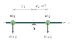
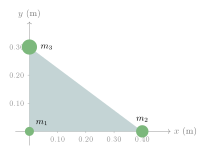
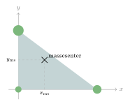

:::: {.oppgaver}

Når vi har tegnet inn tyngdekraften, så har vi etter beste evne forsøkt å plassere den midt på legemet. Grunnen til det er nettopp at tyngdekraften egentlig virker på hele legemet, og ett sted må vi jo tegne den inn. Vi skal nå definere et punkt som kalles *massensenter* (eller tyngdepunkt), som er det punktet der tyngdekraften kan anses å virke.

::: {.callout-note title="Definisjon: Massesenter"}

Massesenteret (eller tyngdepunktet) til et system av partikler med masser $m_1, m_2, \ldots, m_n$ og posisjoner $x_1, x_2, \ldots, x_n$ langs en akse, er: $$x_{\text{ms}} = \frac{\sum_i m_i x_i}{\sum_i m_i} = \frac{m_1 x_1 + m_2 x_2 + \cdots + m_n x_n}{m_1 + m_2 + \cdots + m_n}$$ I to dimensjoner beregnes $x_{\text{ms}}$ og $y_{\text{ms}}$ hver for seg med tilsvarende formel.

:::

::: {.callout-important title="Merk: Momentlikevekt og massesenter"}

Massesenteret er nettopp det punktet der tyngdekraften har null nettomoment. Hvis man støtter opp et legeme i massesenteret, er systemet i rotasjonslikevekt — momentene fra venstre og høyre side kansellerer hverandre.

:::

Det er altså i massesenteret det er mest naturlig å tegne inn tyngdekraften. Hva er så dette massesenteret? Jo, det er *balsepunktet*; altså det punktet som er slik at dersom du støtter opp legemet der, og det starter i ro, så forblir det i ro. Det roterer ikke.

::: {.eksempel}
[Eksempel 6.9: Massesenter for to barn på en huske]{.eks-tittel}

To barn sitter på en $3.0\,\mathrm{m}$ lang, masselos huske festet i midten ($x = 0$). Barn 1 har masse $m_1 = 25\,\mathrm{kg}$ og sitter i $x_1 = -1.2\,\mathrm{m}$ (venstre side). Barn 2 har masse $m_2 = 35\,\mathrm{kg}$. Hvor må barn 2 sitte for at huska skal balansere?

::: center
{.tikz-fig style="width:292px"}
:::

:::

::: {.callout-note .svar collapse="true" title="Vis løsning"}

For at huska skal balansere, må massesenteret være i støttepunktet $x = 0$: $$x_{\text{ms}} = \frac{m_1 x_1 + m_2 x_2}{m_1 + m_2} = 0
  \implies m_1 x_1 + m_2 x_2 = 0$$ $$x_2 = -\frac{m_1}{m_2}\,x_1
      = -\frac{25\,\mathrm{kg}}{35\,\mathrm{kg}}\cdot(-1.2\,\mathrm{m})
      = +0.857\,\mathrm{m} \approx \underline{\underline{0.86\,\mathrm{m}}}$$ Barn 2 må sitte $0.86\,\mathrm{m}$ til høyre for midten.

:::

::: {.eksempel}
[Eksempel 6.10: Massesenter for tre kuler]{.eks-tittel}

Tre små kuler er festet på en lett plate (vi ser bort fra massen til platen). Kula med masse $m_1 = 1.0\,\mathrm{kg}$ ligger i origo, kula med masse $m_2 = 2.0\,\mathrm{kg}$ ligger i $(x, y) = (0.40\,\mathrm{m}, 0)$, og kula med masse $m_3 = 3.0\,\mathrm{kg}$ ligger i $(x, y) = (0, 0.30\,\mathrm{m})$.

a)  Finn $x$-koordinaten til massesenteret.

b)  Finn $y$-koordinaten til massesenteret.

c)  I hvilket punkt må du støtte opp platen for at den skal balansere horisontalt?

::: center
{.tikz-fig style="width:400px"}

[Tre kuler festet på en lett plate.]{.figurtekst}
:::

:::

::: {.callout-note .svar collapse="true" title="Vis løsning"}

**a)** Vi bruker definisjonen av massesenter langs $x$-aksen. Både $m_1$ og $m_3$ har $x = 0$: $$x_\text{ms} = \frac{m_1 x_1 + m_2 x_2 + m_3 x_3}{m_1 + m_2 + m_3}
    = \frac{2.0\,\mathrm{kg}\cdot0.40\,\mathrm{m}}{6.0\,\mathrm{kg}}
    = 0.133\,\mathrm{m} \approx \underline{\underline{0.13\,\mathrm{m}}}$$

**b)** Tilsvarende langs $y$-aksen, der bare $m_3$ har $y \neq 0$: $$y_\text{ms} = \frac{m_1 y_1 + m_2 y_2 + m_3 y_3}{m_1 + m_2 + m_3}
    = \frac{3.0\,\mathrm{kg}\cdot0.30\,\mathrm{m}}{6.0\,\mathrm{kg}}
    = \underline{\underline{0.15\,\mathrm{m}}}$$

**c)** Platen balanserer når den støttes i massesenteret, altså i punktet $$(x_\text{ms}, y_\text{ms}) \approx \underline{\underline{(0.13\,\mathrm{m},\ 0.15\,\mathrm{m})}}$$ Massesenteret ligger nærmest den tyngste kula, $m_3$, og lengst fra den letteste, $m_1$.

::: center
{.tikz-fig style="width:359px"}

[Massesenteret til de tre kulene.]{.figurtekst}
:::

:::

::: {.oppgave tittel="Tre lodd på en stav"}
[Tre lodd på en stav]{.oppg-tittel}

Tre lodd henger på en lett stav (staven har så liten masse at vi kan se bort fra den). Et lodd med masse $1.0\,\mathrm{kg}$ henger i den venstre enden ($x = 0$), et lodd med masse $2.0\,\mathrm{kg}$ henger i $x = 0.50\,\mathrm{m}$, og et lodd med masse $3.0\,\mathrm{kg}$ henger i $x = 1.20\,\mathrm{m}$.

a)  Finn massesenteret $x_\text{ms}$ til systemet.

b)  Hvor må du holde staven for at den skal balansere?

::: {.losning}

**a)** Vi bruker definisjonen av massesenter (se *Massesenter* i kompendiet): $$x_\text{ms} = \frac{m_1x_1 + m_2x_2 + m_3x_3}{m_1 + m_2 + m_3}
    = \frac{1.0\,\mathrm{kg}\cdot 0 + 2.0\,\mathrm{kg}\cdot0.50\,\mathrm{m} + 3.0\,\mathrm{kg}\cdot1.20\,\mathrm{m}}{6.0\,\mathrm{kg}}
    = \underline{\underline{0.77\,\mathrm{m}}}$$

**b)** Staven balanserer når den støttes i massesenteret. Da blir det totale kraftmomentet fra tyngdekreftene null. Du må holde staven **$0.77\,\mathrm{m}$ fra den venstre enden**.

:::

:::

::::
