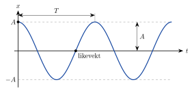

<!-- video: kommer (videoer/fysikk-forkurs/07-01-harmoniske-svingninger) -->
{fig-alt="Video kommer"}

<!-- tillegg: Claude -->
Dytt borti en huske, og den går fram og tilbake, igjen og igjen. Et lodd i en fjær hopper opp og ned. En gitarstreng dirrer så fort at vi hører det som en tone. Alt dette er **svingninger**: en bevegelse fram og tilbake om en likevektsstilling, som gjentar seg selv. På denne siden lærer vi å beskrive svingninger med noen få tall, og vi ser hvordan energien vandrer fram og tilbake mens legemet svinger.

## Likevekt og tilbakeførende kraft

Alle svingninger har en **likevektsstilling**, der legemet kan ligge i ro. Huska henger rett ned, og loddet henger stille i fjæra. Flytter vi legemet ut fra likevekt, virker det en kraft som drar det tilbake. Den kalles den **tilbakeførende kraften**.

Når legemet kommer tilbake til likevektsstillingen, har det fart, så det fortsetter forbi. Da snur kraften og bremser det, til det stopper på den andre siden og blir dratt tilbake igjen. Slik fortsetter det. Uten friksjon og luftmotstand ville svingningen aldri stoppet.

## Periode, frekvens og amplitude

Tre tall beskriver en svingning:

::: {.kort}
- **Amplitude $A$** Største utslag fra likevektsstillingen. Måles i meter (eller i grader for en huske).
- **Periode $T$** Tiden én hel svingning tar, altså fram, tilbake og fram til samme sted igjen. Måles i sekunder.
- **Frekvens $f$** Antall hele svingninger per sekund. Måles i hertz: $1\ \mathrm{Hz} = 1\ \mathrm{s^{-1}}$.
:::

Periode og frekvens er to sider av samme sak. Tar én svingning $0.25\ \mathrm{s}$, rekker legemet fire svingninger på ett sekund:

::: {.graa}
$$
f = \frac{1}{T} \qquad\qquad T = \frac{1}{f}
$$
:::

::: {.callout-tip title="Mål mange svingninger"}
Det er vanskelig å ta tiden på én enkelt svingning nøyaktig, fordi reaksjonstiden din er like lang som en stor del av perioden. Ta heller tiden på 10 eller 20 svingninger og del på antallet. Feilen fra reaksjonstiden blir da fordelt på mange svingninger.
:::

::: {.eksempel}
**Eksempel: Huska.** Et barn på en huske gjør 12 hele svingninger på $30.0\ \mathrm{s}$. Finn perioden og frekvensen.

::: {.losning}
Én svingning tar
$$
T = \frac{30.0\ \mathrm{s}}{12} = \underline{\underline{2.50\ \mathrm{s}}}
$$
Tallet 12 er en telling og er eksakt, så svaret får tre gjeldende siffer, som tiden.

Frekvensen er
$$
f = \frac{1}{T} = \frac{1}{2.50\ \mathrm{s}} = \underline{\underline{0.400\ \mathrm{Hz}}}
$$
Huska rekker altså 0.4 svingninger hvert sekund.
:::
:::

## Svingningen som en cosinuskurve

Fester vi en tusj til et lodd som svinger opp og ned, og drar et papir jevnt forbi, tegner tusjen en bølgeformet kurve. Kurven har samme form som en cosinusfunksjon. Svingninger med denne formen kalles **harmoniske svingninger**.

{.tikz-fig style="width:460px" fig-alt="Graf av posisjonen x mot tiden t for en harmonisk svingning. Kurven starter i x lik A, går ned gjennom likevekt til minus A og opp igjen. Perioden T er avstanden mellom to topper, og amplituden A er høyden på toppene over likevektslinjen."}

Starter vi klokka når legemet er i det ene ytterpunktet, er posisjonen

::: {.graa}
$$
x(t) = A\cos\!\left(\frac{2\pi}{T}\,t\right)
$$
:::

Her er $x$ utslaget fra likevekt. Hver gang $t$ øker med én periode $T$, øker vinkelen inni cosinus med $2\pi$, altså en hel runde, og kurven gjentar seg.

Tallet $\dfrac{2\pi}{T} = 2\pi f$ dukker opp så ofte at det har eget navn og symbol, **vinkelfrekvensen** $\omega$ (den greske bokstaven omega). Den måles i $\mathrm{s^{-1}}$, eller radianer per sekund. Da kan vi skrive kortere $x = A\cos(\omega t)$.

::: {.callout-warning title="Radianer på kalkulatoren"}
Vinkelen $\dfrac{2\pi}{T}t$ er i **radianer**. Still kalkulatoren på radianer (RAD) før du regner ut cosinus. Vil du heller bruke grader, skriver du vinkelen som $360^\circ\cdot\dfrac{t}{T}$.
:::

### Hvor fort går det?

Farten er størst når legemet passerer likevektsstillingen, og null i ytterpunktene der det snur. En fin måte å finne den største farten på er å se på en ball som går rundt i en sirkel med radius $A$, én runde per periode $T$. Ser vi sirkelen rett fra siden, beveger skyggen av ballen seg fram og tilbake akkurat som en harmonisk svingning. Midt i, ved likevekt, går skyggen like fort som ballen selv. Ballen går en omkrets $2\pi A$ på tiden $T$, så

::: {.graa}
$$
v_{\text{maks}} = \frac{2\pi A}{T} = \omega A
$$
:::

::: {.eksempel}
**Eksempel: Loddet i fjæra.** Et lodd svinger opp og ned med amplituden $5.0\ \mathrm{cm}$ og perioden $0.80\ \mathrm{s}$. Vi starter klokka når loddet er i det øverste punktet, og regner oppover som positiv retning. a) Hvor er loddet etter $0.30\ \mathrm{s}$? b) Hvor stor er den største farten?

::: {.losning}
**Kjent:** $A = 5.0\ \mathrm{cm} = 0.050\ \mathrm{m}$, $T = 0.80\ \mathrm{s}$.

a) Vinkelen inni cosinus er
$$
\frac{2\pi}{T}\,t = \frac{2\pi}{0.80\ \mathrm{s}}\cdot 0.30\ \mathrm{s} = 2.356\ \text{rad} \quad (= 135^\circ).
$$
Posisjonen blir
$$
x = A\cos(2.356) = 5.0\ \mathrm{cm}\cdot(-0.7071) = -3.54\ \mathrm{cm} \approx \underline{\underline{-3.5\ \mathrm{cm}}}
$$
Minustegnet betyr at loddet er $3.5\ \mathrm{cm}$ *under* likevektsstillingen. Det stemmer: $0.30\ \mathrm{s}$ er litt mer enn en kvart periode ($0.20\ \mathrm{s}$), så loddet har passert likevekt på vei ned.

b) Den største farten har loddet når det passerer likevekt:
$$
v_{\text{maks}} = \frac{2\pi A}{T} = \frac{2\pi\cdot 0.050\ \mathrm{m}}{0.80\ \mathrm{s}} = 0.393\ \mathrm{m/s} \approx \underline{\underline{0.39\ \mathrm{m/s}}}
$$
Svarene har to gjeldende siffer, som dataene.
:::
:::

## Energien i en svingning

Mens legemet svinger, går energien fram og tilbake mellom to former. Vi ser på et lodd med massen $m$ som glir uten friksjon på et bord, festet til en fjær med fjærkonstanten $k$.

::: {.kort}
- **I ytterpunktet** Loddet står stille et øyeblikk, så den kinetiske energien er null. Fjæra er strukket (eller presset sammen) mest, så all energien er elastisk potensiell energi $\tfrac12 kA^2$.
- **I likevekt** Fjæra er verken strukket eller presset sammen, så den potensielle energien er null. All energien er kinetisk, og farten er størst: $\tfrac12 m v_{\text{maks}}^2$.
- **Midt imellom** Litt av hvert. Summen er den samme hele tiden.
:::

Uten friksjon er den mekaniske energien bevart:

::: {.graa}
$$
E = \tfrac12 kx^2 + \tfrac12 mv^2 = \tfrac12 kA^2
$$
:::

Formelen sier at energien i svingningen bare avhenger av fjærkonstanten og amplituden. Dobler vi amplituden, blir energien fire ganger så stor. I virkeligheten tar friksjon og luftmotstand litt energi hver gang, så amplituden blir gradvis mindre. Svingningen er **dempet**.

## Prøv selv

Programmet tegner posisjonen $x(t)$ for en harmonisk svingning og skriver ut frekvensen og den største farten. Endre amplituden og perioden og trykk **Kjør**. Hva skjer med kurven når du halverer perioden?

```{.python .kjor}
import numpy as np
import matplotlib.pyplot as plt

A = 0.050      # amplitude i m
T = 0.80       # periode i s

f = 1 / T
v_maks = 2 * np.pi * A / T
print(f"Frekvens:      {f:.2f} Hz")
print(f"Største fart:  {v_maks:.2f} m/s")

t = np.linspace(0, 3 * T, 300)    # tre hele perioder
x = A * np.cos(2 * np.pi * t / T)
plt.plot(t, x)
plt.axhline(0, color="gray")
plt.xlabel("t (s)")
plt.ylabel("x (m)")
plt.grid(True)
plt.show()
```

:::: {.oppgaver}

::: {.oppgave tittel="Pulsen"}
Et hjerte slår 72 slag i minuttet. Se på hjerteslagene som en svingning. Finn frekvensen i hertz og perioden.

::: {.losning}
Frekvensen er antall slag per sekund. Ett minutt er $60\ \mathrm{s}$:
$$
f = \frac{72}{60\ \mathrm{s}} = \underline{\underline{1.2\ \mathrm{Hz}}}
$$
Perioden er tiden for ett slag:
$$
T = \frac{1}{f} = \frac{60\ \mathrm{s}}{72} = 0.833\ \mathrm{s} \approx \underline{\underline{0.83\ \mathrm{s}}}
$$
Pulsen er oppgitt med to gjeldende siffer, så svarene får to.
:::
:::

::: {.oppgave tittel="Gitarstrengen"}
Den tykkeste G-strengen på en gitar svinger med frekvensen $196\ \mathrm{Hz}$ når den er stemt. a) Hvor lang er perioden? Bruk et passende prefiks. b) Hvor mange svingninger gjør strengen på $2.00\ \mathrm{s}$?

::: {.losning}
a) Perioden er
$$
T = \frac{1}{f} = \frac{1}{196\ \mathrm{Hz}} = 0.00510\ \mathrm{s} = \underline{\underline{5.10\ \mathrm{ms}}}
$$
Med prefikset milli (m) slipper vi de mange nullene.

b) Frekvensen er antall svingninger per sekund, så på $2.00\ \mathrm{s}$ blir det
$$
N = f\cdot t = 196\ \mathrm{s^{-1}}\cdot 2.00\ \mathrm{s} = \underline{\underline{392}}
$$
svingninger.
:::
:::

::: {.oppgave tittel="Les av formelen"}
Posisjonen til et lodd er gitt ved
$$
x(t) = 0.12\ \mathrm{m}\cdot\cos\!\left(\frac{2\pi}{1.6\ \mathrm{s}}\,t\right).
$$
a) Hva er amplituden, perioden og frekvensen? b) Hvor er loddet ved $t = 0.40\ \mathrm{s}$ og ved $t = 0.80\ \mathrm{s}$? Forklar svarene uten kalkulator.

::: {.losning}
a) Vi sammenligner med $x = A\cos\!\left(\frac{2\pi}{T}t\right)$:
$$
A = \underline{\underline{0.12\ \mathrm{m}}}, \qquad T = \underline{\underline{1.6\ \mathrm{s}}}, \qquad f = \frac{1}{T} = \frac{1}{1.6\ \mathrm{s}} = 0.625\ \mathrm{Hz} \approx \underline{\underline{0.63\ \mathrm{Hz}}}
$$

b) $t = 0.40\ \mathrm{s}$ er en kvart periode. Da er vinkelen $\frac{2\pi}{4} = \frac{\pi}{2}$, og $\cos\frac{\pi}{2} = 0$. Loddet er i **likevektsstillingen**, $\underline{\underline{x = 0}}$.

$t = 0.80\ \mathrm{s}$ er en halv periode. Da er vinkelen $\pi$, og $\cos\pi = -1$. Loddet er i det **andre ytterpunktet**, $\underline{\underline{x = -0.12\ \mathrm{m}}}$.

Det stemmer med figuren: Kurven starter på toppen, krysser likevekt etter en kvart periode og er i bunnen etter en halv.
:::
:::

::: {.oppgave tittel="Fra ytterpunkt til likevekt" niva="Middels"}
Et lodd svinger med amplituden $8.0\ \mathrm{cm}$ og perioden $1.20\ \mathrm{s}$. Klokka startes når loddet er i det øverste punktet. a) Hvor lang tid tar det før loddet passerer likevektsstillingen første gang? b) Hvor er loddet ved $t = 0.20\ \mathrm{s}$? c) Hvor stor er den største farten?

::: {.losning}
a) Fra ytterpunktet til likevekt er en kvart svingning:
$$
t = \frac{T}{4} = \frac{1.20\ \mathrm{s}}{4} = \underline{\underline{0.300\ \mathrm{s}}}
$$

b) Vinkelen inni cosinus er
$$
\frac{2\pi}{T}\,t = \frac{2\pi}{1.20\ \mathrm{s}}\cdot 0.20\ \mathrm{s} = \frac{\pi}{3}\ \text{rad} \quad (= 60^\circ),
$$
og $\cos 60^\circ = 0.5$, så
$$
x = 8.0\ \mathrm{cm}\cdot 0.5 = \underline{\underline{4.0\ \mathrm{cm}}}
$$
over likevekt. Legg merke til at loddet har brukt $0.20\ \mathrm{s}$ på de første $4.0\ \mathrm{cm}$, men bare $0.10\ \mathrm{s}$ på de neste $4.0\ \mathrm{cm}$ inn til likevekt. Det går fortere og fortere mot midten.

c) Den største farten er
$$
v_{\text{maks}} = \frac{2\pi A}{T} = \frac{2\pi\cdot 0.080\ \mathrm{m}}{1.20\ \mathrm{s}} = 0.419\ \mathrm{m/s} \approx \underline{\underline{0.42\ \mathrm{m/s}}}
$$
Amplituden har to gjeldende siffer, så svaret får to.
:::
:::

::: {.oppgave tittel="Energien i fjærsvingningen" niva="Utfordrende"}
Et lodd med massen $0.500\ \mathrm{kg}$ er festet til en fjær med fjærkonstanten $245\ \mathrm{N/m}$ og glir uten friksjon på et vannrett bord. Loddet trekkes $10.0\ \mathrm{cm}$ ut fra likevekt og slippes. a) Hvor stor er den mekaniske energien i svingningen? b) Hvor stor er farten når loddet passerer likevekt? c) Hvor stor er farten når loddet er $5.0\ \mathrm{cm}$ fra likevekt?

::: {.losning}
**Kjent:** $m = 0.500\ \mathrm{kg}$, $k = 245\ \mathrm{N/m}$, $A = 0.100\ \mathrm{m}$.

a) I ytterpunktet står loddet stille, så all energien er elastisk potensiell energi:
$$
E = \tfrac12 kA^2 = \tfrac12\cdot 245\ \mathrm{N/m}\cdot(0.100\ \mathrm{m})^2 = 1.225\ \mathrm{J} \approx \underline{\underline{1.23\ \mathrm{J}}}
$$

b) I likevekt er all energien kinetisk:
$$
\tfrac12 m v_{\text{maks}}^2 = E \quad\Longrightarrow\quad
v_{\text{maks}} = \sqrt{\frac{2E}{m}} = \sqrt{\frac{2\cdot 1.225\ \mathrm{J}}{0.500\ \mathrm{kg}}} = 2.214\ \mathrm{m/s} \approx \underline{\underline{2.21\ \mathrm{m/s}}}
$$

c) Når $x = 0.050\ \mathrm{m}$, er den potensielle energien
$$
\tfrac12 kx^2 = \tfrac12\cdot 245\ \mathrm{N/m}\cdot(0.050\ \mathrm{m})^2 = 0.306\ \mathrm{J}.
$$
Resten er kinetisk energi:
$$
\tfrac12 mv^2 = E - \tfrac12 kx^2 = 1.225\ \mathrm{J} - 0.306\ \mathrm{J} = 0.919\ \mathrm{J},
$$
$$
v = \sqrt{\frac{2\cdot 0.919\ \mathrm{J}}{0.500\ \mathrm{kg}}} = 1.917\ \mathrm{m/s} \approx \underline{\underline{1.9\ \mathrm{m/s}}}
$$
Utslaget $5.0\ \mathrm{cm}$ har to gjeldende siffer, så svaret får to. Halvveis ut har loddet fortsatt nesten 90 % av den største farten, fordi bare en fjerdedel av energien er potensiell der.
:::
:::

::::
