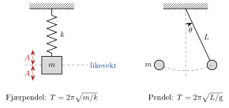

<!-- video: kommer (videoer/fysikk-forkurs/07-02-fjaer-og-pendel) -->
{fig-alt="Video kommer"}

<!-- tillegg: Claude -->
En gammel veggklokke går fordi en pendel svinger fram og tilbake i nøyaktig samme takt, time etter time. En bil som kjører over en fartsdump, vugger opp og ned på fjæringen noen ganger før den roer seg. Begge er svingninger med en fast **svingetid** (periode). På denne siden finner vi ut hva som bestemmer svingetiden for et lodd i en fjær og for en pendel, og hvorfor det er så nyttig at den er fast.

{.tikz-fig style="width:520px" fig-alt="Til venstre: et lodd med massen m henger i en fjær med fjærkonstanten k og svinger med amplituden A opp og ned om likevektsstillingen. Til høyre: en pendel med lengden L, utslagsvinkelen theta og et lodd med massen m som svinger fram og tilbake langs en sirkelbue."}

## Fjærpendelen

Et lodd som henger i en fjær eller er festet til en fjær på et glatt bord, kalles en **fjærpendel**. Drar vi loddet ut fra likevekt, drar fjæra tilbake med en kraft som er proporsjonal med utslaget (Hookes lov):
$$
F = -kx
$$
Fjærkonstanten $k$ (i $\mathrm{N/m}$) sier hvor stiv fjæra er. Minustegnet betyr at kraften alltid peker tilbake mot likevekt. Når den tilbakeførende kraften er proporsjonal med utslaget, blir svingningen harmonisk, og svingetiden er

::: {.graa}
$$
T = 2\pi\sqrt{\frac{m}{k}}
$$
:::

Formelen er lett å forstå hvis vi ser på hvert ledd for seg:

::: {.kort}
- **Tyngre lodd, saktere svingning** Et tungt lodd er vanskeligere å sette i fart, så det bruker lengre tid fram og tilbake. $m$ står over brøkstreken.
- **Stivere fjær, raskere svingning** En stiv fjær drar hardere, så loddet blir dratt fortere tilbake. $k$ står under brøkstreken.
- **Amplituden er ikke med** Drar vi loddet dobbelt så langt ut, blir kraften dobbelt så stor. Loddet må gå dobbelt så langt, men får også dobbelt så stor fart, så tiden blir den samme.
:::

Legg merke til kvadratroten: Skal svingetiden dobles, må massen bli **fire** ganger så stor.

::: {.callout-note title="Loddrett fjær"}
Henger loddet i en loddrett fjær, strekkes fjæra litt før loddet blir hengende i ro. Tyngdekraften flytter bare likevektsstillingen ned. Loddet svinger om den nye likevektsstillingen med **samme** svingetid $T = 2\pi\sqrt{m/k}$ som på et vannrett bord.
:::

::: {.eksempel}
**Eksempel: Lodd i en fjær.** Et lodd med massen $250\ \mathrm{g}$ henger i en fjær med fjærkonstanten $40.0\ \mathrm{N/m}$. a) Hvor mye strekkes fjæra når loddet henger i ro? b) Finn svingetiden og frekvensen når loddet settes i svingninger.

::: {.losning}
**Kjent:** $m = 250\ \mathrm{g} = 0.250\ \mathrm{kg}$, $k = 40.0\ \mathrm{N/m}$.

a) I likevekt er fjærkraften like stor som tyngden: $k\,\Delta l = m\mathrm{g}$. Strekket er
$$
\Delta l = \frac{m\mathrm{g}}{k} = \frac{0.250\ \mathrm{kg}\cdot 9.81\ \mathrm{m/s^2}}{40.0\ \mathrm{N/m}} = 0.0613\ \mathrm{m} = \underline{\underline{6.13\ \mathrm{cm}}}
$$

b) Svingetiden er
$$
T = 2\pi\sqrt{\frac{m}{k}} = 2\pi\sqrt{\frac{0.250\ \mathrm{kg}}{40.0\ \mathrm{N/m}}} = 0.4967\ \mathrm{s} \approx \underline{\underline{0.497\ \mathrm{s}}}
$$
og frekvensen
$$
f = \frac{1}{T} = \frac{1}{0.4967\ \mathrm{s}} = \underline{\underline{2.01\ \mathrm{Hz}}}
$$
Loddet svinger altså omtrent to ganger i sekundet. Enhetene går opp: $\mathrm{kg}/(\mathrm{N/m}) = \mathrm{kg\cdot m}/(\mathrm{kg\cdot m/s^2}) = \mathrm{s^2}$, og kvadratroten gir sekunder.
:::
:::

## Pendelen

En **pendel** er et lodd som henger i en snor og svinger fram og tilbake. Er snora lett og loddet lite sammenlignet med lengden av snora, kaller vi det en **matematisk pendel**. Her er det tyngdekraften som gir den tilbakeførende kraften: Når loddet er trukket til siden, drar tyngden det tilbake mot det laveste punktet.

Så lenge utslaget er lite (under omtrent $15^\circ$), er svingningen tilnærmet harmonisk, og svingetiden er

::: {.graa}
$$
T = 2\pi\sqrt{\frac{L}{\mathrm{g}}}
$$
:::

der $L$ er lengden fra opphengspunktet til midten av loddet.

::: {.callout-important title="Massen er ikke med"}
Svingetiden til en pendel avhenger **ikke** av massen. Et tungt lodd blir dratt hardere tilbake av tyngden, men er også like mye vanskeligere å sette i fart. De to virkningene opphever hverandre, akkurat som når tunge og lette ting faller like fort. Svingetiden avhenger heller ikke av utslaget, så lenge det er lite. Det var dette Galileo la merke til, og det er derfor pendelen ble brukt i klokker.
:::

::: {.eksempel}
**Eksempel: Pendelen i veggklokka.** a) Finn svingetiden til en pendel som er $1.00\ \mathrm{m}$ lang. b) I en klokke skal pendelen bruke nøyaktig $1.00\ \mathrm{s}$ hver vei, altså $T = 2.00\ \mathrm{s}$. Hvor lang må pendelen være?

::: {.losning}
a) Vi setter inn i formelen:
$$
T = 2\pi\sqrt{\frac{L}{\mathrm{g}}} = 2\pi\sqrt{\frac{1.00\ \mathrm{m}}{9.81\ \mathrm{m/s^2}}} = 2.006\ \mathrm{s} \approx \underline{\underline{2.01\ \mathrm{s}}}
$$

b) Vi løser formelen med hensyn på $L$. Først deler vi med $2\pi$ og kvadrerer:
$$
\left(\frac{T}{2\pi}\right)^2 = \frac{L}{\mathrm{g}} \quad\Longrightarrow\quad L = \frac{\mathrm{g}\,T^2}{4\pi^2}
$$
Med tall:
$$
L = \frac{9.81\ \mathrm{m/s^2}\cdot(2.00\ \mathrm{s})^2}{4\pi^2} = 0.9940\ \mathrm{m} \approx \underline{\underline{0.994\ \mathrm{m}}}
$$
En slik pendel kalles en *sekundpendel*. Den er litt under én meter lang.
:::
:::

### Måle tyngdeakselerasjonen med en pendel

Snur vi formelen, kan vi finne $\mathrm{g}$ ved å måle lengden og svingetiden til en pendel:

::: {.graa}
$$
\mathrm{g} = \frac{4\pi^2 L}{T^2}
$$
:::

Dette er et klassisk forsøk. Mål tiden for mange svingninger (for eksempel 20) og del på antallet, så blir feilen fra reaksjonstiden liten. Hold utslaget lite.

## Demping og resonans

I virkeligheten tar friksjon og luftmotstand litt av energien for hver svingning. Amplituden blir mindre og mindre, og til slutt stopper svingningen. Det kalles **demping**. Svingetiden endrer seg nesten ikke så lenge dempingen er svak. Støtdemperne i en bil er laget for å dempe kraftig, slik at bilen ikke fortsetter å vugge etter en fartsdump.

Hvert system som kan svinge, har sin egen svingetid, eller sin **egenfrekvens** $f_0 = 1/T$. Dytter vi i takt med egenfrekvensen, får systemet litt mer energi for hver svingning, og amplituden vokser. Det kalles **resonans**.

::: {.kort}
- **Huska** Du dytter én gang per svingning, akkurat når huska snur. Små dytt i riktig takt gir store utslag.
- **Musikkinstrumenter** Kassen på en gitar og luften i en fløyte svinger med i resonans og gjør tonen sterkere.
- **Bruer og bygninger** Vind eller folk som går i takt, kan gi farlige svingninger hvis takten treffer egenfrekvensen. Ingeniører sørger for demping eller en annen egenfrekvens.
:::

## Prøv selv

Programmet regner ut svingetiden for en fjærpendel og en pendel, og tegner hvordan svingetiden til pendelen avhenger av lengden. Endre massen, fjærkonstanten og lengden og trykk **Kjør**. Hvor lang må pendelen være for at svingetiden skal bli dobbelt så lang?

```{.python .kjor}
import numpy as np
import matplotlib.pyplot as plt

g = 9.81       # tyngdeakselerasjon i m/s^2

# Fjærpendel
m = 0.250      # masse i kg
k = 40.0       # fjærkonstant i N/m
T_fjaer = 2 * np.pi * np.sqrt(m / k)
print(f"Fjærpendel: T = {T_fjaer:.3f} s")

# Pendel
L = 1.00       # lengde i m
T_pendel = 2 * np.pi * np.sqrt(L / g)
print(f"Pendel:     T = {T_pendel:.3f} s")

# Svingetid som funksjon av lengden
Ler = np.linspace(0.05, 4.0, 200)
plt.plot(Ler, 2 * np.pi * np.sqrt(Ler / g))
plt.plot(L, T_pendel, "o")
plt.xlabel("L (m)")
plt.ylabel("T (s)")
plt.grid(True)
plt.show()
```

:::: {.oppgaver}

::: {.oppgave tittel="Svingetid for en fjærpendel"}
Et lodd med massen $0.400\ \mathrm{kg}$ er festet til en fjær med fjærkonstanten $25.0\ \mathrm{N/m}$. Finn svingetiden og frekvensen.

::: {.losning}
Svingetiden er
$$
T = 2\pi\sqrt{\frac{m}{k}} = 2\pi\sqrt{\frac{0.400\ \mathrm{kg}}{25.0\ \mathrm{N/m}}} = 2\pi\cdot 0.126\ \mathrm{s} = 0.7948\ \mathrm{s} \approx \underline{\underline{0.795\ \mathrm{s}}}
$$
Frekvensen er
$$
f = \frac{1}{T} = \frac{1}{0.7948\ \mathrm{s}} = \underline{\underline{1.26\ \mathrm{Hz}}}
$$
Dataene har tre gjeldende siffer, så svarene får tre.
:::
:::

::: {.oppgave tittel="Pendel som slår sekunder"}
En liten klokke har en pendel som skal ha svingetiden $1.00\ \mathrm{s}$. Hvor lang må pendelen være? Bruk et passende prefiks.

::: {.losning}
Vi løser $T = 2\pi\sqrt{L/\mathrm{g}}$ med hensyn på $L$:
$$
L = \frac{\mathrm{g}\,T^2}{4\pi^2} = \frac{9.81\ \mathrm{m/s^2}\cdot(1.00\ \mathrm{s})^2}{4\pi^2} = 0.2485\ \mathrm{m} \approx \underline{\underline{24.8\ \mathrm{cm}}}
$$
Halveres svingetiden, blir pendelen bare en fjerdedel så lang: $0.994\ \mathrm{m}/4 \approx 24.8\ \mathrm{cm}$.
:::
:::

::: {.oppgave tittel="Måle g med en pendel" niva="Middels"}
En elev lager en pendel med lengden $75.0\ \mathrm{cm}$. Hun tar tiden på 20 hele svingninger og får $34.8\ \mathrm{s}$. a) Hva er svingetiden? b) Hvilken verdi for tyngdeakselerasjonen gir målingen? c) Hvorfor tar hun tiden på 20 svingninger i stedet for én?

::: {.losning}
a) Tallet 20 er en telling og er eksakt:
$$
T = \frac{34.8\ \mathrm{s}}{20} = \underline{\underline{1.74\ \mathrm{s}}}
$$

b) Vi bruker $\mathrm{g} = \dfrac{4\pi^2 L}{T^2}$ med $L = 0.750\ \mathrm{m}$:
$$
\mathrm{g} = \frac{4\pi^2\cdot 0.750\ \mathrm{m}}{(1.74\ \mathrm{s})^2} = \underline{\underline{9.78\ \mathrm{m/s^2}}}
$$
Det er nær den kjente verdien $9.81\ \mathrm{m/s^2}$ (avviket er omtrent $0.3\ \%$).

c) Reaksjonstiden når man starter og stopper klokka, er gjerne rundt $0.2\ \mathrm{s}$. Den feilen kommer bare én gang, uansett hvor mange svingninger vi tar tiden på. Deler vi på 20, blir feilen i svingetiden 20 ganger mindre.
:::
:::

::: {.oppgave tittel="Finn fjærkonstanten" niva="Middels"}
Et lodd med massen $200\ \mathrm{g}$ henges i en fjær, og fjæra strekkes $4.9\ \mathrm{cm}$. a) Finn fjærkonstanten. b) Finn svingetiden når loddet settes i svingninger. c) Loddet byttes ut med et på $800\ \mathrm{g}$. Hvor stor blir svingetiden nå? Svar uten å regne ut $k$ på nytt.

::: {.losning}
**Kjent:** $m = 0.200\ \mathrm{kg}$, $\Delta l = 0.049\ \mathrm{m}$.

a) I likevekt er $k\,\Delta l = m\mathrm{g}$:
$$
k = \frac{m\mathrm{g}}{\Delta l} = \frac{0.200\ \mathrm{kg}\cdot 9.81\ \mathrm{m/s^2}}{0.049\ \mathrm{m}} = 40.0\ \mathrm{N/m} \approx \underline{\underline{40\ \mathrm{N/m}}}
$$
Strekket har bare to gjeldende siffer, så svaret får to.

b) Vi bruker den uavrundede verdien $k = 40.04\ \mathrm{N/m}$ videre:
$$
T = 2\pi\sqrt{\frac{m}{k}} = 2\pi\sqrt{\frac{0.200\ \mathrm{kg}}{40.04\ \mathrm{N/m}}} = 0.444\ \mathrm{s} \approx \underline{\underline{0.44\ \mathrm{s}}}
$$

c) Massen blir fire ganger så stor. Siden $T$ er proporsjonal med $\sqrt{m}$, blir svingetiden $\sqrt{4} = 2$ ganger så lang:
$$
T = 2\cdot 0.444\ \mathrm{s} = 0.888\ \mathrm{s} \approx \underline{\underline{0.89\ \mathrm{s}}}
$$
:::
:::

::: {.oppgave tittel="Dytt på huska"}
En huske har tauene $2.5\ \mathrm{m}$ lange. Se på den som en pendel. Hvor ofte bør du dytte for å få størst mulig utslag?

::: {.losning}
Du får størst utslag når du dytter i takt med egenfrekvensen (resonans), altså én gang per svingetid:
$$
T = 2\pi\sqrt{\frac{L}{\mathrm{g}}} = 2\pi\sqrt{\frac{2.5\ \mathrm{m}}{9.81\ \mathrm{m/s^2}}} = 3.17\ \mathrm{s} \approx \underline{\underline{3.2\ \mathrm{s}}}
$$
Du bør altså dytte omtrent hvert tredje sekund, hver gang huska er tilbake hos deg. Lengden har to gjeldende siffer, så svaret får to.
:::
:::

::: {.oppgave tittel="Pendelklokke på Månen" niva="Utfordrende"}
Tyngdeakselerasjonen på Månen er $1.62\ \mathrm{m/s^2}$. En pendelklokke som går riktig på jorda, har en pendel med svingetiden $2.00\ \mathrm{s}$. Klokka tas med til Månen. a) Hvor lang blir svingetiden der? b) Klokka teller én svingning som $2.00\ \mathrm{s}$. Hvor mye viser den etter at det har gått én time på Månen? c) Hvordan måtte pendelen endres for at klokka skulle gå riktig?

::: {.losning}
a) Lengden er den samme. Vi deler formelen for Månen på formelen for jorda, så $L$ og $2\pi$ forsvinner:
$$
\frac{T_\text{måne}}{T_\text{jord}} = \sqrt{\frac{\mathrm{g}_\text{jord}}{\mathrm{g}_\text{måne}}}
\quad\Longrightarrow\quad
T_\text{måne} = 2.00\ \mathrm{s}\cdot\sqrt{\frac{9.81\ \mathrm{m/s^2}}{1.62\ \mathrm{m/s^2}}} = 4.922\ \mathrm{s} \approx \underline{\underline{4.92\ \mathrm{s}}}
$$

b) På én time ($3600\ \mathrm{s}$) gjør pendelen
$$
N = \frac{3600\ \mathrm{s}}{4.922\ \mathrm{s}} = 731.4
$$
svingninger. Klokka teller $2.00\ \mathrm{s}$ for hver, så den viser
$$
731.4\cdot 2.00\ \mathrm{s} = 1463\ \mathrm{s} \approx \underline{\underline{24.4\ \mathrm{min}}}
$$
Klokka går altså altfor sakte.

c) Svingetiden skal være $2.00\ \mathrm{s}$ også på Månen. Da må $L/\mathrm{g}$ være den samme, så pendelen må gjøres kortere med samme faktor som $\mathrm{g}$ er mindre:
$$
L_\text{måne} = 0.994\ \mathrm{m}\cdot\frac{1.62}{9.81} = 0.164\ \mathrm{m} = \underline{\underline{16.4\ \mathrm{cm}}}
$$
:::
:::

::::
