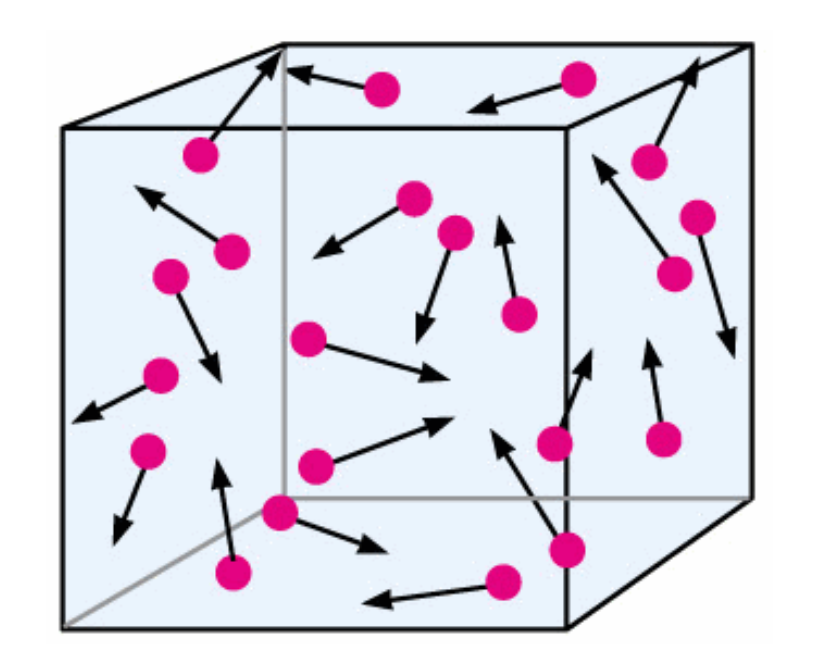

:::: {.oppgaver}



Fluidfysikk handler om studiet av fluider, som inkluderer både væsker og gasser. Et fluid er et materiale som kan flyte og tilpasse seg formen til beholderen det er i. I motsetning til faste stoffer, som har en fast form og volum, kan fluider lett endre form og tilpasse seg omgivelsene.\
Væsker, som vann, har gjerne et bestemt volum, men kan flyte og tilpasse seg formen til beholderen sin. De har høyere tetthet enn gasser, og molekylene i en væske er relativt tettpakket, men de kan fortsatt bevege seg rundt hverandre. Gasser, som luft, har verken en fast form eller et fast volum. Gasser vil utvide seg og fylle hele volumet til beholderen de er i, og molekylene i en gass har mye større bevegelsesfrihet enn i en væske.

## Massetetthet

Massetetthet er et mål på hvor mye masse som er pakket inn i et gitt volum av et stoff. Tettheten varierer mellom forskjellige materialer. For eksempel har metall en høyere tetthet enn tre.

::: {.callout-tip title="Til ettertanke"}

Skip med skrog laget av metall flyter, enda metall er tyngre enn vann. Kan du forklare hvorfor?

:::

Tetthet er en viktig egenskap i både fysikk og ingeniørfag og måles naturligvis i kg/m$^3$ eller g/cm$^3$.

::: {.callout-note title="Definisjon: Massetetthet"}

Massetetthet $\rho$ kan uttrykkes som: $$\begin{aligned}
        \rho = \frac{m}{V}
\end{aligned}$$ hvor $m$ er massen til stoffet og $V$ er volumet. Massetettheten angir hvor mye masse som finnes per volumenhet.

:::

| **Stoff** | **Tetthet $\rho$ ($10^3$ kg/m$^3$)** |
|:---------:|:------------------------------------:|
|   Gull    |                 19.3                 |
| Kvikksølv |                 13.6                 |
|   Stål    |                 7.85                 |
| Aluminium |                 2.70                 |
|  Sjøvann  |                 1.03                 |
|   Vann    |                 1.0                  |
|    Is     |                 0.92                 |
|   Luft    |                0.0012                |
| Vanndamp  |                0.0006                |

: Massetetthet $\rho$ til forskjellige stoffer, angitt i $10^3$ kg/m$^3$.

::: {.eksempel}
[Eksempel 7.1: Massen til en liter vann]{.eks-tittel}

Hva er massen til $1.0\,\mathrm{L}$ vann?

:::

::: {.callout-note .svar collapse="true" title="Vis løsning"}

Vi vet at massetetthet $\rho$ er definert som massen $m$ per volum $V$: $$\rho = \frac{m}{V}$$ For å finne massen $m$, omformer vi formelen slik at $$m = \rho \cdot V$$

Siden vi har oppgitt volumet som $V = 1.0 \, \text{L}$, konverterer vi dette til kubikkmeter: $$1.0 \, \text{L} = 1.0 \, \text{dm}^3 = 1.0 \cdot 10^{-3} \, \text{m}^3$$

Nå setter vi inn verdiene med $\rho = 1.0 \cdot 10^3 \, \text{kg/m}^3$ (tabellen) og $V = 1.0 \cdot 10^{-3} \, \text{m}^3$: $$m = (1.0 \cdot 10^3 \, \text{kg/m}^3) \cdot (1.0 \cdot 10^{-3} \, \text{m}^3)
  = \underline{\underline{1.0 \, \text{kg}}}$$ Én liter vann har altså en masse på omtrent ett kilogram. Dette er lurt å huske, fordi det gjør det lett å anslå massen til vann i bøtter, flasker og badekar.

:::

::: {.oppgave tittel="Hvilket metall?"}
[Hvilket metall?]{.oppg-tittel}

En liten metallterning har sidekanter på $3.0\,\mathrm{cm}$ og masse $73\,\mathrm{g}$.

a)  Finn volumet til terningen i $\mathrm{cm}^{3}$ og i $\mathrm{m}^{3}$.

b)  Finn massetettheten til terningen. Bruk tabell  til å finne ut hvilket metall terningen sannsynligvis er laget av.

c)  Hvor stor masse ville en like stor terning av gull hatt?

::: {.losning}

**a)** Volumet til en terning er sidekanten opphøyd i tredje: $$V = (3.0\,\mathrm{cm})^3 = \underline{\underline{27\,\mathrm{cm}^{3}}}$$ Siden $1\,\mathrm{cm} = 1\cdot 10^{-2}\,\mathrm{m}$, er $1\,\mathrm{cm}^{3} = (1\cdot 10^{-2}\,\mathrm{m})^3 = 1\cdot 10^{-6}\,\mathrm{m}^{3}$. Dermed er $$V = 27\cdot1\cdot 10^{-6}\,\mathrm{m}^{3} = \underline{\underline{2.7\cdot 10^{-5}\,\mathrm{m}^{3}}}$$

**b)** Vi bruker definisjonen av massetetthet (se *Massetetthet* i kompendiet): $$\rho = \frac{m}{V} = \frac{73\,\mathrm{g}}{27\,\mathrm{cm}^{3}} = 2.70\,\mathrm{g}\,\mathrm{cm}^{-3} \approx \underline{\underline{2.7\cdot 10^{3}\,\mathrm{kg}\,\mathrm{m}^{-3}}}$$ I tabell  ser vi at dette passer med **aluminium**.

**c)** Gull har $\rho = 19.3\cdot 10^{3}\,\mathrm{kg}\,\mathrm{m}^{-3}$. En terning av gull med samme volum har massen $$m = \rho\cdot V = 19.3\cdot 10^{3}\,\mathrm{kg}\,\mathrm{m}^{-3}\cdot2.7\cdot 10^{-5}\,\mathrm{m}^{3} = 0.521\,\mathrm{kg} \approx \underline{\underline{0.52\,\mathrm{kg}}}$$ Gullterningen ville altså vært omtrent sju ganger så tung som aluminiumsterningen, selv om de er like store.

:::

:::

## Trykk

Trykk er definert som kraften som virker vinkelrett på en overflate per arealenhet. Det beskriver hvor mye kraft som påføres en bestemt flate. Trykk måles ofte i enheter av pascal (Pa), hvor $1 \, \text{Pa} = 1 \, \text{N/m}^2$.

::: {.callout-note title="Definisjon: Trykk"}

Trykket $p$ er gitt ved: $$\begin{aligned}
        p = \frac{F}{A}
\end{aligned}$$ hvor $F$ er kraften som virker vinkelrett på overflaten, og $A$ er arealet til overflaten. Trykk måler kraft per arealenhet og uttrykkes vanligvis i pascal (Pa). Dette betyr at trykk også kan uttrykkes som $1 \, \text{Pa} = 1 \, \text{kg} \cdot \text{m}^{-1} \cdot \text{s}^{-2}$.

:::

Trykk er en skalar størrelse. Det betyr at trykk kun har en størrelse, men ingen retning. Trykk er altså IKKE en vektor! Det er *kraften* fra trykket som har en retning: den står alltid vinkelrett på flaten den virker på.\
Formelen $p = F/A$ forteller oss at den samme kraften kan gi svært ulikt trykk, avhengig av hvor stort areal kraften fordeles over. Det skal vi se i neste eksempel.

::: {.eksempel}
[Eksempel 7.2: Ski eller støvler?]{.eks-tittel}

En person med masse $m = 72\,\mathrm{kg}$ står på snø. Vi antar at trykket er jevnt fordelt over støvelsålene.

a)  Finn trykket mot snøen når personen står i støvler. Til sammen har de to sålene et areal på $A = 0.050\,\mathrm{m}^{2}$.

b)  Personen tar på seg ski. Hver ski er $1.8\,\mathrm{m}$ lang og $7.0\,\mathrm{cm}$ bred. Finn trykket mot snøen nå (anta at skiene er uendelig stive, slik at trykket blir jevnt fordelt).

c)  Forklar hvorfor det er lettere å gå i dyp snø med ski enn med støvler.

:::

::: {.callout-note .svar collapse="true" title="Vis løsning"}

Kraften som virker vinkelrett på snøen, er tyngden av personen: $$F = m\mathrm{g} = 72\,\mathrm{kg}\cdot9.81\,\mathrm{m}\,\mathrm{s}^{-2} = 706.3\,\mathrm{N}$$

**a)** Med støvler fordeles kraften over $A = 0.050\,\mathrm{m}^{2}$: $$p = \frac{F}{A} = \frac{706.3\,\mathrm{N}}{0.050\,\mathrm{m}^{2}} = 14126\,\mathrm{Pa} \approx \underline{\underline{14\,\mathrm{kPa}}}$$

**b)** Med ski er arealet $$A = 2\cdot 1.8\,\mathrm{m}\cdot0.070\,\mathrm{m} = 0.252\,\mathrm{m}^{2},$$ og trykket blir $$p = \frac{706.3\,\mathrm{N}}{0.252\,\mathrm{m}^{2}} = 2803\,\mathrm{Pa} \approx \underline{\underline{2.8\,\mathrm{kPa}}}$$

**c)** Kraften mot snøen er like stor i begge tilfeller. Men med ski fordeles kraften over et omtrent fem ganger så stort areal, og da blir trykket omtrent fem ganger så lite. Snøen blir derfor ikke presset like mye sammen, og man synker mindre ned.

:::

På mikroskopisk nivå er trykk en konsekvens av interaksjoner. Se for deg en beholder med gassmolekyler. Hvert molekyl i gassen utøver en liten kraft på veggen i beholeren hver gang det treffer den, og summen av alle disse kollisjonene per arealenhet gir opphav til trykket i beholderen. Kreftene som påføres veggen skyldes altså impulsoverføringen fra molekylene til veggen. Jo flere molekyler som treffer veggen per tidsenhet, og jo raskere de beveger seg, desto større blir trykket.

:::: figure
{.kompendium-bilde}

::: caption
Trykk i gassbeholder
:::
::::

::: {.oppgave tittel="Tegnestift"}
[Tegnestift]{.oppg-tittel}

Du trykker en tegnestift inn i en vegg med tommelen. Kraften fra tommelen på stiften er $F = 20\,\mathrm{N}$. Hodet på tegnestiften har areal $1.0\,\mathrm{cm}^{2}$, og spissen har areal $0.10\,\mathrm{mm}^{2}$.

a)  Finn trykket mot tommelen.

b)  Stiften er i ro i det øyeblikket du trykker, så den presser på veggen med den samme kraften. Finn trykket fra spissen mot veggen.

c)  Forklar hvorfor stiften går inn i veggen, men ikke inn i tommelen.

*Hint: Husk at $1\,\mathrm{cm}^{2} = 1\cdot 10^{-4}\,\mathrm{m}^{2}$ og $1\,\mathrm{mm}^{2} = 1\cdot 10^{-6}\,\mathrm{m}^{2}$.*

::: {.losning}

Vi bruker definisjonen av trykk, $p = F/A$ (se *Trykk* i kompendiet).

**a)** Arealet av hodet er $A = 1.0\,\mathrm{cm}^{2} = 1.0\cdot 10^{-4}\,\mathrm{m}^{2}$: $$p_\text{tommel} = \frac{F}{A} = \frac{20\,\mathrm{N}}{1.0\cdot 10^{-4}\,\mathrm{m}^{2}} = \underline{\underline{2.0\cdot 10^{5}\,\mathrm{Pa}}}$$

**b)** Arealet av spissen er $A = 0.10\,\mathrm{mm}^{2} = 0.10\cdot1\cdot 10^{-6}\,\mathrm{m}^{2} = 1.0\cdot 10^{-7}\,\mathrm{m}^{2}$: $$p_\text{vegg} = \frac{F}{A} = \frac{20\,\mathrm{N}}{1.0\cdot 10^{-7}\,\mathrm{m}^{2}} = \underline{\underline{2.0\cdot 10^{8}\,\mathrm{Pa}}}$$

**c)** Kraften er like stor i begge ender av stiften, men spissen har et areal som er tusen ganger mindre enn hodet. Derfor er trykket mot veggen tusen ganger større enn trykket mot tommelen. Det store trykket er nok til at spissen trenger inn i veggen, mens trykket mot tommelen er så lite at det ikke gjør vondt.

:::

:::

## Lufttrykk

::: {.callout-tip title="Til ettertanke"}

Hvorfor fungerer sugekopper?

:::

Her nede på jordens overflate er vi mennesker omgitt av luft. Det vi kanskje ikke tenker på, er at denne luften veier noe. Den har vekt. Når du stiger ned i vann, merker du at vannet utøver et trykk på deg. Det er på grunn av vannets vekt. Men luften gjør det samme. Lufttrykket rundt oss (som følge av luftens vekt) er omtrent $1.013\cdot 10^{5}\,\mathrm{Pa}$. Dette trykket kalles også *én atmosfære* (1 atm).

::: {.graa}

$\displaystyle 1\,\text{atm} = 101325\,\mathrm{Pa} \approx 1.013\cdot 10^{5}\,\mathrm{Pa}$

:::

Grunnen til at sugekopper fungerer, er trykket fra luften. Lufttrykket tvinger sugekoppen til å holde seg på plass. Desto større flate sugekoppen har, desto større blir de totale kreftene som holder den på plass. Det er derfor sugekopper med større diameter holder bedre enn små sugekopper. Dette betyr at dersom du pumper vekk luften fra et rom, vil alt som er festet med sugekopper slippe taket, fordi det ikke lenger er lufttrykk som holder dem på plass.

Lufttrykket virker fra alle kanter på alt som er omgitt av luft. Siden $1\,\mathrm{atm}$ er et stort trykk, kan kraften fra lufta bli svært stor, selv på helt vanlige flater. I videoklippet (fra NRK) ser du hva som skjer med en campingvogn når lufta inni den pumpes ut. Hvor store krefter det er snakk om, ser vi i neste eksempel.

::: {.eksempel}
[Eksempel 7.3: Lufta presser på et bord]{.eks-tittel}

Et bord har en rektangulær bordplate som er $1.2\,\mathrm{m}$ lang og $0.80\,\mathrm{m}$ bred. Lufttrykket er $p_0 = 1.013\cdot 10^{5}\,\mathrm{Pa}$.

a)  Finn kraften fra lufta på oversiden av bordplata.

b)  Hvor stor masse ville hatt en like stor tyngde?

c)  Hvorfor knekker ikke bordet sammen?

:::

::: {.callout-note .svar collapse="true" title="Vis løsning"}

**a)** Arealet av bordplata er $$A = 1.2\,\mathrm{m}\cdot0.80\,\mathrm{m} = 0.96\,\mathrm{m}^{2}$$ Fra definisjonen av trykk, $p = F/A$, er kraften fra lufta $$F = p_0 A = 1.013\cdot 10^{5}\,\mathrm{Pa}\cdot0.96\,\mathrm{m}^{2} = 9.72\cdot 10^{4}\,\mathrm{N} \approx \underline{\underline{9.7\cdot 10^{4}\,\mathrm{N}}}$$

**b)** En masse $m$ har tyngden $m\mathrm{g}$. Vi setter $m\mathrm{g} = F$: $$m = \frac{F}{\mathrm{g}} = \frac{9.72\cdot 10^{4}\,\mathrm{N}}{9.81\,\mathrm{m}\,\mathrm{s}^{-2}} = 9.91\cdot 10^{3}\,\mathrm{kg} \approx \underline{\underline{9.9\cdot 10^{3}\,\mathrm{kg}}}$$ Lufta presser altså på bordplata med en kraft som tilsvarer tyngden av nesten ti tonn!

**c)** Lufta presser ikke bare på oversiden av bordplata, men også på undersiden, med det samme trykket. Kraften oppover på undersiden er derfor like stor som kraften nedover på oversiden, og de to kreftene opphever hverandre. Bordet merker bare tyngden av det som ligger på det.

:::

Inne i et bildekk er trykket større enn lufttrykket utenfor. Trykkmålere på bensinstasjonen viser *overtrykket*, altså hvor mye større trykket i dekket er enn lufttrykket rundt. Dekktrykk oppgis ofte i enheten bar, der $1\,\mathrm{bar} = 1.0\cdot 10^{5}\,\mathrm{Pa}$.

::: {.eksempel}
[Eksempel 7.4: Lufttrykk i bildekk]{.eks-tittel}

En trykkmåler viser at overtrykket i et bildekk er $2.3\,\mathrm{bar}$, altså $2.3\cdot 10^{5}\,\mathrm{Pa}$. Lufttrykket utenfor er $p_0 = 1.013\cdot 10^{5}\,\mathrm{Pa}$.

a)  Finn det totale trykket inne i dekket. Hvor mange atmosfærer er det?

b)  Bilen har masse $1200\,\mathrm{kg}$, og vi antar at tyngden fordeler seg likt på de fire hjulene. Det er overtrykket i dekket som bærer bilen. Hvor stort areal av hvert dekk må ligge an mot veien? Vi ser bort fra stivheten i dekkveggen.

:::

::: {.callout-note .svar collapse="true" title="Vis løsning"}

**a)** Det totale trykket er lufttrykket pluss overtrykket: $$p = p_0 + \Delta p = 1.013\cdot 10^{5}\,\mathrm{Pa} + 2.3\cdot 10^{5}\,\mathrm{Pa} = 3.31\cdot 10^{5}\,\mathrm{Pa} \approx \underline{\underline{3.3\cdot 10^{5}\,\mathrm{Pa}}}$$ Målt i atmosfærer er dette $$\frac{3.31\cdot 10^{5}\,\mathrm{Pa}}{1.013\cdot 10^{5}\,\mathrm{Pa}} = 3.27 \approx \underline{\underline{3.3\,\mathrm{atm}}}$$

**b)** Hvert hjul bærer en fjerdedel av tyngden: $$F = \frac{m\mathrm{g}}{4} = \frac{1200\,\mathrm{kg}\cdot9.81\,\mathrm{m}\,\mathrm{s}^{-2}}{4} = 2943\,\mathrm{N}$$ Der dekket ligger an mot veien, presser lufta inne i dekket nedover med trykket $p_0 + \Delta p$, mens lufta utenfor bare presser med $p_0$. Det er altså overtrykket $\Delta p$ som gir nettokraften som bærer bilen: $F = \Delta p\cdot A$. Dermed er $$A = \frac{F}{\Delta p} = \frac{2943\,\mathrm{N}}{2.3\cdot 10^{5}\,\mathrm{Pa}} = 1.28\cdot 10^{-2}\,\mathrm{m}^{2} \approx \underline{\underline{1.3\cdot 10^{-2}\,\mathrm{m}^{2}}}$$ Det tilsvarer omtrent $130\,\mathrm{cm}^{2}$, eller en flate på omtrent $11\,\mathrm{cm}\times11\,\mathrm{cm}$. Har dekket for lavt trykk, må en større del av dekket ligge an mot veien for å bære bilen. Dekket blir da flatere, og bilen bruker mer drivstoff.

:::

::::
