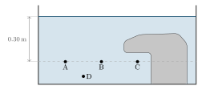
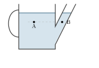
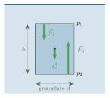
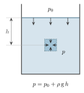
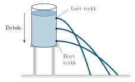
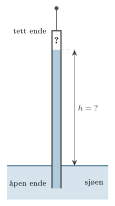

:::: {.oppgaver}

Trykk i væsker oppstår som følge av vekten av væsken over et gitt punkt og de kreftene som væsken utøver på overflatene rundt seg. Dette trykket avhenger av væskens tetthet $\rho$, dybden $h$, og tyngdeakselerasjonen $\mathrm{g}$. Vi kan analysere væsketrykket ved å bruke to forskjellige elementer: et horisontalt væskeelement og et vertikalt væskeelement.

## Horisontalt væskeelement

I et horisontalt væskeelement er trykket likt i alle retninger, forutsatt at væsken er i ro. Dette skyldes at væsker alltid fordeler kreftene jevnt i et horisontalt plan når de ikke er i bevegelse. Dersom trykket ikke var likt, ville væsken begynne å strømme fra områder med høyt trykk til områder med lavt trykk. Derfor gjelder:

::: tcolorbox
$\displaystyle p_1 = p_2$
:::



I et horisontalt væskeelement i ro er altså trykket det samme i alle punkter på samme nivå.

Men merk at dersom væsken er i bevegelse, kan trykket variere i horisontal retning. For eksempel, i et rør hvor arealet av røret endrer seg, vil væsken strømme med ulik fart i de ulike delene av røret, med det resultat at trykket blir forskjellig. Der røret er smalt, strømmer væsken fortere, og der er trykket lavere.

:::: figure
{.kompendium-bilde}

::: caption
Et rør der arealet reduseres fra $A_1$ til $A_2$. Væsken strømmer fortere i den smale delen av røret ($v_2 > v_1$), og trykket i punkt 2 er lavere enn i punkt 1. Slike scenario er ikke del av pensum i dette faget, hvor vi holder oss til fluidstatikk.
:::
::::

I dette faget skal vi ikke studere væsker i bevegelse, slik som i eksemplet over. Vi holder oss til fluid*statikken*.

::: {.callout-note title="Definisjon: Trykk i horisontalt væskeelement"}

I et horisontalt væskeelement i ro gjelder: $$\begin{aligned}
        p_1 = p_2
\end{aligned}$$ hvor $p_1$ og $p_2$ er trykkene i forskjellige punkter på samme horisontale nivå i den samme sammenhengende væsken. Dersom væsken strømmer og rørets areal endrer seg, vil trykket kunne variere.

:::

Legg merke til at definisjonen krever at punktene ligger i den *samme sammenhengende* væsken. Det betyr at vi må kunne gå fra det ene punktet til det andre uten å forlate væsken. Hvor mye vann som ligger rett over hvert punkt, spiller ingen rolle. Det ser vi i neste eksempel.

::: {.eksempel}
[Eksempel 7.5: Trykket i et akvarium]{.eks-tittel}

Et akvarium er fylt med vann som står i ro. På bunnen ligger en stein med en hule, der fiskene kan gjemme seg (se figuren). Punktene A, B og C ligger alle $0.30\,\mathrm{m}$ under vannoverflaten. Punkt C ligger inne i hula, rett under steinen. En trykkmåler viser at trykket i punkt A er $1.04\cdot 10^{5}\,\mathrm{Pa}$.

a)  Hva er trykket i punkt B?

b)  Hva er trykket i punkt C, inne i hula?

c)  Punkt D ligger litt dypere enn A, B og C. Er trykket i D større eller mindre enn i A?

::: center
{.tikz-fig style="width:488px"}

[Et akvarium med en stein med hule. Punktene A, B og C ligger på samme dybde. Figuren er ikke i målestokk.]{.figurtekst}
:::

:::

::: {.callout-note .svar collapse="true" title="Vis løsning"}

**a)** Punktene A og B ligger på samme horisontale nivå i den samme vannmassen, og vannet er i ro. Da er trykket likt: $$p_B = p_A = \underline{\underline{1.04\cdot 10^{5}\,\mathrm{Pa}}}$$

**b)** Det ligger mindre vann rett over punkt C enn over punkt A, fordi steinen er i veien. Likevel kan vi gå fra A til C gjennom vannet, inn i hula, uten å forlate vannet. Punktene ligger altså på samme nivå i den samme sammenhengende væsken, og derfor er $$p_C = p_A = \underline{\underline{1.04\cdot 10^{5}\,\mathrm{Pa}}}$$ Vi kan også forstå dette slik: Hvis trykket i C var lavere enn i A, ville vannet begynt å strømme fra A inn i hula. Men vannet er i ro, så trykket må være likt.

**c)** Punkt D ligger dypere enn A. Da er det mer vann over D som presser nedover, og trykket i D er **større** enn i A. Hvor mye større, skal vi finne ut i neste delkapittel.

:::

::: {.oppgave tittel="Vannkanne"}
[Vannkanne]{.oppg-tittel}

En vannkanne er fylt med vann som står i ro. Punkt A ligger inne i kanna, og punkt B ligger i tuten, i samme høyde som A (se figuren).

::: center
{.tikz-fig style="width:318px"}
:::

a)  En trykkmåler viser at trykket i A er $1.05\cdot 10^{5}\,\mathrm{Pa}$. Hva er trykket i B? Begrunn svaret.

b)  Bruk svaret i a) til å forklare hvorfor vannet i tuten står like høyt som vannet i kanna.

::: {.losning}

**a)** Punktene A og B ligger på samme horisontale nivå, og vi kan gå fra A til B gjennom vannet uten å forlate det. Vannet står i ro. Da er trykket likt i de to punktene (se *Horisontalt væskeelement* i kompendiet): $$p_B = p_A = \underline{\underline{1.05\cdot 10^{5}\,\mathrm{Pa}}}$$

**b)** Trykket i et punkt skyldes vekten av vannet over punktet (pluss lufttrykket). Tenk deg at vannet i tuten stod lavere enn vannet i kanna. Da ville det vært mindre vann over B enn over A, og trykket i B ville vært lavere enn i A. Vannet ville da strømmet fra A mot B, altså inn i tuten, helt til trykkene var like. Vannet kommer derfor bare til ro når det står like høyt i tuten som i kanna.

:::

:::

## Vertikalt væskeelement

Vi skal nå finne ut hvordan trykket endrer seg når vi går nedover i en væske. Tenk deg at vi plukker ut en loddrett søyle av væsken, med grunnflate $A$ og høyde $h$ (se figuren). Søylen er en del av væsken, og den er i ro. Tre krefter virker på den:

-   Væsken over søylen presser *ned* på toppen med kraften $F_1 = p_1 A$, der $p_1$ er trykket ved toppen.

-   Væsken under søylen presser *opp* på bunnen med kraften $F_2 = p_2 A$, der $p_2$ er trykket ved bunnen.

-   Tyngdekraften $G = m\mathrm{g}$ virker nedover. Massen til søylen er $m = \rho V = \rho A h$.

Kreftene fra væsken på sidene av søylen er horisontale og like store fra alle kanter, så de opphever hverandre.

::: center
{.tikz-fig style="width:309px"}

[En loddrett væskesøyle i ro. Væsken over presser ned på toppen ($\vec{F}_1$), væsken under presser opp på bunnen ($\vec{F}_2$), og tyngdekraften $\vec{G}$ virker nedover.]{.figurtekst}
:::



Siden søylen er i ro, er summen av kreftene null (Newtons 1. lov). Med positiv retning oppover får vi: $$p_2 A - p_1 A - \rho A h \mathrm{g} = 0$$ Alle leddene inneholder arealet $A$, så vi kan dele på $A$ på begge sider: $$p_2 - p_1 = \rho \mathrm{g} h$$ Trykket ved bunnen av søylen er altså større enn trykket ved toppen, og forskjellen er nøyaktig det som trengs for å bære tyngden av væsken i søylen.

Legg merke til at arealet $A$ forsvant fra likningen. Hvor bred søylen er, spiller altså ingen rolle. Sammenhengen gjelder derfor for *hvilke som helst* to punkter i en væske i ro, der det ene ligger en høyde $h$ under det andre: trykket i det nederste punktet er alltid $\rho\mathrm{g}h$ større enn trykket i det øverste.

La oss nå legge toppen av søylen i væskeoverflaten. Da blir $h$ dybden under overflaten. Trykkøkningen fra overflaten og ned til dybden $h$ skyldes vekten av væsken over punktet, og den kalles det *hydrostatiske trykket*:

::: {.graa}

$\displaystyle p = \rho\mathrm{g}h$

:::

Det hydrostatiske trykket avhenger bare av dybden $h$, væskens tetthet $\rho$ og tyngdeakselerasjonen $\mathrm{g}$. Men over væskeoverflaten er det som regel luft, og som vi så i delkapittelet om lufttrykk, presser lufta også på overflaten. Trykket ved toppen av søylen er da ikke null, men lik trykket $p_0$ ved overflaten. Setter vi $p_1 = p_0$ og $p_2 = p(h)$ inn i $p_2 - p_1 = \rho\mathrm{g}h$, får vi det totale trykket i dybden $h$:

::: {.callout-note title="Definisjon: Trykk i vertikalt væskeelement"}

Trykket $p(h)$ i en væske som er i ro er gitt som: $$\begin{aligned}
        p(h) = p_0 + \rho \mathrm{g} h
\end{aligned}$$ Her er $p_0$ det ytre trykket ved væskeoverflaten, $\rho$ er tettheten til væsken ($\text{kg/m}^3$), $\mathrm{g}$ er tyngdeakselerasjonen ($9.81 \, \text{m/s}^2$), og $h$ er dybden i væsken ($\text{m}$).

:::

:::: figure
{.tikz-fig style="width:267px"}

::: caption
Hydrostatisk trykk $p$ i en væske, som avhenger av væskens tetthet $\rho$, tyngdeakselerasjonen $\mathrm{g}$, dybden $h$, og det ytre trykket $p_0$. Væsken rundt det lille væskeelementet presser på det fra alle kanter med trykket $p$. Trykket øker jevnt med dybden.
:::
::::

:::: figure
{.tikz-fig style="width:441px"}

::: caption
Illustrasjon av trykk i en væske som øker med dybden. Ved større dybde er trykket høyere på grunn av vekten av væsken over punktet. Derfor strømmer vannet ut med større fart jo dypere hullet ligger. (Hvor langt strålen når, avhenger også av hvor høyt over gulvet hullet sitter.)
:::
::::

::: {.callout-tip title="Til ettertanke"}

Tre beholdere med ulik form — en smal sylinder, en vid bolle og en kjegle med spissen opp — fylles med vann til samme høyde. Er trykket i bunnen størst i beholderen med mest vann?

:::

::: {.eksempel}
[Eksempel 7.6: Beregning av trykk ved ulike dybder]{.eks-tittel}

En dykker er under vann med tetthet $\rho = 1000 \, \text{kg/m}^3$, og det atmosfæriske trykket ved overflaten er $p_0 = 101325 \, \text{Pa}$. Hva er det totale trykket på dykkeren ved dybdene $h = 2.0 \, \text{m}$, $h = 5.0 \, \text{m}$, og $h = 10 \, \text{m}$?

:::

::: {.callout-note .svar collapse="true" title="Vis løsning"}

Vi bruker formelen for trykk i væsken: $$p(h) = p_0 + \rho \mathrm{g} h$$ hvor $p_0 = 101325 \, \text{Pa}$, $\rho = 1000 \, \text{kg/m}^3$, og $\mathrm{g} = 9.81 \, \text{m/s}^2$. Vi setter inn de tre ulike dybdene én etter én.\
**Ved $h = 2.0 \, \text{m}$:** $$p(2.0) = 101325 + 1000 \cdot 9.81 \cdot 2.0 = 101325 + 19620 = 120945 \, \text{Pa} \approx \underline{\underline{1.2 \cdot 10^5 \, \text{Pa}}}.$$

**Ved $h = 5.0 \, \text{m}$:** $$p(5.0) = 101325 + 1000 \cdot 9.81 \cdot 5.0 = 101325 + 49050 = 150375 \, \text{Pa} \approx \underline{\underline{1.5 \cdot 10^5 \, \text{Pa}}}.$$

**Ved $h = 10 \, \text{m}$:** $$p(10) = 101325 + 1000 \cdot 9.81 \cdot 10 = 101325 + 98100 = 199425 \, \text{Pa} \approx \underline{\underline{2.0 \cdot 10^5 \, \text{Pa}}}.$$

Legg merke til at trykket ved $10\,\mathrm{m}$ dybde er omtrent dobbelt så stort som ved overflaten. For hver tiende meter nedover i vann øker trykket med omtrent én atmosfære.

:::

I forrige eksempel regnet vi ut trykket målt fra overflaten. Men ofte kjenner vi trykket i ett punkt inne i væsken og vil finne trykket i et annet punkt høyere opp eller lenger ned. Da bruker vi trykkdifferansen direkte.

::: {.eksempel}
[Eksempel 7.7: Vannrør i et høyhus]{.eks-tittel}

Et vannrør går loddrett fra kjelleren og opp til toppen av et høyhus. Kranene er stengt, så vannet i røret står i ro. I kjelleren viser en trykkmåler at trykket i røret er $4.5\cdot 10^{5}\,\mathrm{Pa}$.

a)  Finn trykket i røret i en etasje som ligger $18\,\mathrm{m}$ over kjelleren.

b)  Tenk deg at røret var åpent i toppen, slik at trykket på vannoverflaten i røret var lufttrykket $p_0 = 1.013\cdot 10^{5}\,\mathrm{Pa}$. Hvor høyt over kjelleren ville vannet da stått i røret?

:::

::: {.callout-note .svar collapse="true" title="Vis løsning"}

**a)** Vi kaller trykket i kjelleren $p_2$ (bunnen) og trykket $18\,\mathrm{m}$ høyere opp $p_1$ (toppen). Vannet står i ro, så $$p_2 - p_1 = \rho\mathrm{g}h
    \quad\implies\quad
    p_1 = p_2 - \rho\mathrm{g}h$$ $$p_1 = 4.5\cdot 10^{5}\,\mathrm{Pa} - 1000\,\mathrm{kg}\,\mathrm{m}^{-3}\cdot9.81\,\mathrm{m}\,\mathrm{s}^{-2}\cdot18\,\mathrm{m}$$ $$p_1 = 4.5\cdot 10^{5}\,\mathrm{Pa} - 1.77\cdot 10^{5}\,\mathrm{Pa} = 2.73\cdot 10^{5}\,\mathrm{Pa} \approx \underline{\underline{2.7\cdot 10^{5}\,\mathrm{Pa}}}$$ Trykket er lavere høyere opp, fordi det er mindre vann over punktet. Derfor kommer det ofte mindre vann ut av kranen i de øverste etasjene.

**b)** Nå er trykket på toppen av vannsøylen $p_1 = p_0$, og vi søker høyden $h$: $$h = \frac{p_2 - p_0}{\rho\mathrm{g}}
      = \frac{4.5\cdot 10^{5}\,\mathrm{Pa} - 1.013\cdot 10^{5}\,\mathrm{Pa}}{1000\,\mathrm{kg}\,\mathrm{m}^{-3}\cdot9.81\,\mathrm{m}\,\mathrm{s}^{-2}}
      = 35.5\,\mathrm{m} \approx \underline{\underline{36\,\mathrm{m}}}$$

:::

::: {.eksempel}
[Eksempel 7.8: Et langt rør heises opp av vannet]{.eks-tittel}

Et $12\,\mathrm{m}$ langt rør er tett i den ene enden og åpent i den andre. Røret ligger helt fylt med vann nede i sjøen. En kran heiser røret loddrett opp, med den tette enden først. Den åpne enden er hele tiden under vannflaten. Kranføreren legger merke til at det blir med vann opp i røret (se figuren). Lufttrykket er $p_0 = 1.013\cdot 10^{5}\,\mathrm{Pa}$.

a)  Hvor høy blir vannsøylen i røret, målt fra vannflaten utenfor?

b)  Over vannsøylen ser det ut som om det er luft. Men hva er det egentlig der?

::: center
{.tikz-fig style="width:223px"}

[Et rør som er tett i toppen, heises opp av vannet. Vannet blir med opp i røret. Figuren er ikke i målestokk.]{.figurtekst}
:::

:::

::: {.callout-note .svar collapse="true" title="Vis løsning"}

**a)** Vi ser på to punkter. Det ene ligger inne i røret, i samme høyde som vannflaten utenfor. Der er trykket $p_0$, fordi punktet ligger på samme nivå som vannflaten utenfor, i den samme sammenhengende væsken (se *Horisontalt væskeelement*). Det andre punktet ligger på toppen av vannsøylen inne i røret. Over vannsøylen er det ikke noe luft som kan presse ned, så trykket der er (nesten) null. Trykkforskjellen mellom bunnen og toppen av vannsøylen er da $$p_0 - 0 = \rho\mathrm{g}h
    \quad\implies\quad
    h = \frac{p_0}{\rho\mathrm{g}} = \frac{1.013\cdot 10^{5}\,\mathrm{Pa}}{1000\,\mathrm{kg}\,\mathrm{m}^{-3}\cdot9.81\,\mathrm{m}\,\mathrm{s}^{-2}} = 10.33\,\mathrm{m} \approx \underline{\underline{10.3\,\mathrm{m}}}$$ Det er lufttrykket på vannflaten utenfor røret som holder vannsøylen oppe. Men lufttrykket klarer ikke å presse vannet høyere enn $10.3\,\mathrm{m}$. Resten av røret blir derfor ikke fylt med vann.

**b)** Det er ikke luft over vannsøylen. Det kom ikke noe luft inn i røret, for den tette enden er i toppen og den åpne enden er under vann. Rommet over vannsøylen er derfor tilnærmet **vakuum**, altså tomt rom. Helt tomt er det likevel ikke: Litt av vannet fordamper, og rommet fylles med vanndamp med et svært lavt trykk (omtrent $2\,\mathrm{kPa}$ ved romtemperatur). Derfor blir vannsøylen i virkeligheten litt lavere enn $10.3\,\mathrm{m}$, omtrent $10.1\,\mathrm{m}$.

:::

::: {.oppgave tittel="Vanntårn"}
[Vanntårn]{.oppg-tittel}

Mange byer får vannet sitt fra et vanntårn eller et basseng som ligger høyt i terrenget. Vannflaten i et vanntårn ligger $40\,\mathrm{m}$ over en vannkran i et hus. Vannet i ledningen står i ro så lenge kranen er stengt. Lufttrykket er $p_0 = 1.013\cdot 10^{5}\,\mathrm{Pa}$.

a)  Finn det hydrostatiske trykket ved kranen, altså den delen av trykket som skyldes vannet.

b)  Finn det totale trykket ved kranen.

c)  Et annet hus ligger høyere opp i bakken, slik at kranen der er $25\,\mathrm{m}$ under vannflaten i tårnet. Finn det totale trykket ved denne kranen. Hvilket av husene får best vanntrykk?

::: {.losning}

**a)** Det hydrostatiske trykket er $\rho\mathrm{g}h$, der $h$ er dybden under vannflaten (se *Vertikalt væskeelement* i kompendiet): $$\rho\mathrm{g}h = 1000\,\mathrm{kg}\,\mathrm{m}^{-3}\cdot9.81\,\mathrm{m}\,\mathrm{s}^{-2}\cdot40\,\mathrm{m} = 3.92\cdot 10^{5}\,\mathrm{Pa} \approx \underline{\underline{3.9\cdot 10^{5}\,\mathrm{Pa}}}$$

**b)** Det totale trykket er lufttrykket pluss det hydrostatiske trykket: $$p = p_0 + \rho\mathrm{g}h = 1.013\cdot 10^{5}\,\mathrm{Pa} + 3.92\cdot 10^{5}\,\mathrm{Pa} = 4.94\cdot 10^{5}\,\mathrm{Pa} \approx \underline{\underline{4.9\cdot 10^{5}\,\mathrm{Pa}}}$$

**c)** Nå er dybden under vannflaten $25\,\mathrm{m}$: $$p = p_0 + \rho\mathrm{g}h = 1.013\cdot 10^{5}\,\mathrm{Pa} + 1000\,\mathrm{kg}\,\mathrm{m}^{-3}\cdot9.81\,\mathrm{m}\,\mathrm{s}^{-2}\cdot25\,\mathrm{m}$$ $$p = 1.013\cdot 10^{5}\,\mathrm{Pa} + 2.45\cdot 10^{5}\,\mathrm{Pa} = 3.47\cdot 10^{5}\,\mathrm{Pa} \approx \underline{\underline{3.5\cdot 10^{5}\,\mathrm{Pa}}}$$ Huset som ligger lavest (lengst under vannflaten i tårnet) får det største trykket og dermed best vanntrykk. Det er derfor vanntårn bygges høyt, eller på toppen av en høyde.

:::

:::

::: {.oppgave tittel="Vannsøyle og lufttrykk"}
[Vannsøyle og lufttrykk]{.oppg-tittel}

a)  Hvor høy må en vannsøyle være for at trykket i bunnen av den skal være like stort som lufttrykket, $p_0 = 1.013\cdot 10^{5}\,\mathrm{Pa}$?

b)  Du senker en kopp ned i vann slik at den fylles helt. Så snur du koppen opp ned og drar den sakte opp, slik at kanten hele tiden er under vannflaten. Hvorfor blir vannet med opp i koppen?

::: {.losning}

**a)** Trykket i bunnen av en vannsøyle med høyde $h$ er det hydrostatiske trykket $\rho\mathrm{g}h$ (se *Vertikalt væskeelement* i kompendiet). Vi setter dette lik lufttrykket: $$\rho\mathrm{g}h = p_0
    \quad\implies\quad
    h = \frac{p_0}{\rho\mathrm{g}} = \frac{1.013\cdot 10^{5}\,\mathrm{Pa}}{1000\,\mathrm{kg}\,\mathrm{m}^{-3}\cdot9.81\,\mathrm{m}\,\mathrm{s}^{-2}} = 10.33\,\mathrm{m} \approx \underline{\underline{10.3\,\mathrm{m}}}$$ En vannsøyle på drøyt ti meter gir altså like stort trykk som hele lufthavet over oss.

**b)** Det er ingen luft inne i koppen over vannet, så det er ingenting der som presser vannet ned. Utenfor koppen presser lufta på vannflaten med lufttrykket $p_0$. Inne i vannet, i samme høyde som vannflaten utenfor, er trykket derfor også $p_0$, også rett under koppen. Dette trykket presser vannet opp i koppen og holder det der. Etter a) kan lufttrykket holde oppe en vannsøyle på hele $10.3\,\mathrm{m}$, så en kopp på noen få centimeter er ikke noe problem. Først når kanten av koppen kommer over vannflaten, kan luft slippe inn, og da renner vannet ut.

:::

:::

::::
