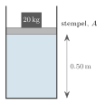
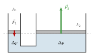
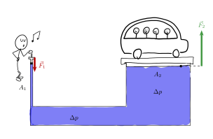
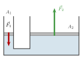

:::: {.oppgaver}



Når vi utøver et ytre trykk $\Delta p$ på en væske som er i ro, vil trykket i hele væsken øke med samme mengde $\Delta p$. Dette betyr at trykkøkningen er lik i alle retninger, uavhengig av væskens høyde. Selv om trykkøkningen er konstant, vil det totale trykket fortsatt variere med høyden på grunn av det hydrostatiske trykket.

::: {.eksempel}
[Eksempel: Lodd på et stempel]{.eks-tittel}

En sylinderformet beholder er fylt med vann og lukket med et tett stempel som kan gli uten friksjon. Stempelet har areal $A = 0.010\,\mathrm{m}^{2}$, og vi ser bort fra massen til stempelet. Over stempelet er det luft med trykket $p_0 = 1.013\cdot 10^{5}\,\mathrm{Pa}$. Vi legger et lodd med masse $m = 20\,\mathrm{kg}$ på stempelet.

a)  Hvor mye øker trykket i vannet like under stempelet?

b)  Hvor mye øker trykket i bunnen av beholderen, $0.50\,\mathrm{m}$ under stempelet?

c)  Hva er det totale trykket i bunnen av beholderen?

::: center
{.tikz-fig style="width:227px"}

[Et lodd ligger på et stempel som stenger inne vann i en beholder.]{.figurtekst}
:::

:::

::: {.callout-note .svar collapse="true" title="Vis løsning"}

**a)** Loddet presser på stempelet med en kraft lik tyngden sin, $F = m\mathrm{g}$. Denne kraften fordeles over stempelets areal, og trykkøkningen like under stempelet er $$\Delta p = \frac{m\mathrm{g}}{A} = \frac{20\,\mathrm{kg}\cdot9.81\,\mathrm{m}\,\mathrm{s}^{-2}}{0.010\,\mathrm{m}^{2}} = 19620\,\mathrm{Pa} \approx \underline{\underline{2.0\cdot 10^{4}\,\mathrm{Pa}}}$$

**b)** Etter Pascals lov forplanter trykkøkningen seg uforminsket til hele væsken. Trykket i bunnen øker derfor med akkurat like mye: $$\Delta p_\text{bunn} = \Delta p \approx \underline{\underline{2.0\cdot 10^{4}\,\mathrm{Pa}}}$$

**c)** Det totale trykket i bunnen er summen av lufttrykket, trykkøkningen på grunn av vekten av loddet, samt det hydrostatiske trykket fra vannet: $$p = p_0 + \Delta p + \rho\mathrm{g}h = 1.013\cdot 10^{5}\,\mathrm{Pa} + 19620\,\mathrm{Pa} + 1000\,\mathrm{kg}\,\mathrm{m}^{-3}\cdot9.81\,\mathrm{m}\,\mathrm{s}^{-2}\cdot0.50\,\mathrm{m}$$ $$p = 1.013\cdot 10^{5}\,\mathrm{Pa} + 1.96\cdot 10^{4}\,\mathrm{Pa} + 4.9\cdot 10^{3}\,\mathrm{Pa} = 1.26\cdot 10^{5}\,\mathrm{Pa} \approx \underline{\underline{1.3\cdot 10^{5}\,\mathrm{Pa}}}$$

:::



Pascals lov blir særlig nyttig når to stempler med ulikt areal er koblet sammen gjennom den samme væsken. Trykkøkningen er den samme ved begge stemplene, men kraften er trykk ganget med areal. Da blir kraften størst på det største stempelet. Dette er prinsippet bak den hydrauliske jekken.

La oss se hvordan dette fungerer. Figuren viser et lite stempel med areal $A_1$ og et stort stempel med areal $A_2$. Stemplene står i samme høyde, og de er koblet sammen gjennom den samme væsken.

::: center
{.tikz-fig style="width:361px"}

[To stempler koblet sammen gjennom samme væske. Kraften $\vec{F}_1$ på det lille stempelet gir en trykkøkning $\Delta p$ i væsken. Den samme trykkøkningen virker under det store stempelet og gir kraften $\vec{F}_2$.]{.figurtekst}
:::

Vi presser ned på det lille stempelet med kraften $F_1$. Kraften fordeles over arealet $A_1$, så trykket i væsken like under det lille stempelet øker med $$\Delta p = \frac{F_1}{A_1}$$ Etter Pascals lov forplanter denne trykkøkningen seg uforminsket gjennom hele væsken. Under det store stempelet, i samme høyde, øker trykket derfor med den samme $\Delta p$. Væsken presser da opp på det store stempelet med kraften $$F_2 = \Delta p\cdot A_2
    \quad\Longrightarrow\quad
    \Delta p = \frac{F_2}{A_2}$$ Trykkøkningen er den samme i begge uttrykkene, så vi kan sette dem lik hverandre: $$\frac{F_1}{A_1} = \frac{F_2}{A_2}
    \quad\Longrightarrow\quad
    F_2 = F_1\cdot\frac{A_2}{A_1}$$ Kraften på det store stempelet blir altså så mange ganger større enn $F_1$ som arealet $A_2$ er større enn $A_1$.

::: {.callout-note title="Definisjon: Pascals lov i hydrauliske systemer"}

For to stempler i samme høyde, koblet sammen gjennom samme væske i ro, er $$\begin{aligned}
        \frac{F_1}{A_1} = \frac{F_2}{A_2}
\end{aligned}$$

:::

:::: figure
{.tikz-fig style="width:587px"}

::: caption
Pascals lov i et hydraulisk system. Personen presser lett ned på det lille stempelet (areal $A_1$) med kraften $\vec{F}_1$. Trykkøkningen $\Delta p$ forplanter seg gjennom væsken, og væsken presser opp på det store stempelet (areal $A_2$) med en mye større kraft $\vec{F}_2$, som løfter bilen. $\vec{F}_2$ virker på undersiden av det store stempelet. Pila er flyttet ut til siden langs den stiplede linjen.
:::
::::

::: {.eksempel}
[Eksempel: Hydraulisk jekk]{.eks-tittel}

En hydraulisk jekk har to stempler. Det lille stempelet har areal $A_1 = 5.0\,\mathrm{cm}^{2} = 5.0\cdot 10^{-4}\,\mathrm{m}^{2}$ og det store stempelet har areal $A_2 = 200\,\mathrm{cm}^{2} = 2.0\cdot 10^{-2}\,\mathrm{m}^{2}$. En kraft $F_1 = 50\,\mathrm{N}$ påføres det lille stempelet. Hva er kraften $F_2$ fra væsken på det store stempelet?

::: center
{.tikz-fig style="width:277px"}

[Hydraulisk jekk. Kraften $\vec{F}_1$ virker på det lille stempelet, og væsken presser opp på det store stempelet med kraften $\vec{F}_2$. Figuren er ikke i målestokk.]{.figurtekst}
:::

:::

::: {.callout-note .svar collapse="true" title="Vis løsning"}

Fra Pascals lov er trykkøkningen den samme ved begge stemplene: $$\frac{F_1}{A_1} = \frac{F_2}{A_2}
  \implies
  F_2 = F_1 \cdot \frac{A_2}{A_1}
      = 50\,\mathrm{N} \cdot \frac{2.0\cdot 10^{-2}\,\mathrm{m}^{2}}{5.0\cdot 10^{-4}\,\mathrm{m}^{2}}
      = \underline{\underline{2.0\cdot 10^{3}\,\mathrm{N}}}$$ Med et lite stempel kan vi altså løfte en last som er 40 ganger så tung — det er prinsippet bak bilheis og hydrauliske bremser.

:::

::: {.oppgave tittel="Billøfter på verkstedet"}
[Billøfter på verkstedet]{.oppg-tittel}

En billøfter på et verksted virker som en hydraulisk jekk. Det lille stempelet har diameter $2.0\,\mathrm{cm}$, og det store stempelet har diameter $20\,\mathrm{cm}$. En bil med masse $1500\,\mathrm{kg}$ står på det store stempelet. Vi ser bort fra massen til stemplene og antar at begge stemplene er i samme høyde.

a)  Hvor mange ganger større er arealet av det store stempelet enn arealet av det lille? (Arealet av en sirkel er $A = \pi r^2$.)

b)  Hvor stor kraft må virke på det lille stempelet for å holde bilen oppe?

c)  Det lille stempelet presses $10\,\mathrm{cm}$ ned. Hvor mye løftes bilen? *Hint: Væsken som presses ut av den lille sylinderen, må gå inn i den store.*

d)  Regn ut arbeidet som gjøres på det lille stempelet, og arbeidet som gjøres på bilen. Hva ser du? Får vi noe «gratis» med en hydraulisk jekk?

::: {.losning}

**a)** Radiene er $r_1 = 1.0\,\mathrm{cm}$ og $r_2 = 10\,\mathrm{cm}$. Forholdet mellom arealene er $$\frac{A_2}{A_1} = \frac{\pi r_2^2}{\pi r_1^2} = \left(\frac{r_2}{r_1}\right)^2 = \left(\frac{10\,\mathrm{cm}}{1.0\,\mathrm{cm}}\right)^2 = \underline{\underline{100}}$$ Når diameteren blir ti ganger så stor, blir arealet hundre ganger så stort.

**b)** For å holde bilen oppe må kraften fra væsken på det store stempelet være lik tyngden av bilen, $F_2 = m\mathrm{g} = 1500\,\mathrm{kg}\cdot9.81\,\mathrm{m}\,\mathrm{s}^{-2} = 14715\,\mathrm{N}$. Fra Pascals lov (se *Pascals lov*): $$\frac{F_1}{A_1} = \frac{F_2}{A_2}
    \quad\implies\quad
    F_1 = F_2\cdot\frac{A_1}{A_2} = \frac{14715\,\mathrm{N}}{100} = 147\,\mathrm{N} \approx \underline{\underline{1.5\cdot 10^{2}\,\mathrm{N}}}$$ Det tilsvarer tyngden av omtrent $15\,\mathrm{kg}$.

**c)** Væsken kan ikke presses sammen, så volumet som presses ut av den lille sylinderen, må være lik volumet som går inn i den store: $$A_1 s_1 = A_2 s_2
    \quad\implies\quad
    s_2 = s_1\cdot\frac{A_1}{A_2} = \frac{10\,\mathrm{cm}}{100} = 0.10\,\mathrm{cm} = \underline{\underline{1.0\,\mathrm{mm}}}$$

**d)** Arbeidet på det lille stempelet: $$W_1 = F_1 s_1 = 147\,\mathrm{N}\cdot0.10\,\mathrm{m} = 14.7\,\mathrm{J} \approx \underline{\underline{15\,\mathrm{J}}}$$ Arbeidet på bilen: $$W_2 = F_2 s_2 = 14715\,\mathrm{N}\cdot1.0\cdot 10^{-3}\,\mathrm{m} = 14.7\,\mathrm{J} \approx \underline{\underline{15\,\mathrm{J}}}$$ Arbeidene er like store. Den hydrauliske jekken gir oss en hundre ganger større kraft, men vi må presse det lille stempelet hundre ganger lenger enn bilen løftes. Vi får altså ikke noe gratis: energien er bevart.

:::

:::

::: {.oppgave tittel="Hydrauliske bremser"}
[Hydrauliske bremser]{.oppg-tittel}

Når du tråkker på bremsepedalen i en bil, presses et lite stempel inn i en sylinder med bremsevæske. Røret med bremsevæske fører videre til et stempel ved hvert av de fire hjulene. Stempelet ved pedalen har areal $1.5\,\mathrm{cm}^{2}$, og hvert av stemplene ved hjulene har areal $9.0\,\mathrm{cm}^{2}$. Kraften fra pedalen på det lille stempelet er $200\,\mathrm{N}$.

a)  Finn trykkøkningen i bremsevæsken.

b)  Finn kraften fra bremsevæsken på hvert av stemplene ved hjulene.

c)  Rørene fram til hjulene har ulik lengde. Hvorfor blir likevel kraften på stempelet like stor ved alle fire hjulene?

::: {.losning}

**a)** Trykkøkningen er kraften delt på arealet til det lille stempelet, $A_1 = 1.5\cdot 10^{-4}\,\mathrm{m}^{2}$: $$\Delta p = \frac{F_1}{A_1} = \frac{200\,\mathrm{N}}{1.5\cdot 10^{-4}\,\mathrm{m}^{2}} = 1.33\cdot 10^{6}\,\mathrm{Pa} \approx \underline{\underline{1.3\cdot 10^{6}\,\mathrm{Pa}}}$$

**b)** Etter Pascals lov får bremsevæsken den samme trykkøkningen overalt. Kraften på hvert stempel ved hjulene, med $A_2 = 9.0\cdot 10^{-4}\,\mathrm{m}^{2}$, er da $$F_2 = \Delta p\cdot A_2 = 1.33\cdot 10^{6}\,\mathrm{Pa}\cdot9.0\cdot 10^{-4}\,\mathrm{m}^{2} = \underline{\underline{1.2\cdot 10^{3}\,\mathrm{N}}}$$ Hvert stempel ved hjulene får altså en kraft som er seks ganger så stor som kraften fra pedalen.

**c)** Ifølge Pascals lov forplanter trykkøkningen seg uforminsket til alle deler av væsken, uansett hvor lange rørene er og hvilken vei de går. Siden stemplene ved hjulene har samme areal, blir kraften $F = \Delta p\cdot A$ like stor ved alle fire hjulene. Bilen bremser derfor likt på alle hjulene.

:::

:::

::::
