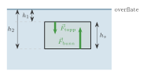
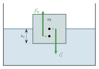
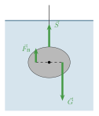
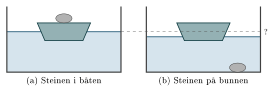
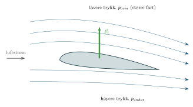
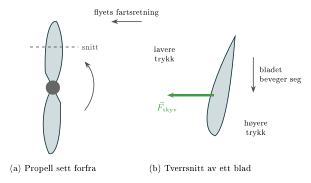

:::: {.oppgaver}

Når et legeme er omgitt av en væske, utøves en oppdriftskraft på legemet. Denne kraften skyldes at trykket varierer langs legemets høyde. La oss se nærmere på dette.

Tenk deg et rektangulært legeme med grunnflate $A$ og høyde $h_s$, som er senket helt ned i en væske. Toppen er på dybden $h_1$, og bunnen er på dybden $h_2 = h_1 + h_s$:

::: center
{.tikz-fig style="width:362px"}

[Trykkreftene på toppen og bunnen av et legeme under vann. Kraften på bunnen er større enn kraften på toppen, fordi trykket er større lenger ned.]{.figurtekst}
:::



Trykkraften *ned* på toppen er $F_{\text{topp}} = p_1\cdot A = (p_0+\rho_v \mathrm{g} h_1)\,A$, og kraften *opp* på bunnen er $F_{\text{bunn}} = p_2 \cdot A = (p_0+\rho_v \mathrm{g} h_2)\,A$. Merk forøvrig at trykkreftene på sidene er like store fra begge kanter og opphever hverandre. Kraftsummen fra trykket på legemet kaller vi *oppdriftskraften* $F_{\textrm{B}}$. Bokstaven B står for det engelske ordet *buoyancy*, som betyr oppdrift. Oppdriftskraften er gitt ved: $$F_{\textrm{B}} = F_{\text{bunn}} - F_{\text{topp}}
    = \rho_v \mathrm{g} A (h_2 - h_1)
    = \rho_v \mathrm{g} A h_s
    = \rho_v \mathrm{g} V_\text{f}$$ Leddet $\rho_v$ er tettheten til væsken, $\mathrm{g}$ er tyngdeakselerasjonen, og $V_\text{f}$ er volumet av væsken som fortrenges av legemet. Dermed ser vi at oppdriftskraften $F_{\textrm{B}}$ er direkte knyttet til vekten av væsken som fortrenges av legemet.

Forskjellen mellom trykkreftene på oversiden og undersiden av legemet gir altså et netto løft, kalt oppdriftskraften $F_{\textrm{B}}$.

::: {.callout-note title="Definisjon: Arkimedes’ oppdriftslov"}

Oppdriftskraften $F_{\textrm{B}}$ på et legeme omgitt av en væske i ro kan uttrykkes som: $$\begin{aligned}
        F_{\textrm{B}} = \rho_v \mathrm{g} V_\text{f}
\end{aligned}$$ Her er $\rho_v$ tettheten til væsken, $\mathrm{g}$ er tyngdeakselerasjonen, og $V_\text{f}$ er volumet av væsken under vann. Volumet av legemet i væsken må naturligvis være like stort som volumet av den fortrengte væsken. Dermed ser vi at oppdriftskraften $F_{\textrm{B}}$ er direkte knyttet til tyngden av den fortrengte væsken!

:::

:::: figure
{.tikz-fig style="width:381px"}

::: caption
Et legeme med masse $m$ flyter i vann. Det fortrengte volumet er den delen av legemet som er under vannflaten, $V_\text{f} = h_\text{f}\cdot A$, der $h_\text{f}$ er hvor dypt legemet stikker ned, og $A$ er arealet av bunnflaten. Begge kreftene angriper på legemets midtlinje: oppdriftskraften $\vec{F}_{\textrm{B}}$ i sentrum av det fortrengte volumet og tyngdekraften $\vec{G}$ i massesenteret (prikkene). Pilene er skjøvet litt ut til hver side langs de stiplede linjene, slik at de ikke tegnes oppå hverandre.
:::
::::

::: {.eksempel}
[Eksempel: Stein i vann]{.eks-tittel}

Du holder en stein i en snor, slik at steinen henger i ro helt under vann. Steinen har masse $m = 5.4\,\mathrm{kg}$ og volum $V = 2.0\,\mathrm{L}$.

a)  Tegn kreftene som virker på steinen.

b)  Finn oppdriftskraften på steinen.

c)  Finn snorkraften $S$. Sammenlign med snorkraften som trengs for å holde steinen i lufta.

:::

::: {.callout-note .svar collapse="true" title="Vis løsning"}

**a)** Tre krefter virker på steinen: tyngdekraften $\vec{G}$ nedover, oppdriftskraften $\vec{F}_{\textrm{B}}$ oppover og snorkraften $\vec{S}$ oppover.

::: center
{.tikz-fig style="width:243px"}

[Kreftene som virker på steinen. $\vec{G}$ og $\vec{F}_{\textrm{B}}$ angriper begge i sentrum av steinen (prikken). Pilene er flyttet ut til hver sin side langs den stiplede linjen, slik at de ikke tegnes oppå hverandre.]{.figurtekst}
:::

**b)** Steinen er helt under vann, så det fortrengte volumet er hele steinens volum, $V_\text{f} = 2.0\,\mathrm{L} = 2.0\cdot 10^{-3}\,\mathrm{m}^{3}$: $$F_{\textrm{B}} = \rho_v\mathrm{g}V_\text{f} = 1000\,\mathrm{kg}\,\mathrm{m}^{-3}\cdot9.81\,\mathrm{m}\,\mathrm{s}^{-2}\cdot2.0\cdot 10^{-3}\,\mathrm{m}^{3} = 19.6\,\mathrm{N} \approx \underline{\underline{20\,\mathrm{N}}}$$

**c)** Steinen er i ro, så $\sum F = 0$. Med positiv retning oppover: $$S + F_{\textrm{B}} - G = 0 \quad\implies\quad S = G - F_{\textrm{B}}$$ Tyngdekraften er $G = m\mathrm{g} = 5.4\,\mathrm{kg}\cdot9.81\,\mathrm{m}\,\mathrm{s}^{-2} = 53.0\,\mathrm{N}$, så $$S = 53.0\,\mathrm{N} - 19.6\,\mathrm{N} = 33.4\,\mathrm{N} \approx \underline{\underline{33\,\mathrm{N}}}$$ I lufta må snora holde hele tyngden, $53\,\mathrm{N}$ (oppdriften i luft er så liten at vi kan se bort fra den). Under vann trenger snora bare å holde $33\,\mathrm{N}$. Derfor føles steiner lettere når vi løfter dem under vann.

:::

For å avgjøre om et legeme flyter eller synker, må vi sammenligne oppdriftskraften med tyngdekraften på legemet. Tyngdekraften $G$ avhenger av legemets masse $m$ og tyngdeakselerasjonen $\mathrm{g}$. Hvis massen til legemet uttrykkes som $m = \rho_L V$, der $\rho_L$ er legemets tetthet og $V$ er volumet, kan tyngdekraften skrives som: $$G = m \mathrm{g} = \rho_L V \mathrm{g}.$$ Nå har vi både oppdriftskraften og tyngdekraften uttrykt ved tettheter og volum. Det gjør det lett å sammenligne dem.

Nettokraften på et legeme med tetthet $\rho_L$ og volum $V$ helt nedsenket i en væske med tetthet $\rho_v$ er: $$F_{\text{netto}} = F_{\textrm{B}} - G = \rho_v \mathrm{g} V - \rho_L \mathrm{g} V = (\rho_v - \rho_L)\,\mathrm{g} V$$

::: {.graa}
-   $\rho_L < \rho_v$: $F_{\text{netto}} > 0$ — legemet **flyter** (akselererer opp til det er delvis ute av væsken).

-   $\rho_L = \rho_v$: $F_{\text{netto}} = 0$ — legemet **svever** i likevekt inne i væsken.

-   $\rho_L > \rho_v$: $F_{\text{netto}} < 0$ — legemet **synker**.
:::

Når et legeme flyter i ro på overflaten, er bare en del av det under væsken. Da er oppdriftskraften akkurat like stor som tyngdekraften, $F_{\textrm{B}} = G$.

::: {.callout-important title="Merk: Stål flyter ikke i vann — men et stålskip gjør det!"}

Stål har tetthet $\rho \approx 7850\,\mathrm{kg}\,\mathrm{m}^{-3}$, langt høyere enn vann. Likevel flyter et skip laget av stål, fordi *skipet som helhet* — stål pluss luft inni — har en gjennomsnittlig tetthet *lavere* enn vann. Det er den totale massen delt på det totale volumet som avgjør.

:::

::: {.eksempel}
[Eksempel: Toppen av isfjellet]{.eks-tittel}

Et isfjell flyter i sjøen. Hvor stor andel av isfjellet ligger under vann? Bruk tettheter fra tabellen.

:::

::: {.callout-note .svar collapse="true" title="Vis løsning"}

Isfjellet flyter i ro, så oppdriftskraften er like stor som tyngdekraften: $$F_{\textrm{B}} = G$$ La $V$ være hele volumet til isfjellet og $V_\text{f}$ volumet som er under vann. Vi setter inn uttrykkene for $F_{\textrm{B}}$ og $G$: $$\rho_\text{sjø}\,\mathrm{g}\,V_\text{f} = \rho_\text{is}\,\mathrm{g}\,V$$ Vi deler på $\mathrm{g}$ og på $V$ på begge sider og får $$\frac{V_\text{f}}{V} = \frac{\rho_\text{is}}{\rho_\text{sjø}} = \frac{0.92\cdot 10^{3}\,\mathrm{kg}\,\mathrm{m}^{-3}}{1.03\cdot 10^{3}\,\mathrm{kg}\,\mathrm{m}^{-3}} = 0.893 \approx \underline{\underline{89\,\%}}$$ Omtrent ni tideler av isfjellet ligger altså under vann, og bare én tidel stikker opp. Det er derfor vi sier at noe bare er «toppen av isfjellet».

:::

::: {.eksempel}
[Eksempel: Oppdrift på en båt]{.eks-tittel}

En båt har et volum på $V = 9.0 \, \text{m}^3$, og $12\%$ av dette volumet er under vann.

a)  Hva er oppdriftskraften på båten?

b)  Hva er massen til båten?

:::

::: {.callout-note .svar collapse="true" title="Vis løsning"}

**a)** Volumet av vann som fortrenges er: $$V_\text{f} = 0.12 \cdot V = 0.12 \cdot 9.0 \, \text{m}^3 = 1.08 \, \text{m}^3.$$ Oppdriftskraften beregnes ved å bruke formelen for oppdrift: $$F_{\textrm{B}} = \rho_v \mathrm{g} V_\text{f} = 1000 \, \text{kg/m}^3 \cdot 9.81 \, \text{m/s}^2 \cdot 1.08 \, \text{m}^3 = 10594.8 \, \text{N} \approx \underline{\underline{11 \, \text{kN}}}.$$

**b)** Når båten flyter, er oppdriftskraften lik tyngdekraften på båten: $$F_{\textrm{B}} = G = m \mathrm{g}.$$ Vi løser for massen $m$: $$m = \frac{F_{\textrm{B}}}{\mathrm{g}} = \frac{10594.8 \, \text{N}}{9.81 \, \text{m/s}^2} = 1080 \, \text{kg} \approx \underline{\underline{1.1 \cdot 10^3 \, \text{kg}}}.$$ Legg merke til at båtens masse er lik massen til vannet den fortrenger, $\rho_v V_\text{f} = 1080\,\mathrm{kg}$. Det er nettopp det Arkimedes’ lov sier.

:::

::: {.eksempel}
[Eksempel: Stein, båt og basseng]{.eks-tittel}

En liten båt flyter i et basseng. I båten ligger en stein med masse $m_\text{s} = 3.0\,\mathrm{kg}$ og massetetthet $\rho_\text{s} = 2.5\cdot 10^{3}\,\mathrm{kg}\,\mathrm{m}^{-3}$. Vannflaten i bassenget har areal $A = 2.0\,\mathrm{m}^{2}$. Du tar steinen ut av båten og slipper den ned i bassenget, der den synker til bunnen (se figuren).

Når står vannet høyest i bassenget: når steinen ligger i båten, eller når steinen ligger på bunnen av bassenget?

a)  Finn volumet av vann som fortrenges på grunn av steinen når steinen ligger i båten.

b)  Finn volumet av vann som fortrenges på grunn av steinen når den ligger på bunnen.

c)  Hvor mye høyere står vannet i det ene tilfellet enn i det andre?

::: center
{.tikz-fig style="width:538px"}

[En båt med en stein flyter i et basseng. (a) Steinen ligger i båten. (b) Steinen er sluppet ned i bassenget og ligger på bunnen. Den stiplede linjen viser vannstanden i (a). Figuren er ikke i målestokk.]{.figurtekst}
:::

:::

::: {.callout-note .svar collapse="true" title="Vis løsning"}

Båten fortrenger like mye vann på grunn av sin egen masse i begge tilfellene. Vi trenger derfor bare å se på hvor mye vann som fortrenges på grunn av *steinen*.

**a)** Når steinen ligger i båten, flyter båten og steinen sammen. Da er oppdriftskraften lik tyngden: $F_{\textrm{B}} = G$. Den ekstra oppdriftskraften som trengs for å bære steinen, er lik tyngden av steinen: $$\rho_v\mathrm{g}V_1 = m_\text{s}\mathrm{g}
    \quad\implies\quad
    V_1 = \frac{m_\text{s}}{\rho_v} = \frac{3.0\,\mathrm{kg}}{1.0\cdot 10^{3}\,\mathrm{kg}\,\mathrm{m}^{-3}} = \underline{\underline{3.0\cdot 10^{-3}\,\mathrm{m}^{3}}}$$ Båten må altså fortrenge vann med *samme masse* som steinen, $3.0\,\mathrm{L}$.

**b)** Når steinen ligger på bunnen, fortrenger den bare sitt eget volum: $$V_2 = \frac{m_\text{s}}{\rho_\text{s}} = \frac{3.0\,\mathrm{kg}}{2.5\cdot 10^{3}\,\mathrm{kg}\,\mathrm{m}^{-3}} = \underline{\underline{1.2\cdot 10^{-3}\,\mathrm{m}^{3}}}$$ Det er bare $1.2\,\mathrm{L}$, fordi steinen har større massetetthet enn vann.

**c)** Når et volum $V$ vann blir fortrengt, stiger vannflaten med $\Delta h = V/A$. Forskjellen i vannstand er derfor $$\Delta h = \frac{V_1 - V_2}{A} = \frac{3.0\cdot 10^{-3}\,\mathrm{m}^{3} - 1.2\cdot 10^{-3}\,\mathrm{m}^{3}}{2.0\,\mathrm{m}^{2}} = 9.0\cdot 10^{-4}\,\mathrm{m} = \underline{\underline{0.90\,\mathrm{mm}}}$$ Vannet står altså **høyest når steinen ligger i båten**. Når du slipper steinen ned i bassenget, synker vannstanden litt. Grunnen er at en flytende stein må fortrenge vann med like stor *masse* som seg selv, mens en stein på bunnen bare fortrenger vann med like stort *volum* som seg selv.

:::

## Ekstra: Løft på flyvinger og propeller

Oppdriftskraften skyldes at trykket på undersiden av et legeme er større enn trykket på oversiden. Det samme prinsippet, at en trykkforskjell gir en netto kraft, forklarer også hvordan en flyvinge holder et fly oppe. Forskjellen er at trykkforskjellen nå ikke skyldes dybden, men at lufta *strømmer* rundt vingen.

Et tverrsnitt av en flyvinge kalles en *vingeprofil* (på engelsk *airfoil*). Profilen er avrundet foran, spiss bak, og som regel mer krummet på oversiden enn på undersiden. I tillegg er vingen gjerne vinklet litt opp i forkant. Når flyet beveger seg framover, strømmer lufta rundt vingen. Formen og vinkelen gjør at lufta over vingen strømmer *fortere* enn lufta under, og at lufta bøyes nedover bak vingen. Akkurat som i det smale røret i figuren gjelder det at der lufta strømmer fortere, er trykket lavere. Trykket på oversiden av vingen blir derfor lavere enn trykket på undersiden.

::: center
{.tikz-fig style="width:635px"}

[Tverrsnitt av en flyvinge med strømlinjer. Lufta strømmer fortere over vingen enn under (strømlinjene ligger tettere), og trykket over vingen blir lavere enn trykket under. Trykkforskjellen gir en netto kraft oppover: løftet $\vec{F}_\text{L}$.]{.figurtekst}
:::

Akkurat som for oppdriftskraften får vi altså en netto kraft oppover, fordi lufta presser hardere på undersiden enn på oversiden. Denne kraften kalles *løftet* $F_\text{L}$ (L for det engelske *lift*). Er trykkforskjellen $\Delta p = p_\text{under} - p_\text{over}$ og vingearealet $A$, er løftet omtrent $$F_\text{L} \approx \Delta p \cdot A$$ Trykkforskjellen trenger ikke være stor. Et lite fly med masse $1.0\cdot 10^{3}\,\mathrm{kg}$ og vingeareal $16\,\mathrm{m}^{2}$ holdes oppe i jevn flukt når $F_\text{L} = G$. Det gir $\Delta p = m\mathrm{g}/A = 9.81\cdot 10^{3}\,\mathrm{N}/16\,\mathrm{m}^{2} \approx 6.1\cdot 10^{2}\,\mathrm{Pa}$. Det er under én prosent av lufttrykket!

::: {.callout-important title="Merk: En vanlig misforståelse"}

Det sies ofte at lufta over og under vingen må bruke like lang tid fra forkanten til bakkanten, og at lufta over derfor må gå fortere fordi veien er lengre. Det stemmer ikke. Lufta over vingen kommer faktisk fram til bakkanten *før* lufta under. Det er formen og vinkelen på vingen som bestemmer hvordan lufta strømmer. Vingen bøyer lufta nedover, og etter Newtons tredje lov dytter lufta da vingen oppover. Trykkforskjellen og nedbøyingen av lufta er to sider av samme sak.

:::

En *propell* virker på samme måte. Hvert propellblad er en liten vinge som roterer. Bladet har en vingeprofil, men er vendt slik at «oversiden» peker framover. Når propellen roterer, strømmer lufta fortere over den fremre siden av bladet, og trykket der blir lavere enn på baksiden. Trykkforskjellen gir en kraft framover, som vi kaller *skyvekraften*. Den trekker flyet framover. Det samme prinsippet brukes i båtpropeller, vifter, helikopterrotorer og vindturbiner.

::: center
{.tikz-fig style="width:602px"}

[(a) En propell sett forfra. Bladene roterer, og hvert blad har en vingeprofil. (b) Tverrsnitt av ett blad, sett fra siden. Flyet beveger seg mot venstre, og bladet beveger seg nedover i figuren. Trykket er lavere på den fremre siden av bladet enn på baksiden. Trykkforskjellen gir skyvekraften $\vec{F}_\text{skyv}$, som peker framover.]{.figurtekst}
:::

::: {.oppgave tittel="Er kronen av gull?"}
[Er kronen av gull?]{.oppg-tittel}

Ifølge en gammel fortelling fikk Arkimedes i oppdrag av kongen å finne ut om en ny krone var laget av rent gull. Vi gjør et tilsvarende forsøk. En krone har masse $1.00\,\mathrm{kg}$. Vi henger kronen i en kraftmåler og senker den helt ned i vann. Mens kronen henger i ro under vann, viser kraftmåleren $9.15\,\mathrm{N}$.

a)  Tegn kreftene som virker på kronen mens den henger under vann.

b)  Finn oppdriftskraften på kronen.

c)  Finn volumet til kronen.

d)  Finn massetettheten til kronen. Er den laget av rent gull?

::: {.losning}

**a)** Tre krefter virker på kronen: tyngdekraften $\vec{G}$ nedover, oppdriftskraften $\vec{F}_{\textrm{B}}$ oppover og kraften $\vec{S}$ fra kraftmåleren oppover. Det er $S$ som kraftmåleren viser.

**b)** Kronen henger i ro, så $\sum F = 0$: $$S + F_{\textrm{B}} - G = 0 \quad\implies\quad F_{\textrm{B}} = G - S$$ Tyngdekraften er $G = m\mathrm{g} = 1.00\,\mathrm{kg}\cdot9.81\,\mathrm{m}\,\mathrm{s}^{-2} = 9.81\,\mathrm{N}$, så $$F_{\textrm{B}} = 9.81\,\mathrm{N} - 9.15\,\mathrm{N} = \underline{\underline{0.660\,\mathrm{N}}}$$

**c)** Kronen er helt under vann, så det fortrengte volumet er lik volumet til kronen. Fra $F_{\textrm{B}} = \rho_v\mathrm{g}V$ (se *Oppdriftskraft*): $$V = \frac{F_{\textrm{B}}}{\rho_v\mathrm{g}} = \frac{0.660\,\mathrm{N}}{1000\,\mathrm{kg}\,\mathrm{m}^{-3}\cdot9.81\,\mathrm{m}\,\mathrm{s}^{-2}} = 6.728\cdot 10^{-5}\,\mathrm{m}^{3} \approx \underline{\underline{6.73\cdot 10^{-5}\,\mathrm{m}^{3}}}$$

**d)** Massetettheten er $$\rho = \frac{m}{V} = \frac{1.00\,\mathrm{kg}}{6.73\cdot 10^{-5}\,\mathrm{m}^{3}} = 1.486\cdot 10^{4}\,\mathrm{kg}\,\mathrm{m}^{-3} \approx \underline{\underline{1.49\cdot 10^{4}\,\mathrm{kg}\,\mathrm{m}^{-3}}}$$ Rent gull har $\rho = 19.3\cdot 10^{3}\,\mathrm{kg}\,\mathrm{m}^{-3}$. Kronen har lavere tetthet, så den er **ikke laget av rent gull**. Den er trolig blandet med et lettere metall, for eksempel sølv. En krone av rent gull ville hatt mindre volum, fått mindre oppdrift, og kraftmåleren ville vist omtrent $9.30\,\mathrm{N}$.

:::

:::

::: {.oppgave tittel="Trekloss som flyter"}
[Trekloss som flyter]{.oppg-tittel}

En rektangulær trekloss er $20\,\mathrm{cm}$ lang, $10\,\mathrm{cm}$ bred og $10\,\mathrm{cm}$ høy. Treet har massetetthet $600\,\mathrm{kg}\,\mathrm{m}^{-3}$. Klossen legges i vann, der den flyter med den største flaten ned.

a)  Finn massen til klossen.

b)  Hvor stor andel av klossens volum er under vann?

c)  Hvor dypt stikker klossen ned i vannet?

d)  Hvor stor masse kan du legge oppå klossen før den synker helt ned under vannflaten?

::: {.losning}

**a)** Volumet til klossen er $$V = 0.20\,\mathrm{m}\cdot0.10\,\mathrm{m}\cdot0.10\,\mathrm{m} = 2.0\cdot 10^{-3}\,\mathrm{m}^{3},$$ og massen er $$m = \rho_L V = 600\,\mathrm{kg}\,\mathrm{m}^{-3}\cdot2.0\cdot 10^{-3}\,\mathrm{m}^{3} = \underline{\underline{1.2\,\mathrm{kg}}}$$

**b)** Klossen flyter i ro, så oppdriftskraften er lik tyngdekraften, $F_{\textrm{B}} = G$: $$\rho_v\mathrm{g}V_\text{f} = \rho_L\mathrm{g}V
    \quad\implies\quad
    \frac{V_\text{f}}{V} = \frac{\rho_L}{\rho_v} = \frac{600\,\mathrm{kg}\,\mathrm{m}^{-3}}{1000\,\mathrm{kg}\,\mathrm{m}^{-3}} = 0.60 = \underline{\underline{60\,\%}}$$ (Dette er samme fremgangsmåte som i eksempelet *Toppen av isfjellet*.)

**c)** Klossen ligger med den største flaten ned, så høyden er $10\,\mathrm{cm}$. Siden 60 % av volumet er under vann, og grunnflaten er den samme hele veien opp, er også 60 % av høyden under vann: $$h_\text{f} = 0.60\cdot10\,\mathrm{cm} = \underline{\underline{6.0\,\mathrm{cm}}}$$

**d)** Den største oppdriftskraften klossen kan få, er når hele klossen er under vann, $V_\text{f} = V$: $$F_{\textrm{B},\text{maks}} = \rho_v\mathrm{g}V = 1000\,\mathrm{kg}\,\mathrm{m}^{-3}\cdot9.81\,\mathrm{m}\,\mathrm{s}^{-2}\cdot2.0\cdot 10^{-3}\,\mathrm{m}^{3} = 19.6\,\mathrm{N}$$ Denne kraften kan bære en total masse på $$m_\text{total} = \frac{F_{\textrm{B},\text{maks}}}{\mathrm{g}} = \frac{19.6\,\mathrm{N}}{9.81\,\mathrm{m}\,\mathrm{s}^{-2}} = 2.0\,\mathrm{kg}$$ Klossen selv har masse $1.2\,\mathrm{kg}$, så vi kan legge på $$\Delta m = 2.0\,\mathrm{kg} - 1.2\,\mathrm{kg} = \underline{\underline{0.80\,\mathrm{kg}}}$$

:::

:::

::::
