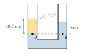

:::: {.oppgaver}

Oppgavene her kombinerer stoff fra flere delkapitler. Følger du en løype, ser du bare oppgavene du har gått gjennom stoffet til.

::: {.oppgave tittel="Lufta i et klasserom" krever="hydrostatikk/trykk"}
[Lufta i et klasserom]{.oppg-tittel}

Et klasserom er $5.0\,\mathrm{m}$ langt, $4.0\,\mathrm{m}$ bredt og $2.5\,\mathrm{m}$ høyt. Lufta har massetetthet $1.2\,\mathrm{kg}\,\mathrm{m}^{-3}$.

a)  Finn massen til lufta i klasserommet.

b)  Sammenlign med massen til en voksen person. Er svaret overraskende?

::: {.fasit}
$60\,\mathrm{kg}$
:::

:::

::: {.oppgave tittel="Dykking i sjøen" krever="hydrostatikk/trykk"}
[Dykking i sjøen]{.oppg-tittel}

En dykker svømmer $30\,\mathrm{m}$ under overflaten i sjøen. Sjøvann har massetetthet $1030\,\mathrm{kg}\,\mathrm{m}^{-3}$, og lufttrykket ved overflaten er $p_0 = 1.013\cdot 10^{5}\,\mathrm{Pa}$.

a)  Finn det totale trykket på dykkeren.

b)  Hvor mange ganger større er dette trykket enn lufttrykket ved overflaten?

::: {.fasit}
a) $4.0\cdot 10^{5}\,\mathrm{Pa}$ · b) $4.0$
:::

:::

::: {.oppgave tittel="Sugerør" krever="hydrostatikk/trykk"}
[Sugerør]{.oppg-tittel}

Når du drikker med sugerør, senker du trykket i munnen. Da er det lufttrykket på væskeoverflaten i glasset som presser væsken opp i sugerøret.

a)  Tenk deg at du klarer å fjerne all lufta i sugerøret, slik at trykket over vannet i røret blir null. Hvor høyt kan lufttrykket da presse vannet opp i røret? Lufttrykket er $p_0 = 1.013\cdot 10^{5}\,\mathrm{Pa}$.

b)  Kan man drikke vann med et $12\,\mathrm{m}$ langt sugerør, uansett hvor kraftig man suger? Begrunn svaret.

::: {.fasit}
$10.3\,\mathrm{m}$
:::

:::

::: {.oppgave tittel="Vindu i en ubåt" krever="hydrostatikk/trykk"}
[Vindu i en ubåt]{.oppg-tittel}

En ubåt ligger $100\,\mathrm{m}$ under overflaten i sjøen ($\rho = 1030\,\mathrm{kg}\,\mathrm{m}^{-3}$). Inne i ubåten er trykket det samme som lufttrykket ved overflaten. Ubåten har et vindu med areal $0.050\,\mathrm{m}^{2}$.

a)  Finn trykkforskjellen mellom utsiden og innsiden av vinduet.

b)  Finn nettokraften fra vannet og lufta på vinduet.

*Hint: Lufttrykket virker både på overflaten av sjøen og inne i ubåten.*

::: {.fasit}
a) $1.0\cdot 10^{6}\,\mathrm{Pa}$ · b) $5.1\cdot 10^{4}\,\mathrm{N}$
:::

:::

::: {.oppgave tittel="Heliumballong" krever="hydrostatikk/oppdrift, newtons-lover/newtons-lover"}
[Heliumballong]{.oppg-tittel}

Arkimedes’ lov gjelder ikke bare i væsker, men også i gasser. En ballong er fylt med $0.010\,\mathrm{m}^{3}$ helium. Helium har massetetthet $0.18\,\mathrm{kg}\,\mathrm{m}^{-3}$, og lufta rundt har massetetthet $1.2\,\mathrm{kg}\,\mathrm{m}^{-3}$. Selve ballongen (gummien og snora) har masse $3.0\,\mathrm{g}$. Vi ser bort fra volumet til gummien.

a)  Finn oppdriftskraften fra lufta på ballongen.

b)  Finn tyngdekraften på ballongen med helium.

c)  Vil ballongen stige eller synke? Finn nettokraften på ballongen.

::: {.fasit}
a) $0.12\,\mathrm{N}$ · b) $0.047\,\mathrm{N}$
:::

:::

::: {.oppgave tittel="Olje og vann i et U-rør" krever="hydrostatikk/trykk"}
[Olje og vann i et U-rør]{.oppg-tittel}

Et U-rør inneholder vann. I det venstre røret heller vi oppå vannet en $10.0\,\mathrm{cm}$ høy søyle med olje, som har massetetthet $800\,\mathrm{kg}\,\mathrm{m}^{-3}$. Olje og vann blander seg ikke. Når alt står i ro, ligger grenseflaten mellom olje og vann i den venstre delen av røret (se figuren).

::: center
{.tikz-fig style="width:284px"}
:::

a)  Punkt A ligger ved grenseflaten mellom olje og vann i det venstre røret, og punkt B ligger i samme høyde i det høyre røret. Forklar hvorfor trykket i A og B er likt.

b)  Hvor høyt over grenseflaten står vannet i det høyre røret?

c)  Hvor mye høyere står oljeoverflaten enn vannoverflaten?

::: {.losning}

**a)** Under punkt A er det bare vann, og vannet henger sammen gjennom bunnen av U-røret og opp til punkt B. A og B ligger altså på samme horisontale nivå i den samme sammenhengende væsken (vannet), og alt står i ro. Da er $p_A = p_B$.

(Over grenseflaten er det olje i det venstre røret og vann i det høyre. Der er det ikke samme væske på begge sider, og da kan vi ikke bruke denne regelen.)

**b)** Trykket i A skyldes lufta og oljesøylen over A. Trykket i B skyldes lufta og vannsøylen over B: $$p_A = p_0 + \rho_\text{olje}\mathrm{g}h_\text{olje}
    \qquad\text{og}\qquad
    p_B = p_0 + \rho_\text{vann}\mathrm{g}h_\text{vann}$$ Vi setter $p_A = p_B$. Da faller $p_0$ og $\mathrm{g}$ bort, og vi får $$\rho_\text{olje}h_\text{olje} = \rho_\text{vann}h_\text{vann}
    \quad\implies\quad
    h_\text{vann} = \frac{\rho_\text{olje}}{\rho_\text{vann}}\,h_\text{olje} = \frac{800}{1000}\cdot10.0\,\mathrm{cm} = \underline{\underline{8.0\,\mathrm{cm}}}$$

**c)** Oljeoverflaten ligger $10.0\,\mathrm{cm}$ over grenseflaten, og vannoverflaten ligger $8.0\,\mathrm{cm}$ over grenseflaten. Forskjellen er $$10.0\,\mathrm{cm} - 8.0\,\mathrm{cm} = \underline{\underline{2.0\,\mathrm{cm}}}$$ Oljen står høyest fordi den har lavere massetetthet enn vann. Det trengs en høyere oljesøyle for å gi det samme trykket.

:::

:::

::::
