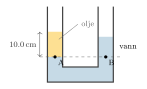

:::: {.oppgaver}

Her er flere oppgaver om temaene foran.

::: {.oppgave tittel="Lufta i et klasserom"}
[Lufta i et klasserom]{.oppg-tittel}

Et klasserom er $5.0\,\mathrm{m}$ langt, $4.0\,\mathrm{m}$ bredt og $2.5\,\mathrm{m}$ høyt. Lufta har massetetthet $1.2\,\mathrm{kg}\,\mathrm{m}^{-3}$.

a)  Finn massen til lufta i klasserommet.

b)  Sammenlign med massen til en voksen person. Er svaret overraskende?

::: {.losning}

**a)** Volumet av rommet er $$V = 5.0\,\mathrm{m}\cdot4.0\,\mathrm{m}\cdot2.5\,\mathrm{m} = 50\,\mathrm{m}^{3},$$ og massen til lufta er $$m = \rho V = 1.2\,\mathrm{kg}\,\mathrm{m}^{-3}\cdot50\,\mathrm{m}^{3} = \underline{\underline{60\,\mathrm{kg}}}$$

**b)** Lufta i klasserommet har omtrent like stor masse som en voksen person. Mange blir overrasket over dette, fordi vi ikke merker at lufta veier noe. Lufta har liten massetetthet, men et klasserom har et stort volum.

:::

:::

::: {.oppgave tittel="Dykking i sjøen"}
[Dykking i sjøen]{.oppg-tittel}

En dykker svømmer $30\,\mathrm{m}$ under overflaten i sjøen. Sjøvann har massetetthet $1030\,\mathrm{kg}\,\mathrm{m}^{-3}$, og lufttrykket ved overflaten er $p_0 = 1.013\cdot 10^{5}\,\mathrm{Pa}$.

a)  Finn det totale trykket på dykkeren.

b)  Hvor mange ganger større er dette trykket enn lufttrykket ved overflaten?

::: {.losning}

**a)** Vi bruker $p = p_0 + \rho\mathrm{g}h$: $$p = 1.013\cdot 10^{5}\,\mathrm{Pa} + 1030\,\mathrm{kg}\,\mathrm{m}^{-3}\cdot9.81\,\mathrm{m}\,\mathrm{s}^{-2}\cdot30\,\mathrm{m}$$ $$p = 1.013\cdot 10^{5}\,\mathrm{Pa} + 3.03\cdot 10^{5}\,\mathrm{Pa} = 4.04\cdot 10^{5}\,\mathrm{Pa} \approx \underline{\underline{4.0\cdot 10^{5}\,\mathrm{Pa}}}$$

**b)** $$\frac{p}{p_0} = \frac{4.04\cdot 10^{5}\,\mathrm{Pa}}{1.013\cdot 10^{5}\,\mathrm{Pa}} = 3.99 \approx \underline{\underline{4.0}}$$ Trykket på $30\,\mathrm{m}$ dybde er omtrent fire ganger så stort som ved overflaten: én atmosfære fra lufta og omtrent én atmosfære for hver tiende meter med vann.

:::

:::

::: {.oppgave tittel="Sugerør"}
[Sugerør]{.oppg-tittel}

Når du drikker med sugerør, senker du trykket i munnen. Da er det lufttrykket på væskeoverflaten i glasset som presser væsken opp i sugerøret.

a)  Tenk deg at du klarer å fjerne all lufta i sugerøret, slik at trykket over vannet i røret blir null. Hvor høyt kan lufttrykket da presse vannet opp i røret? Lufttrykket er $p_0 = 1.013\cdot 10^{5}\,\mathrm{Pa}$.

b)  Kan man drikke vann med et $12\,\mathrm{m}$ langt sugerør, uansett hvor kraftig man suger? Begrunn svaret.

::: {.losning}

**a)** Vi ser på vannsøylen i sugerøret. Ved vannflaten i glasset er trykket $p_0$. Inne i røret, i samme høyde, er trykket også $p_0$ (samme nivå i den samme sammenhengende væsken). Over vannet i røret er trykket null. Trykkdifferansen mellom bunnen og toppen av vannsøylen i røret er da $$p_0 - 0 = \rho\mathrm{g}h
    \quad\implies\quad
    h = \frac{p_0}{\rho\mathrm{g}} = \frac{1.013\cdot 10^{5}\,\mathrm{Pa}}{1000\,\mathrm{kg}\,\mathrm{m}^{-3}\cdot9.81\,\mathrm{m}\,\mathrm{s}^{-2}} = \underline{\underline{10.3\,\mathrm{m}}}$$

**b)** **Nei.** Selv med et perfekt vakuum i røret kan lufttrykket bare presse vannet $10.3\,\mathrm{m}$ opp. Det hjelper ikke å suge hardere, for vi kan ikke senke trykket under null. Det er lufttrykket som gjør jobben, ikke selve sugingen.

:::

:::

::: {.oppgave tittel="Vindu i en ubåt"}
[Vindu i en ubåt]{.oppg-tittel}

En ubåt ligger $100\,\mathrm{m}$ under overflaten i sjøen ($\rho = 1030\,\mathrm{kg}\,\mathrm{m}^{-3}$). Inne i ubåten er trykket det samme som lufttrykket ved overflaten. Ubåten har et vindu med areal $0.050\,\mathrm{m}^{2}$.

a)  Finn trykkforskjellen mellom utsiden og innsiden av vinduet.

b)  Finn nettokraften fra vannet og lufta på vinduet.

*Hint: Lufttrykket virker både på overflaten av sjøen og inne i ubåten.*

::: {.losning}

**a)** Utenfor vinduet er trykket $p_\text{ute} = p_0 + \rho\mathrm{g}h$, og inne i ubåten er det $p_\text{inne} = p_0$. Trykkforskjellen er derfor bare det hydrostatiske trykket: $$\Delta p = p_\text{ute} - p_\text{inne} = \rho\mathrm{g}h = 1030\,\mathrm{kg}\,\mathrm{m}^{-3}\cdot9.81\,\mathrm{m}\,\mathrm{s}^{-2}\cdot100\,\mathrm{m} = 1.01\cdot 10^{6}\,\mathrm{Pa} \approx \underline{\underline{1.0\cdot 10^{6}\,\mathrm{Pa}}}$$

**b)** Nettokraften på vinduet er trykkforskjellen ganget med arealet: $$F = \Delta p\cdot A = 1.01\cdot 10^{6}\,\mathrm{Pa}\cdot0.050\,\mathrm{m}^{2} = 5.05\cdot 10^{4}\,\mathrm{N} \approx \underline{\underline{5.1\cdot 10^{4}\,\mathrm{N}}}$$ Det tilsvarer tyngden av omtrent fem tonn. Vinduet må derfor være svært kraftig.

:::

:::

::: {.oppgave tittel="Heliumballong"}
[Heliumballong]{.oppg-tittel}

Arkimedes’ lov gjelder ikke bare i væsker, men også i gasser. En ballong er fylt med $0.010\,\mathrm{m}^{3}$ helium. Helium har massetetthet $0.18\,\mathrm{kg}\,\mathrm{m}^{-3}$, og lufta rundt har massetetthet $1.2\,\mathrm{kg}\,\mathrm{m}^{-3}$. Selve ballongen (gummien og snora) har masse $3.0\,\mathrm{g}$. Vi ser bort fra volumet til gummien.

a)  Finn oppdriftskraften fra lufta på ballongen.

b)  Finn tyngdekraften på ballongen med helium.

c)  Vil ballongen stige eller synke? Finn nettokraften på ballongen.

::: {.losning}

**a)** Ballongen fortrenger $0.010\,\mathrm{m}^{3}$ luft. Etter Arkimedes’ lov er oppdriftskraften lik tyngden av denne lufta: $$F_{\textrm{B}} = \rho_\text{luft}\mathrm{g}V = 1.2\,\mathrm{kg}\,\mathrm{m}^{-3}\cdot9.81\,\mathrm{m}\,\mathrm{s}^{-2}\cdot0.010\,\mathrm{m}^{3} = 0.118\,\mathrm{N} \approx \underline{\underline{0.12\,\mathrm{N}}}$$

**b)** Massen til heliumet er $m_\text{He} = \rho_\text{He}V = 0.18\,\mathrm{kg}\,\mathrm{m}^{-3}\cdot0.010\,\mathrm{m}^{3} = 1.8\cdot 10^{-3}\,\mathrm{kg}$. Den totale massen er $$m = 1.8\cdot 10^{-3}\,\mathrm{kg} + 3.0\cdot 10^{-3}\,\mathrm{kg} = 4.8\cdot 10^{-3}\,\mathrm{kg},$$ og tyngdekraften er $$G = m\mathrm{g} = 4.8\cdot 10^{-3}\,\mathrm{kg}\cdot9.81\,\mathrm{m}\,\mathrm{s}^{-2} = 0.0471\,\mathrm{N} \approx \underline{\underline{0.047\,\mathrm{N}}}$$

**c)** Med positiv retning oppover er nettokraften $$F_\text{netto} = F_{\textrm{B}} - G = 0.118\,\mathrm{N} - 0.047\,\mathrm{N} = 0.071\,\mathrm{N}$$ Nettokraften er positiv, så ballongen **stiger**, med en nettokraft på omtrent **$0.071\,\mathrm{N}$** oppover.

:::

:::

::: {.oppgave tittel="Olje og vann i et U-rør"}
[Olje og vann i et U-rør]{.oppg-tittel}

Et U-rør inneholder vann. I det venstre røret heller vi oppå vannet en $10.0\,\mathrm{cm}$ høy søyle med olje, som har massetetthet $800\,\mathrm{kg}\,\mathrm{m}^{-3}$. Olje og vann blander seg ikke. Når alt står i ro, ligger grenseflaten mellom olje og vann i den venstre delen av røret (se figuren).

::: center
{.tikz-fig style="width:284px"}
:::

a)  Punkt A ligger ved grenseflaten mellom olje og vann i det venstre røret, og punkt B ligger i samme høyde i det høyre røret. Forklar hvorfor trykket i A og B er likt.

b)  Hvor høyt over grenseflaten står vannet i det høyre røret?

c)  Hvor mye høyere står oljeoverflaten enn vannoverflaten?

::: {.losning}

**a)** Under punkt A er det bare vann, og vannet henger sammen gjennom bunnen av U-røret og opp til punkt B. A og B ligger altså på samme horisontale nivå i den samme sammenhengende væsken (vannet), og alt står i ro. Da er $p_A = p_B$.

(Over grenseflaten er det olje i det venstre røret og vann i det høyre. Der er det ikke samme væske på begge sider, og da kan vi ikke bruke denne regelen.)

**b)** Trykket i A skyldes lufta og oljesøylen over A. Trykket i B skyldes lufta og vannsøylen over B: $$p_A = p_0 + \rho_\text{olje}\mathrm{g}h_\text{olje}
    \qquad\text{og}\qquad
    p_B = p_0 + \rho_\text{vann}\mathrm{g}h_\text{vann}$$ Vi setter $p_A = p_B$. Da faller $p_0$ og $\mathrm{g}$ bort, og vi får $$\rho_\text{olje}h_\text{olje} = \rho_\text{vann}h_\text{vann}
    \quad\implies\quad
    h_\text{vann} = \frac{\rho_\text{olje}}{\rho_\text{vann}}\,h_\text{olje} = \frac{800}{1000}\cdot10.0\,\mathrm{cm} = \underline{\underline{8.0\,\mathrm{cm}}}$$

**c)** Oljeoverflaten ligger $10.0\,\mathrm{cm}$ over grenseflaten, og vannoverflaten ligger $8.0\,\mathrm{cm}$ over grenseflaten. Forskjellen er $$10.0\,\mathrm{cm} - 8.0\,\mathrm{cm} = \underline{\underline{2.0\,\mathrm{cm}}}$$ Oljen står høyest fordi den har lavere massetetthet enn vann. Det trengs en høyere oljesøyle for å gi det samme trykket.

:::

:::

::::
