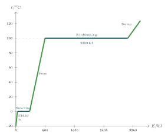

::: {.callout-warning title="Under arbeid"}
Denne siden skrives fortsatt.
:::

:::: {.oppgaver}

Stoff kan eksistere i tre faser: *fast stoff*, *væske* og *gass*. Overgangen mellom fasene — smelting, størkning (frysing), fordamping, kondensering — kalles *faseovergang*. Det karakteristiske er at temperaturen holder seg *konstant* under en faseovergang, selv om vi fortsetter å tilføre energi. Den tilførte energien går i stedet med til å bryte opp de molekylære bindingene (potensiell indre energi), ikke til å øke hastigheten til molekylene.

Figuren viser oppvarmingskurven for $1\,\mathrm{kg}$ vann, fra is ved $-20\,^\circ$C til vanndamp:

-   **Is** (skrå linje): temperatur stiger lineært.

-   **Smeltepunkt** (horisontalt platå ved $0\,^\circ$C): $334\,\mathrm{kJ}$ brukes til å bryte krystallstrukturen i isen — temperaturen holdes konstant.

-   **Vann** (skrå linje): temperaturen stiger igjen. Linjen er slakere enn for is fordi $c_{\text{vann}} > c_{\text{is}}$ — vann krever mer energi per grads oppvarming.

-   **Kokepunkt** (horisontalt platå ved $100\,^\circ$C): hele $2259\,\mathrm{kJ}$ brukes til fordamping — langt mer enn til smelting.

-   **Damp**: temperaturen stiger igjen.

{.tikz-fig style="width:551px"}

[Oppvarmingskurve for $1\,\mathrm{kg}$ vann. De horisontale platåene ved $0\,^\circ$C og $100\,^\circ$C er faseovergangene.]{.figurtekst}

::: {.callout-important title="Merk: Faseoverganger avhenger av trykk"}

Smelte- og kokepunktet avhenger av omgivelsenes trykk. Høyt til fjells, der lufttrykket er lavere, koker vann ved under $100\,^\circ$C — og det tar lenger tid å koke egg fordi temperaturen aldri blir høy nok.

:::

::: {.eksempel}
[Eksempel: Kokende vann på full plate]{.eks-tittel}

En kjele med $1.0\,\mathrm{kg}$ vann står på en kokeplate som gir vannet $2.0\,\mathrm{kJ}$ hvert sekund. Det tar $3.5\,\mathrm{min}$ å varme vannet fra $0\,^\circ$C til $100\,^\circ$C.

a)  Plata står på full effekt. Hvorfor blir ikke vannet varmere enn $100\,^\circ$C?

b)  Bruk oppvarmingskurven i figuren til å finne omtrent hvor lang tid det tar før alt vannet har kokt bort.

:::

::: {.callout-note .svar collapse="true" title="Vis løsning"}

**a)** Når vannet koker, går all energien fra plata til å bryte bindingene mellom vannmolekylene, slik at de kan forlate væsken som damp. Energien øker den *potensielle* indre energien, ikke farten til molekylene. Temperaturen holder seg derfor på $100\,^\circ$C helt til alt vannet har fordampet.

**b)** Fra figuren ser vi at det trengs omtrent $420\,\mathrm{kJ}$ for å varme vannet fra $0\,^\circ$C til $100\,^\circ$C, og $2259\,\mathrm{kJ}$ for å fordampe det. Fordampingen krever altså $$\frac{2259\,\mathrm{kJ}}{420\,\mathrm{kJ}} = 5.4$$ ganger så mye energi. Plata gir like mye energi hvert sekund, så fordampingen tar 5.4 ganger så lang tid: $$t = 5.4\cdot3.5\,\mathrm{min} = 18.8\,\mathrm{min} \approx \underline{\underline{19\,\mathrm{min}}}$$

:::

::: {.oppgave tittel="Les av oppvarmingskurven"}
[Les av oppvarmingskurven]{.oppg-tittel}

Bruk oppvarmingskurven for $1\,\mathrm{kg}$ vann i figur .

a)  Hva skjer med temperaturen mens isen smelter? Hvor mye energi går med til å smelte isen?

b)  Omtrent hvor mye energi trengs for å varme opp vannet fra $0\,^\circ$C til $100\,^\circ$C?

c)  Hvorfor er linjen for is brattere enn linjen for vann?

d)  Omtrent hvor mye energi trengs totalt for å gjøre isen ved $-20\,^\circ$C om til damp ved $100\,^\circ$C?

::: {.losning}

**a)** Mens isen smelter, er temperaturen **konstant, $0\,^\circ$C**. Det er det horisontale platået i figuren. Energien som går med, er **$334\,\mathrm{kJ}$**. Energien brukes til å bryte bindingene i iskrystallen, ikke til å gi molekylene større fart.

**b)** Linjen for vann starter ved omtrent $376\,\mathrm{kJ}$ og slutter ved omtrent $796\,\mathrm{kJ}$. Energien er differansen: $$E \approx 796\,\mathrm{kJ} - 376\,\mathrm{kJ} = \underline{\underline{4.2\cdot 10^{2}\,\mathrm{kJ}}}$$

**c)** Is har mindre spesifikk varmekapasitet enn vann (omtrent halvparten). Det trengs derfor mindre energi for å øke temperaturen til isen med én grad, og temperaturen stiger raskere per kilojoule. Linjen blir brattere.

**d)** Fordampingen er ferdig der det øverste platået slutter, ved omtrent $3055\,\mathrm{kJ}$. Totalt trengs det altså omtrent **$3.1\,\mathrm{MJ}$**. Legg merke til at fordampingen alene står for $2259\,\mathrm{kJ}$, altså mer enn to tredjedeler av energien.

:::

:::

::: {.oppgave tittel="Hvorfor svetter vi?"}
[Hvorfor svetter vi?]{.oppg-tittel}

a)  Når svette fordamper fra huden, trengs det energi. Hvor kommer denne energien fra, og hva skjer med kroppen?

b)  Hvorfor føles det kaldt å komme opp av vannet på en dag med vind, selv om lufta er varm?

c)  Ett gram vanndamp på $100\,^\circ$C og ett gram vann på $100\,^\circ$C treffer huden, som holder omtrent $37\,^\circ$C. Hvilket av dem gir mest energi til huden? Bruk figur .

::: {.losning}

**a)** Fordamping krever energi (fordampingsvarme). Energien tas fra huden og kroppen, som avgir varme til svetten. Kroppen blir dermed **avkjølt**. Det er derfor vi svetter når vi er varme.

**b)** Når du er våt, fordamper vannet fra huden, og fordampingen tar energi fra kroppen. Vinden fjerner den fuktige lufta like ved huden, slik at vannet fordamper *raskere*. Da tas det mer energi fra kroppen per sekund, og du fryser, selv om lufta er varm.

**c)** Vi sammenligner per kilogram og leser av figuren.

*Vann på $100\,^\circ$C* avgir bare varme mens det kjøles ned til $37\,^\circ$C. Fra figuren trengs det omtrent $420\,\mathrm{kJ}$ for å varme $1\,\mathrm{kg}$ vann $100\,\mathrm{K}$. Avkjøling på $63\,\mathrm{K}$ gir derfor omtrent $$\frac{63}{100}\cdot420\,\mathrm{kJ} \approx 2.6\cdot 10^{2}\,\mathrm{kJ}$$ *Damp på $100\,^\circ$C* kondenserer først til vann og avgir da like mye energi som det trengs for å fordampe det, $2259\,\mathrm{kJ}$. Deretter kjøles vannet ned som over. Til sammen er det omtrent $$2259\,\mathrm{kJ} + 2.6\cdot 10^{2}\,\mathrm{kJ} \approx 2.5\cdot 10^{3}\,\mathrm{kJ}$$ Per gram gir altså **dampen nesten ti ganger så mye energi** til huden som vannet.

*Merk:* Svaret gjelder for like stor *masse*. Vanndamp har mye mindre massetetthet enn vann. En liter vanndamp har bare en masse på omtrent $0.6\,\mathrm{g}$, mens en liter vann har massen $1\,\mathrm{kg}$. En liter kokende vann over hånda er derfor langt verre enn en liter damp. Men en dampstråle fra en kjele eller en dampkoker fortsetter å kondensere på huden så lenge den treffer, og da blir det fort mye energi.

:::

:::

::::
