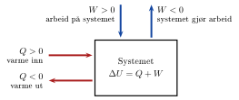

<!-- video: kommer (videoer/fysikk-forkurs/09-04-termodynamikkens-1-lov) -->
{fig-alt="Video kommer"}

<!-- tillegg: Claude -->
Gni hendene hardt mot hverandre, og de blir varme. Hold dem over en kopp te, og de blir også varme. Resultatet er det samme, men energien har kommet inn på to forskjellige måter: som **arbeid** og som **varme**. Termodynamikkens 1. lov holder regnskap med begge, og den er ikke noe nytt i seg selv: Det er energibevaringen vi kjenner fra mekanikken, bare utvidet med varme.

## Varme, arbeid og indre energi

<!-- tillegg: Claude -->
Den **indre energien** $U$ er all energien som partiklene i et system har: bevegelsesenergien til molekylene og energien i bindingene mellom dem. Den kan ikke måles direkte, men vi kan måle hvor mye den *endrer seg*. Energi kan bare komme inn i eller ut av systemet på to måter:

::: {.kort}
- **Varme $Q$** Energi som går fra et varmere til et kaldere legeme *bare fordi temperaturen er forskjellig*. Ingenting trenger å bevege seg synlig.
- **Arbeid $W$** Energi som overføres ved at en kraft virker langs en bevegelse: et stempel som skyver, en mikser som rører, friksjon mellom to flater.
:::

Varme og arbeid er altså ikke noe systemet *har*. Det er måter energi *flytter seg* på. Systemet har bare indre energi.

Den indre energien $U$ til et system kan endres på to måter: varme $Q$ tilføres (eller avgis), og arbeid $W$ utføres på (eller av) systemet. Termodynamikkens 1. lov er energibevaringsloven uttrykt for termodynamiske systemer:

::: {.callout-note title="Definisjon: Termodynamikkens 1. lov"}

Endringen i den indre energien $\Delta U$ er lik summen av tilført varme $Q$ og arbeid $W$ utført *på* systemet: $$\Delta U = Q + W$$

:::

**Fortegnskonvensjon:** Alt som går *inn* i systemet, regnes positivt.
<!-- tillegg: Claude: lærerens liste over fortegn er gjort om til kort og en figur -->

{.tikz-fig style="width:420px" fig-alt="Et system tegnet som en boks med teksten delta U = Q + W. Fra venstre går en pil inn merket Q større enn null, varme inn, og en pil ut merket Q mindre enn null, varme ut. Ovenfra går en pil inn merket W større enn null, arbeid på systemet, og en pil ut merket W mindre enn null, systemet gjør arbeid."}

::: {.kort}
- **$\Delta U > 0$** Den indre energien øker (systemet lagrer mer energi).
- **$Q > 0$** Varme strømmer *inn* i systemet. Er $Q < 0$, avgir systemet varme til omgivelsene.
- **$W > 0$** Arbeid utføres *på* systemet (f.eks. stempelet komprimerer gassen).
- **$W < 0$** Systemet gjør arbeid *på* omgivelsene (f.eks. gassen ekspanderer og løfter et stempel).
:::

Figuren under viser et typisk termodynamisk system: en gass i en sylinder med bevegelig stempel. Varme $Q > 0$ kan tilføres fra en varmekilde. Stempelet kan gjøre arbeid $W > 0$ på gassen ved å komprimere den — eller gassen kan ekspandere og løfte stempelet ($W < 0$). Endringen $\Delta U$ samler opp begge bidragene.

::: center
{.tikz-fig style="width:263px"}

[Gass i sylinder. Varme $Q$ tilføres fra en varmekilde, og stempelet gjør arbeid $W$ på gassen.]{.figurtekst}
:::

## Arbeid gjort av en gass

Hvor stort arbeid gjør en gass når den utvider seg? Se på en gass i en sylinder med et bevegelig stempel med areal $A$. Gassen har trykket $p$, så den presser på stempelet med kraften $$F = p\cdot A$$ Anta at trykket holdes konstant mens gassen utvider seg og skyver stempelet et lite stykke $\Delta x$ utover. Kraften og bevegelsen har samme retning, så arbeidet gassen gjør på stempelet, er kraft ganger strekning: $$W_\text{gass} = F\cdot\Delta x = p\cdot A\cdot\Delta x$$ Men $A\cdot\Delta x$ er nettopp økningen i volumet til gassen, $\Delta V$ (se figuren). Dermed er arbeidet gassen gjør

::: {.graa}
$$
W_\text{gass} = p\,\Delta V \qquad (\text{når } p \text{ er konstant})
$$
:::

::: center
{.tikz-fig style="width:392px"}

[Gassen skyver stempelet $\Delta x$ utover med kraften $F = pA$. Volumet øker med $\Delta V = A\,\Delta x$ (det skraverte området), og gassen gjør arbeidet $W_\text{gass} = F\,\Delta x = p\,\Delta V$.]{.figurtekst}
:::

::: {.callout-important title="Merk: $p\,\Delta V$, ikke $\Delta p\, V$"}

Arbeid krever at noe flytter seg. Det er derfor volum*endringen* $\Delta V$ som inngår. Øker trykket mens volumet er konstant (en isokor prosess), flytter ikke stempelet seg, og gassen gjør *ingen* arbeid, selv om trykket endres. $\Delta p\,V$ er altså ikke et arbeid. Formelen $W_\text{gass} = p\,\Delta V$ gjelder når trykket er konstant. Endres trykket underveis, må vi regne annerledes. Det ser vi på under [Prosesstyper og pV-diagram](07-prosesstyper-og-pv-diagram.qmd), der arbeidet blir arealet under en kurve.

:::

I termodynamikkens 1. lov er $W$ arbeidet som gjøres *på* gassen. Når gassen utvider seg ($\Delta V > 0$), gjør den arbeid på omgivelsene, og $W = -p\,\Delta V$ er negativ. Når gassen presses sammen, er $W$ positiv.

::: {.eksempel}
**Eksempel: Gass i sylinder.** $Q = 500\,\mathrm{J}$ tilføres en gass i en sylinder. Den indre energien øker med $\Delta U = 100\,\mathrm{J}$.

a)  Hvor stort arbeid gjør stempelet på gassen?

b)  Stempelet sitter på toppen av sylinderen, som i figuren, og har masse $m = 50\,\mathrm{kg}$. Gassen løfter stempelet rett opp. Hvor langt flyttes det? Se bort fra lufttrykket over stempelet og friksjon.

::: {.losning}
**a)** Fra 1. lov løser vi for $W$: $$\Delta U = Q + W \implies W = \Delta U - Q = 100\,\mathrm{J} - 500\,\mathrm{J}
  = \underline{\underline{-400\,\mathrm{J}}}$$ Det negative fortegnet viser at stempelet *ikke* gjør arbeid på gassen — det er gassen som gjør $400\,\mathrm{J}$ arbeid på stempelet og løfter det oppover.

**b)** Gassen gjør $400\,\mathrm{J}$ arbeid på stempelet. Dette arbeidet brukes til å løfte stempelet mot tyngdekraften ($W = \Delta E_{\text{pot}} = m\mathrm{g}y$): $$y = \frac{W}{m\mathrm{g}} = \frac{400\,\mathrm{J}}{50\,\mathrm{kg}\cdot9.81\,\mathrm{m/s^2}}
  = \underline{\underline{0.82\,\mathrm{m}}}$$ Stempelet flyttes $82\,\mathrm{cm}$.
:::
:::

::: {.eksempel}
<!-- tillegg: Claude -->
**Eksempel: Oppvarming ved konstant trykk.** En gass i en sylinder med et stempel som glir lett, har trykket $120\ \mathrm{kPa}$. Gassen får tilført $200\ \mathrm{J}$ varme, og volumet øker fra $2.0\ \mathrm{L}$ til $2.5\ \mathrm{L}$ mens trykket er konstant. Hvor mye øker den indre energien?

::: {.losning}
Først arbeidet gassen gjør. Med $\Delta V = 0.5\ \mathrm{L} = 5\cdot10^{-4}\ \mathrm{m^3}$:
$$
W_\text{gass} = p\,\Delta V = 120\cdot10^{3}\ \mathrm{Pa}\cdot5\cdot10^{-4}\ \mathrm{m^3} = 60\ \mathrm{J}
$$
Gassen gjør arbeidet, så i 1. lov er $W = -60\ \mathrm{J}$:
$$
\Delta U = Q + W = 200\ \mathrm{J} - 60\ \mathrm{J} = \underline{\underline{140\ \mathrm{J}}}
$$
Av de $200\ \mathrm{J}$ som kom inn som varme, ble $60\ \mathrm{J}$ sendt videre som arbeid på stempelet. Resten ble igjen i gassen og gjorde den varmere.
:::
:::

### Adiabatisk prosess

En *adiabatisk* prosess er en prosess uten varmeoverføring: $Q = 0$. Da gir 1. lov: $$\Delta U = W$$ I en slik prosess skyldes all endring i indre energi arbeid. Eksempler: en **sykkelpumpe** (komprimering skjer for raskt til at varme rekker å slippe ut — pumpa blir varm), og **dieselmotorer** (luften komprimeres adiabatisk inntil temperaturen er høy nok til at drivstoffet antennes av seg selv, uten tennplugg).

<!-- tillegg: Claude -->
Flere slike prosesser, og hvordan de ser ut i et $pV$-diagram, finner du under [Prosesstyper og pV-diagram](07-prosesstyper-og-pv-diagram.qmd).

:::: {.oppgaver}

::: {.oppgave tittel="Varme eller arbeid?"}

Avgjør om energien overføres til systemet som *varme* $Q$ eller som *arbeid* $W$. Systemet står i parentes.

a)  Du gnir hendene hardt mot hverandre (hendene).

b)  En gryte med vann står på en varm kokeplate (vannet).

c)  Lufta i en sykkelpumpe blir presset sammen av stempelet (lufta).

d)  Sola varmer opp en stein på stranda (steinen).

e)  En elektrisk mikser rører i en bolle med kakedeig (deigen).

::: {.losning}

Varme er energi som overføres *bare* på grunn av en temperaturforskjell. All annen energioverføring, der noe skyver, drar eller rører, er arbeid.

**a)** **Arbeid**. Friksjonskraften virker langs bevegelsen og gjør arbeid på hendene.

**b)** **Varme**. Kokeplata er varmere enn gryta og vannet, og energien går fra det varme til det kalde.

**c)** **Arbeid**. Stempelet skyver på lufta og presser den sammen.

**d)** **Varme**. Sola er mye varmere enn steinen. Energien kommer som stråling, og det regner vi som varme.

**e)** **Arbeid**. Mikseren skyver deigen rundt. Deigen blir litt varmere, selv om ingenting varmt er i kontakt med den.

:::

:::

::: {.oppgave tittel="Sykkelpumpe"}

En sykkelpumpe komprimerer luft raskt, slik at prosessen er tilnærmet adiabatisk. Et arbeid på $W = 30\,\mathrm{J}$ utføres på lufta.

a)  Hva er endringen i den indre energien til lufta?

b)  Stiger eller synker temperaturen i pumpa? Forklar hvorfor.

::: {.losning}

**a)** Prosessen er adiabatisk, så $Q = 0$. Termodynamikkens 1. lov gir $$\Delta U = Q + W = 0 + 30\,\mathrm{J} = \underline{\underline{+30\,\mathrm{J}}}$$

**b)** $\Delta U > 0$, så den indre energien øker. Den indre energien til lufta er knyttet til bevegelsen til molekylene, og dermed til temperaturen. Temperaturen **stiger**. Stempelet beveger seg mot molekylene og gir dem større fart når de spretter mot det. Du kan kjenne at pumpa blir varm etter bruk.

:::

:::

::: {.oppgave tittel="Gass som komprimeres"}

Et stempel presser sammen en gass i en sylinder og gjør et arbeid på $250\,\mathrm{J}$ på gassen. Samtidig avgir gassen $80\,\mathrm{J}$ varme til omgivelsene. Anta at den indre energien til gassen bare avhenger av temperaturen.

a)  Finn endringen $\Delta U$ i den indre energien til gassen.

b)  Stiger eller synker temperaturen til gassen?

c)  Hvor mye varme måtte gassen ha avgitt for at temperaturen skulle vært uendret?

d)  Senere tilføres gassen $600\,\mathrm{J}$ varme. Gassen utvider seg og løfter stempelet, som har masse $25\,\mathrm{kg}$, rett opp. Den indre energien øker med $450\,\mathrm{J}$. Hvor høyt løftes stempelet? Se bort fra lufttrykket over stempelet og friksjon.

::: {.losning}

**a)** Arbeidet utføres *på* gassen, så $W = +250\,\mathrm{J}$. Gassen *avgir* varme, så $Q = -80\,\mathrm{J}$. Termodynamikkens 1. lov gir $$\Delta U = Q + W = -80\,\mathrm{J} + 250\,\mathrm{J} = \underline{\underline{+170\,\mathrm{J}}}$$

**b)** Den indre energien øker. Siden den indre energien bare avhenger av temperaturen, **stiger temperaturen**.

**c)** Temperaturen er uendret når $\Delta U = 0$: $$0 = Q + W \quad\implies\quad Q = -W = \underline{\underline{-250\,\mathrm{J}}}$$ Gassen måtte altså ha avgitt $250\,\mathrm{J}$ varme, like mye som arbeidet stempelet gjør på den.

**d)** Nå er $Q = +600\,\mathrm{J}$ og $\Delta U = +450\,\mathrm{J}$. Termodynamikkens 1. lov gir $$W = \Delta U - Q = 450\,\mathrm{J} - 600\,\mathrm{J} = -150\,\mathrm{J}$$ Det negative fortegnet betyr at gassen gjør $150\,\mathrm{J}$ arbeid på stempelet. Arbeidet går til å løfte stempelet mot tyngdekraften, $W_\text{gass} = m\mathrm{g}h$: $$h = \frac{W_\text{gass}}{m\mathrm{g}} = \frac{150\,\mathrm{J}}{25\,\mathrm{kg}\cdot9.81\,\mathrm{m/s^2}} = 0.612\,\mathrm{m} \approx \underline{\underline{0.61\,\mathrm{m}}}$$

:::

:::

::: {.oppgave tittel="Ballong i sola" niva="Middels"}
<!-- tillegg: Claude -->
En ballong ligger i sola og får tilført $50\ \mathrm{J}$ varme. Lufta i ballongen utvider seg fra $2.00\ \mathrm{L}$ til $2.15\ \mathrm{L}$. Trykket i ballongen er hele tiden omtrent lik lufttrykket utenfor, $101\ \mathrm{kPa}$.

a)  Hvor stort arbeid gjør lufta i ballongen på lufta utenfor?

b)  Hvor mye øker den indre energien til lufta i ballongen?

c)  Hvor stor del av varmen ble igjen som indre energi?

::: {.losning}
**a)** Trykket er konstant, og $\Delta V = 0.15\ \mathrm{L} = 1.5\cdot10^{-4}\ \mathrm{m^3}$:
$$
W_\text{gass} = p\,\Delta V = 101\cdot10^{3}\ \mathrm{Pa}\cdot1.5\cdot10^{-4}\ \mathrm{m^3} = 15.2\ \mathrm{J} \approx \underline{\underline{15\ \mathrm{J}}}
$$
Ballongen skyver lufta rundt seg til side, og det krever arbeid.

**b)** Lufta i ballongen gjør arbeidet, så $W = -15.2\ \mathrm{J}$ i 1. lov:
$$
\Delta U = Q + W = 50\ \mathrm{J} - 15.2\ \mathrm{J} = 34.8\ \mathrm{J} \approx \underline{\underline{35\ \mathrm{J}}}
$$

**c)** $34.8\ \mathrm{J}/50\ \mathrm{J} = 0.70$, altså omtrent $\underline{\underline{70\ \%}}$. Resten gikk med til å skyve lufta utenfor til side.
:::
:::

::::
