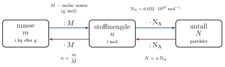

<!-- video: kommer (videoer/fysikk-forkurs/09-05-stoffmengde) -->
{fig-alt="Video kommer"}

<!-- tillegg: Claude -->
Et glass vann veier omtrent $250\ \mathrm{g}$. Det er lett å måle med en kjøkkenvekt. Men hvor mange vannmolekyler er det i glasset? Svaret er omtrent $8\cdot10^{24}$, et tall med 25 sifre. Ingen kan telle så mange molekyler. Likevel trenger vi antallet når vi skal forstå gasser, kjemiske reaksjoner og varme, for det er molekylene som bærer energien. Løsningen er å telle molekyler *i pakker*. En slik pakke kalles et **mol**, og antall pakker kalles **stoffmengden**.

## Atomer og molekyler

Alt stoff er bygd opp av atomer. Atomer kan henge sammen i **molekyler**: Et vannmolekyl, $\mathrm{H_2O}$, består av to hydrogenatomer og ett oksygenatom. Lufta består mest av nitrogenmolekyler, $\mathrm{N_2}$, og oksygenmolekyler, $\mathrm{O_2}$. Helium, $\mathrm{He}$, finnes som enkeltatomer.

Atomer er så lette at kilogram er en upraktisk enhet. Vi bruker i stedet **atommasseenheten** $\mathrm{u}$:

::: {.callout-note title="Definisjon: Atommasseenheten"}
$$
1\ \mathrm{u} = 1.661\cdot10^{-27}\ \mathrm{kg}
$$
Det er omtrent massen til ett proton eller ett nøytron. Et karbonatom med 6 protoner og 6 nøytroner har massen $12\ \mathrm{u}$.
:::

Atommassene står i periodesystemet. Noen som vi bruker mye:

::: {.graa}
| Grunnstoff | Symbol | Atommasse |
|:---|:---:|:---:|
| Hydrogen | H | $1.008\ \mathrm{u}$ |
| Helium | He | $4.003\ \mathrm{u}$ |
| Karbon | C | $12.011\ \mathrm{u}$ |
| Nitrogen | N | $14.007\ \mathrm{u}$ |
| Oksygen | O | $15.999\ \mathrm{u}$ |
| Argon | Ar | $39.948\ \mathrm{u}$ |
:::

Atommassene er ikke hele tall. Det kommer blant annet av at et grunnstoff er en blanding av isotoper med litt ulik masse, og tabellen gir gjennomsnittet.

**Molekylmassen** finner vi ved å legge sammen atommassene. For vann:
$$
m_{\mathrm{H_2O}} = 2\cdot1.008\ \mathrm{u} + 15.999\ \mathrm{u} = 18.015\ \mathrm{u}
$$
Regnet om til kilogram er det $18.015\cdot1.661\cdot10^{-27}\ \mathrm{kg} = 2.99\cdot10^{-26}\ \mathrm{kg}$. Ett vannmolekyl er altså ufattelig lett, og derfor er det ufattelig mange av dem i et glass vann.

## Mol og Avogadros tall

Et dusin er 12 stykker, uansett om det er egg eller blyanter. Et **mol** er på samme måte et bestemt antall partikler, bare mye større:

::: {.callout-note title="Definisjon: Mol og Avogadros tall"}
Ett mol er $6.022\cdot10^{23}$ partikler (atomer, molekyler eller andre enheter). Antallet per mol kalles **Avogadros tall**:
$$
\mathrm{N_A} = 6.022\cdot10^{23}\ \mathrm{mol^{-1}}
$$
**Stoffmengden** $n$ er antall mol. Enheten er $\mathrm{mol}$, som er en av de sju grunnenhetene i SI.
:::

Hvorfor akkurat dette rare tallet? Det er valgt slik at to enheter passer sammen:
$$
1\ \mathrm{u}\cdot\mathrm{N_A} = 1.661\cdot10^{-27}\ \mathrm{kg}\cdot6.022\cdot10^{23}\ \mathrm{mol^{-1}} = 1.00\cdot10^{-3}\ \mathrm{kg/mol} = 1.00\ \mathrm{g/mol}
$$
Ett mol av partikler som veier $1\ \mathrm{u}$ hver, veier altså $1\ \mathrm{g}$. Det gir en svært praktisk regel: **Et molekyl som veier $18.015\ \mathrm{u}$, har en molar masse på $18.015\ \mathrm{g/mol}$.** Tallet i periodesystemet kan brukes direkte.

## Molar masse

::: {.callout-note title="Definisjon: Molar masse"}
Den **molare massen** $M$ er massen av ett mol av stoffet. Den har samme tallverdi som molekylmassen i $\mathrm{u}$, men enheten er $\mathrm{g/mol}$.
:::

Vann har $M = 18.015\ \mathrm{g/mol}$, nitrogen $\mathrm{N_2}$ har $M = 2\cdot14.007\ \mathrm{g/mol} = 28.014\ \mathrm{g/mol}$, og oksygen $\mathrm{O_2}$ har $M = 31.998\ \mathrm{g/mol}$.

::: {.callout-warning title="g/mol eller kg/mol?"}
Tabeller oppgir nesten alltid molar masse i $\mathrm{g/mol}$. SI-enheten er $\mathrm{kg/mol}$, og den må du bruke når $M$ skal inn i formler sammen med joule, pascal og kubikkmeter. Del på 1000:
$$
M_{\mathrm{H_2O}} = 18.015\ \mathrm{g/mol} = 0.018015\ \mathrm{kg/mol}
$$
Når du bare regner om mellom masse og stoffmengde, går det fint å bruke gram og $\mathrm{g/mol}$, så lenge du bruker de samme enhetene begge steder.
:::

## Broen mellom masse, stoffmengde og antall

Nå har vi tre måter å si «hvor mye stoff» på: massen $m$ (det vi kan veie), stoffmengden $n$ (antall mol) og antallet $N$ (antall partikler). Den molare massen $M$ og Avogadros tall $\mathrm{N_A}$ er broene mellom dem.

{.tikz-fig style="width:640px" fig-alt="Tre bokser på rad: masse m, stoffmengde n og antall N. Fra masse til stoffmengde går en pil merket «delt på M», og tilbake en pil merket «ganger M». Fra stoffmengde til antall går en pil merket «ganger N_A», og tilbake en pil merket «delt på N_A». Under står formlene n = m/M og N = n N_A."}

::: {.callout-important title="Stoffmengde, masse og antall"}
$$
n = \frac{m}{M} \qquad\qquad N = n\,\mathrm{N_A}
$$
:::

Du kan sjekke enhetene: $\mathrm{g}/(\mathrm{g/mol}) = \mathrm{mol}$, og $\mathrm{mol}\cdot\mathrm{mol^{-1}}$ er et rent tall. Det er en god vane, for det avslører om du har gått feil vei over broen.

::: {.eksempel}
**Eksempel: Et glass vann.** Et glass inneholder $250\ \mathrm{g}$ vann. a) Hvor mange mol vann er det? b) Hvor mange vannmolekyler er det?

::: {.losning}
a) Vann har molar masse $M = 18.015\ \mathrm{g/mol}$:
$$
n = \frac{m}{M} = \frac{250\ \mathrm{g}}{18.015\ \mathrm{g/mol}} = 13.88\ \mathrm{mol} \approx \underline{\underline{13.9\ \mathrm{mol}}}
$$

b) Vi går videre over broen og ganger med Avogadros tall:
$$
N = n\,\mathrm{N_A} = 13.88\ \mathrm{mol}\cdot6.022\cdot10^{23}\ \mathrm{mol^{-1}} = \underline{\underline{8.36\cdot10^{24}}}
$$
Til sammenlikning er det omtrent $8\cdot10^{9}$ mennesker på jorda. Hvert menneske måtte ha fått omtrent $10^{15}$ molekyler hver for å dele glasset likt.
:::
:::

## Luft er en blanding

Lufta er ikke ett stoff, men en blanding. Av molekylene er omtrent $78\ \%$ nitrogen, $21\ \%$ oksygen og $1\ \%$ argon. Når vi regner på luft, bruker vi et vektet gjennomsnitt av de molare massene:
$$
M_\text{luft} = 0.78\cdot28.014\ \mathrm{g/mol} + 0.21\cdot31.998\ \mathrm{g/mol} + 0.01\cdot39.948\ \mathrm{g/mol} = 28.97\ \mathrm{g/mol}
$$
Vi regner derfor med $M_\text{luft} = 29.0\ \mathrm{g/mol}$. Det er god nok nøyaktighet for nesten alt vi gjør med luft.

::: {.eksempel}
**Eksempel: Lufta i et rom.** Et rom er $4.0\ \mathrm{m}$ langt, $5.0\ \mathrm{m}$ bredt og $2.5\ \mathrm{m}$ høyt. Lufta har massetettheten $1.2\ \mathrm{kg/m^3}$. a) Hvor stor masse har lufta i rommet? b) Hvor mange mol luft er det? c) Hvor mange molekyler?

::: {.losning}
a) Volumet er $V = 4.0\ \mathrm{m}\cdot5.0\ \mathrm{m}\cdot2.5\ \mathrm{m} = 50\ \mathrm{m^3}$, så massen er
$$
m = \rho V = 1.2\ \mathrm{kg/m^3}\cdot50\ \mathrm{m^3} = \underline{\underline{60\ \mathrm{kg}}}
$$
Lufta i et vanlig rom veier altså omtrent like mye som et menneske.

b) Her har vi massen i kilogram, så vi bruker $M = 29.0\ \mathrm{g/mol} = 0.0290\ \mathrm{kg/mol}$:
$$
n = \frac{m}{M} = \frac{60\ \mathrm{kg}}{0.0290\ \mathrm{kg/mol}} = 2.07\cdot10^{3}\ \mathrm{mol} \approx \underline{\underline{2.1\cdot10^{3}\ \mathrm{mol}}}
$$

c)
$$
N = n\,\mathrm{N_A} = 2.07\cdot10^{3}\ \mathrm{mol}\cdot6.022\cdot10^{23}\ \mathrm{mol^{-1}} = \underline{\underline{1.2\cdot10^{27}}}
$$
:::
:::

## Gassmengde og molart volum

For gasser er det ofte volumet vi kjenner, ikke massen. Det viser seg at **alle gasser** ved samme trykk og temperatur har omtrent like mange molekyler per kubikkmeter, uansett hva slags molekyler det er. Ett mol gass tar derfor like stor plass, enten det er helium eller luft. Dette volumet kalles det **molare volumet** $V_\mathrm{m}$:

::: {.graa}
| Forhold | Molart volum $V_\mathrm{m}$ |
|:---|:---:|
| $0\ ^\circ\mathrm{C}$ og $101.3\ \mathrm{kPa}$ | $22.4\ \mathrm{L/mol}$ |
| $20\ ^\circ\mathrm{C}$ og $101.3\ \mathrm{kPa}$ | $24.1\ \mathrm{L/mol}$ |
:::

Da er stoffmengden $n = V/V_\mathrm{m}$. Tallene i tabellen gjelder bare ved disse forholdene. Hvorfor volumet ikke avhenger av hva slags gass det er, og hvordan det endrer seg med trykk og temperatur, ser vi under [Tilstandslikningen for idealgass](06-tilstandslikningen-for-idealgass.qmd). Der kommer også den molare gasskonstanten $\mathrm{R} = 8.314\ \mathrm{J/(mol\cdot K)}$ inn. Den er Boltzmanns konstant ganget med Avogadros tall, $\mathrm{R} = \mathrm{k_B}\,\mathrm{N_A}$, altså den samme konstanten regnet per mol i stedet for per molekyl.

::: {.eksempel}
**Eksempel: Heliumballong.** En ballong fylles med $5.0\ \mathrm{L}$ helium ved $20\ ^\circ\mathrm{C}$ og $101.3\ \mathrm{kPa}$. a) Hvor mange mol helium er det i ballongen? b) Hvor stor masse har heliumet? c) Hvor mange heliumatomer er det?

::: {.losning}
a) Vi bruker det molare volumet ved $20\ ^\circ\mathrm{C}$:
$$
n = \frac{V}{V_\mathrm{m}} = \frac{5.0\ \mathrm{L}}{24.1\ \mathrm{L/mol}} = 0.207\ \mathrm{mol} \approx \underline{\underline{0.21\ \mathrm{mol}}}
$$

b) Helium har $M = 4.003\ \mathrm{g/mol}$, og vi går over broen den andre veien:
$$
m = n\,M = 0.207\ \mathrm{mol}\cdot4.003\ \mathrm{g/mol} = \underline{\underline{0.83\ \mathrm{g}}}
$$

c)
$$
N = n\,\mathrm{N_A} = 0.207\ \mathrm{mol}\cdot6.022\cdot10^{23}\ \mathrm{mol^{-1}} = \underline{\underline{1.2\cdot10^{23}}}
$$
Den samme mengden luft ville veid $0.207\ \mathrm{mol}\cdot29.0\ \mathrm{g/mol} = 6.0\ \mathrm{g}$. Heliumet er mye lettere enn lufta det skyver unna, og derfor stiger ballongen.
:::
:::

## Prøv selv

Programmet regner ut molar masse ut fra hvor mange atomer av hvert slag molekylet har, og går så over broen fra masse til stoffmengde og antall. Bytt ut molekylet (prøv for eksempel `{"C": 1, "O": 2}` for karbondioksid) og massen, og trykk **Kjør**.

```{.python .kjor}
NA = 6.022e23    # Avogadros tall i 1/mol

# atommasser i u (= g/mol)
atommasse = {"H": 1.008, "He": 4.003, "C": 12.011, "N": 14.007, "O": 15.999, "Ar": 39.948}

molekyl = {"H": 2, "O": 1}   # vann: 2 H og 1 O
m = 250                      # masse i gram

M = sum(atommasse[a] * antall for a, antall in molekyl.items())
n = m / M
N = n * NA
print(f"Molar masse:  M = {M:.3f} g/mol")
print(f"Stoffmengde:  n = {n:.3g} mol")
print(f"Antall:       N = {N:.3g}")
```

:::: {.oppgaver}

::: {.oppgave tittel="Molar masse"}
Finn den molare massen til a) karbondioksid, $\mathrm{CO_2}$, b) metan, $\mathrm{CH_4}$. c) Hva er massen til ett $\mathrm{CO_2}$-molekyl i kilogram?

::: {.losning}
Vi legger sammen atommassene fra tabellen.

a)
$$
M_{\mathrm{CO_2}} = 12.011\ \mathrm{g/mol} + 2\cdot15.999\ \mathrm{g/mol} = \underline{\underline{44.009\ \mathrm{g/mol}}}
$$

b)
$$
M_{\mathrm{CH_4}} = 12.011\ \mathrm{g/mol} + 4\cdot1.008\ \mathrm{g/mol} = \underline{\underline{16.043\ \mathrm{g/mol}}}
$$

c) Molekylmassen er $44.009\ \mathrm{u}$. Med $1\ \mathrm{u} = 1.661\cdot10^{-27}\ \mathrm{kg}$:
$$
m = 44.009\cdot1.661\cdot10^{-27}\ \mathrm{kg} = \underline{\underline{7.31\cdot10^{-26}\ \mathrm{kg}}}
$$
Vi kan også dele den molare massen i $\mathrm{kg/mol}$ på Avogadros tall: $0.044009\ \mathrm{kg/mol}\,/\,6.022\cdot10^{23}\ \mathrm{mol^{-1}} = 7.31\cdot10^{-26}\ \mathrm{kg}$. Det må bli det samme, fordi $1\ \mathrm{u}\cdot\mathrm{N_A} = 1\ \mathrm{g/mol}$.
:::
:::

::: {.oppgave tittel="Gullringen"}
En gullring veier $5.0\ \mathrm{g}$. Gull har atommassen $196.97\ \mathrm{u}$. Hvor mange gullatomer er det i ringen? Anta at ringen er av rent gull.

::: {.losning}
Den molare massen er $M = 196.97\ \mathrm{g/mol}$. Først stoffmengden:
$$
n = \frac{m}{M} = \frac{5.0\ \mathrm{g}}{196.97\ \mathrm{g/mol}} = 0.0254\ \mathrm{mol}
$$
Så antallet:
$$
N = n\,\mathrm{N_A} = 0.0254\ \mathrm{mol}\cdot6.022\cdot10^{23}\ \mathrm{mol^{-1}} = \underline{\underline{1.5\cdot10^{22}}}
$$
:::
:::

::: {.oppgave tittel="Sukkerbiten"}
En sukkerbit veier $3.0\ \mathrm{g}$ og består av sukrose, $\mathrm{C_{12}H_{22}O_{11}}$. a) Finn den molare massen til sukrose. b) Hvor mange sukrosemolekyler er det i sukkerbiten?

::: {.losning}
a)
$$
M = 12\cdot12.011\ \mathrm{g/mol} + 22\cdot1.008\ \mathrm{g/mol} + 11\cdot15.999\ \mathrm{g/mol} = \underline{\underline{342.30\ \mathrm{g/mol}}}
$$

b)
$$
n = \frac{m}{M} = \frac{3.0\ \mathrm{g}}{342.30\ \mathrm{g/mol}} = 8.76\cdot10^{-3}\ \mathrm{mol}
$$
$$
N = n\,\mathrm{N_A} = 8.76\cdot10^{-3}\ \mathrm{mol}\cdot6.022\cdot10^{23}\ \mathrm{mol^{-1}} = \underline{\underline{5.3\cdot10^{21}}}
$$
Sukrosemolekylet er stort, så det blir færre molekyler per gram enn for vann.
:::
:::

::: {.oppgave tittel="Utslipp fra en bil" niva="Middels"}
En bil slipper ut $120\ \mathrm{g}$ $\mathrm{CO_2}$ per kilometer. a) Hvor mange mol $\mathrm{CO_2}$ er det? b) Hvor mange molekyler? c) Hvor stort volum tar gassen ved $20\ ^\circ\mathrm{C}$ og $101.3\ \mathrm{kPa}$?

::: {.losning}
a) Fra oppgaven om molar masse er $M_{\mathrm{CO_2}} = 44.009\ \mathrm{g/mol}$:
$$
n = \frac{m}{M} = \frac{120\ \mathrm{g}}{44.009\ \mathrm{g/mol}} = 2.727\ \mathrm{mol} \approx \underline{\underline{2.73\ \mathrm{mol}}}
$$

b)
$$
N = n\,\mathrm{N_A} = 2.727\ \mathrm{mol}\cdot6.022\cdot10^{23}\ \mathrm{mol^{-1}} = \underline{\underline{1.64\cdot10^{24}}}
$$

c) Det molare volumet er $V_\mathrm{m} = 24.1\ \mathrm{L/mol}$ ved disse forholdene:
$$
V = n\,V_\mathrm{m} = 2.727\ \mathrm{mol}\cdot24.1\ \mathrm{L/mol} = \underline{\underline{65.7\ \mathrm{L}}}
$$
Det er omtrent som en stor ryggsekk full av $\mathrm{CO_2}$ for hver kilometer.
:::
:::

::: {.oppgave tittel="Hvor mye helium?" niva="Middels"}
En liten festballong skal fylles med $0.50\ \mathrm{g}$ helium. Hvor stort blir volumet ved $20\ ^\circ\mathrm{C}$ og $101.3\ \mathrm{kPa}$?

::: {.losning}
Vi går fra masse til stoffmengde, og så fra stoffmengde til volum med det molare volumet:
$$
n = \frac{m}{M} = \frac{0.50\ \mathrm{g}}{4.003\ \mathrm{g/mol}} = 0.125\ \mathrm{mol}
$$
$$
V = n\,V_\mathrm{m} = 0.125\ \mathrm{mol}\cdot24.1\ \mathrm{L/mol} = \underline{\underline{3.0\ \mathrm{L}}}
$$
:::
:::

::: {.oppgave tittel="Et glass vann i havet" niva="Utfordrende"}
Du heller et glass med $250\ \mathrm{g}$ vann ut i havet. Tenk deg at vannet blir jevnt blandet i alle verdenshavene, som har et samlet volum på omtrent $1.3\cdot10^{21}\ \mathrm{L}$. Så fyller du glasset med $0.25\ \mathrm{L}$ havvann. Omtrent hvor mange av de opprinnelige vannmolekylene får du tilbake i glasset?

::: {.losning}
Antallet molekyler i glasset fant vi i eksempelet med glasset: $N = 8.36\cdot10^{24}$. Når de er jevnt fordelt i hele havet, er antallet per liter
$$
\frac{N}{V_\text{hav}} = \frac{8.36\cdot10^{24}}{1.3\cdot10^{21}\ \mathrm{L}} = 6.4\cdot10^{3}\ \mathrm{L^{-1}}
$$
I $0.25\ \mathrm{L}$ havvann er det da
$$
6.4\cdot10^{3}\ \mathrm{L^{-1}}\cdot0.25\ \mathrm{L} = \underline{\underline{1.6\cdot10^{3}}}
$$
Omtrent 1600 av de opprinnelige molekylene kommer tilbake. Selv om glasset er en ørliten dråpe i havet, er det så mange molekyler i det at de finnes overalt etterpå.
:::
:::

::::
