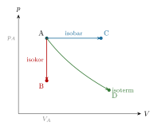
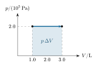

::: {.callout-warning title="Under arbeid"}
Dette kapittelet skrives fortsatt.
:::

:::: {.oppgaver}

Tilstandslikningen $pV = Nk_\text{B}T$ forbinder tre størrelser. Avhengig av hvilken som holdes *konstant*, skiller vi mellom tre idealprosesser:

::: tcolorbox
| **Prosesstype** | **Konstant** | **Sammenheng** | **Eksempel**             |
|:----------------|:-------------|:---------------|:-------------------------|
| Isokor          | $V =$ konst. | $p/T =$ konst. | Trykkbeholder            |
| Isobar          | $p =$ konst. | $V/T =$ konst. | Stempel under atm. trykk |
| Isoterm         | $T =$ konst. | $pV =$ konst.  | Sakte kompresjon         |
:::

Et *$pV$-diagram* viser trykket $p$ som funksjon av volumet $V$. Arealet under kurven tilsvarer arbeidet gassen gjør (eller arbeidet som gjøres på gassen). For en isobar prosess er arealet et rektangel med høyde $p$ og bredde $\Delta V$. Det er nettopp arbeidet $W_\text{gass} = p\,\Delta V$ fra delkapittel . Endres trykket underveis, er arbeidet fortsatt arealet under kurven.

::: center
{.tikz-fig style="width:382px"}

[$pV$-diagram for tre prosesser som starter i punkt A. Isokor (rød): volumet er konstant, trykket synker — bare A$\to$B. Isobar (blå): trykket er konstant, volumet øker — A$\to$C. Isoterm (grønn): temperaturen er konstant, $pV$ er konstant — A$\to$D.]{.figurtekst}
:::

::: {.eksempel}
[Eksempel 8.13: Arbeid ved isobar utvidelse]{.eks-tittel}

En gass i en sylinder har trykket $2.0\cdot 10^{5}\,\mathrm{Pa}$. Gassen varmes opp og utvider seg ved konstant trykk fra $1.0\,\mathrm{L}$ til $3.0\,\mathrm{L}$.

a)  Tegn prosessen i et $pV$-diagram, og finn arbeidet gassen gjør.

b)  Under prosessen tilføres $1.0\,\mathrm{kJ}$ varme. Finn endringen i den indre energien.

:::

::: {.callout-note .svar collapse="true" title="Vis løsning"}

**a)** Prosessen er en horisontal linje i $pV$-diagrammet. Arbeidet gassen gjør, er arealet under linjen (det fargede rektangelet):

::: center
{.tikz-fig style="width:324px"}

[Isobar utvidelse. Arealet under linjen er arbeidet gassen gjør.]{.figurtekst}
:::

Med $\Delta V = 3.0\,\mathrm{L} - 1.0\,\mathrm{L} = 2.0\,\mathrm{L} = 2.0\cdot 10^{-3}\,\mathrm{m}^{3}$: $$W_\text{gass} = p\,\Delta V = 2.0\cdot 10^{5}\,\mathrm{Pa}\cdot2.0\cdot 10^{-3}\,\mathrm{m}^{3} = \underline{\underline{4.0\cdot 10^{2}\,\mathrm{J}}}$$

**b)** Gassen gjør arbeid på omgivelsene, så $W = -4.0\cdot 10^{2}\,\mathrm{J}$ i 1. lov: $$\Delta U = Q + W = 1.0\cdot 10^{3}\,\mathrm{J} - 4.0\cdot 10^{2}\,\mathrm{J} = \underline{\underline{6.0\cdot 10^{2}\,\mathrm{J}}}$$ Bare $60\,\%$ av varmen går til å øke den indre energien. Resten blir til arbeid på stempelet.

:::

::: {.oppgave tittel="Arbeid i et pV-diagram"}
[Arbeid i et pV-diagram]{.oppg-tittel}

En gass utvider seg ved konstant trykk $p = 150\,\mathrm{kPa}$, fra volumet $2.0\,\mathrm{L}$ til $5.0\,\mathrm{L}$.

a)  Tegn prosessen i et $pV$-diagram.

b)  Finn arbeidet gassen gjør på omgivelsene. Hva blir $W$ i termodynamikkens 1. lov?

c)  Under prosessen blir det tilført $1.1\,\mathrm{kJ}$ varme til gassen. Finn endringen i den indre energien til gassen.

::: {.losning}

**a)** Trykket er konstant, så prosessen er en horisontal linje fra $2.0\,\mathrm{L}$ til $5.0\,\mathrm{L}$. Arealet under linjen er arbeidet gassen gjør.

::: center
:::

**b)** Arbeidet gassen gjør, er arealet under linjen. Med $\Delta V = 5.0\,\mathrm{L} - 2.0\,\mathrm{L} = 3.0\,\mathrm{L} = 3.0\cdot 10^{-3}\,\mathrm{m}^{3}$: $$W_\text{gass} = p\,\Delta V = 150\cdot 10^{3}\,\mathrm{Pa}\cdot3.0\cdot 10^{-3}\,\mathrm{m}^{3} = \underline{\underline{4.5\cdot 10^{2}\,\mathrm{J}}}$$ I 1. lov er $W$ arbeidet som gjøres *på* gassen. Gassen gjør arbeid på omgivelsene, så $W = \underline{\underline{-4.5\cdot 10^{2}\,\mathrm{J}}}$.

**c)** $$\Delta U = Q + W = 1.1\cdot 10^{3}\,\mathrm{J} - 4.5\cdot 10^{2}\,\mathrm{J} = \underline{\underline{6.5\cdot 10^{2}\,\mathrm{J}}}$$

:::

:::

::: {.oppgave tittel="To prosesser etter hverandre"}
[To prosesser etter hverandre]{.oppg-tittel}

En gass er i tilstand A med trykk $p_\text{A} = 100\,\mathrm{kPa}$, volum $V_\text{A} = 4.0\,\mathrm{L}$ og temperatur $T_\text{A} = 300\,\mathrm{K}$. Gassen blir først presset sammen isotermt til volumet $1.0\,\mathrm{L}$ (tilstand B). Deretter blir den varmet opp ved konstant volum til $600\,\mathrm{K}$ (tilstand C).

a)  Finn trykket i tilstand B.

b)  Finn trykket i tilstand C.

c)  Skisser de to prosessene i et $pV$-diagram.

d)  Gjør gassen noe arbeid fra B til C? Begrunn svaret.

::: {.losning}

**a)** A til B er isoterm ($T$ konstant), så $pV$ er konstant: $$p_\text{A}V_\text{A} = p_\text{B}V_\text{B}
  \quad\implies\quad
  p_\text{B} = p_\text{A}\cdot\frac{V_\text{A}}{V_\text{B}} = 100\,\mathrm{kPa}\cdot\frac{4.0\,\mathrm{L}}{1.0\,\mathrm{L}} = \underline{\underline{4.0\cdot 10^{2}\,\mathrm{kPa}}}$$

**b)** B til C er isokor ($V$ konstant), så $p/T$ er konstant. Temperaturen i B er fortsatt $300\,\mathrm{K}$: $$p_\text{C} = p_\text{B}\cdot\frac{T_\text{C}}{T_\text{B}} = 4.0\cdot 10^{2}\,\mathrm{kPa}\cdot\frac{600\,\mathrm{K}}{300\,\mathrm{K}} = \underline{\underline{8.0\cdot 10^{2}\,\mathrm{kPa}}}$$

**c)** Fra A til B følger gassen en isoterm, en kurve der $pV$ er konstant. Fra B til C går gassen rett opp, fordi volumet er konstant.

::: center
:::

**d)** **Nei**. Fra B til C er volumet konstant. Stempelet beveger seg ikke, og arealet under linjen i $pV$-diagrammet er null. Da er $W = 0$, og all varmen som tilføres, går til å øke den indre energien.

:::

:::

::::
