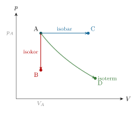
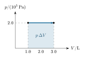
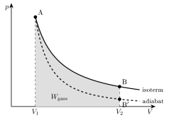
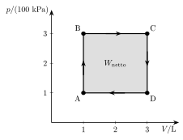
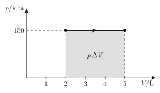

<!-- video: kommer (videoer/fysikk-forkurs/09-07-prosesstyper-og-pv-diagram) -->
{fig-alt="Video kommer"}

<!-- tillegg: Claude -->
Når du pumper sykkelen, blir pumpa varm. I en bilmotor eksploderer bensindamp og skyver et stempel ned. I et kjøleskap blir en gass presset sammen og slipper så ut igjen, om og om igjen. I alle disse tilfellene skjer det noe med en gass: Trykket, volumet og temperaturen endrer seg, og gassen tar opp eller gir fra seg energi som varme og arbeid. En slik endring kaller vi en **prosess**. På denne siden ser vi på de viktigste prosesstypene, og på et diagram som gjør det lett å se hvor mye arbeid gassen gjør.

## Tilstander i et pV-diagram

<!-- tillegg: Claude -->
En bestemt mengde gass har til enhver tid et trykk $p$, et volum $V$ og en temperatur $T$. Til sammen kaller vi dem gassens **tilstand**. Tilstandslikningen for idealgass binder dem sammen:
$$
pV = N\mathrm{k_B}T = n\mathrm{R}T
$$
Kjenner vi to av dem, er den tredje bestemt. Derfor kan vi tegne tilstanden som ett punkt i et diagram med volumet langs førsteaksen og trykket langs andreaksen. Det kalles et **$pV$-diagram**. Temperaturen leser vi ikke direkte av, men den følger av $T = pV/(n\mathrm{R})$.

Alle punkter med samme temperatur ligger på en kurve der $pV$ er konstant. En slik kurve kalles en **isoterm**. Dobler vi volumet, halveres trykket. Isotermene for høyere temperaturer ligger lenger ut fra aksene, fordi produktet $pV$ er større.

{.tikz-fig style="width:440px" fig-alt="pV-diagram med tre isotermer for temperaturene T1, 2T1 og 3T1. Kurvene faller mot høyre, og kurvene for høyere temperatur ligger lenger ut. Punktet A har volumet V_A og trykket p_A og ligger på isotermen T1. Punktet B har dobbelt så stort volum og samme trykk og ligger på isotermen 2T1. Punktet C har dobbelt så stort volum og halvt så stort trykk og ligger på isotermen T1."}

Figuren viser det med tre tilstander. A og C ligger på samme isoterm: Volumet er doblet og trykket halvert, så $pV$ og dermed temperaturen er den samme. I B har gassen dobbelt så stort volum som i A, men samme trykk. Da er $pV$ dobbelt så stort, og den absolutte temperaturen er doblet.

## Fire idealprosesser

Tilstandslikningen $pV = N\mathrm{k_B}T$ forbinder tre størrelser. Avhengig av hvilken som holdes *konstant*, skiller vi mellom tre idealprosesser:
<!-- tillegg: Claude: rettet k_B til rett skrift. Raden for adiabatisk prosess er lagt til. -->

::: {.graa}
| **Prosesstype** | **Konstant** | **Sammenheng** | **Eksempel**             |
|:----------------|:-------------|:---------------|:-------------------------|
| Isokor          | $V =$ konst. | $p/T =$ konst. | Trykkbeholder            |
| Isobar          | $p =$ konst. | $V/T =$ konst. | Stempel under atm. trykk |
| Isoterm         | $T =$ konst. | $pV =$ konst.  | Sakte kompresjon         |
| Adiabatisk      | $Q = 0$      | $p$, $V$ og $T$ endres | Rask kompresjon i sykkelpumpe |
:::

<!-- tillegg: Claude -->
Den fjerde prosessen holder ikke en tilstandsstørrelse konstant. I en **adiabatisk** prosess går det ingen varme inn eller ut av gassen, $Q = 0$. Det skjer når gassen er godt isolert, eller når prosessen går så fort at varmen ikke rekker å strømme. Vi kommer tilbake til den lenger ned.

::: center
{.tikz-fig style="width:382px"}

[$pV$-diagram for tre prosesser som starter i punkt A. Isokor: volumet er konstant, trykket synker — bare A$\to$B, rett ned. Isobar: trykket er konstant, volumet øker — A$\to$C, vannrett mot høyre. Isoterm: temperaturen er konstant, $pV$ er konstant — A$\to$D langs en fallende kurve.]{.figurtekst}
:::
<!-- tillegg: Claude: figurteksten viser til retningene i stedet for fargene, som endres i mørk modus -->

## Arbeid er arealet under kurven

Et *$pV$-diagram* viser trykket $p$ som funksjon av volumet $V$. Arealet under kurven tilsvarer arbeidet gassen gjør (eller arbeidet som gjøres på gassen). For en isobar prosess er arealet et rektangel med høyde $p$ og bredde $\Delta V$. Det er nettopp arbeidet $W_\text{gass} = p\,\Delta V$ fra *termodynamikkens 1. lov*. Endres trykket underveis, er arbeidet fortsatt arealet under kurven.

<!-- tillegg: Claude -->
Hvorfor arealet? Tenk deg at prosessen deles opp i mange små steg. I hvert steg endres volumet bare litt, $\Delta V$, og trykket er nesten konstant. Arbeidet i steget er da $p\,\Delta V$, som er arealet av en smal stolpe under kurven. Summen av alle stolpene er arealet under hele kurven. Retningen avgjør fortegnet:

::: {.kort}
- **Mot høyre** Volumet øker. Gassen skyver stempelet ut og gjør et positivt arbeid $W_\text{gass}$ på omgivelsene. I 1. lov er da $W = -W_\text{gass}$ negativ.
- **Mot venstre** Volumet minker. Omgivelsene presser gassen sammen og gjør arbeid *på* gassen, så $W$ er positiv.
- **Rett opp eller ned** Volumet er konstant. Ingen stolper, ikke noe areal: $W = 0$.
:::

::: {.eksempel}
**Eksempel: Arbeid ved isobar utvidelse.** En gass i en sylinder har trykket $2.0\cdot 10^{5}\ \mathrm{Pa}$. Gassen varmes opp og utvider seg ved konstant trykk fra $1.0\ \mathrm{L}$ til $3.0\ \mathrm{L}$.

a)  Tegn prosessen i et $pV$-diagram, og finn arbeidet gassen gjør.

b)  Under prosessen tilføres $1.0\ \mathrm{kJ}$ varme. Finn endringen i den indre energien.

::: {.losning}
**a)** Prosessen er en horisontal linje i $pV$-diagrammet. Arbeidet gassen gjør, er arealet under linjen (det skraverte rektangelet):

::: center
{.tikz-fig style="width:324px"}

[Isobar utvidelse. Arealet under linjen er arbeidet gassen gjør.]{.figurtekst}
:::

Med $\Delta V = 3.0\ \mathrm{L} - 1.0\ \mathrm{L} = 2.0\ \mathrm{L} = 2.0\cdot 10^{-3}\ \mathrm{m}^{3}$: $$W_\text{gass} = p\,\Delta V = 2.0\cdot 10^{5}\ \mathrm{Pa}\cdot2.0\cdot 10^{-3}\ \mathrm{m}^{3} = \underline{\underline{4.0\cdot 10^{2}\ \mathrm{J}}}$$

**b)** Gassen gjør arbeid på omgivelsene, så $W = -4.0\cdot 10^{2}\ \mathrm{J}$ i 1. lov: $$\Delta U = Q + W = 1.0\cdot 10^{3}\ \mathrm{J} - 4.0\cdot 10^{2}\ \mathrm{J} = \underline{\underline{6.0\cdot 10^{2}\ \mathrm{J}}}$$ Bare $60\ \%$ av varmen går til å øke den indre energien. Resten blir til arbeid på stempelet.
:::
:::

### Arbeid langs en isoterm

<!-- tillegg: Claude -->
Langs en isoterm faller trykket mens volumet øker, så arealet er ikke et rektangel. Vi kan likevel finne det, for eksempel ved å telle ruter, eller ved å la en datamaskin legge sammen mange smale stolper (se *Prøv selv* under). Med matematikk som du lærer senere, kan arealet regnes ut nøyaktig. Resultatet er en formel du kan bruke uten å kunne utledningen:

::: {.graa}
$$
W_\text{gass} = n\mathrm{R}T\,\ln\frac{V_2}{V_1} \qquad\text{(isoterm prosess)}
$$
:::

Her er $\ln$ den naturlige logaritmen, som du finner på kalkulatoren. Når gassen utvider seg, er $V_2 > V_1$, og $\ln(V_2/V_1)$ er positiv.

::: {.eksempel}
**Eksempel: Isoterm utvidelse.** $0.100\ \mathrm{mol}$ gass utvider seg langsomt fra $1.00\ \mathrm{L}$ til $2.00\ \mathrm{L}$ mens temperaturen holdes på $300\ \mathrm{K}$. a) Finn trykket før og etter. b) Finn arbeidet gassen gjør. c) Hvor mye varme tilføres gassen?

::: {.losning}
a) Fra tilstandslikningen, med $V_1 = 1.00\cdot10^{-3}\ \mathrm{m^3}$:
$$
p_1 = \frac{n\mathrm{R}T}{V_1} = \frac{0.100\ \mathrm{mol}\cdot8.314\ \mathrm{J/(mol\cdot K)}\cdot300\ \mathrm{K}}{1.00\cdot10^{-3}\ \mathrm{m^3}} = \underline{\underline{249\ \mathrm{kPa}}}
$$
Volumet dobles og temperaturen er den samme, så trykket halveres: $p_2 = \underline{\underline{125\ \mathrm{kPa}}}$.

b)
$$
W_\text{gass} = n\mathrm{R}T\,\ln\frac{V_2}{V_1} = 0.100\ \mathrm{mol}\cdot8.314\ \mathrm{J/(mol\cdot K)}\cdot300\ \mathrm{K}\cdot\ln 2 = \underline{\underline{173\ \mathrm{J}}}
$$
Er svaret rimelig? Hadde trykket vært $249\ \mathrm{kPa}$ hele veien, ville arbeidet vært $249\ \mathrm{kPa}\cdot1.00\ \mathrm{L} = 249\ \mathrm{J}$. Med $125\ \mathrm{kPa}$ hele veien ville det vært $125\ \mathrm{J}$. Det virkelige trykket ligger mellom, og det gjør svaret også.

c) Temperaturen er konstant, så den indre energien endres ikke: $\Delta U = 0$. Da gir 1. lov $Q = -W = W_\text{gass}$. Gassen får tilført $\underline{\underline{173\ \mathrm{J}}}$ varme, og alt sammen blir til arbeid.
:::
:::

## Energien i hver prosess

<!-- tillegg: Claude -->
Termodynamikkens 1. lov, $\Delta U = Q + W$, gjelder i alle prosesser. For en idealgass hjelper det at den indre energien bare avhenger av temperaturen. I en gass med enkeltatomer, som helium og argon, er den indre energien bare bevegelsesenergien til atomene. Hvert atom har i gjennomsnitt $\tfrac32\mathrm{k_B}T$, så
$$
U = \tfrac32 N\mathrm{k_B}T = \tfrac32 n\mathrm{R}T \qquad\text{og}\qquad \Delta U = \tfrac32 n\mathrm{R}\,\Delta T
$$
For luft og andre gasser med to atomer i molekylet roterer molekylene også, og da blir $U = \tfrac52 n\mathrm{R}T$. Det viktige er at **$U$ øker når $T$ øker, og er uendret når $T$ er uendret**. Da får vi denne oversikten:

::: {.graa}
| Prosess | Arbeid | 1. lov gir |
|:---|:---|:---|
| Isokor | $W = 0$ | $\Delta U = Q$: all varme går til å øke temperaturen |
| Isobar | $W_\text{gass} = p\,\Delta V$ | $Q = \Delta U + p\,\Delta V$: varmen deles mellom $U$ og arbeid |
| Isoterm | $W_\text{gass} = n\mathrm{R}T\ln(V_2/V_1)$ | $\Delta U = 0$, så $Q = W_\text{gass}$: all varme blir til arbeid |
| Adiabatisk | arealet under kurven | $Q = 0$, så $\Delta U = W$: arbeid på gassen gjør den varmere |
:::

::: {.eksempel}
**Eksempel: Samme oppvarming, ulik varme.** $0.100\ \mathrm{mol}$ helium varmes fra $300\ \mathrm{K}$ til $400\ \mathrm{K}$. Hvor mye varme trengs a) når volumet er konstant, og b) når trykket er konstant?

::: {.losning}
Endringen i indre energi er den samme i begge tilfeller, fordi den bare avhenger av temperaturen:
$$
\Delta U = \tfrac32 n\mathrm{R}\,\Delta T = \tfrac32\cdot0.100\ \mathrm{mol}\cdot8.314\ \mathrm{J/(mol\cdot K)}\cdot100\ \mathrm{K} = 124.7\ \mathrm{J}
$$

a) Isokor: $W = 0$, så $Q = \Delta U = \underline{\underline{125\ \mathrm{J}}}$.

b) Isobar: Gassen utvider seg og gjør arbeid. Med tilstandslikningen er $p\,\Delta V = n\mathrm{R}\,\Delta T$ når trykket er konstant:
$$
W_\text{gass} = n\mathrm{R}\,\Delta T = 0.100\ \mathrm{mol}\cdot8.314\ \mathrm{J/(mol\cdot K)}\cdot100\ \mathrm{K} = 83.1\ \mathrm{J}
$$
$$
Q = \Delta U + W_\text{gass} = 124.7\ \mathrm{J} + 83.1\ \mathrm{J} = \underline{\underline{208\ \mathrm{J}}}
$$
Ved konstant trykk trengs det altså mer varme for samme temperaturøkning, fordi en del av energien går med til å skyve stempelet ut.
:::
:::

## Adiabatiske prosesser

<!-- tillegg: Claude -->
I en adiabatisk prosess er $Q = 0$, så $\Delta U = W$. Presses gassen sammen, gjør omgivelsene arbeid på den, $W > 0$, og temperaturen stiger. Det er derfor sykkelpumpa blir varm. Utvider gassen seg, gjør den arbeid, den indre energien synker, og gassen blir kaldere. Det merker du når du slipper luft ut av et bildekk eller bruker en sprayboks: Ventilen blir kald.

I $pV$-diagrammet er en adiabat brattere enn isotermen gjennom samme punkt. Når gassen utvider seg adiabatisk, faller trykket både fordi volumet øker *og* fordi temperaturen synker. Derfor gjør gassen mindre arbeid i en adiabatisk utvidelse enn i en isoterm utvidelse mellom de samme volumene.

{.tikz-fig style="width:440px" fig-alt="pV-diagram med en isoterm og en adiabat som starter i samme punkt A ved volumet V1. Adiabaten, stiplet, faller brattere og ender i punktet B' ved volumet V2, under punktet B på isotermen. Arealet under isotermen fra V1 til V2 er skravert og merket W_gass."}

::: {.callout-tip title="For de spesielt interesserte: likningen for en adiabat"}
For en idealgass i en adiabatisk prosess er
$$
pV^{\gamma} = \text{konst.}
$$
der $\gamma = 5/3$ for gasser med enkeltatomer og $\gamma = 7/5$ for luft. Siden $\gamma > 1$, faller trykket raskere enn langs en isoterm, der $pV$ er konstant. Kombinert med tilstandslikningen gir det også $TV^{\gamma-1} = \text{konst.}$
:::

## Kretsprosesser

<!-- tillegg: Claude -->
En motor kan ikke bare utvide seg for alltid. Stempelet må tilbake, og gassen må tilbake til starttilstanden, så maskinen kan gjenta det samme igjen og igjen. En prosess som ender der den begynte, kalles en **kretsprosess**. I $pV$-diagrammet blir den en lukket kurve.

{.tikz-fig style="width:360px" fig-alt="pV-diagram med en rektangulær kretsprosess A til B til C til D og tilbake til A. A er ved 1 L og 100 kPa, B ved 1 L og 300 kPa, C ved 3 L og 300 kPa og D ved 3 L og 100 kPa. Pilene går med klokka, og arealet inni rektangelet er skravert og merket W_netto."}

Etter én runde er gassen tilbake i samme tilstand, så $\Delta U = 0$. Gassen gjør arbeid når den utvider seg (arealet under den øverste veien), og omgivelsene gjør arbeid på den når den presses sammen (arealet under den nederste veien). Forskjellen er arealet *inni* kurven:

::: {.callout-important title="Arbeid i en kretsprosess"}
Nettoarbeidet gassen gjør i én runde, er arealet som kurven omslutter. Går prosessen **med klokka**, gjør gassen positivt nettoarbeid: Det er en varmekraftmaskin. Går den **mot klokka**, må omgivelsene gjøre nettoarbeid på gassen: Det er et kjøleskap eller en varmepumpe.
:::

::: {.eksempel}
**Eksempel: En rektangulær kretsprosess.** Gassen i figuren går rundt A → B → C → D → A. Finn arbeidet gassen gjør i hvert steg, nettoarbeidet og nettovarmen som tilføres i én runde.

::: {.losning}
A → B og C → D er isokore, så der er arbeidet null.

B → C er isobar ved $300\ \mathrm{kPa}$, med $\Delta V = 2.0\ \mathrm{L} = 2.0\cdot10^{-3}\ \mathrm{m^3}$:
$$
W_\text{BC} = 300\cdot10^{3}\ \mathrm{Pa}\cdot2.0\cdot10^{-3}\ \mathrm{m^3} = 6.0\cdot10^{2}\ \mathrm{J}
$$
D → A er isobar ved $100\ \mathrm{kPa}$, og volumet minker med $2.0\ \mathrm{L}$:
$$
W_\text{DA} = 100\cdot10^{3}\ \mathrm{Pa}\cdot(-2.0\cdot10^{-3}\ \mathrm{m^3}) = -2.0\cdot10^{2}\ \mathrm{J}
$$
Nettoarbeidet gassen gjør, er
$$
W_\text{netto} = 6.0\cdot10^{2}\ \mathrm{J} - 2.0\cdot10^{2}\ \mathrm{J} = \underline{\underline{4.0\cdot10^{2}\ \mathrm{J}}}
$$
Det er nøyaktig arealet av rektangelet: $(300 - 100)\ \mathrm{kPa}\cdot2.0\ \mathrm{L} = 4.0\cdot10^{2}\ \mathrm{J}$.

Etter en runde er $\Delta U = 0$, så 1. lov gir at nettovarmen inn er lik nettoarbeidet ut: $Q_\text{netto} = \underline{\underline{4.0\cdot10^{2}\ \mathrm{J}}}$. Gassen tar opp mer varme enn den gir fra seg, og forskjellen blir til arbeid. Hvor stor del av varmen som kan bli arbeid, er tema for [Termodynamikkens 2. lov](08-termodynamikkens-2-lov.qmd).
:::
:::

## Prøv selv

<!-- tillegg: Claude -->
Programmet tegner en isoterm og en adiabat fra samme starttilstand og finner arbeidet som arealet under kurvene, ved å legge sammen mange smale stolper. Sammenlikn arealet under isotermen med formelen $n\mathrm{R}T\ln(V_2/V_1)$. Endre sluttvolumet, eller sett `gamma = 7/5` for luft, og trykk **Kjør**.

```{.python .kjor}
import numpy as np
import matplotlib.pyplot as plt

R = 8.314        # J/(mol K)
n = 0.100        # stoffmengde i mol
T1 = 300         # starttemperatur i K
V1 = 1.00e-3     # startvolum i m^3
V2 = 2.00e-3     # sluttvolum i m^3
gamma = 5/3      # 5/3 for helium og argon, 7/5 for luft

p1 = n * R * T1 / V1
V = np.linspace(V1, V2, 1000)
p_iso = p1 * V1 / V                  # isoterm: pV = konstant
p_adi = p1 * (V1 / V)**gamma         # adiabat: pV^gamma = konstant

# arealet under kurvene: summen av smale stolper p * dV
dV = V[1] - V[0]
W_iso = np.sum(p_iso[:-1] * dV)
W_adi = np.sum(p_adi[:-1] * dV)
print(f"Isoterm:  W = {W_iso:.1f} J   (formel: {n*R*T1*np.log(V2/V1):.1f} J)")
print(f"Adiabat:  W = {W_adi:.1f} J")
print(f"Temperatur etter adiabaten: {p_adi[-1]*V2/(n*R):.0f} K")

plt.plot(V * 1000, p_iso / 1000, label="isoterm")
plt.plot(V * 1000, p_adi / 1000, "--", label="adiabat")
plt.fill_between(V * 1000, p_iso / 1000, alpha=0.2)
plt.xlabel("V (L)")
plt.ylabel("p (kPa)")
plt.legend()
plt.grid(True)
plt.show()
```

:::: {.oppgaver}

::: {.oppgave tittel="Hvilken prosess?"}
<!-- tillegg: Claude -->
Avgjør hvilken av de fire idealprosessene som passer best, og om gassen gjør arbeid, får arbeid gjort på seg eller ingen av delene.

a)  En lukket gassflaske av stål står i sola og blir varm.

b)  Luft i en sylinder med et stempel som glir lett, varmes langsomt opp. Lufttrykket utenfor er konstant.

c)  Du presser stempelet i en sykkelpumpe raskt inn mens du holder for ventilen.

d)  En gass i en metallsylinder som står i et stort vannbad, presses langsomt sammen.

::: {.losning}
**a)** **Isokor.** Stålflaska har fast volum. Stempel finnes ikke, så **ingen arbeid**. All varmen fra sola går til å øke den indre energien, og trykket stiger.

**b)** **Isobar.** Stempelet glir til trykket inni er like stort som trykket utenfor, så trykket er konstant. Lufta utvider seg og **gjør arbeid** på stempelet.

**c)** **Adiabatisk.** Det går så fort at varmen ikke rekker å strømme ut. **Arbeid gjøres på gassen**, og temperaturen stiger.

**d)** **Isoterm.** Vannbadet holder temperaturen konstant, og langsom kompresjon gir varmen tid til å strømme ut i vannet. **Arbeid gjøres på gassen**, og like mye energi forsvinner ut som varme.
:::
:::

::: {.oppgave tittel="Arbeid i et pV-diagram"}
En gass utvider seg ved konstant trykk $p = 150\ \mathrm{kPa}$, fra volumet $2.0\ \mathrm{L}$ til $5.0\ \mathrm{L}$.

a)  Tegn prosessen i et $pV$-diagram.

b)  Finn arbeidet gassen gjør på omgivelsene. Hva blir $W$ i termodynamikkens 1. lov?

c)  Under prosessen blir det tilført $1.1\ \mathrm{kJ}$ varme til gassen. Finn endringen i den indre energien til gassen.

::: {.losning}
**a)** Trykket er konstant, så prosessen er en horisontal linje fra $2.0\ \mathrm{L}$ til $5.0\ \mathrm{L}$. Arealet under linjen er arbeidet gassen gjør.

{.tikz-fig style="width:340px" fig-alt="pV-diagram med en vannrett linje ved 150 kPa fra 2 L til 5 L, med pil mot høyre. Rektangelet under linjen er skravert og merket p ganger delta V."}
<!-- tillegg: Claude: figuren manglet -->

**b)** Arbeidet gassen gjør, er arealet under linjen. Med $\Delta V = 5.0\ \mathrm{L} - 2.0\ \mathrm{L} = 3.0\ \mathrm{L} = 3.0\cdot 10^{-3}\ \mathrm{m}^{3}$: $$W_\text{gass} = p\,\Delta V = 150\cdot 10^{3}\ \mathrm{Pa}\cdot3.0\cdot 10^{-3}\ \mathrm{m}^{3} = \underline{\underline{4.5\cdot 10^{2}\ \mathrm{J}}}$$ I 1. lov er $W$ arbeidet som gjøres *på* gassen. Gassen gjør arbeid på omgivelsene, så $W = \underline{\underline{-4.5\cdot 10^{2}\ \mathrm{J}}}$.

**c)** $$\Delta U = Q + W = 1.1\cdot 10^{3}\ \mathrm{J} - 4.5\cdot 10^{2}\ \mathrm{J} = \underline{\underline{6.5\cdot 10^{2}\ \mathrm{J}}}$$
:::
:::

::: {.oppgave tittel="To prosesser etter hverandre" niva="Middels"}
En gass er i tilstand A med trykk $p_\text{A} = 100\ \mathrm{kPa}$, volum $V_\text{A} = 4.0\ \mathrm{L}$ og temperatur $T_\text{A} = 300\ \mathrm{K}$. Gassen blir først presset sammen isotermt til volumet $1.0\ \mathrm{L}$ (tilstand B). Deretter blir den varmet opp ved konstant volum til $600\ \mathrm{K}$ (tilstand C).

a)  Finn trykket i tilstand B.

b)  Finn trykket i tilstand C.

c)  Skisser de to prosessene i et $pV$-diagram.

d)  Gjør gassen noe arbeid fra B til C? Begrunn svaret.

::: {.losning}
**a)** A til B er isoterm ($T$ konstant), så $pV$ er konstant: $$p_\text{A}V_\text{A} = p_\text{B}V_\text{B}
  \quad\implies\quad
  p_\text{B} = p_\text{A}\cdot\frac{V_\text{A}}{V_\text{B}} = 100\ \mathrm{kPa}\cdot\frac{4.0\ \mathrm{L}}{1.0\ \mathrm{L}} = \underline{\underline{4.0\cdot 10^{2}\ \mathrm{kPa}}}$$

**b)** B til C er isokor ($V$ konstant), så $p/T$ er konstant. Temperaturen i B er fortsatt $300\ \mathrm{K}$: $$p_\text{C} = p_\text{B}\cdot\frac{T_\text{C}}{T_\text{B}} = 4.0\cdot 10^{2}\ \mathrm{kPa}\cdot\frac{600\ \mathrm{K}}{300\ \mathrm{K}} = \underline{\underline{8.0\cdot 10^{2}\ \mathrm{kPa}}}$$

**c)** Fra A til B følger gassen en isoterm, en kurve der $pV$ er konstant. Fra B til C går gassen rett opp, fordi volumet er konstant.

{.tikz-fig style="width:360px" fig-alt="pV-diagram med to stiplede isotermer for 300 K og 600 K. Gassen går fra A ved 4 L og 100 kPa langs isotermen for 300 K til B ved 1 L og 400 kPa, og derfra rett opp til C ved 1 L og 800 kPa, som ligger på isotermen for 600 K."}
<!-- tillegg: Claude: figuren manglet -->

**d)** **Nei**. Fra B til C er volumet konstant. Stempelet beveger seg ikke, og arealet under linjen i $pV$-diagrammet er null. Da er $W = 0$, og all varmen som tilføres, går til å øke den indre energien.
:::
:::

::: {.oppgave tittel="Trekant mot klokka" niva="Middels"}
<!-- tillegg: Claude -->
En gass går gjennom kretsprosessen A → B → C → A. I A er volumet $1.0\ \mathrm{L}$ og trykket $100\ \mathrm{kPa}$. Fra A til B utvider gassen seg ved konstant trykk til $4.0\ \mathrm{L}$. Fra B går den langs en rett linje i $pV$-diagrammet til C, der volumet er $1.0\ \mathrm{L}$ og trykket $400\ \mathrm{kPa}$. Fra C går den rett ned til A.

a)  Skisser kretsprosessen. Går den med eller mot klokka?

b)  Finn arbeidet gassen gjør i hvert av de tre stegene.

c)  Finn nettoarbeidet gassen gjør i én runde. Er dette en motor eller et kjøleskap?

::: {.losning}
**a)** A og B ligger på bunnen ved $100\ \mathrm{kPa}$, og C ligger rett over A. Gassen går mot høyre langs bunnen, skrått opp og til venstre, og så rett ned. Det er **mot klokka**.

**b)** A → B, isobar med $\Delta V = 3.0\ \mathrm{L} = 3.0\cdot10^{-3}\ \mathrm{m^3}$:
$$
W_\text{AB} = 100\cdot10^{3}\ \mathrm{Pa}\cdot3.0\cdot10^{-3}\ \mathrm{m^3} = \underline{\underline{3.0\cdot10^{2}\ \mathrm{J}}}
$$
B → C: Volumet minker med $3.0\ \mathrm{L}$, så gassen gjør negativt arbeid. Arealet under den skrå linjen er et trapes med gjennomsnittlig høyde $(100 + 400)/2\ \mathrm{kPa} = 250\ \mathrm{kPa}$:
$$
W_\text{BC} = -250\cdot10^{3}\ \mathrm{Pa}\cdot3.0\cdot10^{-3}\ \mathrm{m^3} = \underline{\underline{-7.5\cdot10^{2}\ \mathrm{J}}}
$$
C → A er isokor: $W_\text{CA} = \underline{\underline{0}}$.

**c)**
$$
W_\text{netto} = 3.0\cdot10^{2}\ \mathrm{J} - 7.5\cdot10^{2}\ \mathrm{J} + 0 = \underline{\underline{-4.5\cdot10^{2}\ \mathrm{J}}}
$$
Kontroll: Arealet av trekanten er $\tfrac12\cdot3.0\ \mathrm{L}\cdot300\ \mathrm{kPa} = 4.5\cdot10^{2}\ \mathrm{J}$. Fortegnet er negativt fordi prosessen går mot klokka: Omgivelsene må gjøre nettoarbeid på gassen. Det er et **kjøleskap** (eller en varmepumpe), ikke en motor.
:::
:::

::: {.oppgave tittel="Tenning uten tennplugg" niva="Utfordrende"}
<!-- tillegg: Claude -->
I en dieselmotor blir lufta presset sammen så raskt at prosessen er tilnærmet adiabatisk, til $1/18$ av startvolumet. Lufta har temperaturen $20\ ^\circ\mathrm{C}$ og trykket $100\ \mathrm{kPa}$ før kompresjonen. For luft er $TV^{0.4}$ konstant i en adiabatisk prosess, og $pV^{1.4}$ er konstant.

a)  Finn temperaturen etter kompresjonen. Dieselolje antennes av seg selv ved omtrent $250\ ^\circ\mathrm{C}$. Er lufta varm nok?

b)  Finn trykket etter kompresjonen.

c)  Hvilket trykk ville du fått hvis kompresjonen var isoterm? Forklar med 1. lov hvorfor den adiabatiske kompresjonen gir høyere trykk.

::: {.losning}
**a)** Vi bruker kelvin: $T_1 = 293\ \mathrm{K}$, og $V_1/V_2 = 18$.
$$
T_2V_2^{0.4} = T_1V_1^{0.4} \quad\implies\quad T_2 = T_1\left(\frac{V_1}{V_2}\right)^{0.4} = 293\ \mathrm{K}\cdot18^{0.4} = 931\ \mathrm{K} \approx \underline{\underline{9.3\cdot10^{2}\ \mathrm{K}}}
$$
Det er omtrent $660\ ^\circ\mathrm{C}$, godt over tenningstemperaturen. Dieselen antennes når den sprøytes inn, uten tennplugg.

**b)**
$$
p_2 = p_1\left(\frac{V_1}{V_2}\right)^{1.4} = 100\ \mathrm{kPa}\cdot18^{1.4} = 5.72\ \mathrm{MPa} \approx \underline{\underline{5.7\ \mathrm{MPa}}}
$$

**c)** Isotermt er $pV$ konstant: $p_2 = 100\ \mathrm{kPa}\cdot18 = \underline{\underline{1.8\ \mathrm{MPa}}}$. I den adiabatiske kompresjonen er $Q = 0$, så hele arbeidet stempelet gjør, øker den indre energien: $\Delta U = W > 0$. Temperaturen stiger derfor (her mer enn tre ganger i kelvin), og etter tilstandslikningen gir høyere temperatur ved samme volum høyere trykk. I den isoterme kompresjonen strømmer energien ut som varme, og temperaturen blir den samme.
:::
:::

::::
