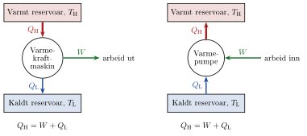

<!-- video: kommer (videoer/fysikk-forkurs/09-07-termodynamikkens-2-lov) -->
{fig-alt="Video kommer"}

<!-- tillegg: Claude -->
En kopp varm kaffe på bordet blir kald etter en stund. Kaffen gir varme til lufta i rommet, og til slutt har kaffen og lufta samme temperatur. Det motsatte skjer aldri: Kaffen begynner ikke av seg selv å suge varme fra den kalde lufta og blir varmere. Det ville ikke bryte energibevaringen, for energien ville bare flyttet seg. Likevel ser vi det aldri. Termodynamikkens 1. lov sier at energien er bevart. **Termodynamikkens 2. lov** sier noe om hvilken *vei* energien går, og den setter grenser for hvor gode motorer, kraftverk og varmepumper kan bli.

## Varme går fra varmt til kaldt

Den enkleste måten å si loven på er denne:

::: {.callout-note title="Definisjon: Termodynamikkens 2. lov"}
Varme går av seg selv bare fra et varmere til et kaldere legeme, aldri omvendt.
:::

«Av seg selv» er viktig. Et kjøleskap flytter varme fra den kalde innsiden til det varmere kjøkkenet, men bare fordi det får tilført elektrisk energi. Uten arbeid utenfra går varmen alltid fra varmt til kaldt.

## Varmekraftmaskiner

En **varmekraftmaskin** gjør varme om til arbeid. Bilmotorer, dampturbiner i kraftverk og jetmotorer er eksempler. Alle virker etter samme mønster:

{.tikz-fig style="width:560px" fig-alt="To energiflytdiagram. Til venstre en varmekraftmaskin: varmen Q_H går fra et varmt reservoar med temperaturen T_H inn i maskinen, maskinen gir arbeidet W ut, og resten av varmen, Q_L, går ned til et kaldt reservoar med temperaturen T_L. Til høyre en varmepumpe: arbeidet W går inn, varmen Q_L hentes fra det kalde reservoaret, og varmen Q_H leveres til det varme reservoaret. I begge er Q_H = W + Q_L."}

::: {.steg}
1. Maskinen tar inn varmen $Q_\text{H}$ fra noe varmt, for eksempel brennende bensin eller damp fra en kjele. Temperaturen der kaller vi $T_\text{H}$ (H for høy).
2. En del av energien blir til arbeid $W$, for eksempel til å drive hjulene eller en generator.
3. Resten, $Q_\text{L}$, må gis bort som varme til noe kaldere, for eksempel lufta eller kjølevann. Den temperaturen kaller vi $T_\text{L}$ (L for lav).
:::

Her regner vi $Q_\text{H}$, $Q_\text{L}$ og $W$ som positive tall. Energien er bevart (1. lov), så det som går inn, må komme ut:
$$
Q_\text{H} = W + Q_\text{L}
$$

2. lov sier at det tredje steget **ikke kan hoppes over**. Ingen varmekraftmaskin kan gjøre all varmen om til arbeid. Noe varme må alltid gis bort til omgivelsene. Det er derfor bilen har radiator og kraftverk har kjøletårn.

Hvor god maskinen er, måles med **virkningsgraden** $\eta$ (den greske bokstaven eta): hvor stor del av varmen som blir til nyttig arbeid.

::: {.graa}
$$
\eta = \frac{W}{Q_\text{H}} = 1 - \frac{Q_\text{L}}{Q_\text{H}}
$$
:::

Virkningsgraden er et tall mellom 0 og 1, og oppgis ofte i prosent. Den samme formelen gjelder for effekter: Bruker vi energi per sekund i stedet for energi, får vi $\eta = P_\text{ut}/P_\text{inn}$.

::: {.eksempel}
**Eksempel: Bilmotoren.** Hvert sekund gir forbrenningen av bensin en bilmotor $96.0\ \mathrm{kJ}$ varme. Motoren gjør $24.0\ \mathrm{kJ}$ arbeid på hjulene i løpet av det samme sekundet. a) Finn virkningsgraden. b) Hvor mye varme gir motoren fra seg til omgivelsene hvert sekund?

::: {.losning}
**Kjent:** $Q_\text{H} = 96.0\ \mathrm{kJ}$, $W = 24.0\ \mathrm{kJ}$.

a) Virkningsgraden er arbeidet delt på varmen som går inn:
$$
\eta = \frac{W}{Q_\text{H}} = \frac{24.0\ \mathrm{kJ}}{96.0\ \mathrm{kJ}} = \underline{\underline{0.250 = 25.0\ \%}}
$$

b) Energien er bevart, så resten går bort som varme:
$$
Q_\text{L} = Q_\text{H} - W = 96.0\ \mathrm{kJ} - 24.0\ \mathrm{kJ} = \underline{\underline{72.0\ \mathrm{kJ}}}
$$
Tre fjerdedeler av energien i bensinen blir altså til varme i eksosen og radiatoren, ikke til fart. Effekten motoren gir til hjulene, er $24.0\ \mathrm{kW}$.
:::
:::

### Den største mulige virkningsgraden

Hvor god kan en varmekraftmaskin bli i beste fall? Den franske ingeniøren Sadi Carnot fant svaret i 1824. Den største mulige virkningsgraden avhenger bare av de to temperaturene:

::: {.graa}
$$
\eta_\text{maks} = 1 - \frac{T_\text{L}}{T_\text{H}}
$$
:::

Temperaturene **må** være i kelvin ($T = t + 273$). Ingen virkelig maskin når helt opp til denne grensen, fordi det alltid er litt friksjon og varmetap underveis. Men formelen viser hva som skal til for å få en god maskin: Temperaturen på den varme siden må være høy, og den kalde siden må være kald. Derfor brenner moderne kraftverk og motorer brenslet ved så høy temperatur som materialene tåler.

::: {.eksempel}
**Eksempel: Dampkraftverket.** I et kraftverk kommer dampen inn i turbinen med temperaturen $540\ ^\circ\mathrm{C}$, og den kjøles ned av elvevann med temperaturen $20\ ^\circ\mathrm{C}$. a) Hva er den største mulige virkningsgraden? b) Kraftverket har i virkeligheten virkningsgraden $40\ \%$. Hvor mye varme må det få fra brenslet for å levere $1.0\ \mathrm{MJ}$ elektrisk energi, og hvor mye varme går til elva?

::: {.losning}
a) Først gjør vi om til kelvin:
$$
T_\text{H} = 540 + 273 = 813\ \mathrm{K}, \qquad T_\text{L} = 20 + 273 = 293\ \mathrm{K}
$$
Den største mulige virkningsgraden er
$$
\eta_\text{maks} = 1 - \frac{T_\text{L}}{T_\text{H}} = 1 - \frac{293\ \mathrm{K}}{813\ \mathrm{K}} = 0.640 = \underline{\underline{64.0\ \%}}
$$

b) Vi løser $\eta = W/Q_\text{H}$ med hensyn på $Q_\text{H}$:
$$
Q_\text{H} = \frac{W}{\eta} = \frac{1.0\ \mathrm{MJ}}{0.40} = \underline{\underline{2.5\ \mathrm{MJ}}}
$$
Varmen som går til elva, er resten:
$$
Q_\text{L} = Q_\text{H} - W = 2.5\ \mathrm{MJ} - 1.0\ \mathrm{MJ} = \underline{\underline{1.5\ \mathrm{MJ}}}
$$
Mer enn halvparten av energien i brenslet går altså til å varme opp elva, selv i et godt kraftverk.
:::
:::

## Varmepumper og kjøleskap

En **varmepumpe** er en varmekraftmaskin som går baklengs (høyre del av figuren). Den bruker arbeid $W$, som regel elektrisk energi, til å flytte varmen $Q_\text{L}$ fra noe kaldt til noe varmt. Til det varme stedet leverer den $Q_\text{H} = W + Q_\text{L}$. Dette bryter ikke 2. lov, for varmen går ikke «av seg selv»: Det kreves arbeid.

::: {.kort}
- **Varmepumpe i huset** Henter varme fra uteluft, jord eller sjøvann og leverer den inne. Det nyttige er varmen $Q_\text{H}$ som kommer inn i huset.
- **Kjøleskap og fryser** Henter varme fra innsiden og gir den fra seg til kjøkkenet gjennom rista på baksiden. Det nyttige er varmen $Q_\text{L}$ som tas ut av skapet.
:::

Hvor god en varmepumpe er, måles med **effektfaktoren**, ofte kalt COP (fra engelsk *coefficient of performance*): hvor mye nyttig varme vi får per joule arbeid vi betaler for.

::: {.graa}
$$
\text{COP}_\text{varmepumpe} = \frac{Q_\text{H}}{W} \qquad\qquad \text{COP}_\text{kjøleskap} = \frac{Q_\text{L}}{W}
$$
:::

Effektfaktoren til en varmepumpe er alltid større enn 1, fordi $Q_\text{H}$ er større enn $W$. Det er hele poenget: En panelovn gir $1\ \mathrm{kWh}$ varme for hver kilowattime strøm, mens en varmepumpe gir gjerne $3\ \mathrm{kWh}$ eller mer. Den største mulige effektfaktoren for en varmepumpe er
$$
\text{COP}_\text{maks} = \frac{T_\text{H}}{T_\text{H} - T_\text{L}}
$$
Jo mindre forskjell det er mellom inne og ute, desto bedre virker varmepumpen. Derfor gir den mindre varme per kilowattime på de kaldeste vinterdagene.

::: {.eksempel}
**Eksempel: Luft-til-luft-varmepumpe.** En varmepumpe gir $6.0\ \mathrm{kW}$ varme til et hus. Effektfaktoren er $3.0$. a) Hvor stor elektrisk effekt bruker varmepumpen? b) Hvor mye varme per sekund henter den fra uteluften? c) Inne er det $21\ ^\circ\mathrm{C}$ og ute $-5\ ^\circ\mathrm{C}$. Hva er den største mulige effektfaktoren?

::: {.losning}
a) Vi bruker effektene: $\text{COP} = P_\text{H}/P_\text{el}$, så
$$
P_\text{el} = \frac{P_\text{H}}{\text{COP}} = \frac{6.0\ \mathrm{kW}}{3.0} = \underline{\underline{2.0\ \mathrm{kW}}}
$$

b) Energien er bevart, så resten av varmen kommer fra uteluften:
$$
P_\text{L} = P_\text{H} - P_\text{el} = 6.0\ \mathrm{kW} - 2.0\ \mathrm{kW} = \underline{\underline{4.0\ \mathrm{kW}}}
$$
Uteluften er kald, men den inneholder likevel mye indre energi som varmepumpen kan hente.

c) I kelvin er $T_\text{H} = 21 + 273 = 294\ \mathrm{K}$ og $T_\text{L} = -5 + 273 = 268\ \mathrm{K}$:
$$
\text{COP}_\text{maks} = \frac{T_\text{H}}{T_\text{H} - T_\text{L}} = \frac{294\ \mathrm{K}}{294\ \mathrm{K} - 268\ \mathrm{K}} = \frac{294\ \mathrm{K}}{26\ \mathrm{K}} = \underline{\underline{11}}
$$
Den virkelige varmepumpen er langt fra denne grensen. Én grunn er at kjølemediet inne i pumpen må være mye kaldere enn uteluften og mye varmere enn inneluften for at varmen skal gå raskt nok.
:::
:::

## Entropi: hvorfor går ting bare én vei?

Hvorfor går varme bare fra varmt til kaldt? Svaret handler om sannsynlighet. Tenk deg en boks med fire gassmolekyler som farer tilfeldig rundt. Hvert molekyl kan være i venstre eller høyre halvdel. Tabellen viser hvor mange måter molekylene kan fordele seg på:

::: {.graa}
| Venstre – høyre | 4 – 0 | 3 – 1 | 2 – 2 | 1 – 3 | 0 – 4 |
|:---|:---:|:---:|:---:|:---:|:---:|
| Antall måter | 1 | 4 | 6 | 4 | 1 |
:::

Det er bare én måte å ha alle fire til venstre på, men seks måter å ha to på hver side på. Med fire molekyler hender det likevel ganske ofte at alle er på samme side. Men en vanlig gassmengde har rundt $10^{23}$ molekyler. Da er sjansen for at alle samler seg i den ene halvdelen så liten at det i praksis aldri skjer. Gassen sprer seg jevnt fordi det finnes uendelig mange flere jevne fordelinger enn skjeve.

**Entropi** er et mål på hvor mange måter et system kan ordne seg på innvendig og fortsatt se likt ut utenfra. En jevn fordeling har høy entropi, en ryddig og samlet fordeling har lav entropi. Med dette begrepet kan 2. lov sies slik:

::: {.callout-important title="2. lov med entropi"}
I et isolert system øker entropien eller blir den samme. Den minker aldri av seg selv.
:::

Det forklarer mange hverdagsfenomener:

::: {.kort}
- **Varm kaffe blir kald** Energien sprer seg fra kaffen til hele rommet. Spredt energi kan fordeles på langt flere måter, så entropien øker.
- **Blekk i vann** En dråpe blekk sprer seg i et glass vann, men samler seg aldri til en dråpe igjen.
- **Knust egg** Et knust egg blir ikke helt igjen. Det finnes mange flere måter å være knust på enn å være helt.
- **Kjøleskapet** Inne i skapet minker entropien når det kjøles, men varmen kjøleskapet gir til kjøkkenet øker entropien der enda mer. Totalt øker den.
:::

Entropi forklarer også grensen for varmekraftmaskiner: Når varmen $Q_\text{H}$ tas ut av det varme reservoaret, minker entropien der. Skal den totale entropien ikke minke, må maskinen gi fra seg litt varme $Q_\text{L}$ til det kalde reservoaret, der entropien øker. Derfor kan $Q_\text{L}$ aldri bli null.

## Prøv selv

Programmet regner ut den største mulige virkningsgraden til en varmekraftmaskin og tegner hvordan den avhenger av temperaturen på den varme siden. Endre temperaturene (i celsius) og trykk **Kjør**. Hvor varm må den varme siden være for at virkningsgraden skal kunne bli $50\ \%$ når den kalde siden er $20\ ^\circ\mathrm{C}$?

```{.python .kjor}
import numpy as np
import matplotlib.pyplot as plt

t_H = 540      # temperatur på den varme siden i grader celsius
t_L = 20       # temperatur på den kalde siden i grader celsius

T_H = t_H + 273    # kelvin
T_L = t_L + 273
eta_maks = 1 - T_L / T_H
print(f"Største mulige virkningsgrad: {eta_maks:.3f} = {100*eta_maks:.1f} %")

# Virkningsgrad som funksjon av temperaturen på den varme siden
t = np.linspace(t_L + 1, 1500, 300)
plt.plot(t, 100 * (1 - T_L / (t + 273)))
plt.plot(t_H, 100 * eta_maks, "o")
plt.xlabel("Temperatur på den varme siden (°C)")
plt.ylabel("Største mulige virkningsgrad (%)")
plt.grid(True)
plt.show()
```

:::: {.oppgaver}

::: {.oppgave tittel="Virkningsgraden til en dampmaskin"}
En gammel dampmaskin tar inn $50.0\ \mathrm{kJ}$ varme fra kjelen og gir fra seg $42.5\ \mathrm{kJ}$ varme til lufta. a) Hvor mye arbeid gjør maskinen? b) Finn virkningsgraden.

::: {.losning}
a) Energien er bevart, $Q_\text{H} = W + Q_\text{L}$, så
$$
W = Q_\text{H} - Q_\text{L} = 50.0\ \mathrm{kJ} - 42.5\ \mathrm{kJ} = \underline{\underline{7.5\ \mathrm{kJ}}}
$$

b) Virkningsgraden er
$$
\eta = \frac{W}{Q_\text{H}} = \frac{7.5\ \mathrm{kJ}}{50.0\ \mathrm{kJ}} = \underline{\underline{0.15 = 15\ \%}}
$$
Arbeidet har bare to gjeldende siffer etter subtraksjonen (én desimal), så svaret får to. Dampmaskinene på 1800-tallet hadde gjerne enda lavere virkningsgrad enn dette.
:::
:::

::: {.oppgave tittel="Kjøleskapet"}
Et kjøleskap tar ut $150\ \mathrm{kJ}$ varme fra innsiden og bruker $50.0\ \mathrm{kJ}$ elektrisk energi til det. a) Hvor mye varme gir kjøleskapet fra seg til kjøkkenet? b) Finn effektfaktoren. c) En varm sommerdag setter noen kjøleskapsdøra åpen for å kjøle ned kjøkkenet. Virker det?

::: {.losning}
a) Kjøleskapet leverer både varmen fra innsiden og den elektriske energien til kjøkkenet:
$$
Q_\text{H} = W + Q_\text{L} = 50.0\ \mathrm{kJ} + 150\ \mathrm{kJ} = \underline{\underline{200\ \mathrm{kJ}}}
$$

b) For et kjøleskap er det varmen som tas ut, som er nyttig:
$$
\text{COP}_\text{kjøleskap} = \frac{Q_\text{L}}{W} = \frac{150\ \mathrm{kJ}}{50.0\ \mathrm{kJ}} = \underline{\underline{3.00}}
$$

c) Nei. Med døra åpen henter kjøleskapet varme fra kjøkkenet foran og gir den tilbake til kjøkkenet bak. I tillegg gir det fra seg den elektriske energien som varme. Kjøkkenet blir derfor litt *varmere*, ikke kaldere. Svaret fra a) viser det: Det kommer ut $200\ \mathrm{kJ}$ bak, men bare $150\ \mathrm{kJ}$ tas inn foran.
:::
:::

::: {.oppgave tittel="Jordvarmekraftverk" niva="Middels"}
Et kraftverk bruker varmt vann fra dypt nede i jorda. Vannet har temperaturen $150\ ^\circ\mathrm{C}$, og kraftverket kjøles med luft på $10\ ^\circ\mathrm{C}$. a) Hva er den største mulige virkningsgraden? b) Hvorfor er virkningsgraden mye lavere enn for et kullkraftverk med damp på over $500\ ^\circ\mathrm{C}$?

::: {.losning}
a) I kelvin er $T_\text{H} = 150 + 273 = 423\ \mathrm{K}$ og $T_\text{L} = 10 + 273 = 283\ \mathrm{K}$:
$$
\eta_\text{maks} = 1 - \frac{T_\text{L}}{T_\text{H}} = 1 - \frac{283\ \mathrm{K}}{423\ \mathrm{K}} = 0.331 = \underline{\underline{33.1\ \%}}
$$

b) Den største mulige virkningsgraden blir høyere jo større $T_\text{H}$ er sammenlignet med $T_\text{L}$. Jordvarmen er bare $150\ ^\circ\mathrm{C}$, så forholdet $T_\text{L}/T_\text{H}$ blir stort og virkningsgraden liten. Til gjengjeld er varmen fra jorda gratis og fornybar.
:::
:::

::: {.oppgave tittel="En for god oppfinnelse" niva="Middels"}
En oppfinner påstår at han har laget en motor som tar inn varme ved $400\ \mathrm{K}$, gir fra seg varme ved $300\ \mathrm{K}$ og har virkningsgraden $30.0\ \%$. Bør du investere i oppfinnelsen?

::: {.losning}
Vi finner den største mulige virkningsgraden for disse temperaturene:
$$
\eta_\text{maks} = 1 - \frac{T_\text{L}}{T_\text{H}} = 1 - \frac{300\ \mathrm{K}}{400\ \mathrm{K}} = 0.250 = \underline{\underline{25.0\ \%}}
$$
Ingen maskin kan ha høyere virkningsgrad enn dette, og virkelige maskiner ligger alltid under grensen. En virkningsgrad på $30.0\ \%$ ville bryte termodynamikkens 2. lov. Påstanden er feil, så du bør ikke investere.
:::
:::

::: {.oppgave tittel="Rydde rommet"}
Et rotete rom blir ikke ryddig av seg selv, men du kan rydde det. Betyr det at du bryter termodynamikkens 2. lov når du rydder? Forklar med entropi.

::: {.losning}
Nei. Entropien i rommet blir mindre når tingene havner på plass, men rommet er ikke et isolert system. For å rydde bruker du energi fra maten. Kroppen din gjør maten om til varme og avfallsstoffer, og den varmen sprer seg i lufta rundt deg. Det øker entropien i omgivelsene mer enn entropien i rommet minker. Totalt øker entropien, akkurat som 2. lov sier. Det er det samme som skjer i et kjøleskap.
:::
:::

::: {.oppgave tittel="Varmepumpe eller panelovn?" niva="Utfordrende"}
Et hus trenger $30.0\ \mathrm{kWh}$ varme et vinterdøgn. Strømmen koster $1.50$ kroner per kilowattime. a) Hvor mye strøm går med hvis huset varmes med panelovner? b) Hvor mye strøm går med med en varmepumpe som har effektfaktoren $3.2$? c) Hvor mye sparer varmepumpen i kroner det døgnet? d) Ute er det $-10\ ^\circ\mathrm{C}$ og inne $20\ ^\circ\mathrm{C}$. Hva er den største mulige effektfaktoren, og hvorfor er den virkelige mye lavere?

::: {.losning}
a) En panelovn gjør all strømmen om til varme (all elektrisk energi blir til slutt indre energi). Den trenger altså like mye strøm som huset trenger varme: $\underline{\underline{30.0\ \mathrm{kWh}}}$.

b) Varmepumpen gir $\text{COP} = Q_\text{H}/W$, så
$$
W = \frac{Q_\text{H}}{\text{COP}} = \frac{30.0\ \mathrm{kWh}}{3.2} = 9.375\ \mathrm{kWh} \approx \underline{\underline{9.4\ \mathrm{kWh}}}
$$
Effektfaktoren har to gjeldende siffer, så svaret får to.

c) Varmepumpen sparer
$$
30.0\ \mathrm{kWh} - 9.4\ \mathrm{kWh} = 20.6\ \mathrm{kWh}
$$
strøm. Det koster
$$
20.6\ \mathrm{kWh}\cdot 1.50\ \text{kr/kWh} = \underline{\underline{30.9\ \text{kr}}}
$$
(Med den uavrundede verdien $9.375\ \mathrm{kWh}$ blir det $30.94$ kr, altså det samme avrundet.)

d) I kelvin er $T_\text{H} = 20 + 273 = 293\ \mathrm{K}$ og $T_\text{L} = -10 + 273 = 263\ \mathrm{K}$:
$$
\text{COP}_\text{maks} = \frac{T_\text{H}}{T_\text{H} - T_\text{L}} = \frac{293\ \mathrm{K}}{30\ \mathrm{K}} = \underline{\underline{9.8}}
$$
Den virkelige effektfaktoren er mye lavere fordi kjølemediet i pumpen må være mye kaldere enn uteluften og mye varmere enn inneluften for at varmen skal gå raskt nok. Da blir temperaturforskjellen pumpen arbeider over, langt større enn $30\ \mathrm{K}$. I tillegg er det friksjon og varmetap i kompressoren.
:::
:::

::::
