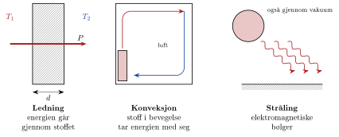

<!-- video: kommer (videoer/fysikk-forkurs/09-08-varmetransport) -->
{fig-alt="Video kommer"}

<!-- tillegg: Claude -->
Står du barbeint på et tregulv og på et flisgulv i samme rom, kjennes flisene mye kaldere. Likevel har de to gulvene samme temperatur. Det du kjenner, er ikke temperaturen i gulvet, men hvor fort energien forsvinner ut av foten din. Varme er energi på vei fra noe varmt til noe kaldere, og det er tre måter energien kan flytte seg på: **ledning**, **konveksjon** og **stråling**.

{.tikz-fig style="width:640px" fig-alt="Tre tegninger. Til venstre en vegg med tykkelsen d, temperaturen T1 på den ene siden og T2 på den andre, og en pil P gjennom veggen: ledning. I midten et rom med en radiator der varm luft stiger, går langs taket og synker ned på motsatt side: konveksjon. Til høyre en sol som sender bølger gjennom tomt rom mot en flate: stråling."}

::: {.kort}
- **Ledning** Energien vandrer gjennom stoffet fra partikkel til partikkel, mens stoffet selv ligger i ro. Eksempel: Håndtaket på en kjele blir varmt.
- **Konveksjon** En varm væske eller gass flytter seg og tar energien med seg. Eksempel: Varm luft stiger fra en radiator og fordeler varmen i rommet.
- **Stråling** Energien sendes ut som elektromagnetiske bølger og trenger ikke noe stoff å gå gjennom. Eksempel: Sola varmer jorda gjennom verdensrommet.
:::

Ofte virker alle tre samtidig. En termos er laget for å stanse alle tre: Mellom de to veggene er det vakuum, slik at det nesten ikke blir ledning eller konveksjon, og veggene er blanke, slik at lite stråling slipper gjennom.

## Ledning gjennom en vegg

Tenk deg en vegg med tykkelse $d$ og areal $A$. Den ene siden har temperaturen $T_1$, og den andre har den lavere temperaturen $T_2$. Hvor stor effekt $P$ (energi per sekund) går gjennom veggen? Vi kan resonnere oss fram til tre ting:

::: {.kort}
- **Stor temperaturforskjell** Jo større forskjell, desto mer varme går gjennom. $P$ er proporsjonal med $T_1 - T_2$.
- **Stort areal** Dobbelt så stor vegg slipper gjennom dobbelt så mye. $P$ er proporsjonal med $A$.
- **Tykk vegg** Dobbelt så tykk vegg slipper gjennom halvparten. $P$ er omvendt proporsjonal med $d$.
:::

Setter vi dette sammen, får vi

::: {.graa}
$$
P = k\,A\,\frac{T_1 - T_2}{d}
$$
:::

Her er $k$ **varmeledningstallet**, som forteller hvor godt stoffet leder varme. Enheten er $\mathrm{W/(m\cdot K)}$. En temperaturforskjell er like stor i kelvin som i grader celsius, så her kan vi bruke begge deler.

::: {.graa}
| Stoff | $k$ i $\mathrm{W/(m\cdot K)}$ |
|:---|:---:|
| Kobber | 390 |
| Aluminium | 240 |
| Rustfritt stål | 16 |
| Betong | 1.5 |
| Glass | 0.80 |
| Vann | 0.60 |
| Tre | 0.12 |
| Ull, klær (mest luft) | 0.040 |
| Mineralull | 0.037 |
| Isopor | 0.035 |
| Luft i ro | 0.026 |
:::

Metaller leder godt fordi de har frie elektroner som bringer energien raskt videre. Luft leder svært dårlig. Derfor virker ull, dun og mineralull så godt: Stoffene holder på luft som ikke kan bevege seg, slik at konveksjonen stanses. Nå kan vi også forklare gulvet: Flis leder varme mye bedre enn tre, så energien forsvinner raskere ut av foten.

::: {.eksempel}
**Eksempel: Et gammelt vindu.** Et vindu med ett lag glass er $1.5\ \mathrm{m^2}$ stort, og glasset er $4.0\ \mathrm{mm}$ tykt. På en vinterdag er temperaturen $5.0\ ^\circ\mathrm{C}$ på innsiden av glasset og $-3.0\ ^\circ\mathrm{C}$ på utsiden. Hvor stor effekt går gjennom vinduet?

::: {.losning}
**Kjent:** $k = 0.80\ \mathrm{W/(m\cdot K)}$, $A = 1.5\ \mathrm{m^2}$, $d = 4.0\ \mathrm{mm} = 4.0\cdot10^{-3}\ \mathrm{m}$. Temperaturforskjellen er $T_1 - T_2 = 5.0\ ^\circ\mathrm{C} - (-3.0\ ^\circ\mathrm{C}) = 8.0\ \mathrm{K}$.

$$
P = k\,A\,\frac{T_1 - T_2}{d} = 0.80\ \mathrm{\frac{W}{m\cdot K}}\cdot 1.5\ \mathrm{m^2}\cdot\frac{8.0\ \mathrm{K}}{4.0\cdot10^{-3}\ \mathrm{m}} = \underline{\underline{2.4\ \mathrm{kW}}}
$$

Det er like mye som to-tre panelovner. Merk at temperaturen i rommet kan være $20\ ^\circ\mathrm{C}$ selv om glasset bare er $5.0\ ^\circ\mathrm{C}$ på innsiden: Et tynt lag stille luft inntil glasset isolerer mer enn glasset gjør.
:::
:::

## Flere lag og U-verdi

En husvegg består av flere lag. Når vi skal regne på flere lag, er det lurt å se på **varmemotstanden** $R$ i hvert lag:
$$
R = \frac{d}{k}
$$
Enheten er $\mathrm{m^2\cdot K/W}$. Varmen må gjennom alle lagene etter hverandre, så motstandene legges sammen: $R_\text{tot} = R_1 + R_2 + \dots$. I byggebransjen oppgir de gjerne **U-verdien**, som er $1/R_\text{tot}$:

::: {.graa}
$$
U = \frac{1}{R_\text{tot}} \qquad\qquad P = U\,A\,(T_1 - T_2)
$$
:::

Lav U-verdi betyr godt isolert. Enheten er $\mathrm{W/(m^2\cdot K)}$. En moderne vegg har $U$ på omtrent $0.18\ \mathrm{W/(m^2\cdot K)}$, mens et godt vindu har omtrent $0.80\ \mathrm{W/(m^2\cdot K)}$.

::: {.eksempel}
**Eksempel: Isolert vegg.** En vegg med areal $12\ \mathrm{m^2}$ består av $15\ \mathrm{mm}$ trepanel og $20.0\ \mathrm{cm}$ mineralull. Inne er det $21\ ^\circ\mathrm{C}$ og ute $-9\ ^\circ\mathrm{C}$. a) Finn U-verdien. b) Hvor stor effekt går gjennom veggen? c) Hvor mye energi tapes på et døgn?

::: {.losning}
Vi ser bort fra de tynne luftlagene inntil veggen.

a) Varmemotstanden i hvert lag er
$$
R_\text{tre} = \frac{0.015\ \mathrm{m}}{0.12\ \mathrm{W/(m\cdot K)}} = 0.125\ \mathrm{\frac{m^2\cdot K}{W}}, \qquad R_\text{ull} = \frac{0.200\ \mathrm{m}}{0.037\ \mathrm{W/(m\cdot K)}} = 5.41\ \mathrm{\frac{m^2\cdot K}{W}}
$$
Samlet er $R_\text{tot} = 5.53\ \mathrm{m^2\cdot K/W}$, slik at
$$
U = \frac{1}{R_\text{tot}} = \underline{\underline{0.18\ \mathrm{W/(m^2\cdot K)}}}
$$

b) Temperaturforskjellen er $21\ ^\circ\mathrm{C} - (-9\ ^\circ\mathrm{C}) = 30\ \mathrm{K}$:
$$
P = U\,A\,(T_1 - T_2) = 0.181\ \mathrm{\frac{W}{m^2\cdot K}}\cdot 12\ \mathrm{m^2}\cdot 30\ \mathrm{K} = \underline{\underline{65\ \mathrm{W}}}
$$

c) Energi er effekt ganger tid. Vi regner $t = 24\ \mathrm{h}$:
$$
E = P\,t = 65\ \mathrm{W}\cdot 24\ \mathrm{h} = \underline{\underline{1.6\ \mathrm{kWh}}}
$$
Trepanelen bidrar nesten ingenting. Det er mineralulla som gjør jobben.
:::
:::

## Konveksjon og stråling i hverdagen

Konveksjon oppstår fordi varm luft og varmt vann utvider seg og får lavere massetetthet. Da stiger de, og kaldere stoff strømmer inn i stedet. Vinden gir *tvungen* konveksjon, som tar med seg varmen enda raskere. Det er derfor det føles kaldere når det blåser, og derfor du blåser på kaffen.

Alle ting sender ut stråling. Ting ved vanlig temperatur stråler mest infrarødt, som vi ikke ser, men som vi kan kjenne på huden foran en peis. Strålingen øker kraftig med temperaturen. Dette tar vi for oss under *varmestråling*.

## Prøv selv

Programmet viser hvordan varmetapet gjennom en vegg avhenger av tykkelsen på isolasjonen. Endre tallene og trykk **Kjør**. Hvor mye sparer du på å gå fra $10\ \mathrm{cm}$ til $20\ \mathrm{cm}$, og hvor mye fra $30\ \mathrm{cm}$ til $40\ \mathrm{cm}$?

```{.python .kjor}
import numpy as np
import matplotlib.pyplot as plt

A = 12        # areal i m^2
dT = 30       # temperaturforskjell i K
k = 0.037     # varmeledningstall for isolasjonen i W/(m K)

d_cm = 20     # tykkelse i cm
P = k * A * dT / (d_cm / 100)
print(f"Varmetap ved {d_cm} cm isolasjon: {P:.0f} W")

d = np.linspace(2, 50, 200)
plt.plot(d, k * A * dT / (d / 100))
plt.xlabel("Tykkelse på isolasjonen (cm)")
plt.ylabel("Varmetap (W)")
plt.grid(True)
plt.show()
```

:::: {.oppgaver}

::: {.oppgave tittel="Tre måter"}
Hvilken måte for varmetransport er viktigst i disse tilfellene? a) Det blir varmt i skjeen du har i teen. b) Du kjenner varmen fra et bål på ansiktet. c) Varmtvann fra en radiatorkjele sirkulerer opp i etasjene av seg selv. d) Hvorfor er det ingen konveksjon i verdensrommet?

::: {.losning}
a) Ledning: Energien går gjennom metallet, mens skjeen ligger i ro.

b) Stråling: Den varme lufta stiger oppover fra bålet, så det du kjenner fra siden, er infrarød stråling.

c) Konveksjon: Varmt vann har lavere massetetthet og stiger.

d) Konveksjon krever en væske eller gass som kan flytte på seg. I verdensrommet er det nesten ikke stoff, så energi kan bare komme fram som stråling.
:::
:::

::: {.oppgave tittel="Bunnen i kjelen"}
En kjele i rustfritt stål har en bunn med areal $0.020\ \mathrm{m^2}$ og tykkelse $3.0\ \mathrm{mm}$. Undersiden er $5.0\ \mathrm{K}$ varmere enn oversiden. Hvor stor effekt går gjennom bunnen?

::: {.losning}
Vi bruker $k = 16\ \mathrm{W/(m\cdot K)}$ fra tabellen og $d = 3.0\cdot10^{-3}\ \mathrm{m}$:
$$
P = k\,A\,\frac{T_1 - T_2}{d} = 16\ \mathrm{\frac{W}{m\cdot K}}\cdot 0.020\ \mathrm{m^2}\cdot\frac{5.0\ \mathrm{K}}{3.0\cdot10^{-3}\ \mathrm{m}} = \underline{\underline{0.53\ \mathrm{kW}}}
$$
:::
:::

::: {.oppgave tittel="Tre mot mineralull"}
Hvor tykk må en trevegg være for å isolere like godt som $10\ \mathrm{cm}$ mineralull?

::: {.losning}
To lag isolerer like godt når de har samme varmemotstand $R = d/k$:
$$
\frac{d_\text{tre}}{k_\text{tre}} = \frac{d_\text{ull}}{k_\text{ull}} \implies d_\text{tre} = d_\text{ull}\cdot\frac{k_\text{tre}}{k_\text{ull}} = 10\ \mathrm{cm}\cdot\frac{0.12}{0.037} = \underline{\underline{32\ \mathrm{cm}}}
$$
:::
:::

::: {.oppgave tittel="Kjølebagen" niva="Middels"}
En kjølebag av isopor har veggtykkelse $2.0\ \mathrm{cm}$ og samlet overflate $0.50\ \mathrm{m^2}$. Inni ligger is ved $0\ ^\circ\mathrm{C}$, og lufta utenfor er $20\ ^\circ\mathrm{C}$. a) Hvor stor effekt strømmer inn gjennom veggene? b) Hvor lang tid tar det før $1.0\ \mathrm{kg}$ is har smeltet? Bruk smeltevarmen $334\ \mathrm{kJ/kg}$.

::: {.losning}
a) Med $k = 0.035\ \mathrm{W/(m\cdot K)}$ og $T_1 - T_2 = 20\ \mathrm{K}$:
$$
P = k\,A\,\frac{T_1 - T_2}{d} = 0.035\ \mathrm{\frac{W}{m\cdot K}}\cdot 0.50\ \mathrm{m^2}\cdot\frac{20\ \mathrm{K}}{0.020\ \mathrm{m}} = 17.5\ \mathrm{W} \approx \underline{\underline{18\ \mathrm{W}}}
$$

b) Energien som trengs, er $Q = mL = 1.0\ \mathrm{kg}\cdot 334\ \mathrm{kJ/kg} = 334\ \mathrm{kJ}$. Tiden er energi delt på effekt:
$$
t = \frac{Q}{P} = \frac{334\cdot10^3\ \mathrm{J}}{17.5\ \mathrm{W}} = 1.9\cdot10^4\ \mathrm{s} = \underline{\underline{5.3\ \mathrm{h}}}
$$
I virkeligheten varer isen litt lenger, fordi lufta inntil veggene også isolerer.
:::
:::

::: {.oppgave tittel="Varmetap fra et hus" niva="Middels"}
Et lite hus har disse flatene:

| Del | Areal i $\mathrm{m^2}$ | $U$ i $\mathrm{W/(m^2\cdot K)}$ |
|:---|:---:|:---:|
| Vegger | 100 | 0.18 |
| Tak | 80 | 0.13 |
| Gulv | 80 | 0.10 |
| Vinduer | 15 | 0.80 |

Inne er det $25\ \mathrm{K}$ varmere enn ute. a) Hvor stort er varmetapet? b) Hvor stor andel av varmetapet går gjennom vinduene, og hvor stor andel av flaten er vinduer? c) Hvor mye energi går med på et døgn?

::: {.losning}
a) For hver del er $U\cdot A$ antall watt per kelvin: $18\ \mathrm{W/K}$ (vegger), $10.4\ \mathrm{W/K}$ (tak), $8.0\ \mathrm{W/K}$ (gulv) og $12\ \mathrm{W/K}$ (vinduer). Til sammen $48.4\ \mathrm{W/K}$, så
$$
P = 48.4\ \mathrm{W/K}\cdot 25\ \mathrm{K} = 1210\ \mathrm{W} \approx \underline{\underline{1.2\ \mathrm{kW}}}
$$

b) Vinduene står for
$$
\frac{12}{48.4} = \underline{\underline{25\ \%}}
$$
av tapet, men bare $15/275 = \underline{\underline{5.5\ \%}}$ av flaten. Selv gode vinduer slipper altså ut langt mer varme enn en like stor vegg.

c) $E = Pt = 1.21\ \mathrm{kW}\cdot 24\ \mathrm{h} = \underline{\underline{29\ \mathrm{kWh}}}$.
:::
:::

::: {.oppgave tittel="Våte klær" niva="Utfordrende"}
Klærne på en person har til sammen overflaten $1.8\ \mathrm{m^2}$ og tykkelse $1.0\ \mathrm{cm}$. Temperaturforskjellen over klærne er $20\ \mathrm{K}$. a) Hvor stor effekt går gjennom klærne med $k = 0.040\ \mathrm{W/(m\cdot K)}$? b) Blir klærne våte, er $k$ omtrent ti ganger større. Hvor stor effekt blir det da? c) En person i ro lager omtrent $100\ \mathrm{W}$ varme. Forklar hva resultatene betyr, og finn hvor tykke de tørre klærne må være for å slippe gjennom nettopp $100\ \mathrm{W}$.

::: {.losning}
a) $$
P = k\,A\,\frac{T_1 - T_2}{d} = 0.040\ \mathrm{\frac{W}{m\cdot K}}\cdot 1.8\ \mathrm{m^2}\cdot\frac{20\ \mathrm{K}}{0.010\ \mathrm{m}} = \underline{\underline{1.4\cdot10^2\ \mathrm{W}}}
$$

b) Ti ganger større $k$ gir ti ganger større effekt: $\underline{\underline{1.4\ \mathrm{kW}}}$.

c) Med tørre klær gir kroppen fra seg litt mer enn den lager, så personen blir sakte kald ved å sitte stille. Med våte klær går varmen ut langt raskere enn kroppen klarer å lage den. Derfor er våte klær farlig i kulda.

Vi løser formelen med hensyn på $d$ og setter inn $P = 100\ \mathrm{W}$:
$$
d = k\,A\,\frac{T_1 - T_2}{P} = 0.040\ \mathrm{\frac{W}{m\cdot K}}\cdot 1.8\ \mathrm{m^2}\cdot\frac{20\ \mathrm{K}}{100\ \mathrm{W}} = 0.014\ \mathrm{m} = \underline{\underline{1.4\ \mathrm{cm}}}
$$
:::
:::

::::
