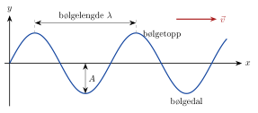
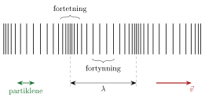
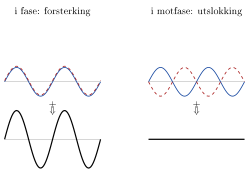

<!-- video: kommer (videoer/fysikk-forkurs/10-01-bolger) -->
{fig-alt="Video kommer"}

<!-- tillegg: Claude -->
Kast en stein i et stille vann. Ringer brer seg utover, men vannet selv blir liggende omtrent der det var: en and som ligger på vannet, vipper bare opp og ned når ringene passerer. Noe flytter seg likevel bortover, nemlig *forstyrrelsen*, og med den energi. Det er det som er en **bølge**. Lyd, lys, radiosignaler og jordskjelv er bølger, og de følger de samme enkle reglene som ringene i vannet.

## Hva er en bølge?

::: {.callout-note title="Definisjon: Bølge"}
En **bølge** er en forstyrrelse som brer seg utover og frakter energi fra ett sted til et annet, uten at stoffet selv blir fraktet med.
:::

Stoffet bølgen går gjennom, kalles **mediet**: vannet for vannbølger, lufta for lyd, tauet for en bølge på et tau. Hver liten del av mediet svinger fram og tilbake om sin egen likevektsstilling, akkurat som i en [svingning](../07-svingninger/01-harmoniske-svingninger.qmd). Fordi naboene henger sammen, drar hver del med seg den neste, og slik vandrer forstyrrelsen videre.

En «bølge» på en fotballstadion viser dette godt. Hver tilskuer reiser seg og setter seg igjen på samme plass. Ingen flytter seg bortover, men bølgen går rundt hele stadion.

## Tverrbølger og langsbølger

Det finnes to hovedtyper bølger, avhengig av hvilken vei mediet svinger.

::: {.kort}
- **Tverrbølge** Mediet svinger *på tvers* av retningen bølgen går. Eksempler: en bølge på et tau eller en gitarstreng, og stadionbølgen.
- **Langsbølge** Mediet svinger *langs* retningen bølgen går, fram og tilbake. Eksempler: lyd i luft, og en trykkbølge i en lang spiralfjær som dyttes i den ene enden.
:::

I en tverrbølge ser vi **bølgetopper** og **bølgedaler**:

{.tikz-fig style="width:480px" fig-alt="Et øyeblikksbilde av en tverrbølge: en sinusformet kurve. Bølgelengden lambda er avstanden mellom to bølgetopper. Amplituden A er avstanden fra likevektslinjen ned til en bølgedal. En pil viser at bølgen går mot høyre med farten v."}

I en langsbølge blir mediet i stedet presset sammen noen steder (**fortetninger**) og trukket ut andre steder (**fortynninger**). Lyd er nettopp slik: Høyttaleren dytter lufta fram og tilbake, og det gir små trykkvariasjoner som brer seg utover.

{.tikz-fig style="width:480px" fig-alt="En langsbølge tegnet som loddrette streker. Noen steder ligger strekene tett (fortetning), andre steder glissent (fortynning). Bølgelengden lambda er avstanden mellom to fortetninger. Partiklene svinger fram og tilbake langs samme retning som bølgen går."}

## Bølgelengde, periode og frekvens

Fire tall beskriver en jevn, gjentakende bølge:

::: {.kort}
- **Amplitude $A$** Største utslag fra likevekt. For en vannbølge er det høyden på toppene over det stille vannet.
- **Bølgelengde $\lambda$** Avstanden mellom to topper som følger etter hverandre (eller to fortetninger). Den greske bokstaven heter lambda. Måles i meter.
- **Periode $T$** Tiden ett punkt i mediet bruker på én hel svingning. Måles i sekunder.
- **Frekvens $f$** Antall svingninger per sekund, $f = 1/T$. Måles i hertz (Hz).
:::

Bølgelengden forteller hvordan bølgen ser ut i *rommet* (et øyeblikksbilde). Perioden og frekvensen forteller hvordan den oppfører seg i *tid* (det du ser hvis du følger ett punkt, som anda på vannet).

## Bølgefarten: $v = \lambda f$

Følg anda mens bølgen passerer. I løpet av én periode $T$ går anda fra én topp, ned i en dal og opp på neste topp. Samtidig har bølgen flyttet seg nøyaktig én bølgelengde, ellers ville ikke en ny topp vært kommet fram. Bølgen går altså strekningen $\lambda$ på tiden $T$, så farten er

::: {.graa}
$$
v = \frac{\lambda}{T} = \lambda f
$$
:::

Dette er **bølgelikningen**, og den gjelder alle slags bølger. Bølgefarten bestemmes av mediet: lyd går omtrent $343\ \mathrm{m/s}$ i luft ved $20\ ^\circ\mathrm{C}$, omtrent $1480\ \mathrm{m/s}$ i vann og enda fortere i stål. Frekvensen bestemmes av kilden, for eksempel hvor fort høyttalermembranen svinger. Bølgelengden tilpasser seg slik at $\lambda = v/f$.

::: {.callout-tip title="Hvorfor bestemmer kilden frekvensen?"}
Når lyd går fra luft og inn i vann, endres farten. Men hver bølgetopp som kommer fram til vannflaten, må lage nøyaktig én bølgetopp i vannet, ellers ville bølgetoppene hope seg opp eller forsvinne ved grenseflaten. Derfor er frekvensen den samme på begge sider. Det er bølgelengden som endres.
:::

::: {.eksempel}
**Eksempel: Bølger på havet.** En bøye går opp og ned 15 ganger på $60\ \mathrm{s}$. Avstanden mellom bølgetoppene er $18\ \mathrm{m}$. Hvor fort går bølgene?

::: {.losning}
Perioden er tiden for én svingning av bøya:
$$
T = \frac{60\ \mathrm{s}}{15} = 4.0\ \mathrm{s}
$$
Bølgen går én bølgelengde per periode:
$$
v = \frac{\lambda}{T} = \frac{18\ \mathrm{m}}{4.0\ \mathrm{s}} = \underline{\underline{4.5\ \mathrm{m/s}}}
$$
Det er omtrent $16\ \mathrm{km/h}$, en vanlig fart for havbølger.
:::
:::

::: {.eksempel}
**Eksempel: Kammertonen.** Kammertonen A, som orkestre stemmer etter, har frekvensen $440\ \mathrm{Hz}$. Hvor lang er lydbølgen i luft ved $20\ ^\circ\mathrm{C}$?

::: {.losning}
Vi løser bølgelikningen for bølgelengden:
$$
\lambda = \frac{v}{f} = \frac{343\ \mathrm{m/s}}{440\ \mathrm{Hz}} = 0.7795\ \mathrm{m} \approx \underline{\underline{0.780\ \mathrm{m}}}
$$
Enheten går opp fordi $\mathrm{Hz} = \mathrm{s^{-1}}$, så $\mathrm{(m/s)/s^{-1}} = \mathrm{m}$. Lydbølgen er altså omtrent like lang som en arm.
:::
:::

## Lyd

Lyd er en langsbølge i lufta (eller i et annet stoff). Øret vårt merker trykkvariasjonene, og hjernen tolker frekvensen som **tonehøyde**: høy frekvens gir lys tone, lav frekvens gir dyp tone. Unge mennesker hører frekvenser fra omtrent $20\ \mathrm{Hz}$ til $20\ \mathrm{kHz}$. Lyd med høyere frekvens kalles **ultralyd** og brukes blant annet til medisinske bilder. Amplituden, altså hvor store trykkvariasjonene er, avgjør hvor **sterk** lyden er.

Lyd trenger et medium. I det tomme verdensrommet er det helt stille, uansett hvor store eksplosjoner som skjer.

## Refleksjon og ekko

Når en bølge treffer en grense, for eksempel en fjellvegg, blir den helt eller delvis **reflektert** (kastet tilbake). Et ekko er reflektert lyd. Måler vi tiden fra vi roper til vi hører ekkoet, kan vi finne avstanden. Det er samme idé som i ekkolodd på båter, i radar og i ultralyd.

::: {.eksempel}
**Eksempel: Ekko fra en fjellvegg.** Du klapper én gang og hører ekkoet fra en fjellvegg $1.40\ \mathrm{s}$ senere. Lufttemperaturen er $20\ ^\circ\mathrm{C}$. Hvor langt unna er fjellveggen?

::: {.losning}
Lyden går bort til veggen *og* tilbake, så den går dobbelt så langt som avstanden $d$:
$$
2d = v t \quad\Rightarrow\quad d = \frac{v t}{2} = \frac{343\ \mathrm{m/s}\cdot 1.40\ \mathrm{s}}{2} = 240.1\ \mathrm{m} \approx \underline{\underline{0.240\ \mathrm{km}}}
$$
Med prefikset kilo ser vi tydelig at svaret har tre gjeldende siffer, som tiden.
:::
:::

## Interferens: når bølger møtes

To bølger kan gå gjennom hverandre uten å ødelegge hverandre. Der de overlapper, legges utslagene sammen. Dette kalles **superposisjon**, og resultatet kalles **interferens**.

{.tikz-fig style="width:460px" fig-alt="To tilfeller av interferens. Til venstre er to like bølger i fase, topp mot topp, og summen er en bølge med dobbel amplitude. Til høyre er to like bølger i motfase, topp mot dal, og summen er en rett strek, altså ingen bølge."}

::: {.kort}
- **Forsterking (konstruktiv interferens)** Topp møter topp og dal møter dal. Utslagene legges sammen, og bølgen blir større.
- **Utslokking (destruktiv interferens)** Topp møter dal. Utslagene opphever hverandre, og det kan bli helt stille.
:::

Om to bølger fra samme kilde forsterker eller slokker hverandre, avhenger av hvor langt hver av dem har gått. Er forskjellen i veilengde et helt antall bølgelengder ($0,\ \lambda,\ 2\lambda,\ \dots$), kommer de fram i fase og forsterker hverandre. Er forskjellen et halvt antall ($\tfrac12\lambda,\ \tfrac32\lambda,\ \dots$), kommer de i motfase og slokker hverandre. Støydempende hodetelefoner bruker utslokking: en mikrofon fanger opp støyen, og høyttaleren sender ut den samme lyden i motfase.

::: {.callout-tip title="Til ettertanke"}
Hvis to bølger slokker hverandre helt på ett sted, hvor blir det da av energien deres?

*Svar:* Energien forsvinner ikke. Andre steder i rommet forsterker bølgene hverandre i stedet, og der er det ekstra mye energi. Interferens fordeler energien på nytt, men den totale energien er bevart.
:::

## Prøv selv

Programmet tegner en tverrbølge $y = A\sin\!\left(2\pi\left(\dfrac{x}{\lambda} - \dfrac{t}{T}\right)\right)$ på to tidspunkter, slik at du ser at bølgen flytter seg. Endre bølgelengden og perioden og trykk **Kjør**. Hvor langt har toppene flyttet seg etter en kvart periode?

```{.python .kjor}
import numpy as np
import matplotlib.pyplot as plt

A = 0.10       # amplitude i m
lam = 2.0      # bølgelengde i m
T = 0.50       # periode i s

v = lam / T
print(f"Bølgefart: {v:.2f} m/s")

x = np.linspace(0, 3 * lam, 400)
for t in [0, T / 4]:
    y = A * np.sin(2 * np.pi * (x / lam - t / T))
    plt.plot(x, y, label=f"t = {t:.3f} s")
plt.xlabel("x (m)")
plt.ylabel("y (m)")
plt.legend()
plt.grid(True)
plt.show()
```

:::: {.oppgaver}

::: {.oppgave tittel="Tverr eller langs?"}
Avgjør om bølgene er tverrbølger eller langsbølger: a) en bølge på en gitarstreng, b) lyd fra en høyttaler, c) en «bølge» på en fotballstadion, d) en spiralfjær som ligger på gulvet og dyttes fram og tilbake i den ene enden.

::: {.losning}
Spør hvilken vei mediet svinger i forhold til retningen bølgen går.

a) Strengen svinger på tvers av strengen, mens bølgen går langs den: **tverrbølge**.

b) Lufta dyttes fram og tilbake i samme retning som lyden går: **langsbølge**.

c) Tilskuerne beveger seg opp og ned, mens bølgen går bortover: **tverrbølge**.

d) Vindingene i fjæra skyves fram og tilbake langs fjæra, i samme retning som bølgen går: **langsbølge**.
:::
:::

::: {.oppgave tittel="Det hørbare området"}
Mennesker hører lyd med frekvenser fra omtrent $20\ \mathrm{Hz}$ til $20\ \mathrm{kHz}$. Finn bølgelengden i luft for den dypeste og den lyseste tonen. Bruk $v = 343\ \mathrm{m/s}$.

::: {.losning}
Bølgelengden er $\lambda = v/f$.

Dypeste tone:
$$
\lambda = \frac{343\ \mathrm{m/s}}{20\ \mathrm{Hz}} = 17.15\ \mathrm{m} \approx \underline{\underline{17\ \mathrm{m}}}
$$
Lyseste tone ($20\ \mathrm{kHz} = 20\cdot10^3\ \mathrm{Hz}$):
$$
\lambda = \frac{343\ \mathrm{m/s}}{20\cdot10^3\ \mathrm{Hz}} = 0.01715\ \mathrm{m} \approx \underline{\underline{17\ \mathrm{mm}}}
$$
Frekvensene er oppgitt med to gjeldende siffer, så svarene får to. Lydbølgene vi hører, spenner altså fra omtrent en centimeter til høyden på et hus.
:::
:::

::: {.oppgave tittel="Lyn og torden"}
Du ser et lyn, og $3.0\ \mathrm{s}$ senere hører du tordenen. Lyset kommer fram praktisk talt med en gang. Hvor langt unna slo lynet ned? Bruk $v = 343\ \mathrm{m/s}$.

::: {.losning}
Lyset kommer fram med en gang, så de $3.0\ \mathrm{s}$ er tiden lyden bruker. Lyden går bare én vei:
$$
d = v t = 343\ \mathrm{m/s}\cdot 3.0\ \mathrm{s} = 1029\ \mathrm{m} \approx \underline{\underline{1.0\ \mathrm{km}}}
$$
Tiden har to gjeldende siffer. En nyttig huskeregel: Tell sekundene og del på tre, så får du omtrent avstanden i kilometer.
:::
:::

::: {.oppgave tittel="To høyttalere" niva="Middels"}
To høyttalere sender ut samme tone, $440\ \mathrm{Hz}$, i fase. Du står slik at du er $0.39\ \mathrm{m}$ lenger fra den ene høyttaleren enn fra den andre. Lydfarten er $343\ \mathrm{m/s}$. Hører du tonen sterkt eller svakt der du står? Forklar.

::: {.losning}
Bølgelengden er
$$
\lambda = \frac{v}{f} = \frac{343\ \mathrm{m/s}}{440\ \mathrm{Hz}} = 0.780\ \mathrm{m}
$$
Forskjellen i veilengde er $0.39\ \mathrm{m}$, som er
$$
\frac{0.39\ \mathrm{m}}{0.780\ \mathrm{m}} = 0.50
$$
bølgelengder, altså en halv bølgelengde. Bølgene kommer fram i motfase: der den ene har en fortetning, har den andre en fortynning. De slokker hverandre, og du hører tonen **svakt**. (Helt stille blir det sjelden, fordi lyden også reflekteres fra vegger, og fordi lyden fra de to høyttalerne ikke er helt like sterk der du står.)
:::
:::

::: {.oppgave tittel="Ultralyd" niva="Utfordrende"}
Et ultralydapparat sender lyd med frekvensen $2.0\ \mathrm{MHz}$ inn i kroppen. Lydfarten i bløtvev er omtrent som i vann, $1480\ \mathrm{m/s}$. a) Hva er bølgelengden? b) Lyden reflekteres fra et organ $6.0\ \mathrm{cm}$ inne i kroppen. Hvor lang tid går det fra apparatet sender lyden til ekkoet kommer tilbake?

::: {.losning}
a) Med $f = 2.0\ \mathrm{MHz} = 2.0\cdot10^6\ \mathrm{Hz}$:
$$
\lambda = \frac{v}{f} = \frac{1480\ \mathrm{m/s}}{2.0\cdot10^6\ \mathrm{Hz}} = 7.4\cdot10^{-4}\ \mathrm{m} = \underline{\underline{0.74\ \mathrm{mm}}}
$$
Den korte bølgelengden er grunnen til at ultralyd kan vise små detaljer.

b) Lyden går inn og ut igjen, altså $2\cdot 0.060\ \mathrm{m} = 0.120\ \mathrm{m}$:
$$
t = \frac{2d}{v} = \frac{0.120\ \mathrm{m}}{1480\ \mathrm{m/s}} = 8.11\cdot10^{-5}\ \mathrm{s} \approx \underline{\underline{81\ \mathrm{\mu s}}}
$$
Apparatet regner baklengs fra slike tider for å finne hvor dypt hvert ekko kommer fra.
:::
:::

::::
