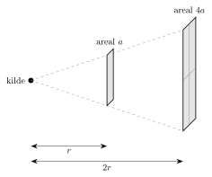

<!-- video: kommer (videoer/fysikk-forkurs/10-02-straling-og-drivhuseffekten) -->
{fig-alt="Video kommer"}

<!-- tillegg: Claude -->
Sollyset som varmer ansiktet ditt, har reist $150$ millioner kilometer gjennom tomt rom for å komme hit. Lyd kunne aldri ha gjort det, for lyd trenger luft å gå gjennom. Lys er en annen slags bølge, en **elektromagnetisk bølge**. Radiosignaler, mikrobølger, varmestråling, røntgen og lys er alle samme fenomen. Det eneste som skiller dem, er bølgelengden.

## Lys er en elektromagnetisk bølge

En elektrisk ladning som svinger fram og tilbake, lager et elektrisk felt og et magnetisk felt som også svinger. De to feltene holder hverandre i gang og brer seg utover som en bølge. Det er ingen ting som svinger, bare feltene, så bølgen trenger **ikke noe medium**. Den går like godt gjennom vakuum.

::: {.callout-note title="Definisjon: Elektromagnetisk stråling"}
**Elektromagnetisk stråling** er bølger av elektriske og magnetiske felt som svinger på tvers av retningen bølgen går. Strålingen frakter energi, og i vakuum går den alltid med lysfarten
$$
\mathrm{c} = 3.00\cdot10^8\ \mathrm{m/s}.
$$
:::

Elektromagnetiske bølger er altså tverrbølger. Bølgelikningen fra [bølgesiden](01-bolger.qmd) gjelder som for alle andre bølger, med lysfarten som bølgefart:

::: {.graa}
$$
\mathrm{c} = \lambda f
$$
:::

I luft er farten nesten den samme som i vakuum. I vann og glass går lyset saktere, omtrent $2.3\cdot10^8\ \mathrm{m/s}$ og $2.0\cdot10^8\ \mathrm{m/s}$.

::: {.eksempel}
**Eksempel: Radiokanalen.** En radiostasjon sender på $100\ \mathrm{MHz}$. Hvor lange er radiobølgene?

::: {.losning}
Med $f = 100\ \mathrm{MHz} = 100\cdot10^6\ \mathrm{Hz}$:
$$
\lambda = \frac{\mathrm{c}}{f} = \frac{3.00\cdot10^8\ \mathrm{m/s}}{100\cdot10^6\ \mathrm{Hz}} = \underline{\underline{3.00\ \mathrm{m}}}
$$
Det er derfor en antenne for FM-radio gjerne er rundt en meter lang: Den fungerer best når lengden er en brøkdel av bølgelengden, for eksempel en halv eller en kvart.
:::
:::

## Det elektromagnetiske spekteret

Vi sorterer elektromagnetisk stråling etter bølgelengde. Hele rekken kalles det **elektromagnetiske spekteret**. Det strekker seg fra radiobølger som er flere kilometer lange, til gammastråling med bølgelengder mindre enn en atomkjerne.

{.tikz-fig style="width:600px" fig-alt="Det elektromagnetiske spekteret som et bånd fra lange til korte bølgelengder: radiobølger (lengre enn 1 m), mikrobølger (1 mm til 1 m), infrarødt (700 nm til 1 mm), et smalt bånd med synlig lys (700 til 400 nm), ultrafiolett (UV), røntgen og gammastråling (kortere enn omtrent 10 pm). Bølgelengdeaksen går fra 1 km til 1 pm, med en faktor tusen mellom hvert merke."}

Legg merke til hvor smalt båndet med **synlig lys** er: bare bølgelengder mellom omtrent $400\ \mathrm{nm}$ og $700\ \mathrm{nm}$. Innenfor det båndet ser vi ulike bølgelengder som ulike farger, fra rødt lys med de lengste bølgelengdene, via oransje, gult, grønt og blått til fiolett med de korteste.

::: {.kort}
- **Radiobølger** Radio, TV, mobilnett. Lages av strømmer som svinger i en antenne.
- **Mikrobølger** Mikrobølgeovn, wifi, radar.
- **Infrarødt (IR)** Varmestråling fra alt som har romtemperatur, fjernkontroller, varmekameraer.
- **Synlig lys** Det øynene våre er tilpasset, og der sola stråler mest.
- **Ultrafiolett (UV)** Gjør oss solbrune og kan gi solbrenthet og hudkreft.
- **Røntgen og gamma** Går gjennom bløtvev. Brukes i medisin, men kan skade cellene.
:::

### Mer energi i kortere bølger

Hvorfor kan UV-stråling skade huden, mens radiobølger går rett gjennom oss uten å gjøre skade? Stråling blir sendt ut og tatt opp i små energipakker som kalles **fotoner**. Jo høyere frekvensen er, desto mer energi har hvert foton. Ett foton med UV-stråling har nok energi til å bryte en kjemisk binding i et DNA-molekyl. Ett foton med radiobølger har mange millioner ganger mindre energi, og kan ikke gjøre det, uansett hvor mange fotoner det er. Mer om fotoner kommer under *atom og kjerne*.

::: {.eksempel}
**Eksempel: Fra sola til jorda.** Avstanden fra sola til jorda er $1.50\cdot10^{11}\ \mathrm{m}$. Hvor lang tid bruker sollyset?

::: {.losning}
Lyset går med konstant fart, så
$$
t = \frac{s}{\mathrm{c}} = \frac{1.50\cdot10^{11}\ \mathrm{m}}{3.00\cdot10^8\ \mathrm{m/s}} = 500\ \mathrm{s} = \underline{\underline{8.33\ \mathrm{min}}}
$$
Vi ser altså sola slik den var for drøyt åtte minutter siden.
:::
:::

## Intensitet: hvor mye energi treffer en flate?

Hvor kraftig strålingen er, måler vi med **intensiteten** $I$: effekten som treffer hver kvadratmeter av en flate som står vinkelrett på strålingen.

::: {.graa}
$$
I = \frac{P}{A} \qquad \text{enhet: } \mathrm{W/m^2}
$$
:::

En liten kilde som stråler like mye i alle retninger, fordeler effekten sin $P$ på en kuleflate rundt seg. Kuleflaten har arealet $4\pi r^2$, så

::: {.graa}
$$
I = \frac{P}{4\pi r^2}
$$
:::

Dobler vi avstanden, blir strålingen fordelt på et fire ganger så stort areal, og intensiteten blir en firedel. Dette kalles **kvadratloven**.

{.tikz-fig style="width:380px" fig-alt="Stråling fra en punktkilde går ut i en kjegle. I avstanden r treffer den en flate med areal a. I avstanden 2r har den samme strålingen spredt seg over en flate som er dobbelt så høy og dobbelt så bred, altså arealet 4a."}

::: {.eksempel}
**Eksempel: Sollys på Mars.** Utenfor atmosfæren er intensiteten av sollys ved jorda $1361\ \mathrm{W/m^2}$. Mars er $1.52$ ganger så langt fra sola som jorda. Hva er intensiteten der?

::: {.losning}
Intensiteten går som $1/r^2$. Når avstanden blir $1.52$ ganger så stor, blir intensiteten delt på $1.52^2$:
$$
I_{\text{Mars}} = \frac{1361\ \mathrm{W/m^2}}{1.52^2} = \underline{\underline{589\ \mathrm{W/m^2}}}
$$
Mars får bare litt over 40 % av sollyset jorda får. Vi trenger ikke vite solas effekt, fordi den forsvinner når vi tar forholdet mellom to avstander.
:::
:::

## Prøv selv

Programmet regner ut frekvensen til lys med en bølgelengde du velger, og sier hvilken del av spekteret det tilhører. Prøv for eksempel $550\ \mathrm{nm}$, $10\ \mathrm{\mu m}$ (varmestråling fra kroppen) og $0.12\ \mathrm{m}$ (mikrobølgeovn), og trykk **Kjør**.

```{.python .kjor}
c = 3.00e8          # lysfarten i m/s

lam = 550e-9        # bølgelengde i m (550e-9 = 550 nm)

f = c / lam
print(f"Frekvens: {f:.3g} Hz")

if lam > 1e-3:
    del_av_spekteret = "mikrobølger eller radiobølger"
elif lam > 700e-9:
    del_av_spekteret = "infrarødt"
elif lam >= 400e-9:
    del_av_spekteret = "synlig lys"
elif lam > 10e-9:
    del_av_spekteret = "ultrafiolett"
else:
    del_av_spekteret = "røntgen eller gamma"
print("Del av spekteret:", del_av_spekteret)
```

:::: {.oppgaver}

::: {.oppgave tittel="Sorter etter bølgelengde"}
Sorter strålingen fra lengst til kortest bølgelengde: røntgen, synlig lys, mikrobølger, UV, radiobølger, infrarødt. Hvilken har høyest frekvens?

::: {.losning}
Fra lengst til kortest bølgelengde:

radiobølger → mikrobølger → infrarødt → synlig lys → UV → røntgen

Alle går med samme fart $\mathrm{c}$, og $f = \mathrm{c}/\lambda$. Kortest bølgelengde gir derfor høyest frekvens: **røntgen**.
:::
:::

::: {.oppgave tittel="Grønt lys"}
En grønn laserpeker sender lys med bølgelengden $530\ \mathrm{nm}$. Finn frekvensen.

::: {.losning}
Med $\lambda = 530\ \mathrm{nm} = 530\cdot10^{-9}\ \mathrm{m}$:
$$
f = \frac{\mathrm{c}}{\lambda} = \frac{3.00\cdot10^8\ \mathrm{m/s}}{530\cdot10^{-9}\ \mathrm{m}} = \underline{\underline{5.66\cdot10^{14}\ \mathrm{Hz}}}
$$
Lys svinger altså mer enn en halv billiard ganger i sekundet.
:::
:::

::: {.oppgave tittel="Mikrobølgeovnen"}
En mikrobølgeovn bruker stråling med frekvensen $2.45\ \mathrm{GHz}$. Finn bølgelengden.

::: {.losning}
Med $f = 2.45\ \mathrm{GHz} = 2.45\cdot10^9\ \mathrm{Hz}$:
$$
\lambda = \frac{\mathrm{c}}{f} = \frac{3.00\cdot10^8\ \mathrm{m/s}}{2.45\cdot10^9\ \mathrm{Hz}} = 0.122\ \mathrm{m} = \underline{\underline{12.2\ \mathrm{cm}}}
$$
Det stemmer med plasseringen i spekteret: mellom $1\ \mathrm{mm}$ og $1\ \mathrm{m}$.
:::
:::

::: {.oppgave tittel="Solcellepanelet" niva="Middels"}
Et solcellepanel har arealet $1.60\ \mathrm{m^2}$ og står vinkelrett på sollyset en klar dag, når intensiteten er $800\ \mathrm{W/m^2}$. Panelet gjør $20.0\ \%$ av energien i lyset om til elektrisk energi. a) Hvor stor elektrisk effekt gir panelet? b) Hvor mye elektrisk energi gir det på $5.0$ timer, i kWh?

::: {.losning}
a) Effekten i lyset som treffer panelet, er
$$
P_{\text{inn}} = I\cdot A = 800\ \mathrm{W/m^2}\cdot 1.60\ \mathrm{m^2} = 1280\ \mathrm{W}
$$
Panelet gjør $20.0\ \%$ om til elektrisk effekt:
$$
P = 0.200\cdot 1280\ \mathrm{W} = \underline{\underline{256\ \mathrm{W}}}
$$

b) Energi er effekt ganger tid:
$$
E = P t = 0.256\ \mathrm{kW}\cdot 5.0\ \mathrm{h} = 1.28\ \mathrm{kWh} \approx \underline{\underline{1.3\ \mathrm{kWh}}}
$$
Tiden har to gjeldende siffer, så svaret får to. (I virkeligheten endres intensiteten gjennom dagen, så dette er et overslag.)
:::
:::

::: {.oppgave tittel="Lampa" niva="Utfordrende"}
En liten lampe sender ut $3.0\ \mathrm{W}$ synlig lys likt i alle retninger. a) Hva er intensiteten av lyset $2.0\ \mathrm{m}$ fra lampa? b) Du flytter deg til $4.0\ \mathrm{m}$. Hva skjer med intensiteten? Svar uten å regne alt på nytt, og kontroller så med formelen.

::: {.losning}
a) Lyset fordeler seg på en kuleflate med radius $2.0\ \mathrm{m}$:
$$
I = \frac{P}{4\pi r^2} = \frac{3.0\ \mathrm{W}}{4\pi\cdot(2.0\ \mathrm{m})^2} = 0.0597\ \mathrm{W/m^2} \approx \underline{\underline{60\ \mathrm{mW/m^2}}}
$$

b) Avstanden dobles, så etter kvadratloven blir intensiteten en firedel: omtrent $15\ \mathrm{mW/m^2}$. Kontroll:
$$
I = \frac{3.0\ \mathrm{W}}{4\pi\cdot(4.0\ \mathrm{m})^2} = 0.0149\ \mathrm{W/m^2} \approx \underline{\underline{15\ \mathrm{mW/m^2}}}
$$
:::
:::

::::
