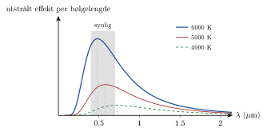

<!-- video: kommer (videoer/fysikk-forkurs/10-03-varmestraling) -->
{fig-alt="Video kommer"}

<!-- tillegg: Claude -->
Hold hånda nær en varm kokeplate uten å ta på den. Du kjenner varmen på avstand, selv om lufta mellom ikke trenger å være varm. Skrur du plata høyt nok opp, begynner den å gløde rødt. Et stearinlys gløder gult, og sola hvitt. Alt dette er **varmestråling**: elektromagnetisk stråling som alle legemer sender ut bare fordi de har en temperatur. Også du stråler, hele tiden, men i infrarødt, så øynene ikke ser det. Et varmekamera gjør det.

## Alt stråler

Atomene og molekylene i et stoff er alltid i bevegelse, og jo varmere stoffet er, desto livligere er bevegelsen. Ladningene i atomene svinger, og ladninger som svinger, sender ut [elektromagnetisk stråling](02-straling-og-drivhuseffekten.qmd). Derfor stråler alle legemer som har en temperatur over det absolutte nullpunktet.

Strålingen er ikke på én bestemt bølgelengde. Den er spredt over et helt område av spekteret, men har en topp et sted. Hvor toppen ligger, og hvor mye som stråles ut i alt, avhenger først og fremst av **temperaturen**.

::: {.callout-note title="Definisjon: Svart legeme"}
Et **svart legeme** er et tenkt, ideelt legeme som tar opp (absorberer) all stråling som treffer det, uten å reflektere noe. Et svart legeme er også den beste strålingskilden som finnes: Ved en gitt temperatur stråler det mer enn noe annet legeme.
:::

«Svart» betyr ikke at legemet ser svart ut når det er varmt. Sola er nesten et svart legeme! Navnet kommer av at det ser svart ut når det er kaldt, fordi det ikke reflekterer noe lys. Mange virkelige ting, som menneskehud, matt maling og jordoverflaten, oppfører seg nesten som svarte legemer i infrarødt.

## Strålingskurven

Figuren viser hvor mye et svart legeme stråler ved hver bølgelengde, for tre temperaturer.

{.tikz-fig style="width:500px" fig-alt="Utstrålt effekt per bølgelengde for et svart legeme ved 6000 K, 5000 K og 4000 K, med bølgelengden i mikrometer langs x-aksen fra 0 til 2. Kurven for 6000 K er høyest og har toppen ved omtrent 0.5 mikrometer, midt i det synlige området fra 0.4 til 0.7 mikrometer. Kurven for 5000 K er lavere med toppen ved omtrent 0.6 mikrometer, og kurven for 4000 K er lavest med toppen ved omtrent 0.7 mikrometer."}

To ting skjer når temperaturen øker:

::: {.kort}
- **Toppen flytter seg** mot kortere bølgelengder. Et legeme som blir varmere, går fra å stråle mest i infrarødt, via rødt, til gult og hvitt.
- **Kurven blir mye høyere** over alt. Arealet under kurven er den totale utstrålte effekten, og den øker voldsomt med temperaturen.
:::

De to tingene har hver sin lov.

## Wiens forskyvningslov

Bølgelengden $\lambda_{\text{maks}}$ der strålingen er sterkest, er omvendt proporsjonal med temperaturen:

::: {.callout-important title="Wiens forskyvningslov"}
$$
\lambda_{\text{maks}} = \frac{b}{T}, \qquad b = 2.90\cdot10^{-3}\ \mathrm{m\,K}
$$
Temperaturen $T$ må være i kelvin.
:::

Konstanten $b$ kalles Wiens konstant. Dobler vi temperaturen, halveres bølgelengden der toppen ligger.

::: {.eksempel}
**Eksempel: Sola og du.** Overflaten på sola har temperaturen $5778\ \mathrm{K}$, og huden din har omtrent $37\ ^\circ\mathrm{C}$ (vi regner med kroppstemperaturen, $310\ \mathrm{K}$). Hvor ligger toppen i strålingen fra hver av dem?

::: {.losning}
For sola:
$$
\lambda_{\text{maks}} = \frac{2.90\cdot10^{-3}\ \mathrm{m\,K}}{5778\ \mathrm{K}} = 5.02\cdot10^{-7}\ \mathrm{m} = \underline{\underline{502\ \mathrm{nm}}}
$$
Det er midt i det synlige området. Det er ingen tilfeldighet: Øynene våre har utviklet seg til å se akkurat det lyset det er mest av.

For deg:
$$
\lambda_{\text{maks}} = \frac{2.90\cdot10^{-3}\ \mathrm{m\,K}}{310\ \mathrm{K}} = 9.35\cdot10^{-6}\ \mathrm{m} \approx \underline{\underline{9.4\ \mathrm{\mu m}}}
$$
Det er langt inne i infrarødt. Varmekameraer er laget for å se nettopp bølgelengder rundt $10\ \mathrm{\mu m}$.
:::
:::

## Stefan–Boltzmanns lov

Den totale effekten et svart legeme stråler ut, øker med **fjerde potens** av temperaturen:

::: {.callout-important title="Stefan–Boltzmanns lov"}
$$
P = \varepsilon\,\sigma A T^4, \qquad \sigma = 5.67\cdot10^{-8}\ \mathrm{W/(m^2\,K^4)}
$$
$A$ er overflatearealet, $T$ er temperaturen i kelvin, og $\varepsilon$ er **emissiviteten**, et tall mellom 0 og 1. Et svart legeme har $\varepsilon = 1$.
:::

Fjerde potens betyr at temperaturen betyr enormt mye. Dobler vi temperaturen i kelvin, blir effekten $2^4 = 16$ ganger så stor.

Et legeme stråler ikke bare ut, det tar også opp stråling fra omgivelsene. Står det i et rom der veggene har temperaturen $T_{\text{omg}}$, tar det opp $\varepsilon\sigma A T_{\text{omg}}^4$. Netto varmetap ved stråling er da

::: {.graa}
$$
P_{\text{netto}} = \varepsilon\,\sigma A\left(T^4 - T_{\text{omg}}^4\right)
$$
:::

Er legemet varmere enn omgivelsene, taper det energi. Er det kaldere, vinner det energi. Har de samme temperatur, går det like mye hver vei.

::: {.eksempel}
**Eksempel: Hvor mye varme stråler du bort?** En person uten klær har overflatearealet $1.8\ \mathrm{m^2}$ og hudtemperaturen $33\ ^\circ\mathrm{C}$. Huden har emissiviteten $0.97$ i infrarødt. Rommet holder $20\ ^\circ\mathrm{C}$. a) Hvor stor effekt stråler personen ut? b) Hva er netto varmetap ved stråling?

::: {.losning}
Først kelvin: $T = 33 + 273 = 306\ \mathrm{K}$ og $T_{\text{omg}} = 20 + 273 = 293\ \mathrm{K}$.

a) Utstrålt effekt:
$$
P_{\text{ut}} = 0.97\cdot 5.67\cdot10^{-8}\ \mathrm{\tfrac{W}{m^2\,K^4}}\cdot 1.8\ \mathrm{m^2}\cdot(306\ \mathrm{K})^4 = 868\ \mathrm{W} \approx \underline{\underline{0.87\ \mathrm{kW}}}
$$

b) Fra veggene tar personen opp
$$
P_{\text{inn}} = 0.97\cdot 5.67\cdot10^{-8}\ \mathrm{\tfrac{W}{m^2\,K^4}}\cdot 1.8\ \mathrm{m^2}\cdot(293\ \mathrm{K})^4 = 730\ \mathrm{W}
$$
Netto tap:
$$
P_{\text{netto}} = 868\ \mathrm{W} - 730\ \mathrm{W} = 138\ \mathrm{W} \approx \underline{\underline{1.4\cdot10^2\ \mathrm{W}}}
$$
Arealet har to gjeldende siffer, så svarene får to. Personen stråler ut nesten en kilowatt, men får det meste tilbake fra veggene. Netto tap er omtrent like mye som kroppen produserer i hvile, rundt $100\ \mathrm{W}$. Det er derfor vi fryser uten klær, selv i et ganske varmt rom.
:::
:::

::: {.eksempel}
**Eksempel: Hvor mye stråler sola?** Sola har radius $6.96\cdot10^8\ \mathrm{m}$ og overflatetemperatur $5778\ \mathrm{K}$. Regn med at den er et svart legeme. Finn den totale effekten sola stråler ut.

::: {.losning}
Overflaten er en kule med areal $A = 4\pi R^2$:
$$
P = \sigma\cdot 4\pi R^2\cdot T^4 = 5.67\cdot10^{-8}\ \mathrm{\tfrac{W}{m^2\,K^4}}\cdot 4\pi\cdot(6.96\cdot10^8\ \mathrm{m})^2\cdot(5778\ \mathrm{K})^4 = \underline{\underline{3.85\cdot10^{26}\ \mathrm{W}}}
$$
Vi kan kontrollere svaret med intensiteten ved jorda, $1361\ \mathrm{W/m^2}$ i avstanden $1.496\cdot10^{11}\ \mathrm{m}$. Med kvadratloven blir solas effekt $1361\ \mathrm{W/m^2}\cdot 4\pi\cdot(1.496\cdot10^{11}\ \mathrm{m})^2 = 3.83\cdot10^{26}\ \mathrm{W}$. De to måtene å regne på stemmer godt overens.
:::
:::

::: {.callout-tip title="Til ettertanke"}
Hvorfor blir en glødelampe så varm, mens en LED-pære med like mye lys holder seg nesten kald?

*Svar:* Glødetråden er omtrent $2800\ \mathrm{K}$, så toppen i strålingen ligger i infrarødt (se oppgaven under). Det meste av effekten går til usynlig varmestråling, og bare noen få prosent blir synlig lys. En LED lager lys på en helt annen måte, og sender ut nesten bare synlig lys.
:::

## Prøv selv

Programmet tegner strålingskurven for et svart legeme ved temperaturen du velger, og regner ut $\lambda_{\text{maks}}$ og utstrålt effekt per kvadratmeter. Prøv $310\ \mathrm{K}$ (deg), $1000\ \mathrm{K}$ (glødende kokeplate) og $5778\ \mathrm{K}$ (sola), og trykk **Kjør**. Legg merke til hvordan tallene på aksene endrer seg.

```{.python .kjor}
import numpy as np
import matplotlib.pyplot as plt

T = 5778                 # temperatur i K

h = 6.626e-34            # Plancks konstant
c = 3.00e8               # lysfarten
k = 1.381e-23            # Boltzmanns konstant
sigma = 5.67e-8
b = 2.90e-3

lam_maks = b / T
print(f"Topp ved {lam_maks * 1e6:.3g} µm")
print(f"Utstrålt effekt per m²: {sigma * T**4:.3g} W/m²")

lam = np.linspace(0.05 * lam_maks, 6 * lam_maks, 500)
intensitet = 1 / lam**5 / (np.exp(h * c / (lam * k * T)) - 1)
plt.plot(lam * 1e6, intensitet / intensitet.max())
plt.axvspan(0.4, 0.7, alpha=0.2, label="synlig lys")
plt.xlabel("bølgelengde (µm)")
plt.ylabel("relativ stråling")
plt.legend()
plt.show()
```

Formelen for kurven heter Plancks strålingslov. Du trenger ikke kunne den, men den var starten på kvantefysikken.

:::: {.oppgaver}

::: {.oppgave tittel="Glødetråden"}
Glødetråden i en gammeldags lyspære har temperaturen $2800\ \mathrm{K}$. Hvor ligger toppen i strålingen? Er den synlig?

::: {.losning}
Med Wiens lov:
$$
\lambda_{\text{maks}} = \frac{2.90\cdot10^{-3}\ \mathrm{m\,K}}{2800\ \mathrm{K}} = 1.04\cdot10^{-6}\ \mathrm{m} = \underline{\underline{1.04\ \mathrm{\mu m}}}
$$
Det er lenger enn $700\ \mathrm{nm}$, altså i infrarødt. Toppen er ikke synlig, og det meste av effekten blir varme. Bare halen av kurven ligger i det synlige området.
:::
:::

::: {.oppgave tittel="Dobbelt så varm"}
Et legeme varmes opp fra $300\ \mathrm{K}$ til $600\ \mathrm{K}$. a) Hvor mange ganger så mye effekt stråler det ut? b) Hva skjer med $\lambda_{\text{maks}}$? c) Hvorfor ville svaret i a) blitt feil om du regnet med temperaturen i grader celsius?

::: {.losning}
a) Effekten går som $T^4$. Temperaturen dobles, så effekten blir
$$
\left(\frac{600\ \mathrm{K}}{300\ \mathrm{K}}\right)^4 = 2^4 = \underline{\underline{16}}
$$
ganger så stor.

b) $\lambda_{\text{maks}}$ er omvendt proporsjonal med $T$, så den **halveres**.

c) I celsius er temperaturene $27\ ^\circ\mathrm{C}$ og $327\ ^\circ\mathrm{C}$, og forholdet ville blitt omtrent 12, som gir et helt feil svar. Lovene gjelder bare med den absolutte temperaturen, fordi strålingen er null først ved det absolutte nullpunktet, $0\ \mathrm{K}$.
:::
:::

::: {.oppgave tittel="En blå stjerne" niva="Middels"}
Stjernen Rigel ser blåhvit ut. Strålingen fra den har toppen ved omtrent $240\ \mathrm{nm}$. a) Anslå overflatetemperaturen. b) Hvorfor ser stjernen blåhvit ut og ikke ultrafiolett?

::: {.losning}
a) Vi løser Wiens lov for temperaturen:
$$
T = \frac{b}{\lambda_{\text{maks}}} = \frac{2.90\cdot10^{-3}\ \mathrm{m\,K}}{240\cdot10^{-9}\ \mathrm{m}} = 1.21\cdot10^4\ \mathrm{K} \approx \underline{\underline{1.2\cdot10^4\ \mathrm{K}}}
$$
Bølgelengden er et anslag med to gjeldende siffer, så svaret får to. Stjernen er omtrent dobbelt så varm som sola.

b) Toppen ligger i UV, som øynene ikke ser. Men kurven er bred, og stjernen stråler også mye synlig lys. Den synlige delen har mest av de korte bølgelengdene (fiolett og blått), så stjernen ser blåhvit ut.
:::
:::

::: {.oppgave tittel="Kokeplaten" niva="Middels"}
En kokeplate har overflaten $0.030\ \mathrm{m^2}$ og er skrudd på fullt, så den holder $600\ ^\circ\mathrm{C}$. Emissiviteten er $0.90$, og kjøkkenet holder $20\ ^\circ\mathrm{C}$. Hvor stor er netto effekt plata gir fra seg som stråling?

::: {.losning}
Temperaturene i kelvin: $T = 873\ \mathrm{K}$ og $T_{\text{omg}} = 293\ \mathrm{K}$.
$$
P_{\text{netto}} = \varepsilon\sigma A\left(T^4 - T_{\text{omg}}^4\right) = 0.90\cdot 5.67\cdot10^{-8}\ \mathrm{\tfrac{W}{m^2\,K^4}}\cdot 0.030\ \mathrm{m^2}\cdot\left(873^4 - 293^4\right)\mathrm{K^4}
$$
$$
P_{\text{netto}} = 878\ \mathrm{W} \approx \underline{\underline{0.88\ \mathrm{kW}}}
$$
Legg merke til at leddet med $293^4$ nesten ikke betyr noe: $873^4$ er omtrent 80 ganger så stort. Når legemet er mye varmere enn omgivelsene, kan vi se bort fra strålingen inn.
:::
:::

::: {.oppgave tittel="Hvor varm er en planet uten luft?" niva="Utfordrende"}
En liten, svart kule henger i rommet i samme avstand fra sola som jorda, der intensiteten av sollyset er $1361\ \mathrm{W/m^2}$. Kula snurrer, slik at hele overflaten får samme temperatur. Sollyset treffer kula som om det traff en sirkelskive med samme radius $R$, men kula stråler ut fra hele kuleflaten. Finn temperaturen kula får når den tar opp like mye effekt som den stråler ut.

::: {.losning}
Effekten kula tar opp, er intensiteten ganger tverrsnittet $\pi R^2$:
$$
P_{\text{inn}} = I\cdot\pi R^2
$$
Effekten den stråler ut (svart legeme, $\varepsilon = 1$), fra hele overflaten $4\pi R^2$:
$$
P_{\text{ut}} = \sigma\cdot 4\pi R^2\cdot T^4
$$
I likevekt er de like store. Radien forkortes bort:
$$
I\pi R^2 = 4\pi R^2\sigma T^4 \quad\Rightarrow\quad T = \left(\frac{I}{4\sigma}\right)^{1/4} = \left(\frac{1361\ \mathrm{W/m^2}}{4\cdot 5.67\cdot10^{-8}\ \mathrm{W/(m^2\,K^4)}}\right)^{1/4}
$$
$$
T = 278\ \mathrm{K} \approx \underline{\underline{5\ ^\circ\mathrm{C}}}
$$
Svaret er uavhengig av hvor stor kula er. Denne enkle modellen er utgangspunktet for å regne ut temperaturen på jorda, som vi gjør på siden om drivhuseffekten.
:::
:::

::::
