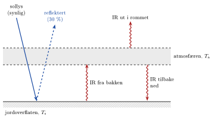

<!-- video: kommer (videoer/fysikk-forkurs/10-04-drivhuseffekten) -->
{fig-alt="Video kommer"}

<!-- tillegg: Claude -->
Månen er like langt fra sola som jorda, men på dagsiden blir den over $100\ ^\circ\mathrm{C}$ og på nattsiden under $-150\ ^\circ\mathrm{C}$. Jorda har en gjennomsnittstemperatur på omtrent $15\ ^\circ\mathrm{C}$ og ganske små forskjeller mellom dag og natt. Forskjellen er atmosfæren. På denne siden bruker vi det vi vet om [varmestråling](03-varmestraling.qmd) til å regne ut jordas temperatur, først uten atmosfære og så med, og vi ser hvorfor litt mer CO₂ i lufta gjør jorda varmere.

## Strålingsbalansen

Jorda får nesten all energien sin fra sola. Den eneste måten jorda kan bli kvitt energi på, er å stråle den ut i verdensrommet igjen. Er det mer som kommer inn enn som går ut, blir jorda varmere. Da stråler den mer ($P \propto T^4$), helt til det går like mye ut som inn. Temperaturen der inn og ut er like store, kalles **likevektstemperaturen**.

::: {.kort}
- **Inn: sollys** Intensiteten utenfor atmosfæren er $1361\ \mathrm{W/m^2}$. Sola er varm, så lyset er mest synlig lys.
- **Reflektert** Skyer, is og snø kaster omtrent $30\ \%$ av sollyset rett tilbake. Andelen kalles **albedo**, $\alpha \approx 0.30$.
- **Ut: varmestråling** Jorda er kald sammenliknet med sola, så den stråler i infrarødt (IR), med toppen rundt $10\ \mathrm{\mu m}$.
:::

### Jorda uten atmosfære

Sollyset treffer jorda som om det traff en flat skive med samme radius $R$, altså tverrsnittet $\pi R^2$. Men jorda snurrer og stråler ut fra hele kuleflaten $4\pi R^2$. Inn og ut skal være like:

$$
(1-\alpha)\,I\,\pi R^2 = \sigma\,4\pi R^2\,T^4
$$

Radien forkortes bort, og vi får

::: {.graa}
$$
T = \left(\frac{(1-\alpha)\,I}{4\sigma}\right)^{1/4}
$$
:::

Tallet $(1-\alpha)I/4$ er den effekten hver kvadratmeter av jordoverflaten får i gjennomsnitt, over dag og natt og alle breddegrader.

::: {.eksempel}
**Eksempel: Jordas temperatur uten atmosfære.** Bruk $I = 1361\ \mathrm{W/m^2}$ og albedoen $\alpha = 0.30$. Hva ville jordas gjennomsnittstemperatur vært uten drivhuseffekt?

::: {.losning}
Gjennomsnittlig innstråling per kvadratmeter:
$$
\frac{(1-\alpha)I}{4} = \frac{0.70\cdot 1361\ \mathrm{W/m^2}}{4} = 238\ \mathrm{W/m^2}
$$
Likevektstemperaturen:
$$
T = \left(\frac{238\ \mathrm{W/m^2}}{5.67\cdot10^{-8}\ \mathrm{W/(m^2\,K^4)}}\right)^{1/4} = 255\ \mathrm{K} \approx \underline{\underline{-18\ ^\circ\mathrm{C}}}
$$
Den virkelige gjennomsnittstemperaturen er omtrent $15\ ^\circ\mathrm{C}$, altså $288\ \mathrm{K}$. Jorda er $33\ \mathrm{K}$ varmere enn den enkle modellen sier. Det er drivhuseffekten.
:::
:::

## Drivhusgassene

Lufta består mest av nitrogen og oksygen. Disse molekylene slipper gjennom både synlig lys og infrarød stråling. Men noen av gassene i lufta, som vanndamp (H₂O), karbondioksid (CO₂) og metan (CH₄), har molekyler som kan begynne å svinge og rotere når de treffes av infrarød stråling. De tar opp IR, men slipper gjennom det meste av det synlige lyset. Slike gasser kalles **drivhusgasser**.

Det er her Wiens lov kommer inn. Sola er så varm at lyset er synlig, og det slipper gjennom atmosfæren. Jorda er kald, så den stråler i infrarødt, og den strålingen blir tatt opp på vei ut.

{.tikz-fig style="width:540px" fig-alt="Modell av drivhuseffekten. Sollys (synlig) går gjennom atmosfæren og varmer jordoverflaten. Omtrent 30 prosent reflekteres. Jordoverflaten stråler infrarødt (IR) opp. Atmosfæren tar opp denne strålingen og stråler selv IR både ut i rommet og tilbake ned mot bakken."}

Atmosfæren som har tatt opp energien, blir varm og stråler selv. Den stråler like mye *opp* som *ned*. Det som går ned, varmer bakken en gang til. Bakken får dermed energi både fra sola og fra atmosfæren, og må bli varmere enn $255\ \mathrm{K}$ for å stråle bort alt sammen.

::: {.callout-note title="Definisjon: Drivhuseffekten"}
**Drivhuseffekten** er at gasser i atmosfæren tar opp infrarød stråling fra jordoverflaten og sender en del av den tilbake ned, slik at overflaten blir varmere enn den ville vært uten atmosfære.
:::

Den naturlige drivhuseffekten er livsviktig: Uten den ville havene vært frosne. Problemet er at vi mennesker gjør den sterkere.

### En enkel modell med atmosfære

Vi lager en svært forenklet modell: Atmosfæren er ett lag som slipper gjennom alt sollyset, men tar opp *all* IR fra bakken. Laget har temperaturen $T_{\text{a}}$ og bakken $T_{\text{s}}$. Vi kaller den gjennomsnittlige innstrålingen $S = (1-\alpha)I/4 = 238\ \mathrm{W/m^2}$.

::: {.steg}
1. **Øverst:** Det eneste som går ut i rommet, er strålingen fra atmosfæren. Den må være lik det som kommer inn: $\sigma T_{\text{a}}^4 = S$. Atmosfæren får altså $255\ \mathrm{K}$, samme temperatur som jorda uten atmosfære.
2. **Bakken:** Bakken får $S$ fra sola og $\sigma T_{\text{a}}^4 = S$ fra atmosfæren, til sammen $2S$. Den må stråle ut like mye: $\sigma T_{\text{s}}^4 = 2S$.
3. **Resultat:** $T_{\text{s}}^4 = 2T_{\text{a}}^4$, så $T_{\text{s}} = 2^{1/4}\cdot 255\ \mathrm{K} = 303\ \mathrm{K} \approx 30\ ^\circ\mathrm{C}$.
:::

Modellen gir $30\ ^\circ\mathrm{C}$, som er for varmt. Den virkelige atmosfæren tar ikke opp all IR: noe slipper ut gjennom «vinduer» der ingen gass tar opp strålingen. Virkeligheten, $15\ ^\circ\mathrm{C}$, ligger mellom de to modellene. Men modellen viser mekanismen: Jo mer IR atmosfæren tar opp, desto varmere blir bakken.

## Menneskeskapte endringer

Før industrialiseringen var det omtrent $280$ CO₂-molekyler per million molekyler i lufta ($280\ \mathrm{ppm}$). Ved forbrenning av kull, olje og gass har vi økt dette til over $420\ \mathrm{ppm}$. Mer CO₂ gjør at atmosfæren tar opp mer av den infrarøde strålingen, og strålingen ut i rommet kommer fra høyere og kaldere lag. Jorda stråler da ut litt mindre enn den tar inn, og varmes opp til balansen er gjenopprettet ved en høyere temperatur.

Oppvarmingen forsterkes av **tilbakekoblinger**:

::: {.kort}
- **Vanndamp** Varmere luft kan holde på mer vanndamp, som selv er en drivhusgass. Forsterker oppvarmingen.
- **Is og snø** Når isen smelter, blir det mer mørkt hav og mørk bakke, albedoen synker, og jorda tar opp mer sollys. Forsterker oppvarmingen.
- **Stråling** En varmere jord stråler mer ($T^4$). Demper oppvarmingen og er grunnen til at det finnes en ny likevekt.
:::

Jordas gjennomsnittstemperatur har allerede økt med mer enn $1\ ^\circ\mathrm{C}$ siden slutten av 1800-tallet. Det høres lite ut, men det er et gjennomsnitt over hele kloden og hele året, og det gir blant annet mer ekstremvær, høyere havnivå og mindre is i Arktis.

## Prøv selv

Programmet bruker modellen med ett atmosfærelag, men lar atmosfæren ta opp bare en andel $\varepsilon$ av IR-strålingen fra bakken. Da blir bakketemperaturen $T_{\text{s}} = \left(\dfrac{S}{\sigma\,(1-\varepsilon/2)}\right)^{1/4}$. Prøv å finne den verdien av $\varepsilon$ som gir $288\ \mathrm{K}$. Hva skjer med temperaturen hvis $\varepsilon$ øker litt, slik den gjør når det blir mer CO₂? Endre også albedoen og trykk **Kjør**.

```{.python .kjor}
sigma = 5.67e-8
I = 1361          # solintensitet i W/m²
albedo = 0.30
eps = 0.50        # andel av IR fra bakken som atmosfæren tar opp

S = (1 - albedo) * I / 4
T_uten = (S / sigma) ** 0.25
T_s = (S / (sigma * (1 - eps / 2))) ** 0.25

print(f"Uten atmosfære: {T_uten:.0f} K = {T_uten - 273.15:.0f} °C")
print(f"Med atmosfære:  {T_s:.0f} K = {T_s - 273.15:.0f} °C")
```

:::: {.oppgaver}

::: {.oppgave tittel="Inn, men ikke ut"}
Forklar med Wiens forskyvningslov hvorfor atmosfæren slipper inn sollyset, men holder igjen mye av strålingen fra jorda. Bruk at sola har overflatetemperaturen $5778\ \mathrm{K}$ og jorda omtrent $288\ \mathrm{K}$.

::: {.losning}
Med $\lambda_{\text{maks}} = b/T$ og $b = 2.90\cdot10^{-3}\ \mathrm{m\,K}$:

- Sola: $\lambda_{\text{maks}} = 2.90\cdot10^{-3}/5778\ \mathrm{m} = 502\ \mathrm{nm}$, synlig lys.
- Jorda: $\lambda_{\text{maks}} = 2.90\cdot10^{-3}/288\ \mathrm{m} = 10.1\ \mathrm{\mu m}$, infrarødt.

Strålingen fra sola og jorda ligger altså i helt ulike deler av spekteret. Drivhusgassene tar opp infrarød stråling, men slipper gjennom det meste av det synlige lyset. Derfor slipper sollyset inn, mens mye av varmestrålingen fra jorda blir tatt opp på vei ut.
:::
:::

::: {.oppgave tittel="Mer is, kaldere jord"}
Anta at jorda ble mer dekket av is og snø, slik at albedoen økte fra $0.30$ til $0.35$. Hvor mye ville likevektstemperaturen uten atmosfære endret seg? Forklar hvorfor dette er en forsterkende tilbakekobling.

::: {.losning}
Med $\alpha = 0.35$:
$$
S = \frac{0.65\cdot 1361\ \mathrm{W/m^2}}{4} = 221\ \mathrm{W/m^2}, \qquad T = \left(\frac{221\ \mathrm{W/m^2}}{5.67\cdot10^{-8}\ \mathrm{W/(m^2\,K^4)}}\right)^{1/4} = 249.9\ \mathrm{K}
$$
Med $\alpha = 0.30$ var $T = 254.6\ \mathrm{K}$. Endringen er
$$
\Delta T = 249.9\ \mathrm{K} - 254.6\ \mathrm{K} = \underline{\underline{-4.7\ \mathrm{K}}}
$$
Kaldere jord gir mer is, som gir høyere albedo, som gir enda kaldere jord. Det motsatte skjer ved oppvarming: Isen smelter, albedoen synker, og jorda blir varmere. En endring som forsterker seg selv, kalles en forsterkende (positiv) tilbakekobling.
:::
:::

::: {.oppgave tittel="Venus" niva="Middels"}
Venus er nærmere sola, og intensiteten av sollyset er $2601\ \mathrm{W/m^2}$. Men Venus er dekket av tykke, hvite skyer med albedo $0.76$. a) Finn likevektstemperaturen uten drivhuseffekt. b) Overflaten på Venus er målt til omtrent $737\ \mathrm{K}$. Hva sier det om atmosfæren?

::: {.losning}
a)
$$
S = \frac{(1-0.76)\cdot 2601\ \mathrm{W/m^2}}{4} = 156\ \mathrm{W/m^2}, \qquad T = \left(\frac{156\ \mathrm{W/m^2}}{5.67\cdot10^{-8}\ \mathrm{W/(m^2\,K^4)}}\right)^{1/4} = 229\ \mathrm{K} \approx \underline{\underline{2.3\cdot10^2\ \mathrm{K}}}
$$
Albedoen har to gjeldende siffer, så svaret får to. Uten drivhuseffekt ville Venus faktisk vært *kaldere* enn jorda, fordi skyene reflekterer så mye.

b) Overflaten er over $500\ \mathrm{K}$ varmere enn dette. Atmosfæren på Venus er nesten bare CO₂ og omtrent 90 ganger så tett som vår. Den tar opp nesten all infrarød stråling fra bakken, og gir en ekstrem drivhuseffekt.
:::
:::

::: {.oppgave tittel="Det som holdes igjen" niva="Middels"}
Jordoverflaten har en gjennomsnittstemperatur på $288\ \mathrm{K}$ og stråler omtrent som et svart legeme i infrarødt. a) Hvor mye stråler hver kvadratmeter av overflaten ut? b) Sammenlikn med de $238\ \mathrm{W/m^2}$ som til slutt går ut i rommet. Hvor blir det av resten?

::: {.losning}
a)
$$
\frac{P}{A} = \sigma T^4 = 5.67\cdot10^{-8}\ \mathrm{W/(m^2\,K^4)}\cdot(288\ \mathrm{K})^4 = \underline{\underline{390\ \mathrm{W/m^2}}}
$$

b) Overflaten stråler ut $390\ \mathrm{W/m^2}$, men bare $238\ \mathrm{W/m^2}$ forlater jorda. Forskjellen, omtrent $150\ \mathrm{W/m^2}$, blir tatt opp av atmosfæren og strålt tilbake mot bakken. Det er drivhuseffekten målt i watt per kvadratmeter. (Bakken taper i tillegg varme ved fordamping og varm luft som stiger, men det har vi sett bort fra her.)
:::
:::

::: {.oppgave tittel="Dobbelt så mye CO₂" niva="Utfordrende"}
Klimaforskere har funnet at hvis CO₂-innholdet i lufta endres fra $C_0$ til $C$, får jorda et ekstra energitilskudd (en *pådriv*) på omtrent
$$
\Delta F = 5.35\ \mathrm{W/m^2}\cdot\ln\frac{C}{C_0}.
$$
a) Hvor stort er pådrivet hvis CO₂-innholdet dobles? b) Uten tilbakekoblinger må jorda bli så mye varmere at den stråler ut $\Delta F$ ekstra. For små endringer er $\Delta(\sigma T^4) \approx 4\sigma T^3\,\Delta T$. Anslå $\Delta T$ med $T = 255\ \mathrm{K}$ (der strålingen ut i rommet kommer fra).

::: {.losning}
a)
$$
\Delta F = 5.35\ \mathrm{W/m^2}\cdot\ln 2 = \underline{\underline{3.71\ \mathrm{W/m^2}}}
$$

b) Den ekstra utstrålingen må være lik pådrivet:
$$
4\sigma T^3\,\Delta T = \Delta F \quad\Rightarrow\quad \Delta T = \frac{\Delta F}{4\sigma T^3}
$$
$$
4\sigma T^3 = 4\cdot 5.67\cdot10^{-8}\ \mathrm{W/(m^2\,K^4)}\cdot(255\ \mathrm{K})^3 = 3.76\ \mathrm{W/(m^2\,K)}
$$
$$
\Delta T = \frac{3.71\ \mathrm{W/m^2}}{3.76\ \mathrm{W/(m^2\,K)}} = 0.99\ \mathrm{K} \approx \underline{\underline{1\ \mathrm{K}}}
$$
Uten tilbakekoblinger gir en dobling av CO₂ altså omtrent én grad oppvarming. Tilbakekoblingene, særlig fra vanndamp og is, gjør at den virkelige oppvarmingen anslås til omtrent tre ganger så mye.
:::
:::

::::
