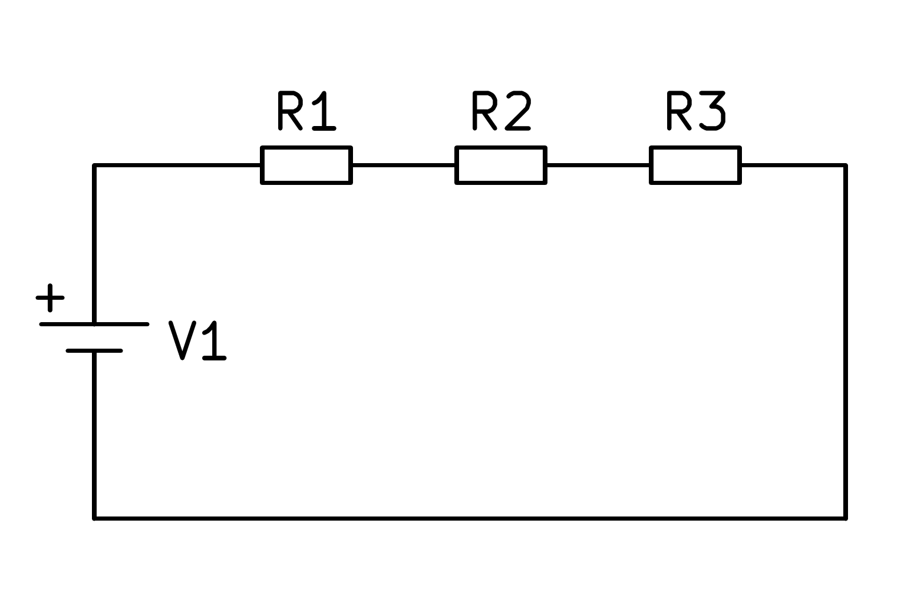
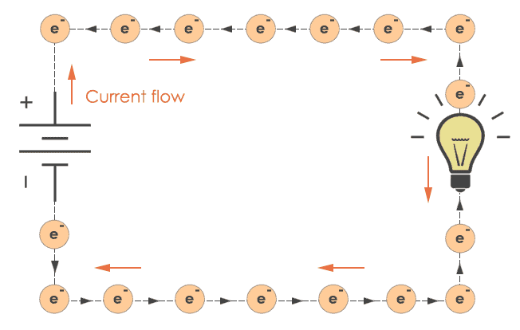

::: {.callout-warning title="Under arbeid"}

Denne siden skrives fortsatt.

:::

:::: {.oppgaver}

Her kommer noen begreper som er nyttige å forstå i elektrisitetslæren.

**Elektrisitet**\
Elektrisitet er små partikler med positive eller negative ladninger.\
**Krets**\
En krets er en vei som strømmen går igjennom. Strømmen går alltid gjennom den delen av kretsen som er lukket. Gjennpm en åpen krets går det ingen strøm. Elektronene i en krets beveger seg motsatt retning som strømmen. Elektronene vil bevege seg fra en negativ ladd pol mot en positiv ladd pol.\
**Elektrisk strøm**\
Elektrisk strøm er partikler i bevegelse. Strøm har symbolet *I* og enhet ampere, \[A\]. Strømmen beveger seg fra den positive polen mot den negative polen.\
Strømmen i en krets kan illustreres slik:\

:::: figure

{.kompendium-bilde}

::: caption

Caption

:::

::::

**Spenning**\
Tenk på spenning som et «elektrisk høydekart»: akkurat som en ball ruller ned fra høyt til lavt i tyngdefeltet, beveger ladninger seg fra høyt spenningspotensial til lavt.

::: {.callout-note title="Definisjon: Spenning"}

Spenningen $U$ mellom to punkter er arbeidet som kreves for å flytte ladningen $q$ fra det ene punktet til det andre: $$U = \frac{W}{q}$$ Enhet: volt, $1\,\mathrm{V} = 1\,\mathrm{J}\,\mathrm{C}^{-1}$. En spenning på $9\,\mathrm{V}$ betyr at det kreves $9\,\mathrm{J}$ per coulomb ladning som flyttes.

:::

Spenningskilden i en krets tegnes typisk to forskjellige måter vist i Figuren og Figuren.

:::: figure

{.kompendium-bilde}

{.kompendium-bilde}

::: caption

Spenningskilde 2

:::

::::

**Seriekobling**\
En seriekobling er en krets som er koblet slik at strømmen bare kan gå "en vei". I Figuren er R1, R2, og R3 resistanser og V1 er en spenningskilde. Strømmen vil gå inn og gjennom i R1, R2 og R3. Siden strømmen bare "har en vei" å gå, vil det i teorien være like mye strøm over hele området i seriekoblingen som vises i Figuren. Strømmen har ingen plass å dele seg.

:::: figure

{.kompendium-bilde}

::: caption

Seriekobling

:::

::::

**Parallellkobling**\
Parallellkobling er en måte å koble en krets slik at komponentene ligger "over" hverandre. I Figuren vises en parallellkobling, der R1 og R2 er resistanser og U er en spenningskilde. I denne kretsen vil strømmen vil gå fra spenningskilden og "dele" seg utover resistansene.\

:::: figure

{.kompendium-bilde}

::: caption

Parallellkobling

:::

::::

**Leder, isolator og halvleder**\
Stoffer deles inn i tre grupper etter evnen til å lede elektrisk strøm:

-   **Ledere** har mange løst bundne elektroner i det ytterste skallet. Disse kan bevege seg fritt og transportere ladning — metaller som kopper og aluminium er gode ledere.

-   **Isolatorer** holder fast på alle elektroner; ingen kan bevege seg fritt. Eksempler: gummi, plast, glass. Brukes til å hindre strøm fra å renne «feil vei».

-   **Halvledere** er midt imellom — ledningsevnen kan styres ved temperatur eller spenning. Grunnlaget for transistorer, dioder og all moderne elektronikk (silisium, Si).

::: {.callout-tip title="Tips: Forståelse av elektroner, strøm og spenning"}

Å forstå hva en elektrisk krets er og hvordan den fungerer kan være utfordrende. En god måte å tenke på en elektrisk krets er å forestille seg en krets bestående av elektroner som kuler plassert side om side. Disse elektronene kan bevege seg fra ett punkt til et annet innen kretsen.\
Når en spenningskilde, som et batteri, påvirker elektronene nærmest seg, skaper dette en dominoeffekt der elektronene setter hverandre i bevegelse. En motstand kan ses på som en trangere del av kretsen, som gjør det vanskeligere for strømmen å passere, derav navnet "motstand".\
I en **seriekobling** har elektronene bare én vei å følge gjennom kretsen. Denne veien forbinder ett punkt til et annet uten avkjøringer.\
I en **parallellkobling**, derimot, deler veien seg og elektronene kan "velge" mellom flere stier. Dette resulterer i at strømmen tar veien med minst motstand på grunn av fysiske lover.

:::

:::: figure

{.kompendium-bilde}

::: caption

Krets med elektroner i

:::

::::

::::

